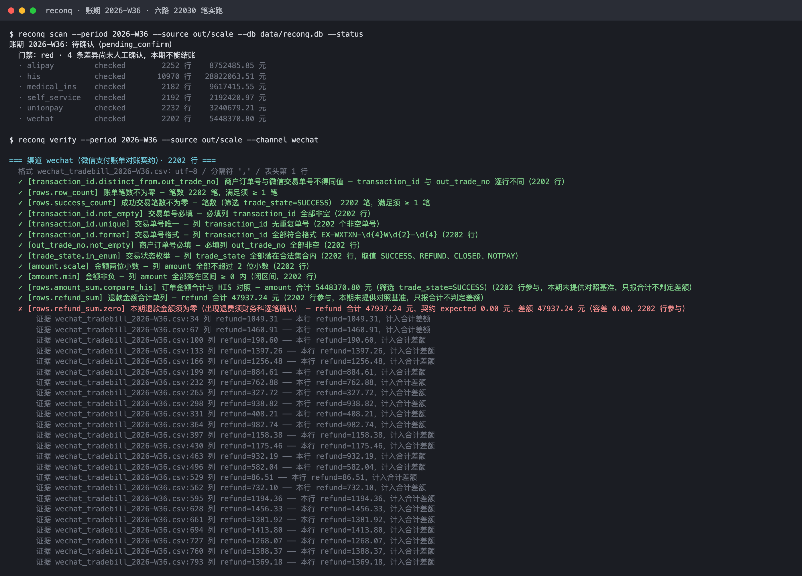
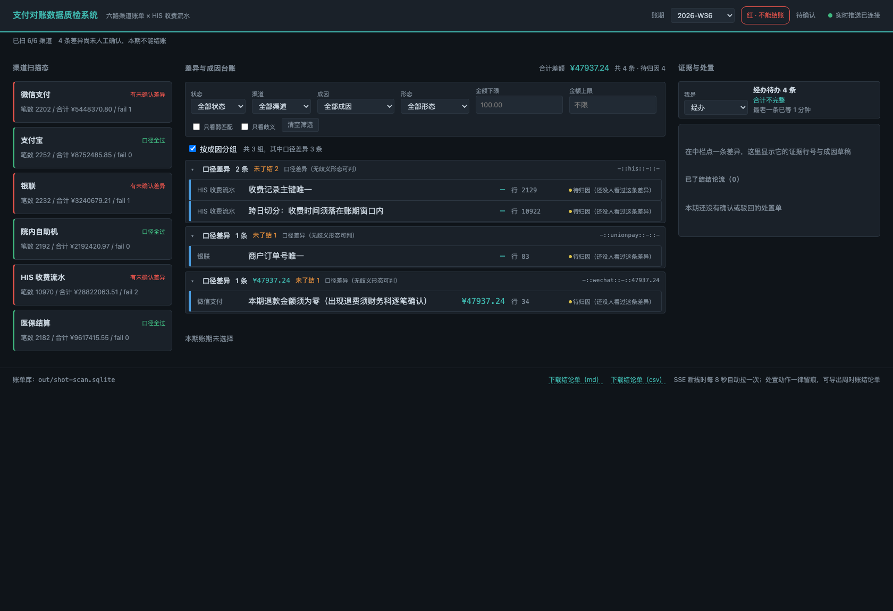
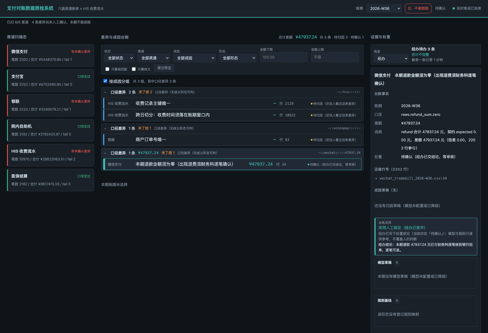
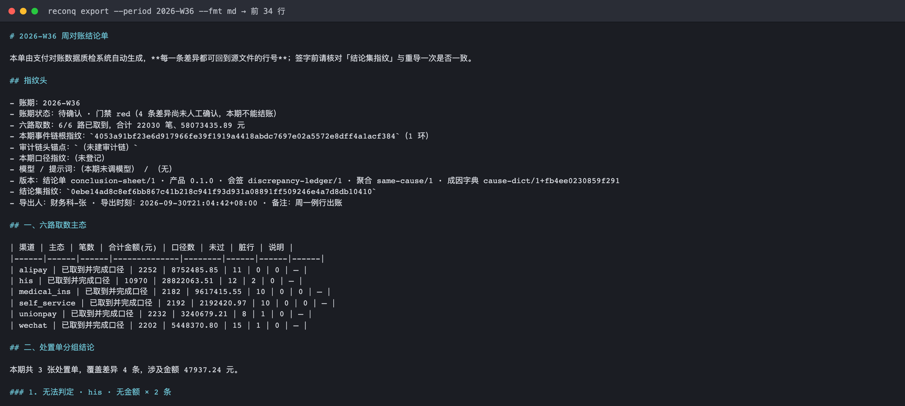
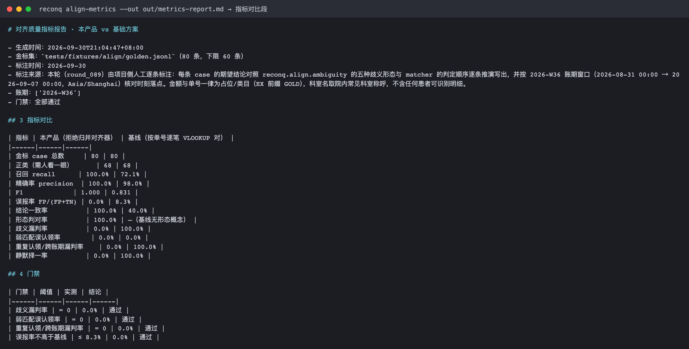

# 支付对账数据质检系统

> 财务科选定一个账期，系统自动取来微信、支付宝、银联、自助机、HIS、医保六路账单，逐条对平后给出一份每条差异都能追到证据行的周对账结论单。

微信、支付宝、银联、自助机、HIS、医保——每周一出上周账时，财务科对账岗要把六份口径不同的账单手工对平：先导文件，再逐笔比对，差异原因一条条问信息科。本系统把这条流程接管过来：按 YAML 对账契约取数、校验口径、跨渠道对齐实体，把差异连同证据行号一并摆到一屏上，讲不清成因的单边账给出带置信度与证据引用的成因草稿，人工逐条确认后导出可签字的结论单。

## 适用场景 / 目标岗位

| 岗位 | 什么时候用 | 得到什么 |
|------|------------|----------|
| 财务科对账岗 | 周一选定上周账期触发扫描，月底出月账 | 一屏看到六路各自主态、每路笔数与合计金额、每条差异的差额与证据行号 |
| 财务科对账岗 | 差异原因讲不清，需要判断该找谁 | 带成因标签、置信度、证据引用的成因草稿，以及建议动作与建议责任方 |
| 财务科主管 | 经办人逐条处置完毕，需要复核签字 | 带处置结论、确认人、复核人与事件链指纹的周对账结论单（Markdown / CSV） |
| 信息科接口岗 | 某一路账单拉不下来、签名过、SHA1 不符、限频 | 明确的失败原因与缺少的环境变量名，不是一句「连接失败」 |
| 信息科接口岗 | 需要只重跑某一路或某一条口径 | 按渠道 / 按口径的选择性重跑，已完成部分不重复入库 |

## 能力要点

- **六路账单一次扫描对齐**：微信、支付宝、银联、自助机、HIS、医保各自按契约取数，一屏看到每路主态、笔数与合计金额；某一路拉不到只标「本期未取到 + 错误码」，其余五路照常出结果。
- **口径写进契约，不写死在代码里**：每路渠道一份 YAML 契约声明列定义与对账口径（笔数、必填非空、交易类型枚举、金额合计、跨日切分、退费红冲、医保勾稽等式）；新增一条口径只改 YAML，不改代码。
- **每条差异都带证据行号**：契约校验失败不是只给「不通过」，而是给到「源文件第几行、原始行是什么、差额多少」，可回查给导出方。
- **脏行进隔离台账，不静默丢**：账单里的坏行进隔离区并导出成 Excel 台账（文件名 + 行号 + 原文），财务科逐行回查导出方；脏行太多则整份文件判坏、该路标未取到，不拿残缺数据出干净结论。
- **对不齐的不静默择一**：同一订单号在 HIS 命中多条记录时（一码付拆笔、合并支付、跨账期落点、退费与原单并存），系统标「歧义待人工」并列出全部候选行与成因分型，绝不猜一条算数。
- **候选分三档，只说「先看哪一条」**：单号缺失时按金额差、时间窗、科室、结算方式、跨渠道印证五个因子给每条候选打分，排成强 / 弱 / 不可用三档；权重与门槛写在配置里由财务科按院内实际调，变更留痕。**三档都不自动认领** —— 金额差 28 元的两行不是「不像同一笔」，是根本不是同一笔，直接否决沉底。
- **讲不清的单边账给出成因草稿**：模型按受控成因字典输出带置信度与证据引用的排序草稿；模型说的金额、时间、单号会与证据行逐项反查，对不上就整条作废退回人工。
- **人工确认才算数**：差异状态只能由人点推进（待归因 → 待确认 → 已确认 / 已驳回，可撤回）；模型与规则都不得自动确认，模型不可达时状态一条都不推进。
- **口径改了，旧结论算不算数当场说得清**：一份契约记一份指纹，改完能交出「哪条口径、哪个参数、从什么变成什么」；重跑前先和回归基线对拍，列出哪几条结论会翻转。**只改说明文字不会惊动已确认的账期** —— 改判定参数才会把它打回待确认，且清标记只有人能点。
- **同一件事只办一次**：单边账逐条落账便于追溯，但经办人按成因、渠道、形态与金额把它们收成处置单——20 条「门诊挂号 50.00 元延迟入账」收成 1 张单，点一次确认整张单办完，组内逐条同步，绝不出现「十条里漏确认一条」。组内状态不齐、成员定位不到台账、金额对不上或成因没登记时**打散或拒收**，宁可多给几张也不给一张点不动的。
- **判过一次的事，下次先给建议**：经办人确认过的成因按「渠道 + 形态 + 交易类型 + 是否跨日边界 + 候选条数 + 候选金额是否全同 + 单号形态」七项特征记成先例；下次同类差异先把历史判法摆出来（带判过几次、最近什么时候），**仍要人点确认**。只判过一次的先例不进候选；改了成因字典或提示词版本后旧先例自动降为「仅供参考」而不是照用。
- **周一早上跑一次就知道有几件事要判**：一条命令跑完建索引 → 三方对齐 → 歧义分型 → 跨账期连坐 → 证据包 → 归因 → 反幻觉核对 → 同根因聚合八个阶段，直接给一张能贴进科务会的表：按成因分组，每条带**条数 / 涉及金额 / 责任方 / 证据条数 / 建议动作**，末尾附分工表。逐段进度与耗时看得见，**哪一段崩了已完成的结果照样在**（该期标「结论不完整」而不是回滚成「本期零差异」）。模型端点没配也能跑 —— 成因取自确定性规则基线，并在汇总里单列「未经模型」，不会与模型归因混成一句「都归好了」。
- **出问题能查到哪一步**：每次运行落一份 JSONL 结构化日志（事件、渠道、账期、错误码、耗时、批次数、峰值内存），出问题时能答出「哪一路、哪一步、因为什么、多慢」；日志里的患者标识在写盘前自动脱敏，正常单号与金额原样保留。

## 快速开始

### 依赖

- Python ≥ 3.11
- 无需数据库服务：台账与事件链用 SQLite（HIS 侧走 SQLAlchemy 连接院内只读库）

### 安装

```bash
cd payment-reconcile-qc
python3 -m venv .venv && source .venv/bin/activate
pip install -r requirements.txt
pip install -e .
```

### 配置

复制 `.env.example` 为 `.env` 并按院内实际填写。**全部凭据从环境变量读取，无硬编码。**

| 配置项 | 默认值 | 说明 |
|--------|--------|------|
| `WECHAT_MCH_ID` / `WECHAT_SERIAL_NO` / `WECHAT_PRIVATE_KEY_PATH` / `WECHAT_API_V3_KEY` | 空 | 微信支付商户平台取账单用；缺任一项即拒绝发起请求并指出缺哪个变量 |
| `ALIPAY_APP_ID` / `ALIPAY_PRIVATE_KEY_PATH` / `ALIPAY_PUBLIC_KEY_PATH` | 空 | 支付宝 RSA2 签名用 |
| `ALIPAY_GATEWAY` | `https://openapi.alipay.com/gateway.do` | 支付宝网关地址 |
| `HIS_DB_DSN` | 空 | HIS 收费流水**只读**库连接串，账号必须只读 |
| `HIS_DB_POOL_SIZE` / `HIS_DB_POOL_TIMEOUT` / `HIS_DB_QUERY_TIMEOUT_SECONDS` | `5` / `10` / `30` | HIS 连接池与查询超时 |
| `WECOM_WEBHOOK_KEY` | 空 | 企业微信机器人；超阈值时推摘要与深链，不发金额明细 |
| `RECONQ_WECOM_UNBALANCED_COUNT_THRESHOLD` / `RECONQ_WECOM_UNBALANCED_AMOUNT_THRESHOLD` | `30` / `5000.00` | 触发企微推送的条数与金额阈值（两条线独立判定；留空 = 该线不判定） |
| `RECONQ_MODEL_BASE_URL` / `RECONQ_MODEL_API_KEY` / `RECONQ_MODEL_NAME` | `http://127.0.0.1:8000/v1` / 空 / 空 | 模型服务（OpenAI-compatible），**仅用于单边账成因草稿**。前三个位任一缺位即在发请求前失败并点名变量名，不走默认端点兜底 |
| `RECONQ_MODEL_TIMEOUT` | `20` | 模型调用**读**超时秒数（连上了但不回话）；留空取 30，配 0 或负数会被拒。超时走降级路径，**不阻塞扫描** |
| `RECONQ_MODEL_CONNECT_TIMEOUT` | `5` | 模型调用**连接**超时秒数（连都没连上）。须**短于**读超时，配反了会在发请求前被拒并点名两个变量——两者的排查方向不同：连不上先查网络与进程是否在监听 |
| `RECONQ_HOST` / `RECONQ_PORT` | `127.0.0.1` / `8788` | 常驻服务监听地址 |
| `RECONQ_TZ` | `Asia/Shanghai` | 会话时区；跨日切分判定基准，脏值显式报错 |
| `RECONQ_INDEX_BUDGET_MB` | `64` | 对齐倒排索引常驻内存上限（MB，**只填数字**）。约束的是「单号 → 候选引用」这张映射，**不含记录载荷**；超限把冷块 spill 落盘，查询按 offset 回查 |
| `RECONQ_INDEX_SPILL_ENTRIES` | `200000` | 常驻键数硬阈值。与字节预算**双阈值**先到先触发：单号特别长时（32 位流水号 + 前缀），光键就能吃光字节预算 |
| `RECONQ_INDEX_CACHE_SIZE` | `4096` | LRU 缓存条目数。spill 后回查的结果也进这个缓存；缓存里的键算「热」，不会被当成冷块再次落盘 |

### 构建与验证

```bash
# 单元测试
pytest -q

# 渠道协议兼容性套件（微信 / 支付宝报文回放 + 凭据缺失前置校验）
pytest tests/protocol/ -q

# 最小端到端切片：一份账单文件 → 契约 check → 终端打印差异与证据行号
python -m reconq verify --period 2026-W36 --source inbox

# 归因提示词离线回放（不调模型；更差时退出码非零，可当发布门禁）
pytest tests/test_prompt_replay.py -q
python -m reconq attrib-replay --compare v1,v2

# 契约指纹与口径变更影响面（Task 17）
pytest tests/test_contract_fingerprint.py -q
python -m reconq contract snapshot --db /tmp/reconq-demo.db
python -m reconq contract diff --channel wechat --db /tmp/reconq-demo.db

# 真实规模压测：六路各 2000+ 行跑完整扫描，测耗时与峰值内存
PYTHONPATH=src python3 scripts/gen_fixtures.py --out out/scale --force
PYTHONPATH=src python3 scripts/bench.py --fixtures out/scale --db out/bench-scan.sqlite
pytest tests/test_scale.py -q

# 与「按渠道单表逐笔 VLOOKUP 对」的基础实现对拍（需先跑 bench.py 产出账单库）
PYTHONPATH=src python3 scripts/baseline_compare.py --db out/bench-scan.sqlite
```

### 主命令速查

```bash
python -m reconq --help                                    # 查看全部子命令
python -m reconq scan --period 2026-W36 --source inbox     # 正式扫描一个账期：取数→落库→跑口径→判这期能不能结（主命令）
python -m reconq scan --period 2026-W36 --status           # 只看这期账现在到哪一步（不扫描）
python -m reconq scan --period 2026-W36 --reopen           # 人工撤回后重扫（已确认的账期唯一能重扫的入口）
python -m reconq scan --period 2026-W36 --resume           # 从断点继续：已跑完的渠道不重取，其余接着跑
python -m reconq scan --period 2026-W36 --channel wechat --only-check row_count  # 只重跑某一路的某一条口径
python -m reconq verify --period 2026-W36 --source inbox   # 只读排障腿：不落库、不写状态
python -m reconq verify --period 2026-W36 --channel wechat # 只跑某一路渠道
python -m reconq verify --period 2026-W36 --json            # 输出机器可读摘要
python -m reconq data-source test wechat                    # 检查某一路的凭据与连通性
python -m reconq quarantine scan --period 2026-W36          # 落库扫描：脏行隔离、干净行入库
python -m reconq quarantine export --period 2026-W36        # 导出脏行台账，回查导出方用
python -m reconq contract snapshot                           # 记录当前契约指纹（口径变更比对的第一份「上次」）
python -m reconq contract diff --channel wechat              # 口径改了什么、哪几路要重新确认
python -m reconq contract baseline --period 2026-W36 --channel wechat --record  # 落回归基线
python -m reconq contract status                             # 哪些账期因口径变更需重新确认
python -m reconq trace --order EX-WX-SPLIT-0001 --period 2026-W36 --window 1  # 连坐追查：这一笔是不是上周对过了
python -m reconq model-usage --period 2026-W36 --db data/reconq.db           # 这一期模型花了多少钱、命中多少缓存
python -m reconq model-usage --period 2026-W36 --calls                      # 附带逐次调用明细（审计链断则退出码 1）
python -m reconq verify --period 2026-W36 --db data/reconq.db --replay-list   # 列出本期已拍的证据快照
python -m reconq verify --period 2026-W36 --db data/reconq.db --replay 'wechat:2026-W36:EX-WX-SPLIT-0001'  # 复算某条结论（不读账单表）
python -m reconq attrib-replay --list-versions            # 已登记的归因提示词版本与各自的变更说明
python -m reconq attrib-replay --version v2               # 离线回放某版：Top-1/Top-3 命中率与拒因分布
python -m reconq attrib-replay --compare v1,v2            # 两版逐条对比（更差时退出码 1，可当发布门禁）
reconq attrib-eval --out out/attrib-eval.md     # 模型档 vs 规则档：命中率/拒答率/成本（回放，不发请求）
reconq attrib-eval --live                        # 同上，但实连真实模型端点（需 RECONQ_MODEL_*）
python -m reconq align-metrics                              # 对齐质量指标：本产品 vs 逐笔 VLOOKUP 基线（同口径）
python -m reconq align-metrics --cases                      # 逐条列出 80 条金标上两侧的结论（定位哪一条错了）
python -m reconq align-metrics --out out/metrics-report.md  # 落完整指标报告（含口径、样例规模、局限）
python -m reconq align-golden                               # 对齐黄金样例回归：按形态看这次改动有没有弄坏原来对的
python -m reconq align-golden --cases-only                  # 逐条列出 46 条回归用例的结论与形态
python -m reconq align-golden --out out/align-regression.md  # 落完整回归报告（含形态分布与「不能说明什么」）
python -m reconq precedent top --channel wechat              # 先例看板：本渠道历史最常见成因 Top 5
python -m reconq precedent list --channel wechat             # 先例明细：检索特征、命中次数、登记时版本对
python -m reconq precedent hits --period 2026-W36            # 采信留痕：谁在何时采信了哪条先例
python -m reconq export --period 2026-W36 --format md      # 导出周对账结论单
python -m reconq serve                                     # 启动常驻服务与实时面板
```

## 命令 / API / 配置说明

### 关键配置项

见 [快速开始 · 配置](#配置) 的凭据表；另有两类运行期配置在 `contracts/_scoring.yml`：

| 配置项 | 默认值 | 说明 |
|--------|--------|------|
| `amount_tolerance` | `0.01` 元 | 弱匹配金额容差，财务科可按院内实际调 |
| `weights`（5 个因子） | `0.45 / 0.25 / 0.15 / 0.15 / 0.10` | 金额差 / 时间窗距离 / 科室一致 / 结算方式一致 / 跨渠道印证。缺键或出现表外名字**直接报错**，不静默回落默认 |
| `tiers.strong_min` / `tiers.weak_min` | `0.85` / `0.40` | 强候选 / 弱候选的加权分门槛，低于后者记「不可用」 |
| `candidates.max_per_row` | `5` | 单条渠道行最多**展示**的候选数，超出标注截断；全部候选可经 `reconq align expand` 查 |
| `--rate-threshold`（`quarantine scan`） | `0.05` | 脏行率阈值，超过则整文件判 `FORMAT_BROKEN`、干净行不入库 |
| `--bind-contract`（`verify`） | 关（不传即只读） | 开启后把「本期这一路按哪一版口径跑的」写进账单库；口径指纹一变，该账期自动标 `needs_reconfirm`。需同时给 `--db` |
| `--db`（`verify --bind-contract`） | 不传 | 不传时 verify 保持只读排障腿，一条状态都不写；要绑定必须显式给路径，不猜默认值 |
| `--log-dir`（全局） | round 根的 `logs/` | 结构化 JSON 日志目录。也可用环境变量 `RECONQ_LOG_DIR` 覆盖。日志**不写项目子目录** —— 那是直接发布到 GitHub 的内容 |
| `--log-level`（全局） | `INFO` | JSON 日志级别：`DEBUG` / `INFO` / `WARNING` / `ERROR` |
| `--no-log`（全局） | 关 | 本次不落 JSON 日志（想看干净终端时用） |
| `RECONQ_LOG_DIR` | 空 | 等价于 `--log-dir`，供常驻服务与容器环境用 |
| `RECONQ_MODEL_PRICE_PROMPT_PER_1K` | 空（不估成本） | 提示词侧单价，单位**元/千 token**。留空时成本显示「未配置单价」而不是「0.00 元」 |
| `RECONQ_MODEL_PRICE_COMPLETION_PER_1K` | 空（不估成本） | 生成侧单价，单位同上。**两个位都要配**：归因任务的生成 token 往往不比提示词少，只配一个会给出半截成本，而那个数字看起来是完整的 |

### 脏行原因码（受控集合）

脏行按成因分类，不是自由文本 —— 只有受控码才能按成因聚合、才能沉淀经验。

| 原因码 | 中文说明 | 建议动作（给导出方回查） |
|--------|----------|--------------------------|
| `COLUMN_COUNT_MISMATCH` | 该行列数与表头不一致 | 多半是某行少了个分隔符（或数据里带了分隔符）；按行号回查重导 |
| `AMOUNT_UNPARSABLE` | 金额列的值不是合法数字 | 按纯数字导出，不要带大写金额或中文单位（千分位与货币符号会自动清洗） |
| `TIMESTAMP_UNPARSABLE` | 交易时间无法解析 | 按带秒的完整时间导出，不要只给日期 |
| `REQUIRED_FIELD_EMPTY` | 主键列（渠道单号）为空 | 该行进不了幂等唯一键，请补齐商户订单号列 |
| `DUPLICATE_ROW_CONFLICT` | 同一文件内渠道单号重复 | 连金额带时间都一模一样 = 导出方重复导了一次；同号不同额是拆笔/退费并存，不隔离 |
| `ENCODING_UNRESOLVED` | 该行含无法解码的字节 | 请按 UTF-8 或 GBK 重新导出；本产品不会把乱码当单号去对账 |

### CLI 子命令 / 接口端点

| 命令或路径 | 用途 | 关键参数 |
|------------|------|----------|
| `reconq scan` | 正式扫描一个账期：逐路取数、幂等落库、跑口径，并把这期账判成可结/不可结 | `--period` `--db` `--source` `--contracts` `--channel`（可重复）`--set` `--reopen` `--json` |
| `reconq scan --status` | 只读地回答「这期账现在到哪一步」：状态、门禁色、六路各自主态 | `--period` `--db` `--json` |
| `reconq scan --resume` | 从断点继续：已跑完的渠道不重新取数、不重新落库，其余接着跑；无事可做时交一份「无新增」结论并保持账期状态不动 | `--period` `--db` `--source` `--json` |
| `reconq scan --only-check` | 只重跑匹配选择器的口径（如 `row_count` / `not_empty` / `transaction_id.*`），可重复 | `--only-check`（可重复）`--channel` `--actor` |
| `reconq verify --only-check` | 只读腿的口径收窄：一条没命中即报 `CHECK_SELECTOR_EMPTY`，不当成「全部通过」 | `--only-check`（可重复）`--channel` |
| `reconq verify --resume` | 只查断点上还没跑完的渠道（需 `--db` 读断点；未给则退回全量并说明） | `--db` `--json` |
| `reconq verify` | 按契约校验一个账期的六路账单（只读排障腿，不落库、不写状态） | `--period` `--source` `--contracts` `--channel`（可重复）`--check` `--json` `--set` |
| `reconq verify --bind-contract` | 扫描同时登记口径出处；口径日后一变，该账期自动标 `needs_reconfirm` | `--db`（必填，否则显式报错） |
| `reconq verify --lint` | 只做契约静态校验就退出，不碰账单（写完契约先跑这条） | `--period` `--contracts` `--channel` `--json` |
| `reconq verify --replay` | 用证据快照自带的候选集复算某条对齐结论，**不读账单表**；源数据已被重拉也站得住 | `--period` `--db`（必填）`--replay <结论键>` `--json` |
| `reconq verify --replay-list` | 列出本期已拍的全部证据快照（结论键、类型、哈希、参与方条数） | `--period` `--db` `--json` |
| `reconq data-source test` | 逐项检查某一路的凭据存在性与协议连通性 | `<channel>` `--all` `--json` |
| `reconq data-source probe` | 只探格式不跑口径：编码 / 分隔符 / 表头行号 / 列映射 / 脏行 | `<channel>` `--period` `--source` `--json` |
| `reconq quarantine scan` | 落库扫描：脏行进隔离区、干净行进账单表 | `--period` `--channel`（可重复）`--source` `--db` `--rate-threshold` `--json` |
| `reconq quarantine list` | 列出隔离区脏行（中文说明 + 原文 + 行号） | `--period` `--channel` `--db` `--json` |
| `reconq quarantine export` | 导出脏行台账 CSV（utf-8-sig，Excel 双击即开） | `--period` `--channel` `--out` `--db` |
| `reconq contract snapshot` | 记录当前契约的指纹快照（口径变更比对的第一份「上次」） | `--channel`（可重复）`--contracts` `--db` `--list` `--json` |
| `reconq contract diff` | 对比工作区契约与最近快照：改了什么、影响哪几路、要不要重新确认 | `--channel`（可重复）`--contracts` `--db` `--record` `--json` |
| `reconq contract baseline` | 落回归基线，或与已有基线对拍（列出结论翻转的口径） | `--period` `--channel` `--source` `--db` `--record` `--json` |
| `reconq contract status` | 列出因口径变更而需重新确认的账期（只读） | `--period` `--db` `--json` |
| `reconq trace` | 连坐追查：同一单号在相邻账期与全部六路上的出现串成一条链，判跨期/跨渠道重复与金额关系 | `--order`（必填）`--period` \| `--periods`（二选一）`--window` `--db` `--no-index` `--json` |
| 全局开关 | JSON 结构化日志的目录、级别与开关（对所有子命令生效） | `--log-dir` `--log-level` `--no-log` |
| `reconq attrib-replay` | 归因离线回放：某版提示词在 12 条固定证据包上的 Top-1/Top-3 命中率与拒因分布 | `--version` `--set` `--json` |
| `reconq attrib-replay --compare` | 两版提示词逐条对比：指标增减 + 哪几条由对变错；**更差时退出码 1** | `--compare <旧版>,<新版>` `--set` `--json` |
| `reconq attrib-replay --list-versions` | 只列已登记的提示词版本与各自的变更说明（不回放） | `--json` |
| `reconq attrib-eval` | 归因效果评测：同一份人工标注评测集上，**模型档 vs 规则基线档**并排出 Top-1/Top-3 命中率、反幻觉拒绝率与成本；**模型档 Top-3 低于规则档即退出码 1** | `--set` `--out` `--live` `--json` `--cases` |
| `reconq attrib-eval --live` | 同上，但实连真实模型端点重跑（默认回放录制响应替身，不发真实请求、不花钱） | `--live` |
| `reconq align-metrics` | 对齐质量指标：在 80 条人工标注金标集上与「逐笔 VLOOKUP 对」基线同口径对比；**门禁不过时退出码 1** | `--golden`（默认 `tests/fixtures/align/golden.jsonl`）`--out` `--json` `--cases` |
| `reconq align-metrics --cases` | 逐条列出每条金标上「期望 / 本产品 / 基线」三个标签，定位是哪一条错了 | 同上 |
| `reconq align-golden` | 对齐黄金样例回归：按**形态**跑 46 条回归用例，出通过/失败与形态分布；**任一 case 失败即退出码 1** | `--cases`（默认 `tests/fixtures/align/cases.yml`）`--out` `--json` `--cases-only` |
| `reconq align-golden --cases-only` | 逐条列出每条用例的结论、歧义形态与通过与否（定位「哪一条坏了、坏在哪一种形态上」） | 同上 |
| `reconq precedent top` | 先例看板：本渠道（或全渠道）历史最常见成因 Top N，按命中次数降序，带责任方与最近命中时间；**只读** | `--channel` `--limit`（默认 5）`--db` `--json` |
| `reconq precedent list` | 先例明细：逐条列出检索特征、命中次数、样本差异键与**登记时的字典 / 提示词版本对** | `--channel` `--cause` `--min-hits` `--db` `--json` |
| `reconq precedent hits` | 先例采信留痕：谁在何时采信了哪条先例、当时它记成命中过几次（append-only 事件链反查） | `--period`（必填）`--channel` `--diff-key` `--db` `--json` |
| `reconq align-pipeline` | **对齐主路径（跑一遍看看）**：一次跑完建索引 / 三方对齐 / 歧义分型 / 跨账期连坐 / 证据包 / 归因 / 反幻觉核对 / 同根因聚合，出经办人开工前的待办汇总（成因·条数·金额·责任方·证据条数·建议动作）。**只读**，不写台账、不推进处置状态 | `--period`（必填）`--db` `--contracts` `--amount-bucket` `--trace-window` `--history-periods` `--instructions` `--progress` `--stages` `--json` |
| `reconq align-pipeline --progress` | 逐阶段打印进度（阶段名 / 已处理条数 / 耗时 / 第几段），供面板与 CI 观察跑到哪了 | 同上 |
| `reconq align-pipeline --stages` | 只打逐阶段耗时表：哪一段慢，一眼看出是建索引慢还是归因慢 | 同上 |
| `reconq groups list` | 同根因聚合：逐条单边账收成处置单 + 分工表；**只读** | `--period` `--db` `--group-key` `--amount-bucket` `--only-channel` `--include-resolved` `--json` |
| `reconq groups confirm` / `reject` / `withdraw` | 组级处置：整组确认 / 驳回 / 撤回，组内逐条同步 | `--period` `--db` `--group-key`（必填）`--operator`（必填，须为自然人）`--note` `--json` |
| `reconq groups slip` | 导出交办单 Markdown：按组出证明、按条附证据行 | `--period` `--db` `--operator` `--note` `--out` |
| `reconq groups actions` | 组级处置留痕（谁在何时确认/驳回/撤回哪张单的哪些条目） | `--period` `--db` `--group-key` `--json` |
| `reconq export` | 导出周对账结论单 | `--period` `--format md\|csv` |
| `reconq serve` | 启动常驻服务与浏览器面板（默认锁 `127.0.0.1:8788`） | `--host` `--port` `--db` |
| `GET /` | 浏览器面板（三栏 + SSE 实时刷新）；带 `?period=&diff=` 直接落到某条差异 | `?period=` `?diff=` |
| `GET /api/periods` | 库里已扫账期列表与默认账期 | — |
| `GET /api/vocab` | 筛选下拉的**全部词表**（状态 / 渠道 / 成因 / 歧义形态 / 岗位）。前端不硬编码枚举 | — |
| `GET /api/period/{period}/channels` | 左栏六路渠道卡：主态、笔数、合计、脏行数、未取到的错误码 | — |
| `GET /api/period/{period}/discrepancies` | 中栏差异台账。**非法筛选值返 4xx + 错误码**，不静默返空 | `?channel=&state=&cause_code=&ambiguity_kind=&amount_min=&amount_max=&only_weak_match=&only_ambiguous=&include_resolved=` |
| `GET /api/period/{period}/groups` | 按成因分组（组键与 `reconq groups` 同形），中栏整组展开用 | — |
| `GET /api/period/{period}/todo` | 待办聚合：某角色当前该办几条、合计、最老一条等了多久 | `?role=handler\|reviewer\|supervisor` |
| `GET /api/period/{period}/discrepancy/{key}/aid` | 右栏决策辅助：模型草稿 / 规则基线 / 历史先例 / 反幻觉核对**四路并列** + 明示采用哪一路 | — |
| `GET /api/period/{period}/discrepancy/{key}/evidence` | 证据展开：候选行全表 + 对齐快照引用 + 深链三出口 | — |
| `GET /api/period/{period}/disposition` | 已了结结论流（已确认 / 已驳回） | — |
| `GET /api/period/{period}/export` | 页脚下载周对账结论单（打印签字用）。**与 `reconq export` 同一份版式**，指纹同时放正文与响应头 | `?fmt=md\|csv` `&operator=` `&note=` |
| `GET /api/events` | SSE 事件流：`progress` / `channel` / `diff` / `status` 四类 | — |
| `GET /open` | 把 `reconq://` 深链 302 到面板对应差异（企微消息里点进来的入口） | `?link=reconq://period/<期>/diff/<键>` |
| `POST /api/discrepancy/{key}/decide` | 人工处置：`confirm` / `reject` / `withdraw`。**只走状态机白名单迁移**，非法状态返 4xx | body: `decision` `operator`（须自然人）`role` `comment` `expected_version` |
| `POST /api/discrepancy/{key}/review` | 主管复核（服务端强制 `role=supervisor`，不靠前端传什么认什么） | 同上 |

### 模型成本与审计（`reconq model-usage`）

财务科问「这一期模型花了多少钱、慢在哪」时跑的那一条。**只读**：不调模型、
不改台账、不推进任何状态。

| 命令或参数 | 用途 | 关键参数 |
|------------|------|----------|
| `reconq model-usage --period 2026-W36` | 出一张成本与命中表 | `--db` 账单库路径；`--json` 机器可读 |
| `--calls` | 附带**逐次调用明细**（调用 id / 差异键 / 耗时 / token / 状态） | 默认只出聚合表 |
| `--no-chain-check` | 跳过审计链指纹校验（排障腿：只想看数字时的快路径） | 默认**校验**，链断时退出码为 1 |

三个数字口径，别混：

| 数字 | 含义 | 为什么有两个答案 |
|------|------|------------------|
| `calls` | 本期记录在案的调用次数（**含**缓存命中） | 「这一期调了几次」有两个答案 |
| `actual_calls` | **真正打到端点上**的次数 = `calls − cache_hits` | 财务科问「花了多少钱」指的是这个。命中缓存的调用**一个请求都没发** |
| `cache_hits` / `cache_hit_rate` | 命中缓存的次数与占比 | 判断这套缓存值不值得开着的唯一依据 |

成本与 token 的口径同样分清：耗时与 token **只按真正发出的调用累加** ——
把耗时 0 的缓存命中混进平均值里，「模型变慢了」这个信号会消失。

### 对齐质量指标（`reconq align-metrics`）

「本产品比基础方案准」这种话谁都会说，**不说清比的是什么**就没法核对。
这一条把院内现有人工流程的形态原样写成一份**可运行的基线**（按单号逐笔
`VLOOKUP`，命中多条时静默取第一条），在**同一份人工标注金标集**上跑一遍，
出并排指标表与门禁结论。

```bash
reconq align-metrics                          # 并排指标表 + 门禁结论
reconq align-metrics --cases                  # 逐条列出 80 条金标上两侧的结论
reconq align-metrics --out out/metrics-report.md   # 落完整报告（含口径与局限）
reconq align-metrics --json                   # 机器可读
```

```
指标                         本产品              基线
------------------------------------------------
金标 case 总数                  80              80
正类（需人看一眼）                   68              68
召回 recall               100.0%           72.1%
精确率 precision           100.0%           98.0%
误报率 FP/(FP+TN)            0.0%            8.3%
结论一致率                   100.0%           40.0%
形态判对率                   100.0%      —（基线无形态概念）
歧义漏判率                     0.0%          100.0%
弱匹配误认领率                   0.0%            0.0%
重复认领/跨账期漏判率               0.0%          100.0%
静默择一率                     0.0%          100.0%

门禁：全部通过
```

**四条门禁，任一不过即退出码 1**（与 `verify` / `scan` 同一套语义，
可直接当发布门禁）：

| 门禁 | 阈值 | 为什么卡在这里 |
|------|------|----------------|
| 歧义漏判率 | = 0 | 一对多的四种成因（拆笔 / 合并支付 / 跨账期 / 退费并存）处置方式各不相同，猜错会把整段金额归到错的费用项目上 |
| 弱匹配误认领率 | = 0 | 单号都没对上，凭金额碰巧相同就认领，等于把不确定性藏进结论单 |
| 重复认领 / 跨账期漏判率 | = 0 | 前者让同一笔钱进两次合计，后者让同一笔跨两期计入 |
| 误报率不高于基线 | ≤ 基线 | 报得更全可以接受，报得更吵不行 —— 财务科不会因为工具太吵而继续用它 |

**金标集不是凭据，是资产**：`tests/fixtures/align/golden.jsonl`（80 条，
下限 60 条 —— 一条差异偶然对一次是常事，条数不够就没有否决力）逐条自足，
给一组渠道行 + 一组 HIS 行就报得出期望结论，可单条复现。
配套 `golden_meta.json` 记标注来源、时间与逐条标注口径；
**缺 `golden_meta.json` 时报告会显式标出「标注来源未记录」** ——
没有出处的指标不该被当成验收依据。

金标集条数不足、期望标签不在受控空间内、时刻缺时区偏移、`case_id` 重复，
各有明确错误码，不会静默跑出一个假的「零漏判」。

**基线在「弱匹配误认领率」上得 0，但那不代表它更安全** —— 它从不认领，
代价是把「不确定」直接说成「渠道有、HIS 无」。这不是更安全，是把不确定性
换个方向藏起来：经办人会拿着一条并不存在的单边账去查收费处。
所以结论要**一起看**「结论一致率」（40% vs 100%）与「静默择一率」
（100% vs 0%）这两行。指标**不能**说明什么（脱敏样例非真实账期、
拆笔与合并支付字段同形不可分、未实连真实渠道端点）写在
`out/metrics-report.md` 第 6 节，不靠本文转述。

### 对齐黄金样例回归（`reconq align-golden`）

`align-metrics` 回答「本产品比基础方案准不准」；这一条回答的是另一个问题
——「**这次改动有没有把原来判对的弄坏**」。两套用例刻意不合并：指标集里
一条 `matched` 错了只掉 1% 召回，而形态集里一条四形态用例错了，
现场就是**一整类差异的排查方向都反了**。

```bash
reconq align-golden                                 # 形态分布 + 通过/失败
reconq align-golden --cases-only                    # 逐条列结论
reconq align-golden --out out/align-regression.md   # 落完整报告
reconq align-golden --json                          # 机器可读
pytest tests/test_align_golden.py -m align_golden   # 一次跑全部 46 条
```

```
形态                          说明                                    总数  通过  失败
一对一 / 明确单边              单号精确命中唯一一条 HIS 记录，或只有一侧有      10    10     0
一码付拆多笔                  渠道一条单号 → HIS 多条，两侧金额守恒              6     6     0
合并支付                      覆盖多条但金额不守恒、扇出金额不全相同              6     6     0
跨账期落点                    候选收费时间落在账期窗口之外                       6     6     0
退费与原单并存                同一单号同时存在原单与退费行                      6     6     0
弱匹配待人工                  缺单号或未命中，唯一命中也不认领                   8     8     0
脏数据下的结论稳定性           单号带空格 / 两侧皆空 / 缺时刻 / 重复导出           4     4     0

结果：通过 46 / 46
```

**四形态覆盖门禁在加载期就拒（不是跑完再报）**
------------------------------------------------
一码付拆多笔 / 合并支付 / 跨账期落点 / 退费与原单并存**各至少 4 条**，
缺一即报 `ALIGN_FORM_COVERAGE_INSUFFICIENT` 并点名缺哪种、缺几条。
这道门禁挡的是最常见的退化：新增了「让四形态判得更细」的逻辑，只在已覆盖
的形态上验证过，于是**另一种形态悄悄判错半年没人发现**。

放**加载期**而不是跑完再报，是因为「跑完没报错」极易被当成「这次改动没问题」
—— 而最危险的退化恰恰是「某种形态一条用例都没有」。

**门禁的先后顺序也有讲究**：形态门禁**先于**条数门禁。整类形态缺失必然同时
把总数打到下限以下；若先查条数，使用者拿到的是「只有 39 条，低于下限」，
照着这句话去补任意一条，形态照样缺、照样过不了 —— 等于把人引到错的方向。

**新增用例登记规范（写进代码，也被测到）**
--------------------------------------------
发现新边界形态时**先**在 `cases.yml` 加 case（哪怕先把 `expect` 写成现状、
用 `note` 说明它是错的），跑一次让回归集红，再改对齐代码让它绿。顺序反过来
就会出现「代码已按新形态写、回归集里却一条都没有」—— 那种改动下次重构就被
无声抹掉。

形态标签是**受控词表**（`reconq.align.cases.CASE_FORMS`，7 个），写错在加载期
报 `ALIGN_CASE_FORM_UNKNOWN` 并列出全部合法标签，不会被当成新形态静默接受；
要新增形态必须先在词表与 `FORM_ZH` 登记。词表里**刻意不含**「其他 / misc」
这类兜底标签 —— 兜底标签会让新形态悄悄塞进已有形态那一格，覆盖门禁跟着失效。

**每条用例钉死五项，不只是「结论对不对」**
----------------------------------------
状态 / 歧义形态 / 成因分类 / **证据行号** / 差额 / 反向单边账行号，逐项独立报。
只报「结论不对」等于把「状态对但少给了一条候选行」这种改动放过去 ——
而候选行号正是经办人逐条回查时最先用到的东西。失败项带 `case_id` +
**形态标签**（中文名与原始 tag 都带：前者给财务科看，后者给改代码的人看，
中文名一改就跟着变，而失败信息是要贴进工单的）。

回归集**不能**说明什么（它守的是回归面，不证明召回率与误报率；
全部通过不等于没有 bug）写在 `out/align-regression.md` 第 2 节，
不靠本文转述。两份夹具职责分明：`tests/fixtures/align/golden.jsonl` 管指标、
`tests/fixtures/align/cases.yml` 管回归面。

### 归因效果评测：模型档 vs 规则基线档（`reconq attrib-eval`）

`attrib-replay` 回答的是「改了提示词之后是变好还是变坏」（两版之间可比）；
`attrib-eval` 回答的是另一个问题：**这一层模型调用到底值不值**。后者的
尺子必须是一份**人工标注的正确成因**，所以评测集与回放集是两回事。

```bash
# 默认回放录制响应替身：不发真实请求、不花钱，任何机器上都能复现
reconq attrib-eval --out out/attrib-eval.md --cases

# 实连真实端点（需 RECONQ_MODEL_*，单价可选配 RECONQ_MODEL_PRICE_*_PER_1K）
reconq attrib-eval --live --out out/attrib-eval.md
```

```
评测集 48 条（下限 40）· 期望 UNKNOWN 6 条（下限 5）· 账期 2026-W36
模型档跑法：回放录制响应替身（httpx.MockTransport，不发真实请求）
门禁：全部通过

| 指标                          | 模型档   | 规则基线档 |
|-------------------------------|----------|------------|
| Top-1 命中率                  | 72.9%    | 87.5%     |
| Top-3 命中率                  | 93.8%    | 93.8%     |
| 反幻觉拒绝率（Top-1 判不出来）| 83.3%    | 50.0%     |
| 硬猜率（该拒却给了具体成因）  | 16.7%    | 50.0%     |
| 平均置信度（仅 Top-1 答对的） | 0.607    | 0.210     |
| 单条平均成本                  | 未配置单价 | 0.000000 元/条 |
```

三处口径值得单看，它们都不是随手定的：

- **分母是可评条数，不是总条数。** 全被 Schema 拒掉的那几条不参与平均 ——
  否则「让所有草稿都过不了校验」反而会让命中率好看一点。
- **平均置信度只取 Top-1 答对的样本。** 把答错的高置信度算进来，一个把成因
  判错却给 0.95 的模型，均值越高越危险。
- **拒答率的分母只有 UNKNOWN 样本那几条。** 混进全部样本会被大量「本来
  该给具体成因」的平凡 case 稀释，看着高其实没信息。

**门禁只卡 Top-3，不卡 Top-1、也不卡拒答率。** 规则档是「完全不调模型时
能做到的下限」，模型档比它差就说明这层调用没挣回成本。但规则在「形态 →
成因」这类确定性映射上本就强，把 Top-1 也写成硬门禁会逼人对着评测集调
提示词 —— 换来的分数涨不涨得上业务是另一回事。

**评测集里必须有一层「形态查表给出的答案明确是错的」样本**（本轮 5 条，
`semantic_override`）。规则基线读的就是形态，若每条样本的期望都恰好等于
形态查表的结果，规则档会拿到满分 —— 那不是它判得准，是评测集照着它的
查表造的样本，两档对比就自证无效。这一层里期望**只写唯一那个正确成因**，
因为错的那些会把人导向相反的处置方向（找收费处 vs 找信息科）。

模型档数字来自录制响应替身，**不代表任何真实端点的判别能力**；真要回答
「院内那个端点判得准不准」，得配好 `RECONQ_MODEL_*` 后 `--live` 实连重跑。
`out/attrib-eval.md` 第 6 节把这一条和另外三条局限都写在报告里。

### 提示词版本化与离线回放（`reconq attrib-replay`）

改提示词之前跑的那一条。**离线**：不调模型、不花钱、不写台账，只把回放集里
**录好的模型响应**喂进完整后处理链，看某一版的表现。

```bash
# 看已登记的版本与各自的变更说明
reconq attrib-replay --list-versions

# 跑当前版：Top-1/Top-3 命中率 + 逐条结论 + 被哪道闸拒了多少
reconq attrib-replay --version v2

# 两版逐条对比。**更差时退出码 1**，可直接当 CI 门禁
reconq attrib-replay --compare v1,v2
reconq attrib-replay --compare v2,v2-rc1      # 已否决版：报变差 + 告警
```

```
用例 12 条 · 可评 12 条 · 降级 0 条
Top-1 命中 12/12（100.0%） · Top-3 命中 12/12（100.0%） · 引用行达标 12/12（100.0%）
保留草稿 22 条 · 被拒 0 条（反幻觉核对拒 0.0%）

  √ 01-channel-only-his-missing        Top-1 his_missing_order            引用 1 行
  √ 02-weak-match-pending              Top-1 undetermined                 引用 2 行
  √ 03-ambiguous-split-payment         Top-1 split_payment_unallocated    引用 3 行
  …
```

| 数字 | 含义 | 口径要点 |
|------|------|---------|
| `可评` | 通过引用筛查与反幻觉核对、且至少一条成因落在受控字典内的用例数 | **不是**总条数。全被拒掉的那几条不参与平均 —— 否则「让所有草稿都过不了 Schema」反而会让命中率好看一点 |
| `答了但措辞未对齐字典` | 草稿过了前两道闸，却因成因用了字典外的措辞而一条都没落进字典 | 与「被引用越界筛查拒掉」是**两回事**：前者说明模型确实回答了，后者说明它引用了不存在的证据。分开说这两句话，改提示词的人才不会把「措辞没对齐」误当成「模型在说胡话」 |
| `被拒 N 条` | 引用越界 / 核对不过 / 字典外 / 结构不合，逐类单列 | 混成一个数就永远学不到东西 —— 「说了十句错一句」与「说了一句被拒」在命中率上一样，但前者其实是好结果 |
| `ref_hit` | Top-1 引用的行覆盖了用例要求的**必须引用行号** | 不引用差异行却给出成因，等于凭印象归因 |

**「变了」按什么判**：命中与否**优先于** Top-1 文本变化。Top-1 从 A 变成 B
而两者都在期望集合里，这是「换了个同样对的说法」，既不算变好也不算变坏 ——
把它算成变化，报告里会凭空多出十几条「结论变了」，真正该盯的那一条反而被淹了。

**更差怎么判**：变差的条数 > 变好的条数（逐条判，不是看总分）。命中率是 12 条
上的一个比例，改一条就从 11/12 掉到 10/12 —— 逐条看得见，总分看不见。

版本对（`提示词@指纹 + Schema@指纹`）随每条审计记录一起落进 `model_calls`，
事后改会被链校验报出来。**改模板正文却没 bump 版本号**会被指纹当场拦下：
版本串进缓存键，不 bump 就等于没改，而审计链上看不出任何变化。

模板里**不许出现渠道特例**（微信 / 支付宝 / 银联 / 自助机 / `bill_type=` …），
这是代码层面的拒绝而不是注释层面的自律：渠道取件口径属于证据包
（`channel_meta.bill_type`），写进模板等于让「换渠道 / 改渠道参数」都变成
一次提示词改版，而回放集的期望是按旧措辞录的。

回放集在 `tests/fixtures/attrib/`（12 条固定证据包 + 三版录好的响应，
见该目录的 `MANIFEST.md`）。

### 错误与降级

| 场景 | 表现 | 处理方式 |
|------|------|----------|
| 主路径某一阶段崩掉 | 已完成阶段的结果**保留**，该期标「本期结论不完整」并**退出码 2**；汇总顶部直接写明哪一段、哪个错误码 | 看 `reconq align-pipeline --progress` 的阶段表定位。**不要**拿一份 partial 的结论去出结论单：「已归因 8 条、聚合那一步崩了」与「本期零差异」在签字页上长得一模一样 |
| 主路径跑时账单表还没建（`ALIGN_PIPELINE_BILL_TABLE_MISSING`） | 显式报错并点名接入条件，**不跑出一份「零差异」结论** | 先 `reconq scan --period 2026-W36`（取数并幂等落库）；主路径读的是账单库里已落的那份行 |
| 主路径不给账期（`ALIGN_PIPELINE_PERIOD_REQUIRED`） | 显式拒 | 账期是账期实例、台账键与处置单键的共同主键，不给账期就没有唯一的一份「本期」 |
| 阶段名不在受控阶段表内（`ALIGN_PIPELINE_STAGE_UNKNOWN`） | 报出合法阶段名清单 | 面板按阶段名画进度条；新增阶段须先在 `reconq.align.pipeline.STAGES` 与 `STAGE_ZH` 登记 |
| 阶段进度订阅方（面板 SSE）抛错 | 记一条日志后继续跑，**不影响这期账出结论** | 面板侧修订阅；订阅出问题不该让财务科跑不出待办清单 |
| 模型端点没配 / 不可达 | 归因整段降级：成因取自**确定性规则基线**（未经模型），面板与汇总里「成因出处」单列一行标明，仍**待人工判定**、台账状态不推进 | 配 `RECONQ_MODEL_*` 后重跑；「模型说的」与「规则猜的」永远分开计数，不会混成一句「都归好了」 |
| 改了提示词正文却没 bump 版本号（`PROMPT_DIGEST_MISMATCH`） | 任何取版本对的调用当场报错，回放跑不起来 | 同步更新 `PROMPT_VERSION_DIGEST` 与 `PROMPT_VERSION`；漏 bump 的后果是同一版本串对应两份措辞，缓存键与审计链都不变而输出已变 |
| 提示词模板里出现渠道特例（`PROMPT_CHANNEL_SPECIALCASE`） | 注册或渲染时抛错 | 把渠道相关内容移到证据包或契约里；模板只描述「怎么读证据」 |
| 提示词 / Schema 版本未登记（`PROMPT_VERSION_UNKNOWN` / `SCHEMA_VERSION_UNKNOWN`） | 显式报错，**不回落默认版** | `reconq attrib-replay --list-versions` 看已登记的；回落会让 `--compare v9,v2` 静默变成 `v2,v2` |
| 回放集缺某版响应（`REPLAY_RESPONSE_MISSING`） | 该版回放直接报错 | 补录该版响应。缺一版 = 缺一条基线，而「基线缺失」在报告上看起来和「这一版没提上来」一模一样 |
| 金标集条数低于 60 条（`GOLDEN_SET_TOO_SMALL`） | 直接拒评，不「先跑跑看」 | 补标注。小样本报的「零漏判」没有否决力 |
| 归因评测集低于 40 条总体 / 5 条 UNKNOWN（`ATTRIB_EVAL_SET_TOO_SMALL`） | 直接拒评 | 补标注。UNKNOWN 样本是拒答率的分母 —— 2 条里对 1 条是 50%，那是抛硬币不是拒答能力 |
| 评测样本 `expect_unknown` 与 `expect_codes` 不自洽（`ATTRIB_EVAL_CASE_INVALID`） | 加载期即报错 | 两者说的是同一件事（只有恰好 `['undetermined']` 才算 UNKNOWN 期望），标错一个会让拒答率的分母算错 |
| 评测样本缺录制响应（`ATTRIB_EVAL_RESPONSE_MISSING`） | 模型档直接报错，点名缺哪条 | 补录。缺一条会让模型档少算一条，而「少算的那条恰好是对的」在报告上与「这一版没提上来」一模一样 |
| 评测夹具不存在 / JSON 非法 / `case_id` 重复（`ATTRIB_EVAL_FIXTURE_MISSING` / `_INVALID`） | 报错并给出生成命令 | 跑 `tests/fixtures/attrib/golden/generate_eval_set.py` 重新生成；重复会让同一条被计两次，两次还可能算出两个不同结论 |
| 模型档 Top-3 命中率低于规则基线档 | **退出码 1**，可直接当 CI 门禁 | 规则档是「不调模型的下限」，比它差说明这层调用没挣回成本：先看 `out/attrib-eval.md` 第 5 节哪几条拉低了，再决定是改提示词还是干脆关掉模型层 |
| 规则基线档在一条样本上异常（`RULE_BASELINE_FAILED`） | 该条按**不可评**计入并在报告点名，不是「答错」 | 归因的降级兜底路径有问题，先查 `rank_causes_by_rules` |
| 金标 case 时刻缺时区偏移 / 标签不在受控空间 / `case_id` 重复（`GOLDEN_CASE_INVALID` / `GOLDEN_LABEL_UNKNOWN`） | 加载期即报错，带文件与行号 | 时刻不带偏移就判不了跨账期落点；标签必须落在受控空间内，否则「同一个词两种算法」 |
| 四形态覆盖门禁未过（`ALIGN_FORM_COVERAGE_INSUFFICIENT`） | **加载期**即拒，一条 case 都不跑，退出码 2；点名缺哪种形态、缺几条 | 一码付拆多笔 / 合并支付 / 跨账期落点 / 退费并存各至少 4 条。少一种就意味着「为一种形态调细判据、另一种悄悄判错」没人拦得住。**补缺的形态，不要靠补别的形态凑总数** |
| 回归用例形态标签不在受控词表（`ALIGN_CASE_FORM_UNKNOWN`） | 加载期即拒，并列出全部 7 个合法形态 | 新增形态必须先在 `reconq.align.cases.CASE_FORMS` 与 `FORM_ZH` 登记；塞进已有形态那一格会让覆盖门禁失效 |
| 回归集条数低于 40（`ALIGN_CASE_SET_TOO_SMALL`） | 直接拒，不「先跑跑看」；并写明四形态已达标、缺的是其余形态的厚度 | 一条差异偶然对一次是常事，条数不够就分不出「真没弄坏」与「这次没碰到那处代码」 |
| 契约静态校验有 ERROR（`CONTRACT_LINT_FAILED`） | **取数前**就拦下，退出码 2，一条口径都没跑 | 按报错里的 YAML 行号改契约（列名拼错 / check 挂在不存在的列上 / 同一 path 写两遍 / 引用了没声明的变量）；先跑 `reconq verify --lint` 只看校验结果 |
| 组级处置被状态白名单拒绝（`GROUP_ACTION_DENIED`） | 整组一条都没推进，逐条列出卡在哪条、当前什么状态、能去哪 | 常见于组里混进了已确认条目：先 `groups actions` 看留痕，或让上一轮动作先撤回 |
| 操作人不是自然人（`GROUP_ACTION_OPERATOR_INVALID`） | 入口即拒，一个请求都不进台账、连留痕都不写 | `--operator` 只能填经办人 / 审核人 / 主管的工号或姓名；模型与规则不会替你点 |
| 差异还没人确认就登记先例（`PRECEDENT_DISPOSITION_INVALID`） | 拒绝写入，先例表零变化 | 只有「已确认」才沉淀先例。把经办人判为「不是这个原因」的样本存成先例，下一期会给出恰好被否掉的建议 |
| 模型 / 规则 / 降级路径想登记先例（`PRECEDENT_OPERATOR_INVALID`） | 入口即拒，先例表零变化 | 先例是「人判过的」才叫先例。`--operator` 必须是经办人 / 审核人 / 主管的工号或姓名 |
| 渠道名不在六路受控渠道内（`PRECEDENT_CHANNEL_UNKNOWN`） | 签名算不出来，退出码 2 | 渠道是检索特征的一半，写错渠道等于把先例存到另一个地方，而那种错误事后查不出来 |
| 采信了一条已不存在的先例（`PRECEDENT_HIT_MISSING`） | 拒绝登记命中，不写事件链 | 留痕指向空处比没有留痕更难查。先例行不应被删 |
| 改了成因字典 / 提示词 / 签名算法后旧先例仍被直接推荐 | **不报错**，自动降权：先例标「仅供参考」，置信度从 0.70 降到 0.40，输出里写明差在哪 | 丢弃人的判断与照单全收都是错的；降到「佐证」这一档才诚实。改版本身是正常的，改完不需要人工清先例库 |
| 拿的处置单已过期（`GROUP_MEMBER_CAUSE_CHANGED` / `GROUP_MEMBER_KIND_CHANGED`） | 整组不推进，提示重新拉单 | 重跑归因或复扫后成因与形态会变，旧单盖上去等于把上一轮的结论盖到这一轮的账上 |
| 处置单某条已从台账消失（`GROUP_MEMBER_MISSING`） | 整组不推进 | 该差异多半已被复扫消解，重新 `groups list` 拿当期处置单 |
| 金额以浮点传入（`AMOUNT_FLOAT_REJECTED`） | 显式拒绝 | 金额一律用定点字符串或 `Decimal`；浮点尾数会让同金额分不成同一张单 |
| 金额分桶宽度非法（`AMOUNT_BUCKET_INVALID`） | 显式拒绝 | `--amount-bucket` 必须是正数；0 或负会让所有金额落进同一个桶，等于没有分桶 |
| 账单日格式非法（`BILL_DATE_INVALID`） | **发请求之前**就拒，点名实得的值 | 必须是 `YYYY-MM-DD`。`20260907`、`2026-9-7`、`2026-13-01`、`2026-02-30`、带 `T` 的时间戳都拒。本地拦下来是因为渠道只回一句笼统的 `PARAM_ERROR`，分不清是日期写错还是这天没权限；微信与支付宝共用同一道校验 |
| 某渠道账单不存在（`BILL_NOT_EXIST`） | 该渠道主态灰虚线「本期未取到」 | 剔除该渠道，其余五路照常出结果，面板显示错误码 |
| 账单仍在生成（`STATEMENT_CREATING`） | 同上 | 提示稍后重试，不阻塞整期 |
| 账单 SHA1 与响应 `hash` 不符（`SHA1_MISMATCH`） | 显式错误，**拒绝入库** | 不拿错内容对账；核查商户平台侧文件 |
| 下载链接过期（`LINK_EXPIRED`，微信 5 分钟 / 支付宝 30 秒） | 取件后立即下载；已过期不再发请求 | 重新取件一次（退避内），仍失败则该渠道标未取到 |
| 渠道限频（`FREQUENCY_LIMITED`） | 指数退避重试，次数有上限 | 超上限抛 `RATE_LIMITED_EXHAUSTED`，不硬重试 |
| 账单文件脏行率 > 5%（`FORMAT_BROKEN`） | 整文件判不可用，脏行进隔离区 | 干净行**不入库**（不拿残缺数据出干净结论），隔离记录仍写；该渠道本期标未取到，其余渠道照常 |
| 账单文件有零星脏行（脏行率 ≤ 5%） | 渠道主态标黄，干净行照常入库 | 终端与 `--json` 摘要都带 `dirty_rows` 计数，提示「合计因此偏小」；`quarantine export` 出台账回查 |
| 同一文件重复扫描 | 隔离区条数、账单行数、合计金额三项全不变 | 隔离幂等键 = 渠道 + 账期 + 文件 + 行号，重复扫描只更新不累计 |
| HIS 查询超时（`HIS_QUERY_TIMEOUT`） | 该渠道本期标未取到 | 超过 `HIS_DB_QUERY_TIMEOUT_SECONDS` 即中断并作废该连接；记入失败明细，不拖死整次扫描 |
| 有人递了写 HIS 的语句（`READONLY_VIOLATION`） | 该语句**在发到数据库之前**被拦下 | 只读会话只暴露查询入口；DML / DDL / 数据修改型 CTE / 混在查询后面的写 / `SET search_path` 一律拒绝 |
| SQL 用了 `SELECT *`（`HIS_SELECT_STAR_REJECTED`） | 拒绝执行，并在错误里点名该选哪些列 | 生产库上少读一列就少一份 IO；账期取数只发收费流水那八列 |
| 连上了但只读没生效（`HIS_READONLY_ASSERT_FAILED`） | 拒绝取数 | 只读事务建立后当场回读断言；没过就不发任何业务查询，请信息科核对账号权限 |
| 该库只读方式未登记（`HIS_READONLY_UNSUPPORTED`） | 拒绝建连 | 未登记等于无法证明这条连接是只读的，本产品不拿说不清的状态去查生产库 |
| HIS 密码错 / 库不存在 / 网段不通 | 分成三个不同错误码 | `HIS_DB_AUTH_FAILED` / `HIS_DB_NOT_EXIST` / `HIS_DB_UNREACHABLE`；分不清时附原始异常，不猜成因 |
| 渠道回 200 但正文不是 JSON（如网关代理吐回旧版 XML 信封） | 显式 `CHANNEL_REQUEST_FAILED` | **不得**按「今天没账单」处理——那会让这一路合计静默归零、结论单却照样显绿 |
| 渠道回 200 且报文看着完全正常，但响应验签不过（`RESPONSE_SIGNATURE_INVALID`） | 拒绝使用该响应的取件链接 | 平台证书轮换后没换配置、或传输中被改动；连下载请求都不发，不落任何账单行 |
| 索引内存预算配错（`INDEX_BUDGET_INVALID`：`0` / 负数 / 带单位 / 非数字 / 大于 16GB） | 报错并点名 `RECONQ_INDEX_BUDGET_MB`，**不静默回落默认** | 填 `0` 等于没有上限，恰恰是这个预算要防的情况；静默回落会让用户以为自己放开到无限、实际按 64MB 在跑 |
| 凭据位缺了 / 密钥文件读不到 | 发请求**之前**就失败，并点名具体环境变量名 | 一次列全全部缺失位（不让人「补一个跑一次」）；渠道对缺凭据只回笼统的 `SIGN_ERROR` / `isv.invalid-signature`，靠它排查要来回四趟 |
| 模型四个配置位缺了（`MODEL_CONFIG_INVALID`） | **发请求之前**就失败，一次点名全部缺失变量名 | 不提供「缺端点就发默认地址」的兜底——那等于把含金额与订单号的证据包发给一个不知道是哪个服务的模型 |
| 模型服务不可达 / 5xx / 限流（`MODEL_UNAVAILABLE`） | 降级为「只报确定性口径结论 + 全部差异标待人工判定」 | **四类失败各有各的节奏**（不是一律三次）：连接失败退避 0.4s、5xx/429 退避 0.8s、读超时退避 1.2s、本地校验不过退避 0.3s，各重试 2 次；**401/403/404 一次都不重试**——重试鉴权失败只是把同一个错放大三次并白耗院内推理配额 |
| 模型调用读超时（`MODEL_TIMEOUT`） | 同上降级，**不阻塞扫描** | 调 `RECONQ_MODEL_TIMEOUT`。含义是「**连上了但不回话**」：先查 GPU 队列与模型是否加载完 |
| 模型连接超时（`MODEL_CONNECT_TIMEOUT`） | 同上降级 | 调 `RECONQ_MODEL_CONNECT_TIMEOUT`。与上一行**刻意分成两个码**，因为含义不同：本码是「**连都没连上**」，先查院内网络与推理服务进程是否在监听；合成一个码时两种排查方向都指向同一句话 |
| 连续失败达阈值，熔断开启（`MODEL_CIRCUIT_OPEN`） | **一个请求都不发**直接降级，剩余差异零开销 | 这是「一台账两百条差异 × 每条等满 30 秒超时」的解药：闸开着时扫描不再被超时拖住。冷却期 60 秒后放**一次**试探，成功即恢复、失败重新计时 |
| 端点给了 `Retry-After: 600` | 等 30 秒然后降级，不因一个头挂住整次扫描 | 渠道限流最多等到 30 秒；再长就不如让本期降级、下期重来。解析不了这个头时当没给（返回 0 等于叫退避「立刻重试」，正是限流要防的事） |
| 模型响应不合 OpenAI-compatible 结构（`MODEL_RESPONSE_INVALID`） | 拒绝按「模型没说话」处理 | 缺 `choices` / `content` 为空 / 正文不是 JSON / 200 但 body 里是 `error` 字段，各自分类；错误详情带 HTTP 状态码与截断后的响应摘要 |
| 模型返回的草稿结构不合约定（`MODEL_SCHEMA_INVALID`） | 丢弃该草稿并留拒因 | 草稿须为 `{cause, confidence∈[0,1], evidence_refs[](非空), explanation_zh(非空)}`。**不做「尽量修一修」**：百分制 `confidence=85` 不会被悄悄除以 100——修的是模型的错，代价是这份草稿不再可复算 |
| 草稿引用了证据包之外的行（`ATTRIBUTION_EVIDENCE_REF_INVALID`） | **整条作废**并留拒因，该差异标待人工判定 | 不做「就近匹配」「去数字对」这类修补：把 `:18` 悄悄改成 `:17` 会让一份编造的结论看起来有据可查。拒掉的那条带拒因进结果，不静默丢弃 |
| 响应里提取不出**唯一**一份 JSON（`MODEL_OUTPUT_UNPARSEABLE`） | 该条草稿整批拒收 | 允许剥 ` ```json ` 围栏、允许前后是纯说明文字；但正文里出现**两份以上** JSON（哪怕只是句子里举的格式示例）一律拒——那说明模型在讲解而不是在作答，捡哪一份都是编的 |
| 草稿置信度越界（`ATTRIBUTION_CONFIDENCE_OUT_OF_RANGE`） | 丢弃该草稿并留拒因 | 最常见的是**百分制**：模型写 `85` 表示 85%，约定要写 `0.85`。本产品不会悄悄除以 100——同一份输入两次归因会得到两个置信度，「成因 Top-1 命中率」这类指标就无法复算 |
| 草稿中文说明为空或超长（`ATTRIBUTION_EXPLANATION_INVALID`） | 丢弃该草稿并留拒因 | 上限 500 字。超长通常是模型把整份证据包复述了一遍——该写的是「哪几行支持这个成因」，不是把证据再抄一次 |
| 成因短语不在受控字典内（`ATTRIBUTION_CAUSE_UNKNOWN`） | 丢弃该草稿并留拒因 | 自由文本成因无法归组、无法统计命中率，同根因聚合也认不出来。字典未配置时该层记为「**跳过**」而非「通过」——把「没跑」记成 pass，字典加上时会没人发现这层从来没跑过 |
| 成因短语不在受控字典内（`ATTRIBUTION_CAUSE_UNKNOWN`） | **整条拒**并留拒因，该差异标待人工判定 | 自由文本成因无法归组、无法统计命中率，同根因聚合也认不出来。**不做就近归并** —— 把「延迟入账」并进「渠道延迟入账」会让「模型从没产出过新成因」在指标表里消失，而那恰是字典该被扩写的信号。请把该成因补进受控字典后重跑 |
| 说明模板槽位缺项或金额传了 float（`CAUSE_TEMPLATE_SLOT_UNKNOWN`） | 该条说明**不渲染**，报错并点名缺哪个槽位 | 缺项就渲染半句（`该笔金额  元`）会被经办人读成「系统没查」；`float` 会让 `1020.00` 渲染成 `1020.0`、`0.1+0.2` 渲染成 `0.30000000000000004`，财务科会以为账单本身有问题。模板槽位一律走 Decimal 字符串 |
| 草稿引用的行**真实存在**，但对着它说错了话（`ATTRIBUTION_EVIDENCE_MISMATCH`） | **整条作废**并留拒因，该差异标待人工判定 | 逐项对账：金额 / 时间 / 单号必须与**它引用的那些行**一致，声明的成因必须与证据行形态相容。与上一码（ref 越界）是两回事 —— 越界的好歹露馅了，而「引用真实行号、说错金额」的草稿带着正确行号走进经办确认流，经办人看到的是「有据可查」，于是签字。**不改写模型文本**：把 66.00 悄悄改成 86.00 之后，它已经不是模型说过的话了，复算与命中率指标都失去意义 |
| 想把没校验过的原始 dict 直接落库 | `ATTRIBUTION_DRAFT_INVALID`，**一个字节都不写** | 落库出口只接受已过六层的 `AttributionDraft`（pydantic 模型）。纪律落在**入参类型**上，而不是落在「记得先校验」这句口头约定上 |
| 模型压根没配 / 调不通 | 面板显示「待人工判定（归因降级：<错误码>）」，**不显示任何成因** | 成因排序必为草稿：草稿结构里**装不下**「已确认」，想推进状态只能另走人工点的白名单迁移。规则基线会附上带证据行的**候选**（标「规则推断(未经模型)」，置信度封顶 0.5），但 `causes` 仍为空、状态一行不动 |
| 交易时间不带时区偏移，账期边界判据没法用 | 显式跳过该判据，**其余线索照常给候选**，`skipped_clues()` 给出原因 | 账期边界是带偏移的时刻，naive 时刻按 UTC 猜会让整批行都被判成「压在周一零点」，比不判更难查。一条线索没跑与跑了没命中在面板上长得一模一样，所以跳过必须能被问出来 |
| 规则线索里出现受控字典之外的成因码 | 当场抛 `ATTRIBUTION_CAUSE_UNKNOWN` | 规则可以少、可以钝，但不许自造码：自造码落不进台账聚合，事后没人说得清那一桶是什么 |
| 同一账期重复扫描 | 行数与合计金额完全不变 | 幂等键 = 账期 + 渠道 + 账单日期 |
| 契约指纹变了（`PERIOD_NEEDS_RECONFIRM`） | 该账期这一路被标「需重新确认」，**旧确认结论不再自动有效** | 经办人逐条复核后由主管显式确认；系统、模型、规则**都没有**自动清这个标记的路径 |
| 直接重扫一个已确认的账期（`PERIOD_STATE_TRANSITION_DENIED`） | 状态迁移被白名单拒绝，**一条账单都不会重取** | 报错里点名唯一可行的路：`reconq scan --period <账期> --reopen` 人工撤回成「待确认」后再扫。已确认的结论单可能已进财务科台账，静默重扫会让「上周签过字的那一版」和「现在这一版」对不上号 |
| 状态迁移的目标不是合法状态（`PERIOD_STATE_INVALID`） | 直接拒绝，列出五个合法状态的中英对照 | 检查调用方是否传了中文状态名或拼错的码 |
| 查一个从没扫过的账期（`PERIOD_SCAN_NOT_INITIALIZED`） | `--status` 返回「未扫描」而不是报错 | 空库上问「这期扫过没」是常问动作，不该抛异常 |
| 扫描中途进程被杀 | 实例**停在「扫描中」并打上「已中断」标记**，**不回退成「未扫描」** | 财务科自己决定重扫（`--reopen`）还是作废；系统不自动重跑。回退会让「扫到一半」和「还没开始」在面板上长得一模一样 |
| 同一账期同时来了第二次扫描（`SCAN_IN_PROGRESS`） | 第二次**不开跑**，报错点名对端的 run / 持有进程 / 最后心跳 | 并行跑同一账期会让两批落库互相覆盖，合计在中间态上闪烁，比报错难查。等上一次结束，或先 `reconq scan --status` 看上一次是否已中断；对方心跳已超时（进程被杀）时自动接管并告警 |
| `--only-check` 一条口径都没选中（`CHECK_SELECTOR_EMPTY`） | **整次扫描中止**，已有差异一条都不消解 | 「一条都没跑到」不能当成「全部通过」——否则该路的旧差异会被误判成「本次对齐后消失」而全部消解，一期账凭空变绿。核对选择器表达式后重跑 |
| 连坐追查给了 `--period` 又给 `--periods`（`TRACE_WINDOW_INVALID`） | 直接拒绝执行 | 「窗口到底多大」没有唯一答案，挑一个跑就等于替用户猜了范围。二选一即可
| 连坐追查 `--periods` 是空列表（`TRACE_PERIOD_REQUIRED`） | 拒绝执行 | 空账期等于全表扫；追查必须给出范围（`--periods 2026-W35,2026-W36` 或 `--period` 展开窗口）
| 链上多笔金额关系不成立（`AMOUNT_INCONSISTENT`） | 给出**实测差额**与全部链上节点，退出码非零 | 退款应等于被红冲那笔的相反数、渠道一笔应等于 HIS 侧几笔之和；系统**不决定改哪一边**，只把差额摆出来 |
| 同一条差异两次扫描拍出**内容不同**的快照（`SNAPSHOT_CONFLICT`） | 报错并指出该用哪条结论键复算；**两份快照都已保留** | 说明这条差异在这两次扫描之间变了 —— 数据改了或口径改了。用 `verify --replay` 复算看清是哪一种；**不要手工删掉其中一份**，上一期的结论单可能正引用着它 |
| 同一条差异拍出**内容相同**的快照 | 判为重复拍，**不再插第二行** | 内容哈希刻意不含拍摄时刻，「重跑了一次但内容没变」是最常见的重跑，报成冲突等于每次重扫都多一行 |
| 快照里出现患者姓名 / 身份证 / 手机号 / 住院号（`SNAPSHOT_NOT_DEIDENTIFIED`） | **拒写**，抛错而不是打条日志 | 快照字段走白名单（金额、单号、凭证号、账期、科室、时间），不靠人记得列黑名单；值长得像身份证/手机号的也拦 —— 导出方把个人信息写进备注列是常事 |
| 复算结论与快照记录不一致 | 标 `replay_mismatch` 并逐条列出变化点，退出码 1 | 判定状态、差额、歧义形态任一变化都会列出来。口径指纹与索引版本的变化**单独**报，不混进变化点：前者是「比较的前提变了」，混在一起会让人先去查数据、而真因是上周改了口径 |
| 要复算一条跨渠道 / 跨账期的连坐结论 | 明说**不可复算**并给原因，不硬凑一个结论 | 判定器的输入是单行渠道账单，连坐结论跨渠道跨账期，形态不同；这类结论的复算口径在 Task 42 串接主路径时单独给 |
| `--only-check` 没选中的口径上挂着旧差异 | 该差异**保持原状**，不消解 | 没跑 ≠ 跑过且通过。只重跑 `row_count` 时另外 14 条口径的结论仍是未知，不得替它们下「已通过」的结论 |
| 改口径后重跑导致结论翻转 | `contract baseline` 逐条列出 `pass → fail` / `fail → pass` 的口径与差额 | 翻转清单直接进差异台账；新增/删除的口径不算翻转（本来就没有「之前」可比） |
| 只改了契约说明文字 / 版本号 | **不**要求重新确认 | 两层指纹：`check_digest` 只算会改变结论的列定义与 check 参数，说明文字改动不惊动财务科 |
| 模型单价配了非数字或负数（`MODEL_PRICE_INVALID`） | 拒绝执行并点名变量 | 非法值静默回落 0 会让「这一期花了 0 元」看起来像一个**真实结论** |
| 只配了提示词单价、没配生成侧（成本不估） | 显示「未配置单价」，不显示半个数字 | 半截计价给出的数字看起来是完整的，而漏掉的那侧往往不是 0 |
| 有人要覆盖已有缓存但没给理由（`CACHE_OVERWRITE_DENIED`） | 拒绝覆盖，缓存里仍是第一次那份 | 缓存一旦被污染，同期每一条差异都会跟着给出错答案，**且没有任何降级提示**。确要换请显式传 `correction_reason`，覆盖会留痕到 `model_call_corrections` |
| 审计链校验未通过（`MODEL_AUDIT_CHAIN_BROKEN`） | 成本表照常打得出来，但**退出码为 1** | 链断说明该账期的审计记录被改过或删过。让人看得见数字、同时用非零码告诉脚本「这些数字不可信」—— 请信息科按备份还原，**本产品不会自动重算覆盖** |
| 调用记录缺账期，或 `error_code` 被塞进一整段详情（`MODEL_AUDIT_SCHEMA_MISSING` / `MODEL_AUDIT_FIELD_INVALID`） | 拒写 | 缺账期的记录挂不到任何一条链上；把详情塞进短码是「把证据正文抄进审计库」最隐蔽的入口。详情进事件链（JSON 日志统一脱敏），审计表只留码 |
| 出现**没登记**的错误码 | 兜底元数据，不抛 `KeyError` | 界面上仍显示「未登记的错误码 + 请把该码反馈给信息科」，而不是一段英文裸码或一次崩溃 |
| 出现**预期外**的异常（代码 bug、第三方库炸了） | 退出码 2，界面上**不出现裸栈** | 完整调用栈只进 JSON 日志；终端给一行可读结论 + 日志路径，请信息科按 `event=error.raised` 检索 |

### 运行摘要与结构化日志

`--json` 输出里的 `run_summary` 是**这次运行的唯一摘要真源** —— 面板、
CLI、结论单三处读的是同一份，不各写各的（各写各的最先出现的一定是
「面板说 20 行、结论单说 19 行、库里只有 19 行」）。

| 字段 | 含义 | 为什么需要它 |
|------|------|-------------|
| `status` | `checked` / `not_fetched` / `failed` | 「未取到」也算失败：六路少一路绝不能显绿 |
| `row_count` / `total_amount` | 本期该路的行数与金额合计（Decimal 定点字符串） | 金额不用 float，避免 `0.1 + 0.2` 在结论单上印出 1e-17 |
| `batches` | 取数分批次数（文件通道按文件数，HIS 按 FETCH 往返数） | 「跑了多少批」和「跑了多少行」一起看才判断得出分批是否生效：2000 行 2000 批说明分批没起作用 |
| `elapsed_ms` | 本路耗时 | 一路上 40s 与一路 400ms 都在「成功」里，光看行数看不出来 |
| `peak_rss_kb` | 处理期间的进程常驻内存峰值（KB） | 流式取数本该把峰值压在一批之内；有人把批预算改成 0 时，这个数会**先于**报错冒出来 |
| `dirty_rows` | 进隔离区的行数 | 合计被读小了却没人知道少的是脏行，最难查 |
| `error_code` / `cause_code` | 失败码与根因码（两者不同时分列） | 「重试用尽」是处置结果，「链接过期」是根因；不分开的话面板显示的成因会被处置动作盖住 |
| `carried` | 该路结果是否沿用上次重跑 | 不标出来，财务科会把上周算的那几行以为这分钟刚跑过 |
| `channels_ok` / `channels_failed` / `can_close` | 汇总判定 | 六路少一路时 `can_close` 必为 `false` |
| `verification_checked` / `consistent` / `rejected` / `consistency_rate` | 成因草稿反幻觉核对的统计 | 回答的是「模型说的话有多少能直接给人看」—— 与 `model_calls`（「调了几次」）不是一回事：调了 200 次、只有 40 条说得对，剩下 160 条都要人重判 |
| `verification_mismatch_by_kind` | 核对项分布（金额 / 时间 / 单号 / 成因形态） | **给提示词迭代用**：哪一项最常不过，直接指向该改证据包的组织方式还是该改提示词 |

同时每次运行落一份 JSONL 结构化日志（`logs/reconq-<日期>.jsonl`），
每行固定含 `ts` / `level` / `event` / `channel` / `period` / `code` /
`duration_ms` 七个字段，便于工单系统按 `event`、`channel` 聚合统计
（「本月 HIS 那一路失败了几次、成因码分布」只有聚合口径答得上来）。
事件名是**受控集合**（`runlog.LOG_EVENTS`），不在其中时按 `unknown` 记并
保留原名 —— 静默改名会让「这事件去哪了」变成排障谜题。

日志与摘要里的患者标识在**写盘前**统一脱敏（`runlog.redact_payload`）：
手机号、身份证、带标签的姓名与住院号替换成 `[已脱敏]`，命中的**只记模式名
不记内容**（记内容等于把脱敏绕回去）。脱敏按受控模式做，不靠调用方自觉：
账单对账的数据面本就是金额与单号，不含患者明细。

```bash
# 一次扫描的机器可读摘要（面板 / 工单系统直接消费）
reconq verify --period 2026-W36 --source inbox --json | jq '.run_summary'

# 按事件聚合：这一期每一路各发生了什么
jq -r '[.event, .channel, .code, .duration_ms] | @tsv' logs/reconq-20260930.jsonl

# 只看失败（处置结果与根因分列，两个都查）
jq -r 'select(.code != "") | [.channel, .code, .message] | @tsv' logs/reconq-20260930.jsonl
```

### 对接现有系统

| 对端 | 协议 | 方向 | 凭据来源 |
|---|---|---|---|
| 微信支付商户平台 | `GET /v3/bill/tradebill` → 下载并校验账单 SHA1 | 读 | `WECHAT_MCH_ID` / `WECHAT_SERIAL_NO` / `WECHAT_PRIVATE_KEY_PATH` / `WECHAT_API_V3_KEY` |
| 支付宝开放平台 | `POST gateway.do`（`alipay.data.dataservice.bill.downloadurl.query`，RSA2） | 读 | `ALIPAY_APP_ID` / `ALIPAY_PRIVATE_KEY_PATH` / `ALIPAY_PUBLIC_KEY_PATH` |
| HIS 收费流水库 | SQLAlchemy（PostgreSQL / MySQL），**只读账号** | 读 | `HIS_DB_DSN` |
| 银联 / 自助机 | 院内导出文件 `inbox/<period>/<channel>/*.csv` | 读 | 文件通道；**非最终对接方式**，正式方式为渠道按本院约定提供同格式账单接口或 SFTP 投递 |
| 企业微信机器人 | `POST qyapi.weixin.qq.com/cgi-bin/webhook/send` | 写（仅摘要与深链） | `WECOM_WEBHOOK_KEY` |
| 模型服务 | OpenAI-compatible `POST {base_url}/chat/completions`（结构化输出 `response_format: json_schema`） | 读 | `RECONQ_MODEL_BASE_URL` / `RECONQ_MODEL_API_KEY` / `RECONQ_MODEL_NAME` / `RECONQ_MODEL_TIMEOUT`。**本轮未实连真实端点**（需院内模型凭据）；协议级测试用本地回放替身，替身只在测试数据层，不是最终对接方式 |

**本产品不写 HIS 账、不改渠道账、不发渠道写接口。** HIS 侧不是「约定不写」，而是三道都上了：

1. **只读会话**：连上就置只读事务（PostgreSQL `SET TRANSACTION READ ONLY` / MySQL `SET SESSION TRANSACTION READ ONLY`），并**当场回读断言**它真生效了；没过就拒绝取数。
2. **守卫拦写**：只读会话只暴露查询入口，压根没有 `execute_update` / `commit`；真递进来一条写语句，也在**发到数据库之前**被拒（DML、DDL、数据修改型 CTE、混在查询后面的写、改 `search_path` 全算写）。
3. **数据库层独立拒绝**：即使有人绕过前两道拿裸连接写，只读事务/只读账号也会自己拒——这层拦的是「任何代码」，不只本产品。

`reconq data-source test his` 会把「只读已验」当场验出来（`--json` 里 `read_only_verified: true`）并报出池的实际配置与状态，信息科不用翻文档就知道连上去能不能写。

### 渠道协议兼容性测试（`tests/protocol/`）

渠道协议会变：微信加个错误码、支付宝把某个 `sub_code` 改了措辞、网关代理换了信封格式——这些都不该等到财务科周一早上才发现。这套测试把**真实报文的形状**固定下来，渠道一改就红。

```bash
# 只跑渠道协议兼容性套件（37 例）
pytest tests/protocol/ -q
```

| 测试文件 | 守住什么 | 典型断言 |
|----------|---------|---------|
| `test_wechat_protocol.py` | 微信取件的请求形态与五类响应 | URL 打到 `/v3/bill/tradebill`；`bill_date`/`bill_type`/`tar_type` 三个 query 齐全；`Authorization` 五要素齐全；账单不存在**一次都不重试**；账单生成中可重试且退避不超上限；限频退避序列 0.5→1.0 |
| `test_alipay_protocol.py` | 支付宝取件的请求形态与三类响应 | `POST` 表单到 `gateway.do`（不是微信那套 GET+query）；公共参数七件套齐全；`biz_content` 规范化 JSON 键序稳定；`EMPTY_DATA_WITH_BILL_FILE` 按**成功**处理成空数据集；`isv.bill-not-exist` 不重试；未知 `sub_code` 不被静默当成功 |
| `test_credential_absent.py` | 缺凭据时**发请求之前**就失败 | 逐个清空四个微信位与三个支付宝位，每次都点名变量名、且一个请求都不发；全缺时一次列全；纯空白等同缺失；缺平台证书也拒；报错里不出现凭据**值** |

报文样例在 `tests/fixtures/protocol/`，目录里的 `MANIFEST.md` 列了每份报文对应的错误类别。里面有两类**长得正常但不能用**的报文专门做回归：

- `wechat/take_signature_invalid.json` —— HTTP 200、字段齐全、`download_url` 可用，只是响应验签不过。必须被拒且**连下载请求都不发**。
- `alipay/query_empty_data_with_bill_file.json` —— HTTP 200、`code=10000`，但业务状态是「有文件、无数据」。必须按成功处理成空数据集并带原因。

这两类防住的是「一律按 200 放行」和「一律按非 10000 报错」两种简化写法。

> **测试替身只存在于测试数据层。** 产品代码走真实协议：真实 URL、真实 header 形态、真实错误码表、真实凭据位，替身不参与产品运行路径。院内真实对接是直连渠道正式接口（凭据从环境变量读），**不是**这些样例。本轮**未实连**真实端点——缺院内商户凭据，测试全部走本地自签密钥与报文回放。

## 典型场景

### 场景 1：财务科周一选定上周账期跑一次扫描

1. 财务科在面板上选 `2026-W36`，点「开始扫描」。
2. 六路依次取数、校验口径、跨渠道对齐实体，页面实时刷新进度。
3. 中栏逐行追加差异，每行带成因色块、差额与证据行号；右栏等经办人处置。

```bash
export RECONQ_TZ=Asia/Shanghai
python -m reconq serve                 # 浏览器打开 http://127.0.0.1:8788
# 或排障时走 CLI：
python -m reconq verify --period 2026-W36 --json
```

### 场景 2：经办人处理「微信有、HIS 无」的单边账

1. 差异条目显示差额、候选行与成因草稿（成因标签 + 置信度 + 证据引用 + 中文说明）。
2. 经办人点「确认」或「驳回」；被模型判为歧义的必须先看全部候选行。
3. 主管复核后该条进入已确认结论流，可随时撤回重置为待确认。

```bash
python -m reconq verify --period 2026-W36 --channel wechat --json
python -m reconq export --period 2026-W36 --format md   # 导出 out/2026-W36-conclusion.md
```

### 场景 3：信息科排查某一路账单拉不下来

1. 先单独验数据源，确认是凭据缺失还是协议问题。
2. 错误信息直接给出缺哪个环境变量名，不是一句连接失败。
3. 修好后只重跑这一路，其余结果沿用。

```bash
python -m reconq data-source test wechat
python -m reconq verify --period 2026-W36 --channel wechat
```

### 场景 4：财务科发现某一路合计比 HIS 少几行

1. `quarantine scan` 扫一遍：脏行进隔离区、干净行进账单表，逐份文件给主态。
2. 主态标黄说明「有脏行但未超阈值」——合计偏小是这个原因，不是渠道少给钱。
3. `quarantine export` 导出台账，把**文件名 + 行号 + 原文**交给导出方逐行回查。
4. 导出方修好后重扫同一账期：隔离记录按幂等键更新，不会重复累计。

```bash
python -m reconq quarantine scan --period 2026-W36 --source inbox
python -m reconq quarantine list --period 2026-W36 --channel unionpay
python -m reconq quarantine export --period 2026-W36 --out out/2026-W36-脏行台账.csv
```

### 场景 5：口径改了，上周已确认的差异还算不算数

1. 财务科把「交易状态枚举」加了一个 `REVOKED` 值（渠道新导出版本多了一种状态）。
2. `contract diff` 交出：哪条口径、哪个参数、从什么变成什么，并点名该账期要重新确认。
3. 先看 `contract baseline` 的对拍：这条改动会不会把哪几条口径的结论翻过来。
4. 改口径只动说明文字、没动判定参数时，`diff` 会明说「已确认的差异结论继续有效」——不会白折腾财务科重看一遍。
5. 确认无误后 `--record` 把当前口径记成新的「上次」。

```bash
python -m reconq contract snapshot --channel wechat              # 上一份快照
# —— 改 contracts/wechat.yml 之后 ——
python -m reconq contract diff --channel wechat                  # 改了什么、影响哪几路
python -m reconq contract baseline --period 2026-W36 --channel wechat   # 结论会不会翻
python -m reconq contract diff --channel wechat --record         # 记成新的「上次」
```

### 场景 6：这期账能不能结？——查账期状态，不重扫

周一财务科只想知道上周那期到哪一步了（不重跑、不改数据）。

1. `reconq scan --period 2026-W36 --status`：读出状态、门禁色、六路各自主态
2. 若显示「待确认（红）」，进差异台账逐条确认
3. 若要重扫一个已确认的账期，先 `--reopen` 人工撤回

```bash
python -m reconq scan --period 2026-W36 --status           # 只读：这期现在到哪一步
python -m reconq scan --period 2026-W36 --status --json    # 给面板 / 工单用的机器可读版
python -m reconq scan --period 2026-W36 --source inbox     # 正式扫描（重复扫不重复入库）
python -m reconq scan --period 2026-W36 --source inbox --reopen   # 已确认的账期：人工撤回后重扫
```

### 场景 7：只重跑受影响的那一部分

周二早上银联补了一批账单、信息科说微信那条 `row_count` 口径要重跑 —— 整期重来一次要十分钟，还要把已经确认过的差异全翻一遍。

1. 只重跑微信的两条口径，其余四路结果原样沿用
2. 终端分开显示「本次产出」与「沿用上次」，一眼看出哪些数是刚算的
3. 本次过了的旧差异标消解（台账行保留，不计入待确认）；没重跑到的口径上的差异原样不动

```bash
python -m reconq scan --period 2026-W36 --channel wechat --only-check row_count --actor 张三
python -m reconq scan --period 2026-W36 --resume          # 上一轮崩了：从断点接着跑，已完成的渠道不重取
```

> 断点续跑时若待跑的那几路全部取不到（最常见的是 HIS 凭据没配），本产品**不中止**，
> 而是交一份「本轮无新增 + 这一路取不到」的结论并把账期状态放回原样 ——
> 库里已经有前几轮算好的结果，中止等于把它们扔了。

### 场景 9：经办人处理「同一单号撞了两条 HIS 收费」

1. 差异条目状态是「歧义待人工」，一次列出**全部**候选行（行号 / 金额 / 时间 / 科室 / 结算方式）。
2. 形态标签直接告诉经办人去查什么：本例是「退费与原单并存」——该问的是红冲有没有生效，
   而不是去查支付是不是拆了笔。
3. 经办人确认后由主管复核；系统不代为择一，也不因为「选第一条看起来对」就自动结掉。

```bash
# 该账期的全部歧义与弱匹配（--json 交出结构化候选，可直接贴工单）
python -m reconq verify --period 2026-W36 --json
```

### 场景 8：信息科问「这一趟到底哪一路慢、为什么没成」

周一扫描跑完，财务科说「今天特别慢」，且银联那一行显示未取到。信息科要的不是
「看日志」四个字，而是一份能贴进工单、按渠道聚合的结论。

1. 跑一次扫描（JSON 日志自动落到 `logs/reconq-<日期>.jsonl`）
2. 按事件聚合，看每路耗时与批次数 —— 慢的是取件还是跑口径，一眼分开
3. 只捞失败行，连根因码一起看（`error_code` 是处置结果，`cause_code` 是根因）

```bash
python -m reconq verify --period 2026-W36 --source inbox --json | jq '.run_summary.channels[] | {channel, status, batches, elapsed_ms}'

# 按渠道聚合这周各路跑了多久
jq -r 'select(.event=="channel.check.done") | [.channel, .duration_ms] | @tsv' logs/reconq-*.jsonl \
  | awk '{s[$1]+=$2; n[$1]++} END {for (c in s) printf "%-14s %6.0f ms (%d 次)\n", c, s[c]/n[c], n[c]}'

# 只看失败：处置结果与根因分列，两个都查
jq -r 'select(.code != "") | [.channel, .code, .message] | @tsv' logs/reconq-*.jsonl
```

> 日志里的患者标识（住院号、手机号、身份证、带标签的姓名）在**写盘前**就替换成
> `[已脱敏]`，命中的只记模式名不记内容。订单号、金额、账期原样保留 ——
> 把它们一起吃掉的话，日志就没有排障价值了。

### 场景 10：经办人问「这笔钱上周不是已经对过了吗」

差异台账上一条「渠道有 HIS 无」，金额 128.00。经办人记得上周处理过一模一样的
一笔，于是问：是不是重复报了。六路各扫各的账期时，这个问题**答不出来** ——
上一期的单边账在上一期的单子里，两张单子各自看都成立。

1. 拿单号做一次连坐追查，把相邻账期与全部六路上的出现串成一条链
2. 链上直接给出结论：**跨账期重复计入**，两期各一条证据行，逐条能回查到源文件行号
3. 建议动作写在结论里：确认这一笔该计入哪一期、另一期做冲销 ——
   **不要**为了两期都对平而在两期都留

```bash
# 以 W36 为中心、上下各展开 1 期
python -m reconq trace --order EX-WX-SPLIT-0001 --period 2026-W36 --window 1

# 或直接指定追查范围（与 --period 二选一）
python -m reconq trace --order EX-WX-SPLIT-0001 --periods 2026-W35,2026-W36
```

> 结论**不写入台账**：`reconq trace` 是只读排障腿，它从落库行反推认领，
> 比对齐器当时真正的认领弱一层（账单表只存单号，不存「对齐器判的是什么」）。
> 正式结论由扫描编排在对齐阶段生成 —— 那时才认得清哪几条真被认领了。

### 场景 11：主管签字前问「上周这条差异，依据的是哪几行」

结论单上有一条「微信渠道有、HIS 无，金额 128.00 元」。三个月后复核时账单已经
重拉过、导出方也换了模板，**当时到底比的是哪几行**没人说得清。证据快照就是
为这一问准备的：拍快照时把参与方（渠道行 + HIS 行 + 全部候选行）、金额、归一
时区后的时间戳、源文件与行号、当时的契约指纹与索引版本一并落下来，且只追加。

1. 列出本期已拍的全部证据快照，拿到那条差异的结论键
2. 用该结论键复算 —— 复算**只读快照**，不碰账单表，因此源数据已重拉也站得住
3. 逐条比对：判定状态、差额、歧义形态任一变了都会列出来；口径指纹变了会**单独**提示
4. 若复算一致，签字依据就是「当时这几行、现在重算还是这个结果」，可复核

```bash
# 列出本期全部证据快照（结论键、类型、哈希、参与方条数）
python -m reconq verify --period 2026-W36 --db data/reconq.db --replay-list

# 复算某一条；--replay 后面是「渠道:账期:单号」三段式的结论键
python -m reconq verify --period 2026-W36 --db data/reconq.db \
  --replay 'wechat:2026-W36:EX-WX-SPLIT-0001'
```

> 复算不一致时退出码为 1（与 `verify` / `scan` 同一套门禁语义），信息科在脚本里
> 靠 `$?` 就能判「这一期有没有复算不过的结论」。

### 场景 12：模型服务挂着，扫描还是不能被拖死

周一跑扫描时院内推理服务的 GPU 队列正好排满。这个挂法不是拒绝而是不回应 ——
每条差异都要等满 30 秒超时，而一台账有两三百条差异。财务科看到的不是
「归因不可用」这四个字，而是**扫描从 40 秒变成 40 分钟**，跑完还因为拿不到成因
而全部待人工判定。

1. 前几条差异照常走失败链：首次 + 2 次重试（退避按失败类型分档），仍失败即降级
2. 连续失败达阈值 → 熔断开启。此后**一个请求都不发**，剩下两百条差异零开销降级
3. 面板显示「本期 200 条降级、熔断 10:12 开 / 10:13 恢复」，而不是一句「不可用」
4. 冷却期满放**一次**试探：成功即恢复，失败重新计时
5. 全程差异台账状态一条都没动 —— 归因降级只是标「待人工判定」，**已确认仍只能人工点**

```bash
# 端到端看一遍这条链：不可达 → 降级 → 熔断零请求 → 半开恢复 → 台账状态未动
PYTHONPATH=src python3 scripts/demo_gateway_degradation.py
```

> 演示脚本用本地协议替身与假钟，**不真等也不真发**。产品代码走真实
> OpenAI-compatible 协议；院内端点需院内凭据，本轮未实连。

### 场景 13：财务科问「上周这期模型到底花了多少钱」

一期账结完，财务科要去申请下个月的院内推理服务额度。他要的不是「调过模型」，
是**一个能写进申请单的数**，以及这个数是怎么来的。

1. 先配单价（单位是**元/千 token**，两个位都要配；院内自建端点没公开单价就留空）

   ```bash
   export RECONQ_MODEL_PRICE_PROMPT_PER_1K=0.012
   export RECONQ_MODEL_PRICE_COMPLETION_PER_1K=0.036
   ```

2. 出一张成本与命中表：

   ```bash
   reconq model-usage --period 2026-W36 --db data/reconq.db
   ```

3. 表上四个数各回答一件事：**总调用次数**（含缓存命中）、**真正发出的次数**
   （钱花在这上面）、**缓存命中率**（判断这套缓存值不值得开着）、**降级次数**
   （按真实错误码分组，不是一句「归因不可用」）
4. 要写进申请单的明细用 `--calls` 逐条列；要把这张表贴进工单用 `--json`
5. 退出码为 0 说明审计链完整；为 1 说明该账期的调用记录被动过 —— **这时候
   表上的数字不可信**，请信息科按备份还原，别拿它去申请额度

同一份证据、同一版提示词问第二次时**不再问模型**（缓存键 = 证据包字节
sha256 + 提示词版本 + 模型名，三者缺一就是静默的错误），但审计表照样记一条
`cache_hit` —— 不记的话命中率会随「有没有记审计」而变，而它恰是判断这套
缓存值不值得开着的唯一依据。

```bash
# 端到端看一遍：12 条逐条问 → 重扫 6 条命中缓存零请求 → 超时降级 →
# 成本表 → 改一条后审计链检出 → 证据正文没进审计库
PYTHONPATH=src python3 scripts/demo_model_usage.py
```

> 演示脚本用本地协议替身与假钟，**不真等也不真发**。产品代码走真实
> OpenAI-compatible 协议；院内端点需院内凭据，本轮未实连。

### 场景 14：主管问「模型给的那条成因，靠得住吗」

一期账有二百多条单边账要归因。系统给出成因排序草稿，主管签字前想知道：
这些说法**有没有被核对过**，还是模型说什么就写什么。

1. 每条草稿在进经办确认流之前先过一道逐项对账：把草稿里出现的**每一个**
   金额、时间、单号，与**它自己引用的那几行**逐项比；声明的成因也要与
   证据行形态相容（说「一码付拆笔」而对面只有一行，判矛盾）
2. 任一项对不上 → 整条拒，差异标「待人工判定」，**不进经办确认流**
3. 主管要看总体：核对了多少条、一致多少、一致率多少、哪一类核对项最常不过
4. 哪一项最常不过，就指向该改哪：金额/单号类多说明**证据包该重新组织**
   （该给的列没给全），成因形态类多说明**提示词该收紧**

```text
归因草稿反幻觉核对 4 条：一致 1 / 拒 3（一致率 25.00%） · 不一致项 金额与所引证据行对不上×1、声明的成因与证据行形态矛盾×1、引用的单号不在证据包内×1
```

主管最该问的是**被拒的三条**。它们不是「模型没答上来」，是**模型答了、但
说的和证据对不上** —— 尤其金额类，模型引用的行号往往完全正确，只是把行上的
金额写错了。行号越界的那类反而好查（一眼看出编了），这一类带着正确的行号
和笃定的语气进来，不做逐项对账就会一路走到签字。

> 一致率低不一定是提示词差，也可能是**证据包给的信息本来就不够**让模型说对 ——
> 两个方向的处理完全不同，分布字段就是为了分开它们。


### 场景 15：改了提示词之后，想知道是变好还是变坏

上周按回放把归因提示词改了：要求模型直接给受控成因编码、并把成因字典注入
进去。改完跑了一期，看着「差不多」，就上去了。今天主管问「上周那 2 条
『无法判定』怎么这周变成『一码付拆笔』了」，翻审计链只查得到提示词版本号
变了 —— 到底变好还是变坏，没人答得上来。

1. `reconq attrib-replay --list-versions` 看两版各自的变更说明（改的是哪一句话）
2. `reconq attrib-replay --compare v1,v2` 逐条对比：指标增减 + **哪几条由对变错**
3. 更差的一版**退出码非零**，可直接当发布门禁；不静默采用

```bash
# 上线前把这一条挂进脚本：更差就红
python -m reconq attrib-replay --compare v1,v2 || echo "回放未通过，勿发布"
```

```
指标                        v1          v2          变化
Top-1 命中率              83.3%      100.0%     +16.7pp
Top-3 命中率             100.0%      100.0%       0.0pp
引用行达标率             100.0%      100.0%       0.0pp
反幻觉核对拒率             14.3%        0.0%     -14.3pp

逐条结论变化：
  ↑ 01-channel-only-his-missing        （无） → his_missing_order
  ↑ 02-weak-match-pending              （无） → undetermined
  …
```

> 回放**不调模型**：跑的是回放集里录好的模型响应（12 条固定证据包，
> 覆盖六路渠道与六种对齐形态，含一条期望「无法判定」的）。重调模型测的是
> 端点当天的状态而不是提示词版的差别 —— 那是 `reconq scan` 的事。
> 回放集在 `tests/fixtures/attrib/`，说明见该目录的 `MANIFEST.md`。

### 场景 16：周一模型服务挂了，这期账不能就这么交白卷

周一早上财务科选定上周账期跑扫描。跑到一半，院内推理服务的进程被运维重启，
剩下的差异全部拿不到成因 —— 面板上二十条差异、零条成因、零条线索，每一条都
只写「待人工判定」。财务科要的是「先告诉我该找谁」，不是一句「我也不知道」。

1. 归因自动改用**确定性规则基线**（不调模型、不发网络，约 0.02 ms/条）
2. 每条差异给出带**证据行号**的成因候选，标「规则推断(未经模型)」
3. `causes` 仍为空、状态仍停在「待人工判定」、台账一行不动
4. 端点恢复后重扫：模型接管，规则同时跑一遍记下「一致还是分歧」

```text
wechat / 2026-W36 / wechat:2026-W36:ex-split-0003：待人工判定（归因降级：MODEL_CONFIG_INVALID
网关配置缺位或非法）（已附 2 条规则推断候选，未经模型）
  降级原因：未提供模型网关（RECONQ_MODEL_* 未配置？）。本条差异只保留确定性口径结论，成因待人工判定
  以下为规则推断候选（未经模型，置信度封顶 0.5），仅供人工判定的起点：
  1. 规则推断(未经模型) · 一码付拆笔未分摊（置信度 0.25，封顶 0.5） ← wechat_bill.csv:3、charge_record.csv:17、charge_record.csv:18
     · 线索：候选金额结构（守恒 / 不守恒 / 全同） —— 2 条候选金额加总 128.00 元与差异行 128.00 元守恒（差 0.00 元，容差 0.01）
  2. 规则推断(未经模型) · 无法判定（置信度 0.02，封顶 0.5） ← wechat_bill.csv:3
```

经办人现在看到的是「一码付拆笔未分摊，请收费处补分摊说明，责任方病案收费处」，
而不是一句空话。他仍然要自己确认 —— 置信度封顶 0.5 就是为了让「规则说的」
在界面上永远和「模型说的」长得不一样。

> **置信度为什么封顶 0.5**：规则能读出的全是**形态**（候选几条、金额守不守恒、
> 是不是退费行），成因要知道账单列的**业务含义** —— `bill_type=ALL` 与
> `=SUCCESS` 看到的是两份不同的账单。形态相同而成因不同的两类差异在字段层面
> 无法区分，那正是模型存在的理由。规则打 0.9 只会让人签字时以为模型也确认过了。

### 场景 17：第二周又出现同一类差异 —— 先例先给建议，但仍然要人点

上周 13 条「微信跨账期落点、候选 2 条金额全同」被经办人逐条确认成
**渠道延迟入账**。这周同一路又冒出 8 条形态一模一样的差异，经办人第一反应
是「这个上周不是已经对过了吗」—— 但没人说得清上周判的那个成因是**人认下的**
还是**模型草稿里的第一条**。

1. 本期每条差异的归因草稿里多一条**先例候选**，带判过几次、最近什么时候、该找谁
2. 置信度封顶 0.70 —— 高于规则基线的 0.50（它来自人的判断），低于模型（它没看过这期的账单列）
3. **状态一条都不动**：先例只是候选，仍要经办人逐条点确认
4. 谁在何时采信了哪条先例，落在与重跑 / 字典版本同一条 append-only 事件链上
5. 若这周改过成因字典或提示词版本，旧先例自动标「仅供参考」、置信度降到 0.40

```bash
# 开工前先看全局：这一路历史上最常见的成因是什么、该找谁
python -m reconq precedent top --channel wechat --db data/reconq.db

# 看某条先例是靠哪几项特征检索出来的（决定「像不像同类」由谁说了算）
python -m reconq precedent list --cause channel_late_posting --db data/reconq.db

# 事后反查：谁在何时采信了哪条先例
python -m reconq precedent hits --period 2026-W40 --db data/reconq.db
```

> **只判过一次的先例不进候选**：命中一次的先例与「上周那笔只是个意外」在证据上
> 无法区分，把它当经验推出去，不如老实说「本期无先例可依」。

> **先例是建议不是结论**，且**不替代模型与规则**：它是与模型草稿、规则基线并列的
> **第三条腿**。来源标记（`precedent_library` / 规则基线 / 模型草稿）在面板上
> 分得清清楚楚，读的人能一眼看出「哪条是这期算的、哪条是这期推的、哪条是人以前判的」。

### 场景 18：周一早上跑一次，知道「这周我要判几件事、每件归谁」

不必先钻进 `groups` 逐个键看。`align-pipeline` 一次跑完八个阶段，直接给一张
能贴进科务会的表：

```bash
# 1) 先把账期扫进账单库（取数 + 幂等落库）
python -m reconq scan --period 2026-W36 --source inbox --db data/reconq.db

# 2) 跑主路径，逐阶段看得见跑到哪
python -m reconq align-pipeline --period 2026-W36 --db data/reconq.db --progress
```

经办人拿到的是「本期需要你判的 N 件事」：按成因聚合，每条带**条数 / 涉及金额 /
责任方 / 证据条数 / 建议动作**，末尾再给一张分工表（谁几条）。拿到单子后
`reconq groups confirm --group-key '<处置单键>' --operator <工号>` 逐张办。

> **这条腿只读**：不写台账、不推进任何处置状态。它回答「有多少事等我判」，
> 不替你把事办掉。模型端点没配也能跑 —— 成因取自确定性规则基线，汇总里
> 「成因出处」单列一行标明「规则推断 8 条 / 未经模型」，不会与模型归因混成一句
> 「都归好了」。

## 输出样例

### 终端输出（`reconq align-pipeline --progress`：跑一遍看看）

演示输入为 `tests/fixtures/align/2026-W36/` 下四路脱敏账单（HIS 15 行 / 微信 7 行 /
支付宝 4 行 / 银联 2 行），模型端点**未配置**（故归因整段走规则基线降级）：

```text
  [1/8] ✓ 建索引           0 条      0.0 ms  开始
  [1/8] ✓ 建索引          12 条      0.1 ms  2 片 / 1 条跨账期
  [2/8] ✓ 三方对齐          0 条      0.0 ms  开始
  [2/8] ✓ 三方对齐          8 条      0.1 ms  alipay 3 条待归因、wechat 4 条待归因；反向单边账 1 条
  [3/8] ✓ 歧义分型          0 条      0.0 ms  开始
  [3/8] ✓ 歧义分型          2 条      0.0 ms  跨账期落点 1、不可判定 1
  [4/8] ✓ 跨账期连坐         0 条      0.0 ms  开始
  [4/8] ✓ 跨账期连坐         0 条      0.4 ms  追查窗口 2026-W34、2026-W35、2026-W36、2026-W37、2026-W38
  [5/8] ✓ 建证据包          0 条      0.0 ms  开始
  [5/8] ✓ 建证据包          8 条     88.3 ms  证据包 8 份
  [6/8] ✓ 归因            0 条      0.0 ms  开始
  [6/8] ✓ 归因            8 条      0.8 ms  8 条降级（模型不可达/超时/草稿被拒）
  [7/8] ✓ 反幻觉核对         0 条      0.0 ms  开始
  [7/8] ✓ 反幻觉核对         0 条      0.2 ms  未核对任何草稿
  [8/8] ✓ 同根因聚合         0 条      0.0 ms  开始
  [8/8] ✓ 同根因聚合         8 条      0.1 ms  8 条 → 8 张处置单（合并 0 条）

账期 2026-W36 · 对账主路径待办汇总
  待判 8 件 / 共 8 条差异，涉及金额 1476.00 元 · 六路 + HIS 落库 25 行 / 合计 8782.10 元 · 耗时 89 ms

  按成因（本期需要你判的事）：
    成因 / 条数 / 金额 / 责任方 / 证据条数 / 建议动作
    HIS 未落单（his_missing_order） 2 条 / 888.00 元 / 病案收费处 / 证据 2 条
      建议动作：请收费处核查该笔是否漏做收费登记；确属漏登的补登记后复扫本期
    无法判定（undetermined） 2 条 / 335.00 元 / 财务科 / 证据 3 条
      建议动作：由经办人人工判定：向导出方索取完整单号，或由收费员确认；系统不猜
    对账口径配置错（contract_config_error） 2 条 / 99.00 元 / 信息科 / 证据 4 条
      建议动作：核对 contracts/<渠道>.yml 里报错那条口径的取值，改完重跑本期（改口径要留版本）
    账期边界落点差（period_boundary_landing） 1 条 / 240.00 元 / 财务科 / 证据 2 条
      建议动作：与财务科确认周一零点的归属规则，统一后调整账期口径；不要为了让账对平手工挪账
    退费已在 HIS 红冲（refund_offset_in_his） 1 条 / -86.00 元 / 病案收费处 / 证据 2 条
      建议动作：与收费处确认红冲是否已生效；若已生效，按账单类型重取（微信须用 bill_type=ALL）

  分工：病案收费处 3 条、财务科 3 条、信息科 2 条
  已收成处置单 8 张（8 条 → 8 张，合并 0 条）
  ~ 8 条归因降级（模型不可达/超时/草稿被拒）：成因取自规则基线，**未经模型**，台账状态未推进，仍待人工判定
  成因出处：规则推断 8 条
```

同一账期连跑三次，结论指纹逐字节相同（`--json` 的 `fingerprint` 字段；
耗时与构造时刻**不进指纹**，否则「重复跑一致」这条断言就成了空断言）：

```bash
for i in 1 2 3; do
  python -m reconq align-pipeline --period 2026-W36 --db data/reconq.db --json \
    | python -c "import json,sys; print(json.load(sys.stdin)['fingerprint'])"
done
# 三行输出同一个 sha256
```

> **真实边界据实说明**：这份样例里歧义四形态只跑到两类
> （`cross_period` / `weak_pending`）。账单表唯一键
> `(channel, period, bill_date, channel_order_no)` 会把「同号多笔」的第二行挡在
> 库外（详见 `docs/` 与 `discoveries.md`），因此一码付拆笔 / 同金额多候选 /
> 退费与原单并存这三类在**落库链路**上取不到样例 —— 四形态的完整覆盖由
> `reconq align-golden` 的黄金回归集守（那条路径直接构造对齐行、不经账单表）。
> 两处都不假装。

### 终端输出（`reconq scan`：这期能不能结）

演示输入为 `tests/fixtures/bills/2026-W36/` 下五路脱敏账单（微信 20 行里 1 行空商户
订单号进隔离区，故落库 19 行），HIS 因未配 `HIS_DB_DSN` 未取到：

```text
账期 2026-W36 扫描完成（run=b94b1c799d11）
  状态：待确认（pending_confirm） · 门禁：red · 2 条差异尚未人工确认，本期不能结账
  落库 42 行 · 合计 25406.54 元 · 口径 54 条（未通过 2 条）
  · wechat         checked          19 行      5394.69 元  口径 15 条/未通过 2 条  新增 19 行/重复 0 行
  · alipay         checked           7 行     16383.85 元  口径 11 条/未通过 0 条  新增 7 行/重复 0 行
  · unionpay       checked           6 行       873.00 元  口径 8 条/未通过 0 条  新增 6 行/重复 0 行
  · self_service   checked           5 行      1155.00 元  口径 10 条/未通过 0 条  新增 5 行/重复 0 行
  · his            failed            0 行            0 元  口径 0 条/未通过 0 条  新增 0 行/重复 0 行  [CREDENTIAL_MISSING] 环境变量 HIS_DB_DSN 未设置或为空，无法完成连接属性装配
  · medical_ins    checked           5 行      1600.00 元  口径 10 条/未通过 0 条  新增 5 行/重复 0 行
  ! wechat 本期 1 行进隔离区（REQUIRED_FIELD_EMPTY 等），未参与对账
  ! his 未取到：[CREDENTIAL_MISSING] 环境变量 HIS_DB_DSN 未设置或为空，无法完成连接属性装配
  ✗ 本期还不能结账（2 条差异尚未人工确认，本期不能结账）
```

**同一个账期再扫一次**（幂等）：行数、合计金额、差异条数一条都不变，只有「新增/重复」
两列翻转：

```text
  状态：待确认（pending_confirm） · 门禁：red · 2 条差异尚未人工确认，本期不能结账
  落库 0 行 · 合计 25406.54 元 · 口径 54 条（未通过 2 条）
  · wechat         checked          19 行      5394.69 元  口径 15 条/未通过 2 条  新增 0 行/重复 19 行
```

`--status` 的机器可读版（`--json`）给面板与信息科贴工单用：

```json
{
  "period": "2026-W36",
  "status": "pending_confirm",
  "status_zh": "待确认",
  "gate": "red",
  "reason": "2 条差异尚未人工确认，本期不能结账",
  "channels_total": 6,
  "channels_ok": 5,
  "channels_failed": 1,
  "rows_ingested": 42,
  "checks_total": 54,
  "checks_failed": 2,
  "unconfirmed": 2,
  "total_amount": "25406.54",
  "interrupted": false,
  "stale": false,
  "note": "扫描完成 → 待确认（2 条差异尚未人工确认，本期不能结账）：his"
}
```

### 账期状态机（`src/reconq/engine/period.py`）

```text
              ┌──────────────────┐
              │   未扫描         │  从没扫过：不跑任何口径
              └────────┬─────────┘
                       │ reconq scan
              ┌────────▼─────────┐
     ┌────────│   扫描中         │  进程被杀 → 打「已中断」标记，停在原处
     │        └────────┬─────────┘  不回退成「未扫描」
     │                 │ 扫描收尾，算门禁色
     │      ┌──────────┴──────────┐
     │ 绿   │                     │ 红/黄
     │ ┌────▼──────┐        ┌─────▼──────┐
     │ │  已确认   │        │  待确认    │←── 已确认 --reopen ──┐
     │ └────┬──────┘        └─────┬──────┘                    │
     │      │ 存疑                │ 口径改了 / 有人撤回          │
     │ ┌────▼──────┐              └─────────── 人工 ────────────┘
     │ │  已存疑   │
     │ └───────────┘
     └─→ 重扫只能走 待确认 → 扫描中；**已确认不能直跳扫描中**
```

### 终端输出（`reconq verify`）
演示输入为 `inbox/2026-W36/wechat/` 下一份 20 行的脱敏微信账单（表头按微信真实规范，
单号与付款方均为占位，不含患者可识别明细），其中**故意留了 3 处对不上的地方**：
两行必填单号为空、一笔 86.00 元的退费。

```text
=== 渠道 alipay（支付宝账单对账契约）· 0 行 ===
  ○ 未取到 — 本期未取到账单文件：inbox/2026-W36/alipay/
  ...（his / medical_ins / self_service / unionpay 同理）
=== 渠道 wechat（微信支付账单对账契约）· 20 行 ===
  格式 wechat_tradebill_2026-W36.csv：utf-8 / 分隔符 ',' / 表头第 1 行
  ✓ [transaction_id.distinct_from.out_trade_no] 商户订单号与微信交易单号不得同值 — transaction_id 与 out_trade_no 逐行不同（18 行），另有 2 行因任一列为空未判
  ✓ [rows.row_count] 账单笔数不为零 — 笔数 20 笔，满足须 ≥ 1 笔
  ✓ [rows.success_count] 成功交易笔数不为零 — 笔数（筛选 trade_state=SUCCESS） 20 笔，满足须 ≥ 1 笔
  ✗ [transaction_id.not_empty] 交易单号必填 — 必填列 transaction_id 有 1 行为空
      证据 wechat_tradebill_2026-W36.csv:6 列 transaction_id=（空） —— 必填字段为空
  ✓ [transaction_id.unique] 交易单号唯一 — 列 transaction_id 无重复单号（19 个非空单号），另有 1 行为空（由 not_empty 口径判定）
  ✓ [transaction_id.format] 交易单号格式 — 列 transaction_id 全部符合格式 EX-WXTXN-\d{4}W\d{2}-\d{4}（19 行），另有 1 行为空（由 not_empty 口径判定）
  ✗ [out_trade_no.not_empty] 商户订单号必填 — 必填列 out_trade_no 有 1 行为空
      证据 wechat_tradebill_2026-W36.csv:12 列 out_trade_no=（空） —— 必填字段为空
  ✓ [trade_state.in_enum] 交易状态枚举 — 列 trade_state 全部落在合法集合内（20 行，取值 SUCCESS、REFUND、CLOSED、NOTPAY）
  ✓ [amount.scale] 金额两位小数 — 列 amount 全部不超过 2 位小数（20 行）
  ✓ [amount.min] 金额非负 — 列 amount 全部落在区间 ≥ 0 内（闭区间，20 行）
  ✓ [rows.amount_sum.compare_his] 订单金额合计与 HIS 对照 — amount 合计 5714.69 元（筛选 trade_state=SUCCESS）（20 行参与，本期未提供对照基准，只报合计不判定差额）
  ✗ [rows.refund_sum.zero] 本期退款金额须为零（出现退费须财务科逐笔确认） — refund 合计 86.00 元，契约 expected 0.00 元，差额 86.00 元（容差 0.00，20 行参与）
      证据 wechat_tradebill_2026-W36.csv:17 列 refund=86.00 —— 本行 refund=86.00，计入合计差额
  ✓ [rows.success_time.in_period] 跨日切分：交易时间须落在账期窗口内 — 全部 20 行交易时间落在账期 2026-W36 窗口内（[2026-08-31 00:00, 2026-09-07 00:00)）
  ✓ [rows.refund.offset] 退费红冲：退款额须挂得住原单且不超过原单金额 — 退费红冲逐笔挂得住原单且金额方向正确（行内退费（配对本行原单），退费/红冲 1 行，正向 19 行）
  小计：15 条口径，3 条未通过

=== 账期 2026-W36 汇总 ===
  渠道        状态      笔数        金额合计(元)   口径(未通过)  脏行
  alipay       未取到               0            0.00   0(0)     0
  his          未取到               0            0.00   0(0)     0
  medical_ins  未取到               0            0.00   0(0)     0
  self_service 未取到               0            0.00   0(0)     0
  unionpay     未取到               0            0.00   0(0)     0
  wechat       已核对              20         5714.69   10(3)     0

未取到账单的渠道：alipay, his, medical_ins, self_service, unionpay（本期结论不含这些渠道，需先补齐账单）
结论：3 条口径未通过，账期 2026-W36 门禁不通过（退出码 1）
```

每条失败都带**源文件名 + 行号 + 成因说明**，财务科可以直接拿这个行号回原账单核对；
`--json` 还会额外输出机器可读的 `check_path` / `diff_amount` / 证据原始行，
供信息科贴进工单。

### 运行摘要（`--json` 的 `run_summary`）

面板、CLI、结论单读的是**同一份**摘要。真实运行（`reconq verify --period
2026-W36 --source inbox --json`）截取：

```json
{
  "run_summary": {
    "period": "2026-W36",
    "command": "verify",
    "elapsed_ms": 68.334,
    "peak_rss_kb": 35744,
    "gate": "red",
    "gate_reason": "3 条口径未通过",
    "can_close": false,
    "total_amount": "25726.54",
    "rows_total": 43,
    "checks_total": 54,
    "checks_failed": 3,
    "dirty_rows": 0,
    "channels_ok": 5,
    "channels_failed": 1,
    "channels": [
      {
        "channel": "alipay",
        "status": "checked",
        "status_zh": "已取到并完成口径",
        "row_count": 7,
        "total_amount": "16383.85",
        "batches": 1,
        "elapsed_ms": 13.185,
        "peak_rss_kb": 35568,
        "dirty_rows": 0,
        "error_code": null,
        "cause_code": null,
        "checks_total": 11,
        "checks_failed": 0,
        "carried": false
      },
      {
        "channel": "wechat",
        "status": "checked",
        "status_zh": "已取到并完成口径",
        "row_count": 20,
        "total_amount": "5714.69",
        "batches": 1,
        "elapsed_ms": 12.884,
        "peak_rss_kb": 36618,
        "dirty_rows": 0,
        "error_code": null,
        "cause_code": null,
        "checks_total": 15,
        "checks_failed": 3,
        "carried": false
      }
    ]
  }
}
```

注意 `channels_ok: 5` / `channels_failed: 1`（HIS 未取到）时
`can_close` 恒为 `false` —— 那一路的钱既没被核对也没被排除。

### 结构化 JSON 日志（`logs/reconq-<日期>.jsonl`）

每行一条事件，固定七个字段 `ts` / `level` / `event` / `channel` /
`period` / `code` / `duration_ms`，其余作为扩展字段：

```json
{"ts": "2026-09-30T01:43:42+0800", "level": "INFO", "event": "channel.check.done", "channel": "wechat", "period": "2026-W36", "code": "", "duration_ms": 12.884, "row_count": 20, "batches": 1, "dirty_rows": 0, "checks_total": 15, "checks_failed": 3, "message": "wechat：20 行 / 口径 15 条 / 未通过 3 条"}
{"ts": "2026-09-30T01:43:42+0800", "level": "INFO", "event": "channel.not_fetched", "channel": "his", "period": "2026-W36", "code": "CHANNEL_NOT_FETCHED", "duration_ms": 11.755, "dirty_rows": 0, "message": "his：本期未取到账单（0 行进隔离区）"}
{"ts": "2026-09-30T01:43:42+0800", "level": "INFO", "event": "run.finish", "channel": "", "period": "2026-W36", "code": "", "duration_ms": 68.334, "gate": "red", "rows_total": 43, "total_amount": "25726.54", "message": "verify 账期 2026-W36：5/6 路可用，口径未通过 3 条"}
```

### 对账口径（契约 `type`）与失败证据

一条口径 = 契约里的一条 check。失败证据一律能定位回「哪个文件、第几行、差多少」，
否则财务科还得自己重算一遍才知道差在哪。

| 口径 `type` | 查什么 | 失败证据 | 典型场景 |
|------------|--------|----------|----------|
| `not_empty` | 必填列不得为空 | 全部空值行号（不截断在第一条） | 导出方漏填微信交易单号 |
| `in_enum` | 交易类型 / 结算方式取值范围 | 越界原始值 + 该值涉及行号 + 合法集合 | 渠道账单里混进了本院没接的支付方式 |
| `unique` | 单号不得重复 | 每一组重复单号 + 它的全部行号 | 同一单入账两次 |
| `decimal_scale` | 金额小数位不得超过约定位数 | 实际位数 + 契约允许位数 | 金额被二次折算过，整列合计差一个看不出来的小数 |
| `between` | 数值落在区间内（`min` / `max` / `inclusive`） | 越界方向 + 实际值 + 区间端点 | 单笔缴费超出自助机上限 |
| `matches_regex` | 整串符合约定格式（`pattern` / `ignore_case`） | 实际值 + 契约里的格式 | 渠道换导出版本，单号多出一段前缀，后续对齐整体失准 |
| `set_contains` | 取值须落在给定集合内 | 集合外取值 + 行号 + 集合内容 | 收费科室不在本院科室清单里 |
| `column_not_equal` | 两列逐行不得同值 | 重复取值 + 行号 | 导出脚本把同一列写了两遍，交叉核对能力为零 |
| `column_equality` | 跨列等式（医保勾稽等式） | 逐行差额与行号 + 全表合计差额 | 结算清单金额合计与四类支付对不上 |
| `row_count` | 笔数上下限（`min` / `max` / `exact` + `where`） | 实际笔数 + 越界时多出来的行号 | 「本期零笔」是导出失败，不是一切正常 |
| `decimal_sum` | 金额合计，可与 HIS 侧基准对照 | 差额 + 真正贡献差额的那几行 | 微信合计与 HIS 收费合计差一个零头 |
| `cross_period` | 交易时间须落在本账期窗口内 | 越界行号 + 该笔实际落在哪天 | 导出方切错日界，一批单子落进两期 |
| `refund_offset` | 退费 / 红冲挂得住原单且金额不反向 | 未配对的单号，或退额 > 原单额的行 | 渠道退了钱、HIS 侧没有这笔红冲 |

**新增一条对账口径只改 YAML，不改代码。** 精度、区间、集合、正则这些阈值全部写在
`contracts/<channel>.yml` 里；财务科与信息科自己就能加一条「单笔不得超过 5000 元」，
不需要等开发排期：

```yaml
        - name: 单笔缴费上限
          path: [amount, max]
          type: between
          min: 0
          max: 5000
          inclusive: true      # 顶格 5000 元算合规（院内上限常就卡在这个数）
```

阈值一律不猜：契约里缺 `scale` / `pattern` / `values` / `min`+`max` 时直接报
`CHECK_PATH_INVALID` 并点名缺哪个属性，而不是拿一个默认值替你判账 —— 猜出来的阈值
会报出一堆看着很专业的假问题，财务科得逐条回查导出方，比直接报错贵得多。

### 跨渠道实体对齐（对不上的那几行，去了哪）

口径查的是「这一行本身合不合规」；对齐查的是「**渠道说的这一笔，等于 HIS 记的那几笔
里的哪几笔**」。三方是渠道订单号、HIS 收费记录、账期时间窗，判定结果分七个状态，
**两个方向的单边账都报**——只报「渠道有 HIS 无」会漏掉现金与医保代收，只报另一方向
会漏掉漏收费。

| 状态 | 什么时候判 | 怎么处理 | 现场长什么样 |
|------|-----------|----------|--------------|
| `matched` 已对齐 | 单号精确命中唯一一条 HIS 记录，金额在 0.01 容差内 | 认领，这笔结清 | 正常流水 |
| `mismatch` 已对齐但金额不符 | 单号命中唯一一条，但两边金额不等 | 认领并给差额，**不猜哪边对** | 渠道 1020.00 vs HIS 999.00，差 21.00 |
| `channel_only` 渠道有 HIS 无 | 渠道单号在 HIS 侧查无此单 | 报单边账，给渠道行号与金额 | 漏收费、挂账未记 |
| `ambiguous` 歧义待人工 | 单号命中 **2 条及以上** HIS 记录 | **拒绝归并**，逐条列候选 | 拆笔 / 合并 / 金额相同多候选 |
| `weak_pending` 弱匹配待人工 | 单号未命中，靠金额 + 账期时间窗找到候选 | **即使唯一命中也不认领** | 渠道单号没带出来，只能靠金额找 |
| `cross_period` 跨账期落点待确认 | 单号命中唯一一条，但那条收费时间落在本账期窗口外 | 报告，不认领 | 渠道已入账、HIS 落在周一 00:00 之后 |
| `duplicate_claim` 重复认领待人工 | 单号命中的那条 HIS 记录已被前面的渠道行认领 | 报第二次并点名首认领方 | 同一笔被两路渠道各报一次 |
| `his_only` HIS 有渠道无 | 六路跑完仍无任何渠道行认领的 HIS 记录 | 报反向单边账 | 现金、医保代收、线下收现 |

**为什么一对多时必须拒绝归并。** 医院里能造成「一个订单号对多条 HIS 记录」的真实
业务有四种：一码付拆多笔（住院预交金按费用项目拆开入账）、合并支付（家属一次刷卡
付多个单）、跨账期落点、退费与原单并存。四种的**正确处理各不相同**——有的该合并、
有的该分摊、有的根本不该动——而系统侧没有任何字段能区分它们。择一的代价是整段金额被
归到错的费用项目上，且方向可能连着错好几天。判错比留待确认危险得多，所以本产品
**列全候选交人**：

```text
一码付拆多笔：EX-WX-SPLIT-0001 命中 2 条候选，未归并
  说明：渠道行 wechat_tradebill_2026-W36.csv:4 金额 128.00 元，单号 EX-WX-SPLIT-0001
        命中 2 条 HIS 记录；本产品不择一归并
  候选（逐条回查，系统不择一）：
    charge_record_2026-W36.csv:4 金额 50.00 时间 2026-09-01T10:05:00+08:00 住院收费处 微信
    charge_record_2026-W36.csv:5 金额 78.00 时间 2026-09-01T10:05:00+08:00 住院收费处 微信
  建议：同一渠道订单号在 HIS 侧有多条收费记录，通常是一次结算按费用项目拆开入账；
        请确认哪几条属于本次支付，或请收费处补充拆分说明
```

每条候选都带**行号、金额、时间、科室、结算方式**四样，财务科拿着就能回查导出方。
形态分六类，判据从成因最具体的往回退（跨账期 → 退费并存 → 金额相同 → 拆笔）：

| 形态 | 怎么判出来的 | 该去查什么 |
|------|-------------|-----------|
| `cross_period` 跨账期落点 | 候选收费时间全部落在账期窗口外 | 该笔应计入哪一期，**不要为了对平挪到本期** |
| `refund_and_original` 退费与原单并存 | 候选里既有红冲行又有正常行 | 红冲是否已生效，别把已退的金额当成已收 |
| `equal_amount` 金额相同的多候选 | 候选金额全同，且与渠道行一致 | 单号可能被导出方截断或复用，索取完整单号 |
| `split` 一码付拆多笔 | 一对多且金额各不相同 | 哪几条属于本次支付，请收费处补拆分说明 |
| `weak_multiple` 弱匹配待人工 | 只能靠金额 + 时间窗找到候选 | 人工指定对应记录，系统不自动归并 |
| `duplicate_claim` 重复认领 | 命中的 HIS 记录已被前面的渠道行认领 | 导出重复还是真收了两遍 |

形态判错话术就错：「退费与原单并存」被说成「一码付拆多笔」，经办人会去查拆分说明，
而实际该查的是红冲有没有生效。所以 `classify_ambiguity` 的判据顺序是产品决策不是
实现细节，且每种形态都配一句「该去查什么」——三种一对多在真实样例上必须分到三个
不同形态，有专项测试钉死。

**弱匹配为什么不自动认领。** 唯一命中只说明「碰巧对得上」：院内一天里同金额的缴费
有几十笔，把碰巧对上的当对上，等于把不确定性藏进结论单。弱匹配候选**从不认领**，
那条 HIS 记录也**不再单开一条「HIS 有渠道无」**——同一笔钱既挂在歧义下面、又被开
一条反向单边账，台账上就是同一笔报两次，经办人要判两遍。

### 弱匹配候选打分：三档只决定「先看哪一条」

「找到了 N 条候选」对经办人没用——N 可能是 3，也可能是 2000，而它们显然不是同等可疑。
系统按**五个因子**给每条候选打分并分三档，让经办人先看最像的那一条：

| 因子 | 默认权重 | 怎么取值 | 某侧缺字段时 |
|------|---------|---------|------------|
| 金额差 | `0.45` | 相等 `1.0`；容差内非零 `0.5`；**超容差直接否决** | 不适用（金额必填） |
| 时间窗距离 | `0.25` | 同分钟 `1.0`，随分钟差线性衰减到窗口边缘记 `0` | **不可用**，不进分母 |
| 科室一致 | `0.15` | 两侧都有值且相同 `1.0`，不同 `0.0` | **不可用**，不进分母 |
| 结算方式一致 | `0.15` | 同上 | **不可用**，不进分母 |
| 跨渠道印证 | `0.10` | 同一金额在**另一路渠道**也出现且那路同样无 HIS 对应记 `1.0` | 未提供该数据时**不可用** |

分母**只累加可用因子的权重**。渠道账单导出普遍没有科室列，把它记成「不一致」会让
所有走文件通道的候选平白掉档——那是「数据不全」被当成「数据矛盾」，弱匹配最容易被
误用的地方。权重写 `0` 是合法用法（该路不参与加权），与「缺这个键」不同：后者是配置
写漏了，程序直接报错。

| 档位 | 判据 | 处置 |
|------|------|------|
| `strong` 强候选 | 加权分 ≥ `strong_min`，**且**金额绝对相等、时间在窗内、科室与结算方式在权重 > 0 时无一取 0 | 优先人工确认 |
| `weak` 弱候选 | 部分因子满足，加权分 ≥ `weak_min` | 仍待人工确认 |
| `unusable` 不可用 | 加权分低于 `weak_min`，**或金额超容差** | 不进默认展示，可 `expand` 查 |

**金额超容差是「否决项」而不是「低分项」。** 金额差 28 元的两行不是「不像同一笔」，是
**根本不是同一笔**。只给它记 0 分参与加权，一个「金额 0 分 + 科室结算方式全对」的候选
仍能拿 0.55 分落进弱候选，排在经办人该先看的队列前面——**排得越前越像结论，越前错得
越贵**。因此超容差时分数一并归零，直接沉底。

**三档都不自动认领。** `strong` 只是「最值得先看」，不是「就是它」：金额相等 + 时间接近
+ 科室相同同时成立，仍可能是两笔不同的钱。跨渠道印证同理——它是一条**线索**不是一条
**证据**（告诉经办人「去看另一路渠道同一笔」），所以权重刻意压到 0.10，且**不参与否决
判定**：「没有其它渠道印证」不说明这笔钱对不上，只说明没人能从另一头佐证。

```text
强候选（1.0000）：wechat_tradebill.csv:7 128.00 元 ← charge_record.csv:1 128.00 元
  · 金额差：1 × 权重 0.45 = 0.45（金额完全相等）
  · 时间窗距离：1 × 权重 0.25 = 0.25（交易时间同分钟）
  · 科室一致：不可用（渠道行无科室一致字段（导出侧本就没有这一列），不计入分数）
  · 结算方式一致：1 × 权重 0.15 = 0.15（两侧一致）
  · 跨渠道印证：1 × 权重 0.10 = 0.10（同金额在渠道 self_service 也出现且同样无 HIS 对应，疑合并支付（仅为线索，不作证据））
  · 分母只累加可用因子权重（科室一致 不可用，已剔除）
  · 线索：同一金额在另一路渠道也出现且无 HIS 对应，先去查是否为合并支付
  · 本档位只影响「先看哪一条」，不构成认领，需人工确认
```

**展示上限不是判定上限。** 默认只展示 5 条，超出显式标 `truncated` 并给出真实总数——
静默截断会让「有 2000 条候选」和「只有 5 条」在面板上长得一样。被截掉的第 6 条里完全
可能有强候选（HIS 流水按收费时间导出，本来就没有「强的在前」这个保证），所以全量走
`reconq align expand` 单独一条腿查，不把 limit 设成无穷大。

**权重变更写进事件链。** 「上周那条是强候选、这周同样的数据成了弱候选」要当场答得出
原因，否则下周复核时没人说得清。配置指纹（规范化 sha256，**不含路径**——换个目录就
变指纹会把「口径变没变」污染掉）一变，变化明细连同每个因子的当前权重一起落进
`align.scoring.config` 事件。配置写错（裸小数权重、缺因子、表外因子名、门槛倒挂）一律
**显式报错**而不是静默回落默认：回落默认会让你以为调过参数，实际按内置值在跑。

**2000 条候选实测**（一条渠道行对 2000 条 HIS 记录，院内一天同金额缴费的量级）：

```text
2000 条候选 → 展示 5 条 / 总数 2000 / 截断=True / 14ms
分档: {'strong': 5, 'weak': 0, 'unusable': 0}
默认展示(强+弱): 5
```

### 对齐倒排索引与账期分片（六路两三千行时内存怎么办）

三方对齐要把 HIS 侧的收费流水建一张「单号 → 候选记录」倒排表。单号又**不唯一**
（一码付拆笔、合并支付、跨账期落点、退费与原单并存），每个键平均挂着 1.5–3 条候选。
全量驻留在百万行下会吃掉几个 GB —— 财务科点一次扫描就把信息科的面板服务打死。

**六路各 2000 行（12000 行）实测**，内存预算压到 256KB 以逼出 spill：

```text
建索引 12000 行耗时 0.06s
索引：12000 条记录 / 4000 个键 / 冲突键 4000 / 分片 1 / 常驻 1810 键（255KB，预算 256KB）
      / spill 6 次（2190 键） / LRU 命中率 0.0% / 构建 74.8ms
抽 5 个键回查（验证 spill 后按 offset 回查一条不丢）：
  SCALE-000000 → 3 条候选
  SCALE-000500 → 3 条候选
  SCALE-002000 → 3 条候选
  SCALE-003333 → 3 条候选
  SCALE-003999 → 3 条候选
```

**账期分片：跨账期记录同时进相邻两片，两种视角都留着。** 它在 W35 片里是正常收费，
在 W36 片里是跨期落点候选；砍掉任一边都会把一种真实形态变成「查不到」：

```text
分片: ['2026-W35', '2026-W36', '2026-W37']
PREV-1    → {'2026-W35': '本片正常收费', '2026-W36': '跨期落点'}
INSIDE-1  → {'2026-W36': '本片正常收费'}
NEXT-1    → {'2026-W36': '跨期落点', '2026-W37': '本片正常收费'}
记录全集去重后 3 条 —— 同一笔跨期记录只报一次，不开两张单边账单
```

**单号五种写法互命中，台账展示保留原值。** 归一后的键只用于查找；结论单上给财务科
看的必须是他们系统里那个写法，对不上时他们得靠原值回查：

```text
查询 'wx-abc123'        → 命中 1 条；台账展示原值 'ＷＸ－ＡＢＣ１２３'
查询 ' WX-ABC123 '      → 命中 1 条；台账展示原值 'ＷＸ－ＡＢＣ１２３'
查询 'Ｗｘ－Ａｂｃ１２３ ' → 命中 1 条；台账展示原值 'ＷＸ－ＡＢＣ１２３'
```

### 连坐追查（这笔钱上周不是已经对过了吗）

对不上的两种最常见形态，六路各扫各的账期时**根本看不见**：

- **跨账期落点**：周一凌晨那笔，渠道按结算日记进上周、HIS 按收费时间记进本周。
  上一期报「HIS 有渠道无」、这一期报「渠道有 HIS 无」，两张单子各自看都成立，
  **放在一起是同一笔钱被记了两次**。
- **跨渠道重复**：家属在自助机上刷了一次（自助机走的就是微信通道），
  两路各认领一次，任一路单看都「已对齐」。

这两类都不属于七种单行状态里的任何一种：它们**单行看每一行都对**，
错在「这些行之间的关系」。本模块把同一单号在相邻账期与全部六路上的出现
串成一条链，在**链上**判三件事：

| 链上结论 | 触发条件 | 台账里的处置 |
|---|---|---|
| `duplicate_across_period` 跨账期重复计入 | 同一笔 HIS 收费被两个账期各认领一次 | 列出两期各一条证据行；结论落在**最早**那一期，先撤哪一笔有落点 |
| `duplicate_across_channel` 跨渠道重复计入 | 同一渠道单号被两路渠道各认领一次 | 列出两路各一条证据行；只认领一次，避免同一笔钱被算进合计两次 |
| `amount_inconsistent` 链上金额关系不成立 | 退款不为负 / 合并支付不等于分摊和 | 给出**实测差额**与全部链上节点 |

**金额关系的两条判据不靠启发式，靠渠道间的业务恒等式：**

1. **退款为负** —— 跨账期的红冲节点，净额必须等于被红冲那笔的**相反数**。
   渠道账单把退款记在原单行的退款列上（金额是正数），HIS 侧红冲记录本身金额即为负，
   两边净额必须同号相反。
2. **合并支付为分摊和** —— 同一账期内，**一个渠道节点对多个 HIS 节点**时，
   渠道净额必须等于这些 HIS 节点净额之和。

两条判据都**刻意在信息不足时不判**：多渠道节点之间存在分摊关系，判据需要的是
「谁分摊给谁」这种系统侧拿不到的上下文；期内有红冲节点时净额之和的含义已经变了
（一笔退费会把和拉向 0），照算报出来的差额方向可能连反。窗口里只有红冲、没有
更早的原单时也只记日志不出结论 —— 报成「金额不成立」会给台账塞一条查不出所以然的差异。

**结论挂在全局（渠道记 `*`），不摊给任一路渠道。** 跨渠道重复天生涉及两路渠道，
记在微信名下等于暗示「是微信多记了一笔」，而实际可能两路导出方都有份。
两路渠道名写进结论正文，不因为渠道记 `*` 就丢掉「是哪两路」。

**窗口只约束结论、不删证据。** 窗口外的出现单独点名提示，不悄悄丢掉 ——
「这笔在 W33 也有一份」这条线索，丢了就永远问不出来：

```text
单号 EX-WX-SPLIT-0001 · 追查窗口 2026-W36 ±1 期：5 个节点，覆盖 3 个账期、2 路渠道，
      相邻期成对 2 对，净额合计 624.00 元
  链上节点：
    2026-W35 wechat/channel 金额 128.00 元 … · wechat_tradebill_2026-W36.csv:4
    2026-W35 his/his       金额 120.00 元 … · charge_record.csv:5
    2026-W36 wechat/channel 金额 128.00 元 … · wechat_tradebill_2026-W36.csv:4
    2026-W36 his/his       金额 120.00 元 … · charge_record.csv:5
    2026-W37 wechat/channel 金额 128.00 元 … · wechat_tradebill_2026-W36.csv:4
  连坐结论 1 条：
    跨账期重复计入：EX-WX-SPLIT-0001
  说明：同一笔 HIS 收费记录（ex-wx-split-0001）被 2 个账期各认领一次：2026-W35、2026-W36；
        每一期单看都「已对齐」，放在一起是同一笔钱被记了 2 次
  链上节点（逐条回查，本产品不择一）：
    2026-W35 wechat 金额 128.00 元 · wechat_tradebill_2026-W36.csv:4
    2026-W36 wechat 金额 128.00 元 · wechat_tradebill_2026-W36.csv:4
  建议：…请确认这一笔应计入哪一期，并在另一期做冲销 —— **不要**为了两期都对平而在两期都留
```

**取数走 `(单号, 账期)` 复合索引。** 连坐查询的入口永远是「这个单号在哪些账期出现过」，
用 `(账期, 单号)` 会让单号退化成过滤条件、每期各走一次全表 —— 六路几十万行下就是几分钟。
两处实现细节都不是可选项：

- 索引列上声明 `COLLATE NOCASE`。列默认是 BINARY 排序规则，而查询按归一后的键
  （NFKC + casefold）比大小写不敏感的单号；`WHERE` 上写 `= ? COLLATE NOCASE` 而索引
  没声明时，SQLite 认为排序规则不匹配，复合索引**明明建了却一次都用不上**、
  查询计划退回按账期扫。
- 拆成**两次索引查询**而不是一条 `channel_order_no = ? OR his_order_no = ?`。
  SQLite 对 OR 两列的过滤只能逐行判断，哪怕两列各有复合索引也用不上。

```text
SEARCH bill_rows USING INDEX ix_bill_order_period (channel_order_no=? AND period=?)
SEARCH bill_rows USING INDEX ix_bill_his_order_period (his_order_no=? AND period=?)
```

**只认 `matched` 认领。** 认领是一次判定行为（「对齐器说这两行是同一笔」），
必须显式收集。`ambiguous` / `weak_pending` / `cross_period` 本质是**拒绝归并**，
把它们算成认领，会让连坐在一条「系统都没认下的关系」上判重复计入。


**spill 之后的弱匹配仍然找得到候选。** 这是本层最要紧的一条：单号完全不给、只按
金额 + 账期时间窗找候选时，被 spill 的那批记录也必须能查到：

```text
已 spill 46 个键；单号完全不给、只按金额 + 账期窗找候选：
  金额 100.50 → 1 条候选（ch_id=[0]）
  金额 125.50 → 1 条候选（ch_id=[25]）
  金额 149.50 → 1 条候选（ch_id=[49]）
```

若拿已 spill 的倒排表当全集，这三条会各落成「渠道有 HIS 无」单边账，而那笔钱其实在库里。
`IndexStats` 把构建耗时、条目数、冲突键数、分片数、spill 次数、LRU 命中率、常驻内存
全部交出来，「内存要打爆」必须**能提前看见**，而不是等财务科说「昨天扫描卡死了」
再回头猜。

### 歧义成因分类（同一个「对不上」，该找谁）

一对多被拒绝对并之后，台账上仍然只有一句「一码付拆多笔」。但现场能造成一对多的成因有四种，
**处置动作完全不同**：拆笔要去查拆分明细与分摊、合并支付要查分摊规则、跨账期要定这笔算哪一期、
退费并存要查红冲生效没有。把它们混成一类，排查方向就整个错了。
`ambiguity_kind` 把 `AMBIGUOUS_ENTITY` 这一个错误码展开成可处置的成因分类：

| 成因 | 判据（按硬度从硬到软） | 建议动作 | 该找谁 |
|---|---|---|---|
| `refund_coexist` 退费与原单并存 | 候选里既有退费/红冲行又有原单行 | 核对红冲是否已生效，确认已退金额未再计入已收 | 收费处 |
| `cross_period` 跨账期落点 | 任一候选的账期与本账期不同 | 核对本笔应计入哪个账期，**不要为了对平挪到本期** | 财务科 + 导出方 |
| `split_payment` 一码付拆笔 | 多对一扇出，且两侧金额守恒 | 核对拆分明细与分摊（常见于住院预交金按费用项目拆开） | 收费处 |
| `merged_payment` 合并支付 | 多对一扇出、金额不守恒、扇出侧金额不全相同 | 核对合并支付的分摊规则，确认该笔应覆盖哪几条 HIS 收费 | 收费处 / 信息科 |
| `unknown` 不可判定 | 以上都不成立 | 向导出方索取完整单号，或由收费员确认，**系统不猜** | 导出方 |

**`unknown` 是显式的一类，不是兜底。** 每条 `unknown` 都带一份「已排除的判据」清单，
逐条写明哪条规则不成立、为什么不成立：

```text
不可判定：EX-WX-SAME-0001（渠道侧与 HIS 侧相差 -66.00 元）
  说明：扇出侧候选金额全同且与对侧不守恒，信息已耗尽，判不出是合并支付还是导出重复
  判别依据：
    · 扇出侧金额集合：['66.00']
  参与判别的行（逐条回查）：
    wechat_tradebill_2026-W36.csv:5
    charge_record_2026-W36.csv:6
    charge_record_2026-W36.csv:7
  已排除的判据：
    · 退费与原单并存：不成立（候选里没有退费行（无负额、无红冲标志））
    · 跨账期落点：不成立（全部候选都落在本账期窗口内）
    · 一码付拆笔（金额守恒）：不成立（两侧金额不守恒：渠道 66.00 元 ≠ HIS 132.00 元（差 -66.00 元））
    · 合并支付（金额不守恒）：不成立（扇出侧 2 条金额全为 66.00 元：属信息耗尽（单号被截断或复用），判不出分摊关系）
  建议：现有系统侧字段不足以判别成因：候选金额全同或形态不构成多对一扇出。请向导出方索取完整单号，或由收费员确认，系统不猜
```

这一条最要紧：**同一天同金额的两笔缴费（候选 66.00 + 66.00 对渠道 66.00）如果被判成「合并支付」，
建议会变成「去核对分摊规则」—— 现场根本没有合并支付这回事，是导出方截断了单号。**
判错方向的代价比「不知道」大得多，所以「扇出侧金额不全相同」是判成合并支付的**必要**条件。

四种成因在真实样例上分出三种以上不同结论（`tests/fixtures/align/2026-W36`，走主路径读取）：

```text
一码付拆笔：EX-WX-SPLIT-0001（渠道侧与 HIS 侧相差 0.00 元）
  说明：构成多对一扇出（渠道 1 行 / HIS 2 行），且两侧金额守恒：渠道 128.00 元 = HIS 128.00 元
  判别依据：
    · 渠道侧合计 128.00 元；HIS 侧合计 128.00 元；差额 0.00 元（容差 0.01）
    · 拆分明细：50.00（charge_record_2026-W36.csv:4） + 78.00（charge_record_2026-W36.csv:5） = 128.00
  已排除的判据：
    · 退费与原单并存：不成立（候选里没有退费行（无负额、无红冲标志））
    · 跨账期落点：不成立（全部候选都落在本账期窗口内）
  建议：建议核对拆分明细与分摊：一次渠道支付在 HIS 侧被按费用项目拆成多笔（常见于住院预交金）。请收费处补充分摊说明，确认这几条是否同属本次支付
```

成因结果落在差异台账的 `ambiguity_kind` 列上（`check_path` 形如 `taxonomy.ambiguity:<单号>`），
与单边账、连坐结论**并列**。面板按成因分组时，口径差异（该列为空串）单列一组，
不混进「不可判定」—— 把查口径的问题算成「成因判不出来」会让最需要人推的那组虚高。

### 成因草稿逐项对账（引用真实行号，说错话照样拒）

行号合法**不等于**说的是那一行。模型完全可能引用一个真实存在的行，然后对着它说另一套话。
下面四条草稿引的都是同一份证据包里的**真实行**（渠道 `wechat_bill.csv:17` 128.00 元，
HIS `charge_record.csv:31` 50.00 元与 `:32` 78.00 元）：

| 草稿 | 引用 | 说了什么 | 核对结论 |
|---|---|---|---|
| ① 一码付拆成多笔 | `:17` `:31` `:32` | 渠道 128.00 元在 HIS 侧拆成 50.00 与 78.00 两笔 | **一致**（金额 3 项、时间 0、单号 0、形态 1 全部对上） |
| ② 一码付拆成多笔 | `:17` `:31` | 渠道 **66.00** 元在 HIS 侧拆成 50.00 元 | **拒** —— 金额与所引行对不上 |
| ③ 导出方漏传 | `:17` | 交易时间 UTC `2026-09-02T02:00:00Z`，与 HIS **EX-9** 金额 128.00 元疑似同一笔 | **拒** —— 单号 EX-9 不在证据包内 |
| ④ 退费红冲未在渠道账单反映 | `:17` | 渠道 128.00 元，HIS 侧已红冲 | **拒** —— 声明的成因与证据行形态矛盾（包里没有红冲行） |

```text
  REJECT: ATTRIBUTION_EVIDENCE_MISMATCH | 归因草稿与所引证据行对不上（待人工判定（归因草稿与证据不一致：金额与所引证据行对不上×1））；整条作废，不改写模型文本，不进入经办确认流
  REJECT: ATTRIBUTION_EVIDENCE_MISMATCH | 归因草稿与所引证据行对不上（待人工判定（归因草稿与证据不一致：引用的单号不在证据包内×1））；整条作废，不改写模型文本，不进入经办确认流
  REJECT: ATTRIBUTION_EVIDENCE_MISMATCH | 归因草稿与所引证据行对不上（待人工判定（归因草稿与证据不一致：声明的成因与证据行形态矛盾×1））；整条作废，不改写模型文本，不进入经办确认流

归因草稿反幻觉核对 4 条：一致 1 / 拒 3（一致率 25.00%） · 不一致项 金额与所引证据行对不上×1、声明的成因与证据行形态矛盾×1、引用的单号不在证据包内×1

  amount_mismatch          66.00 元   草稿写「66.00 元」，但所引证据行（charge_record.csv:31、wechat_bill.csv:17）上没有这个金额。不改写模型文本 —— 整条草稿标待人工判定
  order_no_not_in_evidence EX-9       草稿引用单号 EX-9，但它不在证据包的任何一行上 —— 证据包外的事实无法被本条差异核对
  cause_evidence_conflict  退费红冲…  草稿声明「退费与原单并存」，但证据包里没有同时出现红冲行与原单行
```

四条核对项分别是：**金额**（草稿里的金额字面量必须能在所引行的金额 / 退款 / 净额或本期差额上找到）、
**时间**（日期 / 时刻 / ISO 周；**时区写法不同但同一时刻视作一致**，③ 的 `T02:00:00Z` 与院内行的
`10:00:00+08:00` 因此判一致）、**单号**（引用的单号必须在证据包内）、
**成因形态**（声明的成因必须与证据行形态相容）。

三条不肯让的边界：

* **判定基准是「它引用的行」**。② 里 66.00 这个数在证据包里并不存在；若它存在但在
  `:32` 上而草稿只引了 `:17`，照样记 mismatch —— 金额本身并不假，假的是「据以论证的那一行」。
* **不改写模型文本**。发现 66.00 / 实际 128.00 也不把它悄悄改成 128.00：改完之后它已经不是
  模型说过的话了，复算与「成因 Top-1 命中率」这类指标都失去意义。处置只有一条：整条拒、标待人工判定。
* **核不了的项不判通过、也不判失败**。草稿里没写金额就不做金额核对（记「跳过」，不记「通过」）；
  成因短语映射不到受控形态时，形态交叉核对整项跳过 —— 本轮不猜一个形态去比，猜错就会把一份
  正确的草稿拒掉，那比漏放一条更糟。调用方若把 `explanation_zh` 字段名写错，四项核对全不执行，
  结果会**明说**「这不是核对通过」，而不是显示成一条静默的通过。

统计口径 `verification_checked / consistent / rejected / consistency_rate` 进
`--json` 的 `run_summary` 与终端摘要，一致率行**只在核过时出现** —— 没核对过的账期写一行
「一致率 0%」看着像「模型说的全不对」，而事实是一句话都没说。

### 受控成因字典（20 条单边账怎么聚成一屏）

「延迟入账」「渠道晚同步」「可能对账时间差」是三句话、一个意思；「导出方漏传」
「退费未红冲」「跨日切分重复计入」是三件事、却可能被写成同一种措辞。成不成组，
全看措辞碰巧不碰巧 —— 而一个月后复盘上周那期，没人说得清「上周的『渠道晚同步』
和这周的『延迟入账』是不是同一件事」。所以成因收成**受控集合**，十项：

| 编码 | 中文成因 | 责任方 | 判别线索（摘要） |
|---|---|---|---|
| `channel_late_posting` | 渠道延迟入账 | 渠道方 | 交易时间在账期窗内但账单文件晚一天以上出；下期账单里能查到这笔 |
| `his_missing_order` | HIS 未落单 | 病案收费处 | 渠道有单号金额、HIS 侧**查不到行**（不是金额不符） |
| `cross_period_duplicate` | 跨日切分重复计入 | 财务科 | 相邻两期同一单号各记一次，金额相同；命中周一零点边界 |
| `refund_offset_in_his` | 退费已在 HIS 红冲 | 病案收费处 | 同一单号原单与红冲行并存；账单类型不含退款行 |
| `bill_type_excludes_refund` | 账单类型不含退款 | 信息科 | 本期取的是只含成功交易的账单（如 `bill_type=SUCCESS`） |
| `split_payment_unallocated` | 一码付拆笔未分摊 | 病案收费处 | 一笔渠道款在 HIS 拆成多笔，**金额守恒** |
| `merged_payment_allocation` | 合并支付分摊 | 病案收费处 | 一笔覆盖多条 HIS，**金额不守恒**且扇出侧金额不全相同 |
| `period_boundary_landing` | 账期边界落点差 | 财务科 | 收费时间落在半开窗口边界上，两侧归属期处理不一致 |
| `contract_config_error` | 对账口径配置错 | 信息科 | 差异由契约某条口径判出，换上期契约重跑即消失 |
| `undetermined` | 无法判定 | 财务科 | 候选金额全同且不守恒（信息已耗尽）；弱匹配无 HIS 单号 |

**责任方这一列是这张表存在的另一半理由。** 经办人拿到「跨日切分重复计入」仍要决定
去找谁；把 `owner` 与成因绑在一起，面板的成因分组**直接就是分工表** —— 责任方
猜错比成因猜错代价更大：成因猜错只是多查一趟，责任方猜错会让差异在两个岗位之间
来回踢两周。

**末位「无法判定」是必留的，不是兜底分支。** 字典里没有这一项时，模型会被迫在
十条里挑一条最像的，而「我判不出来」比「我判错了」贵得多：前者让人去查证，
后者让人签字。

模板的**句式来自字典，模型只提供填空内容**（金额 / 单号 / 证据行 / 条数）——
同一类成因在十期账上读起来应当是同一种话术，而这套话术是财务科与信息科一起定的，
不是每次由模型现场生成：

```text
【一码付拆笔未分摊】一次渠道支付在 HIS 侧被按费用项目拆成多笔，各笔加总与渠道侧相等
（单号 EX-2026-0001，渠道 1020.00 元，差额 12.50 元）。证据行：wechat_bill_2026-W36.csv:6、
his:charge:11、his:charge:12。建议：请收费处补充分摊说明，确认这几条 HIS 收费是否同属本次
支付；属实的按同一成因结案。责任方：病案收费处（收费与退费业务问题，收费处补手续后财务科复扫）。

【无法判定】现有账单列不足以判别成因：候选金额全相同且与对侧不守恒（单号 EX-2026-0001，
1020.00 元）。证据行：wechat_bill_2026-W36.csv:6、his:charge:11、his:charge:12。
建议：由经办人人工判定：向导出方索取完整单号，或由收费员确认；系统不猜。
责任方：财务科（账期与结算口径问题，财务科与收费处确认后重跑）。
```

字典外的成因**一律整条拒，不做就近归并**：

```text
REJECT: ATTRIBUTION_CAUSE_UNKNOWN | cause='导出方漏传' 不在受控成因字典内；字典现有 10 项，
  可用编码见 reconq.align.causes.cause_vocabulary()。系统不把未登记成因就近归并 —— 请把该成因
  补进字典后重跑
```

不做就近归并是有代价的：现场一定会冒出字典覆盖不了的成因，而每次都拒会让
「模型从没产出过新成因」这件事在指标表里消失 —— 而那恰恰是字典该被扩写的信号。
把「延迟入账」悄悄并进「渠道延迟入账」，扩写的信号就没了。

模板槽位两处不肯让：缺项即报 `CAUSE_TEMPLATE_SLOT_UNKNOWN` 而不渲染半句
（「该笔金额 元」会被读成「系统没查」），金额槽位收到 `float` 直接拒
（`0.1+0.2` 渲染成 `0.30000000000000004`，财务科会以为账单本身有问题）：

```text
SLOT-ERR: CAUSE_TEMPLATE_SLOT_UNKNOWN | 成因 'his_missing_order' 的说明模板需要 {evidence}（证据行），
  本次未提供。渲染半句会让人误以为系统没查 —— 请补齐该槽位，确无可填内容时显式传占位值而不是省略
FLOAT-ERR: CAUSE_TEMPLATE_SLOT_UNKNOWN | 模板槽位金额收到 float：0.30000000000000004。模板槽位一律走
  Decimal —— float 会让 1020.00 渲染成 1020.0，且 0.1+0.2 会渲染成 0.30000000000000004
```

**20 条单边账聚成一屏（真实输出）**。条数与金额刻意**分列**：拆笔类一条就带几千块，
跨期类几十条加起来不到一百元 —— 只看金额会把「8 条小额渠道漏传」排到「1 条大额
拆笔」后面，而前者才是本周最该找渠道方谈的事。默认只统计每条差异的 Top-1 成因
（三条候选全计会让「20 条单边账」变成 60 条，面板上的数字会骗人）：

```text
收下 20 条；丢弃 1 条（ATTRIBUTION_CAUSE_UNKNOWN）
2026-W36 单边账成因聚合（字典 cause-dict/1+fb4ee0230859f291，共 20 条、1108.00 元）：
  · 渠道延迟入账 8 条 / 528.00 元 → 渠道方
  · HIS 未落单 6 条 / 516.00 元 → 病案收费处
  · 对账口径配置错 4 条 / 48.00 元 → 信息科
  · 无法判定 2 条 / 16.00 元 → 财务科
  分工：渠道方 8 条、病案收费处 6 条、信息科 4 条、财务科 2 条
```

绕过字典直接落库的条目**不并入任一桶**，而是记进 `unregistered` —— 静默并进
「无法判定」会让「有没有人绕过受控字典」这个问题在面板上永远答不出来。

字典内容带版本与指纹（`cause-dict/1+<sha256 前 16 位>`），**追加到该账期的事件链**
（与扫描事件同一条 append-only + sha256 链，幂等：链尾已是同一指纹就不重复记）。
每条成因结论自带 `dict_version`；字典改了一条措辞后重算上周那期，`version_check`
会明说「当时记的是 `…` 哪一版」—— 否则「保证可复算」只是一句口号。

### 模型不可达时的确定性成因基线（规则推断，未经模型）

上面那一整套是模型给的成因。**模型不是唯一一条路** —— 院内自建端点可能连不上、
可能超时、可能熔断、也可能当天根本没配 `RECONQ_MODEL_*`。这时如果只留下一句
「待人工判定」，经办人拿到的就是一份**空结论单**：二十条差异、零条成因、
零条线索，还得自己去翻原始文件。

所以另有一条**纯确定性、零模型、零网络**的基线：模型不可达时归因自动改用它；
模型可用时它也照样跑一遍，只为在结果上留一句「规则与模型 Top-1 一致还是分歧」。
分歧样本就是**提示词迭代的方向**（规则能稳定抓住的形态类成因，模型 Top-1 却
落在别处，说明提示词没把形态读成成因）。

| 线索规则 | 读的是什么 | 指向的成因 | 权重 |
|---|---|---|---|
| 账单类型是否覆盖退款 | `channel_meta.bill_type`（`ALL` / `SUCCESS`） | 账单类型不含退款 | 0.55 |
| 交易类型枚举 | 差异行的 `trade_type`（退款类 / 已关闭、未支付） | 退费已在 HIS 红冲 / 对账口径配置错 | 0.55 / 0.50 |
| 退费行形态 | `is_refund`、`refund` 额、候选里的负额行 | 退费已在 HIS 红冲 | 0.50 |
| 是否压在账期边界 | 交易时间距账期半开窗口边界不足 60 秒 | 账期边界落点差 | 0.45 |
| 同单号在相邻账期是否已出现 | 历史里该单号出现在**往后**还是**往前**的账期 | 渠道延迟入账 / 跨日切分重复计入 | 0.55 / 0.50 |
| 对齐形态对应成因 | 对齐器判出的七种形态之一 | 十条字典里对应的那条 | 0.25–0.50 |
| 候选金额结构 | 候选加总**守恒** / **不守恒** / **金额全同** | 拆笔 / 合并支付 / 无法判定 | 0.50 / 0.45 / 0.40 |
| 近几期处置先例 | 同形态已有多少条已确认结论 | 加给**已经成立**的候选 | 0.15 |

几条不肯让的边界：

* **置信度封顶 0.5**（`MAX_CONFIDENCE`），且是**硬上限**。规则能读出的全是**形态**
  （候选几条、金额守不守恒、是不是退费行），成因要知道**账单列的业务含义** ——
  `bill_type=ALL` 与 `=SUCCESS` 看到的是两份不同的账单。形态相同而成因不同的
  两类差异在字段层面无法区分，那正是模型存在的理由。规则给 0.9 只会让人在结论单
  上签字时以为模型也确认过了。
* **每条候选都必须带真实证据行**，引不出行就不给这条候选（不是给一条空候选）。
  面板上「规则推断」四个字后面没有行号，等于让经办人自己再翻一遍原始文件。
* **规则只映射到那十条受控成因码**，字典外的码当场抛错，不自造。理由与字典那条
  一样：自造码落不进台账聚合，事后没人说得清那一桶是什么。
* **规则不推进任何状态**。降级时 `causes` 仍为空、`degraded` 仍为 True、
  `needs_manual` 仍为 True、台账一行不动。规则候选是**人工判定的起点**，不是结论 ——
  `CandidateDraft` 上同样**没有** `disposition` 字段，与模型草稿是同一条纪律。
* **「判不出来」永远在候选表里**（权重恒为最低的 0.05）。字典既然留了这一项，
  基线就不该在实在判不出来时交一张空表 —— 空表在面板上和「跑过了但没线索」
  长得一模一样。

**真实输出（12 条回放用例逐条跑，不调模型、不发网络）**。当前 Top-1 落入
期望成因族 **12/12**，全部候选 `confidence ≤ 0.5`，单条差异约 **0.023 ms**
（预算 5 ms）：

```text
01-channel-only-his-missing   → his_missing_order         conf=0.2250 期望族=['his_missing_order','channel_late_posting'] ✓
    线索[对齐形态对应成因] w=0.45 → 渠道有、HIS 侧本账期无任何记录（不是金额不符，是查不到行）
03-ambiguous-split-payment    → split_payment_unallocated conf=0.2500 期望族=['split_payment_unallocated'] ✓
    线索[候选金额结构] w=0.50 → 2 条候选金额加总 128.00 元与差异行 128.00 元守恒（差 0.00 元，容差 0.01）
    证据行: wechat_bill.csv:3、charge_record.csv:17、charge_record.csv:18
05-ambiguous-refund-coexist   → refund_offset_in_his      conf=0.2500 期望族=['refund_offset_in_his','bill_type_excludes_refund'] ✓
    线索[退费行形态] w=0.50 → 该行本身是退费（红冲）行：金额 128.00 元、退款额 42.00 元、净额 86.00 元
06-cross-period-landing       → period_boundary_landing   conf=0.5000（三条线索叠加，仍封顶 0.5）✓
    线索[是否压在账期边界] w=0.45 → 交易时间 2026-09-07T00:00:00+08:00 距账期 止 边界不足 60 秒
10-unknown-equal-amounts      → undetermined              conf=0.2000 期望族=['undetermined'] ✓
    线索[候选金额结构] w=0.40 → 2 条候选金额全相同（66.00 元）且与差异行 66.00 元不守恒 —— 规则判不出是不是同一笔

规则版本 rule-baseline/1，封顶 0.5，规则 8 条，字典 10 项
```

第 10 条是刻意的：候选金额全相同且不守恒时正确答案是**只能落 `undetermined`** ——
单号可能被导出方截断或复用，此时任何一条形态判据都只是在挑一个看着像的。
「我判不出来」比「我判错了」贵得多：前者让人去查证，后者让人签字。

**降级时自动接管（真实渲染）**：

```text
wechat / 2026-W36 / wechat:2026-W36:ex-split-0003：待人工判定（归因降级：MODEL_CONFIG_INVALID
网关配置缺位或非法）（已附 2 条规则推断候选，未经模型）
  降级原因：未提供模型网关（RECONQ_MODEL_* 未配置？）。本条差异只保留确定性口径结论，成因待人工判定
  以下为规则推断候选（未经模型，置信度封顶 0.5），仅供人工判定的起点：
  1. 规则推断(未经模型) · 一码付拆笔未分摊（置信度 0.25，封顶 0.5） ← wechat_bill.csv:3、charge_record.csv:17、charge_record.csv:18
     【一码付拆笔未分摊】一次渠道支付在 HIS 侧被按费用项目拆成多笔，各笔加总与渠道侧相等
     （单号 EX-SPLIT-0003，渠道 128.00 元，差额 （无差额））。证据行：wechat_bill.csv:3、
     charge_record.csv:17、charge_record.csv:18。建议：请收费处补充分摊说明…责任方：病案收费处。
     · 线索：候选金额结构（守恒 / 不守恒 / 全同） —— 2 条候选金额加总 128.00 元与差异行 128.00 元守恒（差 0.00 元，容差 0.01）
  2. 规则推断(未经模型) · 无法判定（置信度 0.02，封顶 0.5） ← wechat_bill.csv:3
```

`causes` 仍是空的（`causes=()`）：规则候选**不进**那条落库路径。混进去就等于让
封顶 0.5 的规则候选与可给 0.9 的模型草稿共用一条排序，台账上分不出谁说的。

**规则与模型对照**（同一份证据包下）：

```text
模型 Top-1=split_payment_unallocated  规则 Top-1=split_payment_unallocated → agree
模型 Top-1=channel_late_posting       规则 Top-1=split_payment_unallocated → diverge
    分歧用例可落盘：case_id=div-wechat:2026-W36:ex-split-0003
    expect={'cause_codes': ['channel_late_posting','split_payment_unallocated'],
             'required_refs': ['wechat_bill.csv:3'], 'min_refs': 1}
```

分歧样本直接就是 `tests/fixtures/attrib/cases/*.json` 的形状，落盘即可被
`reconq attrib-replay` 读回来（上面那段「提示词版本化」里的对照机制）。
`cause_codes` 给的是**可接受集合**而非单值：一条差异常有两个都说得通的成因，
回放集要评的是「落在这一族里」。**一致样本不进回放集** —— 回放集贵在每条都在
某个方向上给提示词出题。

**判据「没跑」也要看得见**。一条线索没跑与跑了没命中，在面板上长得一模一样，
而前者意味着这条差异少了一条判据。`skipped_clues()` 单独给这个出口：

```text
无时间窗时仍给出候选：['split_payment_unallocated', 'undetermined']
skipped_clues: ['账期时间窗不可用，跳过账期边界判据']
无时区偏移时刻：["交易时间 '2026-09-07T00:00:00' 不带时区偏移，无法与账期边界比较 ——
  跳过该判据（不按 UTC 猜，猜错会让整批行都被判成边界行）"]
```

第二条来自一次真实崩溃：账期边界是**带偏移**的时刻，拿一个 naive 时刻去减它直接
抛 `can't subtract offset-naive and offset-aware`，整条归因跟着崩 —— 而它本来
是「模型不可达时唯一还在跑的那条路」。修法**不是**补一个 `replace(tzinfo=...)`：
那样猜错偏移会把整批行都判成「压在周一零点」，比崩更难查。

### 证据快照与可复算回放（`reconq verify --replay`）

演示输入为 `tests/fixtures/align/2026-W36/` 下的微信 / 支付宝 / 银联三路脱敏
账单与 HIS 收费流水，走主路径（契约 → 文件读入 → 归一 → 对齐）拍出 13 条快照。
下面复算的是微信那条「一码付拆多笔」：

```text
$ python -m reconq verify --period 2026-W36 --db data/reconq.db --replay-list
账期 2026-W36：已拍证据快照 13 条
  · wechat:2026-W36:ex-wx-align-0001                 matched          快照 66da84f3cb83 参与方 2 条（2026-09-07T09:00:00+08:00）
  · wechat:2026-W36:ex-wx-align-0002                 matched          快照 dd3d281d5592 参与方 2 条（2026-09-07T09:00:00+08:00）
  · wechat:2026-W36:ex-wx-split-0001                 ambiguous        快照 1754c319001a 参与方 3 条（2026-09-07T09:00:00+08:00）
  · wechat:2026-W36:ex-wx-same-0001                  ambiguous        快照 f767207d7de6 参与方 3 条（2026-09-07T09:00:00+08:00）
  · wechat:2026-W36:ex-wx-refund-0001                ambiguous        快照 016744cd807b 参与方 3 条（2026-09-07T09:00:00+08:00）
  · wechat:2026-W36:ex-wx-cross-0001                 cross_period     快照 0c5089babb65 参与方 2 条（2026-09-07T09:00:00+08:00）
  · wechat:2026-W36:ex-wx-chanonly-0001              channel_only     快照 c28d05675ea6 参与方 1 条（2026-09-07T09:00:00+08:00）
  · alipay:2026-W36:ex-alipay-align-0001             matched          快照 dfec5050b7c6 参与方 2 条（2026-09-07T09:00:00+08:00）
  · alipay:2026-W36:ex-alipay-diff-0001              mismatch         快照 c8cc6b0d460b 参与方 2 条（2026-09-07T09:00:00+08:00）
  · alipay:2026-W36:ex-alipay-chanonly-0001          channel_only     快照 b87df1a08d12 参与方 1 条（2026-09-07T09:00:00+08:00）
  · alipay:2026-W36:ex-alipay-no-hit-0001            weak_pending     快照 7e777219d43e 参与方 2 条（2026-09-07T09:00:00+08:00）
  · unionpay:2026-W36:ex-upl-align-0001              matched          快照 854f942a9741 参与方 2 条（2026-09-07T09:00:00+08:00）
  · unionpay:2026-W36:ex-upl-dup-0001                matched          快照 5b6320916d39 参与方 2 条（2026-09-07T09:00:00+08:00）
```

```text
$ python -m reconq verify --period 2026-W36 --db data/reconq.db \
    --replay 'wechat:2026-W36:ex-wx-split-0001'
复算 wechat:2026-W36:ex-wx-split-0001
  记录结论：ambiguous
  复算结论：ambiguous
  ! 口径指纹已变：1754c319001a → 2ea3b96e6d6c；结论翻转可能来自口径变更而非数据出错，请先确认口径版本
  ✓ 复算与快照记录一致（候选集完全取自快照，未读账单表）

快照 1754c319001a · 2026-W36 wechat · ambiguous EX-WX-SPLIT-0001
  说明：一码付拆多笔：EX-WX-SPLIT-0001 命中 2 条候选，未归并
  参与方 3 条（复算只用这些，不读账单表现状）：
    channel/wechat 128.00 元 2026-09-01T10:05:19+08:00 · wechat_tradebill_2026-W36.csv:4
    his/his 50.00 元 2026-09-01T10:05:00+08:00 住院收费处 · charge_record_2026-W36.csv:4
    his/his 78.00 元 2026-09-01T10:05:00+08:00 住院收费处 · charge_record_2026-W36.csv:5
  口径指纹 1754c319001a · 口径内容指纹 cccccccccccc · 索引版本 sharded-inverted/1
  拍快照时刻：2026-09-07T09:00:00+08:00
```

三条要看懂的地方：

- **「参与方 3 条」而不是 1 条**：歧义结论的候选行必须一起进快照。漏掉候选的话
  复算时索引是空的，判定必然翻成单边账，`replay_mismatch` 就变成每次都报的噪声。
- **「口径指纹已变」与「复算一致」并存不是矛盾**：前者说的是「比较的前提变了」
  （工作区契约与拍快照时那一版不同），后者说的是「结论仍相同」。两条分开报，
  排障的人才不会先跑去查数据。
- **快照里只有这七样**：金额、订单号、凭证号、账期、科室、时间、源文件行号。
  患者姓名、身份证、手机号、住院号一律不落 —— 结论单附录用脱敏样例即可回查。

### 契约静态校验（写完先跑一次，别等扫描白跑）

`reconq verify` 在**取回六路账单之前**先静态校验契约。契约自己写错了（列名拼错、
check 挂在不存在的列上、同一 path 写两遍、引用了没声明的变量），先取完数据再发现，
财务科白等一次扫描，还得回头分「是账单的问题还是契约的问题」。

```bash
python -m reconq verify --period 2026-W36 --lint     # 只校验，不取数
```

| 严重级 | 判定 | 举例 |
|--------|------|------|
| **ERROR** | 阻断，退出码 2，不进入取数阶段 | 列名拼错（`column: amt` 但表里只有 `amount`）、check 挂在不存在的列上、同一 path 写两遍、引用未声明变量、算子未实现 |
| **WARN** | 记录后放行 | 必填列没挂 `not_empty`、金额列没声明精度口径、复制模板留下的僵尸变量 |

WARN 全部是**覆盖度**问题：不会让口径算错，只会让某类问题查不出来。拿它阻断扫描
是本末倒置。覆盖度类 WARN 按表聚合成一条列出缺哪几列，不逐列刷屏。

```text
契约 contracts/wechat.yml：0 个 ERROR，2 个 WARN
  [WARN ] REQUIRED_COLUMN_NO_NOT_EMPTY dataset.tables[0].columns（第 47 行）：必填列未挂 not_empty 口径：trade_state、amount、success_time；…
  [WARN ] AMOUNT_COLUMN_NO_SCALE_CHECK dataset.tables[0].columns（第 73 行）：金额列未声明精度口径（decimal_scale）：refund；…
```

写错了长这样（`--lint --json` 交出同样的结构化结果，供信息科贴工单）：

```text
[ERROR][DANGLING_COLUMN_REF] checks[0]（第 38 行）：口径引用了未声明的列 amt（属性 column）；该列没在
  dataset.tables[].columns 里声明，运行期取不到值却不会报错 建议：在 columns 里补上这一列，或把属性
  改成已声明的列名；当前表已声明：amount, out_trade_no
```

行号指向**真正写错的那一行**（`column: amt` 那一行），不是笼统指向整条口径 ——
财务科在编辑器里一跳就落得到地方。

医保两条勾稽等式取自江苏省医保办苏医保办发〔2021〕38 号修订要点第四条，
两条**各自独立断言**，一条挂不影响另一条的结论：

```text
✓ [rows.total_amount.equation] 金额合计 = 医保统筹 + 补充医疗 + 医疗救助 + 个人负担
    — 逐行成立（5 行，合计 1600.00 元，容差 0.01）
✓ [rows.personal_burden.equation] 个人负担 = 其他支付 + 个人支付
    — 逐行成立（5 行，合计 770.00 元，容差 0.01）
```

**退费红冲有两种账形态，配对判据完全不同**（混为一谈会把正常退费全报成异常）：

| 形态 | 哪些渠道 | 退费行怎么认 | 配对判据 |
|------|---------|------------|----------|
| 行内退费 | 微信、银联账单 | 该行退款列金额非零 | 配对对象是**本行**的原单金额：退额 ≤ 原单额，且原单不是未支付/已关闭 |
| 独立红冲行 | HIS 红冲、自助机退费 | `is_refund` 标记的行 | 配对对象是**另一行**同号的非退费行；找不到即单边红冲 |

### 终端输出（跨渠道对齐：七种状态逐一落位）

真实样例账期 2026-W36（HIS 权威记录 15 条 × 微信 7 / 支付宝 4 / 银联 2 行），
七种状态里有六种在真实数据上出现，结论逐条可回查到源文件行号
（完整输出见 `logs/task21-align-e2e.log`）：

```text
渠道 wechat 账期 2026-W36：共 7 行，已对齐 2、渠道有 HIS 无 1、歧义待人工 3、跨账期落点待确认 1
渠道 alipay 账期 2026-W36：共 4 行，已对齐 1、已对齐但金额不符 1、渠道有 HIS 无 1、弱匹配待人工 1
渠道 unionpay 账期 2026-W36：共 2 行，已对齐 2

HIS 有渠道无：1 条
  ▸ charge_record_2026-W36.csv:16 EX-HIS-ONLY-0001 75.00 门诊收费室 现金

合计待归因：9 条
```

与基础实现对拍：院内现有人工流程是「按渠道单表逐笔 VLOOKUP 查 HIS 导出」，命中多条
时**静默取第一条**。同一份样例上，基线会把「金额相同的两条候选」判成「对上了」——
一个看着最干净、实则全错的结论；本产品报 `equal_amount` 歧义并列出两条候选。
基线还会让反向单边账整条消失（它只查「渠道有没有」，从不问「HIS 有没有渠道没有」）。

### 同根因聚合与整单处置（`reconq groups`）

财务科周一拉完上周账，20 条单边账逐条列在台账上。真相是三件事：8 笔门诊
挂号延迟入账、7 笔抽血费用延迟入账、5 笔自助机 HIS 未落单。经办人不该点
20 次。

```bash
# 1) 按成因 + 渠道 + 形态 + 金额收成处置单，并给出分工表（只读）
python -m reconq groups list --period 2026-W40 --db data/reconq.db

# 2) 整单确认：组内 8 条逐条同步，事务内一次提交
python -m reconq groups confirm --period 2026-W40 --db data/reconq.db \
  --group-key 'channel_late_posting::wechat::cross_period::50.00' \
  --operator '财务科-李静' --note '已向渠道发起结算查询'

# 3) 导出交办单：按组出证明、按条附证据行与结论键
python -m reconq groups slip --period 2026-W40 --db data/reconq.db \
  --operator '财务科-李静' --out out/2026-W40-处置单.md

# 4) 查留痕：谁在何时确认了哪张单的哪些条目（含被拒的点击）
python -m reconq groups actions --period 2026-W40 --db data/reconq.db
```

真实运行截取（完整输出见 `logs/task36-group-aggregate.log`）：

```text
单边账按同根因聚合（same-cause/1）：20 条 → 3 张处置单（合并 17 条，合计 870.00 元）
  · [待确认] 渠道延迟入账 / wechat / 50.00 元 × 8 条 = 400.00 元 → 渠道方
  · [待确认] 渠道延迟入账 / alipay / 20.00 元 × 7 条 = 140.00 元 → 渠道方
  · [待确认] HIS 未落单 / self_service / 66.00 元 × 5 条 = 330.00 元 → 病案收费处
  分工：渠道方 2 张、病案收费处 1 张

处置单 channel_late_posting::wechat::cross_period::50.00
  成因：渠道延迟入账（channel_late_posting） · 形态：cross_period
  渠道：wechat · 单笔差额：50.00 元 · 共 8 条 / 合计 400.00 元
  责任方：渠道方
  建议动作：向渠道方发起该笔结算查询，拿到结算单号后回填 HIS 对应关系
  逐条明细（共 8 条）：
    · EX-WX-LATE-0001 50.00 元 [待确认] 证据 wechat_bill_2026-W40.csv:2
    · EX-WX-LATE-0002 50.00 元 [待确认] 证据 wechat_bill_2026-W40.csv:3
    ...（其余 6 条略）

处置单 channel_late_posting::wechat::cross_period::50.00 · 确认（操作人 财务科-李静）：8/8 条已推进为 已确认；整组一致，无漏项
```

**为什么 20 条能收成 3 张**：医院账单里固定价目高度重复（门诊挂号 50.00、
抽血 20.00），同因同渠道同形态同金额的重复项本来就是同一件事在账上落了
N 笔。金额分桶默认**精确到分**（0.01 元），50.00 与 50.01 绝不并单 ——
收费处退其中一笔时，单上的合计得还对得上。金额全不相同时分组就多，
这是精确分桶的诚实代价：宁可给 20 张单，也不给 1 张金额对不上的单。

**什么时候会打散**（宁可多给几张，也不给一张含混的）：

| 情形 | 处理 | 为什么 |
|------|------|--------|
| 组内处置状态不齐（1 条已确认 + 7 条待确认） | 按处置状态打散成两张单 | 合成一张的话点确认会 1 成 7 败，经办人还以为办完了 |
| 成因未登记受控字典 | 拒收该条，仍单列一张「未定」单 | 交办单写不出「谁去查、查什么」，交出去也没人认领 |
| 成员自报身份与台账坐标不符 | **拒收，不成单** | 组级确认靠 key 回到台账定位那一行，key 对不上就更新不到；给它一张单等于放一个点了必然失败的按钮 |
| 成员已被复扫消解 | 整组拒绝操作 | 重新 `groups list` 拿当期处置单 |

**整组要么全动要么全不动**：任一条状态不允许（已确认 → 已驳回这种直跳被
禁），整组一条都不推进，逐条报出「卡在哪条、当前什么状态、能去哪」，
并把这次被拒的点击也写进留痕表——「我明明点了确认为什么没动」要答得出来。

### 先例库（`reconq precedent`）

```
$ reconq precedent top --channel wechat --db data/reconq.db
历史最常见成因 Top 3（先例看板）· wechat
成因                              责任方        先例条数  命中次数  最近命中
--------------------------------------------------------------------------------------------
渠道延迟入账（channel_late_posting）渠道方               1       13  2026-09-07T09:12:00
一码付拆笔未分摊（split_payment_unallocated）病案收费处           1        9  2026-09-07T12:00:00
合并支付分摊（merged_payment_allocation）病案收费处           1        6  2026-09-07T10:00:00
```

看板这一格**就是分工表**：经办人开工前先看全局，知道 13 条找渠道方、
9 条找病案收费处、6 条也是收费处 —— 而不是点完 28 次才拼出来。

```
$ reconq precedent list --cause channel_late_posting --db data/reconq.db
先例明细（共 1 条，按命中次数降序）
检索特征（签名口径）：channel、kind、trade_type、cross_period、candidate_count、amounts_equal、order_no_prefix
 渠道延迟入账（channel_late_posting） 渠道 wechat 命中 13 次 最近 2026-09-07T09:12:00 签名 d1a1ce788e1a3041
    特征：channel=wechat、kind=cross_period、trade_type=SUCCESS、cross_period=True、candidate_count=2、amounts_equal=True、order_no_prefix=ALPHA_MIXED
    登记时版本：字典 cause-dict/1@fb4ee0230859f291 / 提示词 v2@297daa01ecd39758
    样本差异键（最近）：2026-W36|wechat|taxonomy.ambiguity:EX-WX-0010、…、EX-WX-0012
```

```
$ reconq precedent hits --period 2026-W36 --db data/reconq.db
2026-W36 先例采信留痕（共 1 条）
 2026-09-07T14:02:11+08:00 wechat channel_late_posting（权威度 strong，当时命中 13 次） ← 审核人-李工 2026-W36|wechat|taxonomy.ambiguity:EX-WX-0000
    备注：跨日切分重复计入，本期已与收费处对上
```

**检索靠七项可比较特征，不靠成因也不靠单号**
------------------------------------------------
上期是「微信 + 跨账期落点 + 候选 3 条」，这期是「微信 + 跨账期落点 + 候选 4 条」
—— 是不是同一件事？按成因查会把「同形态但成因不同」的那几条也捞进来，
于是「上期有人这么判过」这句话没有信息量。所以检索键是七项**形态量**的稳定哈希：

| 特征 | 进签名 | 为什么 |
|------|--------|--------|
| `channel` | ✅ | 不同渠道的成因分布差别极大 |
| `kind`（歧义形态） | ✅ | 同一形态是「同一类问题」的第一道筛 |
| `trade_type` | ✅ | `SUCCESS` 与 `REFUND` 看到的不是同一批行 |
| `cross_period` | ✅ | 压在周一零点上的差异成因完全不同 |
| `candidate_count` | ✅ | 候选 2 条与 4 条是两种拆法 |
| `amounts_equal` | ✅ | 「两条 66.00」与「66.00 + 65.00」成因不同 |
| `order_no_prefix` | ✅ | 只取**形态标签**（`DIGIT` / `ALPHA-DIGIT` / `ALPHA_MIXED`），不取前缀字符 |

**刻意不进签名**：金额本身（进签名则每条差异都成独立先例，等于没有先例）、
单号全量（那张表要长期留存，不做患者标识的旁路存储）、科室与文件名
（会把「同一种问题在不同科室重复导出」这一最值得复用的形态切碎）。

**改版即降权，不是丢弃也不是照用**
--------------------------------------
先例登记时记下当时的成因字典指纹与提示词版本。改版后同一条先例：

| 情况 | 权威度 | 置信度封顶 | 界面显示 |
|------|--------|-----------|---------|
| 字典、提示词、签名算法都没动 | `strong` | 0.70 | 先例 · 历史命中 13 次 |
| 字典或提示词或签名算法动过 | `reference` | 0.40 | 先例(可参考) · 并写明差在哪 |

丢弃人的判断是浪费，照单全收会让一条按旧规则判出来的成因在新规则下继续被推荐
—— 而两版规则为什么不同通常没人记得。降到「佐证」这一档才诚实。

### 连坐追查（`reconq trace --order <单号>`）

真实运行截取（两期各认领同一笔 HIS 收费的样例，完整输出见 `logs/task24-trace.log`）：

```text
单号 EX-WX-SPLIT-0001 · 追查窗口 2026-W36 ±1 期：5 个节点，覆盖 3 个账期、2 路渠道，相邻期成对 2 对，净额合计 624.00 元
  链上节点：
    2026-W35 wechat/channel 金额 128.00 元 2026-09-01T10:05:19+08:00 · wechat_tradebill_2026-W36.csv:4
    2026-W35 his/his 金额 120.00 元 2026-09-02T10:00:00+08:00 现金 · charge_record.csv:5
    2026-W36 wechat/channel 金额 128.00 元 2026-09-01T10:05:19+08:00 · wechat_tradebill_2026-W36.csv:4
    2026-W36 his/his 金额 120.00 元 2026-09-02T10:00:00+08:00 现金 · charge_record.csv:5
    2026-W37 wechat/channel 金额 128.00 元 2026-09-01T10:05:19+08:00 · wechat_tradebill_2026-W36.csv:4
  连坐结论 1 条：
    跨账期重复计入：EX-WX-SPLIT-0001
  说明：同一笔 HIS 收费记录（ex-wx-split-0001）被 2 个账期各认领一次：2026-W35、2026-W36；每一期单看都「已对齐」，放在一起是同一笔钱被记了 2 次
  链上节点（逐条回查，本产品不择一）：
    2026-W35 wechat 金额 128.00 元 · wechat_tradebill_2026-W36.csv:4
    2026-W36 wechat 金额 128.00 元 · wechat_tradebill_2026-W36.csv:4
  建议：同一笔 HIS 收费被两个账期各认领了一次。常见于周一零点前后的落点差异：渠道按自己的结算日记账、HIS 按收费时间记账。请确认这一笔应计入哪一期，并在另一期做冲销 —— **不要**为了两期都对平而在两期都留
```

`--json` 交出同一份结论的机器可读形态（面板与结论单附录消费）：

```json
{
  "order_no": "EX-WX-SPLIT-0001",
  "periods": ["2026-W35", "2026-W36", "2026-W37"],
  "occurrences": {"2026-W35": 2, "2026-W36": 2, "2026-W37": 1},
  "adjacent_period_hits": 2,
  "outside_window": [],
  "conclusions": [
    {
      "kind": "duplicate_across_period",
      "kind_zh": "跨账期重复计入",
      "period": "2026-W35",
      "diff_amount": "",
      "evidence_total": 2
    }
  ],
  "needs_attribution": true
}
```

### 终端输出（`reconq model-usage`：这一期花了多少钱）

```text
账期 2026-W36 · 模型调用 20 次（真正发出 14 次，缓存命中 6 次 / 30.00%）
  token  提示 22080 + 生成 3120 = 合计 25200
  耗时  合计 2160 ms · 平均 154 ms · 单次最慢 360 ms
  成本  0.3773 元
  模型  reconq-attribution-1
  提示词版本  v1
  去重  不同证据包 14 份
  重试  2 次调用发生过重试
  降级  2 次（MODEL_TIMEOUT×2）
```

> 演示数据。金额由 `RECONQ_MODEL_PRICE_*_PER_1K` 两个单价换算而来；
> **没配单价时这一行显示「未配置单价」而不是「0.00 元」** —— 显示 0 元会
> 被读成「这一期真的一次钱没花」。

同一张表的机器可读形态（`--json`）：

```json
{
  "period": "2026-W36",
  "calls": 20,
  "actual_calls": 14,
  "cache_hits": 6,
  "cache_hit_rate": "30.00%",
  "degraded": 2,
  "retried": 2,
  "total_elapsed_ms": 2160.0,
  "avg_elapsed_ms": 154.286,
  "max_elapsed_ms": 360.0,
  "prompt_tokens": 22080,
  "completion_tokens": 3120,
  "total_tokens": 25200,
  "distinct_fingerprints": 14,
  "errors": {"MODEL_TIMEOUT": 2},
  "priced": true,
  "cost_text": "0.3773 元",
  "chain": {"ok": true, "checked": 20, "broken_seq": null, "reason": "链完整"}
}
```

`chain.ok` 为 `false` 时**表照样打得出来**（让人看得见数字），但退出码为 1 ——
脚本据此知道这些数字不可信。断点定位到具体第几条：

```text
  ! 审计链校验未通过：本条指纹与重算值不一致（记录内容被改过）（第 5 条）
```

### 结论单片段（`out/<period>-conclusion.md`）

结算是 `reconq export --period 2026-W36` 的真实产物（脱敏，导出方账号与患者标识均已替换）。
签字前先核对「结论集指纹」与重导一次是否一致——一致才说明这一期没被人偷偷改过。

```text
# 2026-W36 周对账结论单

## 指纹头

- 账期：2026-W36
- 账期状态：待确认 · 门禁 red（4 条差异尚未人工确认，本期不能结账）
- 六路取数：6/6 路已取到，合计 22030 笔、58073435.89 元
- 本期事件链根指纹：`4053a91bf23e6d917966fe39f1919a4418abdc7697e02a5572e8dff4a1acf384`（1 环）
- 版本：结论单 conclusion-sheet/1 · 产品 0.1.0 · 会签 discrepancy-ledger/1 · 聚合 same-cause/1
- 结论集指纹：`0ebe14ad8c8ef6bb867c41b218c941f93d931a08891ff509246e4a7d8db10410`
- 导出人：财务科-张 · 导出时刻：2026-09-30T21:04:42+08:00 · 备注：周一例行出账

## 一、六路取数主态

| 渠道 | 主态 | 笔数 | 合计金额(元) | 口径数 | 未过 | 脏行 |
|------|------|------|--------------|--------|------|------|
| alipay | 已取到并完成口径 | 2252 | 8752485.85 | 11 | 0 | 0 |
| his | 已取到并完成口径 | 10970 | 28822063.51 | 12 | 2 | 0 |
| medical_ins | 已取到并完成口径 | 2182 | 9617415.55 | 10 | 0 | 0 |
| self_service | 已取到并完成口径 | 2192 | 2192420.97 | 10 | 0 | 0 |
| unionpay | 已取到并完成口径 | 2232 | 3240679.21 | 8 | 1 | 0 |
| wechat | 已取到并完成口径 | 2202 | 5448370.80 | 15 | 1 | 0 |

## 二、处置单分组结论

本期共 3 张处置单，覆盖差异 4 条，涉及金额 47937.24 元。

### 1. 无法判定 · wechat · 47937.24 元 × 1 条

- 处置单键：`-::wechat::-::47937.24`
- 责任方：财务科
- 建议动作：由经办人人工判定：向导出方索取完整单号，或由收费员确认；系统不猜
- 当前处置：待确认
- 经办：财务科-张（2026-09-30T21:03:53+08:00） · 复核：—
- 组级结论：本期退款 47937.24 元已与财务科逐笔核到银行回单，逐笔可追。

| # | 渠道单号 | 差额(元) | 处置 | 会签状态 | 结论键 | 证据行 |
|---|----------|----------|------|----------|--------|--------|
| 1 | （无单号） | 47937.24 | 待确认 | 财务科-张 | `2026-W36|wechat|rows.refund_sum.zero` | wechat_tradebill_2026-W36.csv:34 |

## 三、附录

### 附录二 · 未取到渠道及错误码
六路全部取到并完成口径。

### 附录四 · 模型降级与规则基线
- 模型调用 0 次，其中降级 0 次。
- 成因只是**草稿**：`已确认` / `已驳回` 只能由人工在处置单上点出，模型与规则都推不动状态。

## 四、签字

| 岗位 | 姓名 / 工号 | 日期 |
|------|------------|------|
| 经办（财务科） |  |  |
| 复核（信息科） |  |  |
| 主管（财务科长） |  |  |
```

读这张单只要看三处：**门禁是不是 red**（red 就别签）、**六路主态有没有黄**（黄是没取到）、
每条差异那一行的**证据行**（`文件名:行号`）——拿它回源文件核，核得上才进复核。

### 脏行台账（`reconq quarantine export`）

隔离台账是财务科真正会拿在手上的那张表：每行一个**源文件行号** + 原始行文本，
拿它去跟导出方逐行核。CSV 按 `utf-8-sig` 写，Windows Excel 双击直接开、中文不乱码。

```text
已导出脏行台账：out/2026-W36-脏行台账.csv（3 行，utf-8-sig，Excel 可直接打开）
下一步：把这张表连同文件名与行号回查给导出方；修好后在 2026-W36 账期重跑
reconq quarantine scan，隔离记录会按幂等键更新不重复累计
```

```csv
渠道,账期,来源文件,源文件行号,原因码,原因说明,原始行,详情,发现时间,回查定位
unionpay,2026-W36,unionpay_bill_2026-W36.txt,6,COLUMN_COUNT_MISMATCH,该行列数与表头不一致,EX-UPL-BD1	EX-UPTRX-BD1	2026-09-03 13:23:11	900.00,第 6 行列数与表头不一致：表头 7 列，本行 4 列,2026-09-29T21:54:55+08:00,unionpay_bill_2026-W36.txt:6
unionpay,2026-W36,unionpay_bill_2026-W36.txt,7,AMOUNT_UNPARSABLE,金额列的值不是合法数字,EX-UPL-BD2	EX-UPTRX-EX-UPL-BD2	2026-09-04 14:24:11	壹佰元	银行卡	2026-09-07	否,金额列 amount 的值不是合法数字：'壹佰元'（清洗后 '壹佰'）,2026-09-29T21:54:55+08:00,unionpay_bill_2026-W36.txt:7
wechat,2026-W36,wechat_tradebill_2026-W36.csv,12,REQUIRED_FIELD_EMPTY,主键列（渠道单号）为空,"2026-09-10 10:55:09,EXAM_WX_MCH_ID,,EX-WXTXN-2026W36-0011,…",主键列 out_trade_no 为空，该行进不了幂等唯一键；请让导出方补齐该列,2026-09-29T21:54:55+08:00,wechat_tradebill_2026-W36.csv:12
```

隔离区扫描的终端输出里，每份文件都给一个主态，与面板同一套颜色语义：

```text
=== 脏行隔离扫描 · 账期 2026-W36 · 库 data/reconq.db ===

  wechat_tradebill_2026-W36.csv（渠道 wechat）：19 行入库，1 行隔离（5.0%）
    状态：黄 · 本期有脏行，需回查导出方
    19 行入库，1 行进隔离区（本次新增 1 条，命中幂等键跳过 0 条）；隔离台账：reconq quarantine export --period 2026-W36 --channel wechat

  b_broken.txt（渠道 unionpay）：0 行入库，2 行隔离（33.3%）
    状态：红 · 脏行率超阈值，整文件判 FORMAT_BROKEN，本渠道标未取到
    脏行率 33.3% 超过阈值 5.0%：b_broken.txt 共 6 行，其中 2 行进隔离区，
    干净行未入库（避免拿残缺数据出干净结论）。本渠道本期标未取到，其余渠道照常。
```

### 契约口径变更（`reconq contract diff`）

```
## 契约口径变更 · wechat

- 指纹：`2ea3b96e6d6c` → `9f8df70cd300`（口径指纹 `c4c3bafa33fa` → `e3640461e0c3`）
- 影响面：1 条口径参数变化；口径变了，已确认的差异结论需重新确认

### 参数变化（1）
- 口径 交易状态枚举（in_enum:trade_state.in_enum）参数变化：values：[SUCCESS, REFUND, CLOSED, NOTPAY] → [SUCCESS, REFUND, CLOSED, NOTPAY, REVOKED]

  ⚠ 本期口径已变更（wechat）：trade_state.in_enum，结论需重新确认

结论：wechat 的口径语义已变更，相关账期需重新确认（reconq contract status 看具体账期）
```

### 回归基线对拍（`reconq contract baseline`）

```
当前契约指纹 4296ac3c6762
回归基线对拍（基线账期 2026-W36 · 指纹 2ea3b96e6d6c）
  2 条口径结论翻转：
    - 账单笔数不为零（rows.row_count）pass → fail
    - 成功交易笔数不为零（rows.success_count）pass → fail
  未变化 13 条
```

退出码 1（有翻转时门禁不通过）；新增/删除的口径只报「本次新增 N 条 / 基线里有 N 条被删」，不算翻转。

### 终端输出（`reconq scan --only-check`：只重跑受影响的那部分）

下面是**真实运行输出**：先整期扫一遍，再只重跑微信的两条口径。注意四处：

- 「本次范围」写在结论**之前** —— 先说清这次跑了什么，再看数；
- 每路标「沿用上次」，与本次产出分开；
- `口径出处：本次产出 3 条 · 沿用上次 51 条`，3 + 51 = 54 条全量口径；
- `合计 25406.54 元` 是**全期**合计（从账单库算），不是这次跑的那一路的 5394.69；
- 门禁仍为红 —— 另外 14 条口径本次没跑，它们上面的 2 条差异原样保留，一条都没被消解。

```text
账期 2026-W36 扫描完成（run=b4a1c07e9d2f）
  状态：待确认（pending_confirm） · 门禁：red · 2 条差异尚未人工确认，本期不能结账
  落库 0 行 · 合计 25406.54 元 · 口径 54 条（未通过 2 条）
  本次范围：渠道 wechat；口径选择器 row_count,transaction_id.format
  · wechat         checked          19 行      5394.69 元  口径 3 条/未通过 0 条  新增 0 行/重复 19 行
  · alipay         checked           7 行     16383.85 元  口径 11 条/未通过 0 条  新增 0 行/重复 0 行（沿用上次）
  · his            failed            0 行            0 元  口径 0 条/未通过 0 条  新增 0 行/重复 0 行（沿用上次）
  · medical_ins    checked           5 行      1600.00 元  口径 10 条/未通过 0 条  新增 0 行/重复 0 行（沿用上次）
  · self_service   checked           5 行      1155.00 元  口径 10 条/未通过 0 条  新增 0 行/重复 0 行（沿用上次）
  · unionpay       checked           6 行       873.00 元  口径 8 条/未通过 0 条  新增 0 行/重复 0 行（沿用上次）
  口径出处：本次产出 3 条 · 沿用上次 51 条
  ! wechat 本期 1 行进隔离区（REQUIRED_FIELD_EMPTY 等），未参与对账
  ✗ 本期还不能结账（2 条差异尚未人工确认，本期不能结账）
```

### 面板截图

真实浏览器渲染见「[概念 / 实测对照](#概念--实测对照)」的 ② ③ 两张：
扫描完成后的三栏总览，以及**在浏览器里真点一次「提交处置结论」之后**的界面
（中栏该行状态由「待归因」变「待确认」，右栏回显经办写的结论）。
采集命令与复现步骤见 `docs/screenshots/README.md`。

### 面板筛选与分组（真实接口返回）

以下全部是对着跑起来的 `reconq serve` 用 `curl` 打出来的真实返回
（账期 `2026-W36`，样例账单微信 19 行 / 合计 ¥5394.69 / 2 条差异）。

**筛选非法值必须报 4xx，不能静默返空列表** —— 静默返空在面板上与
「本期没有差异」完全一样，经办人会据此认定本期干净，而真相是筛选压根没生效：

```console
$ curl -s -G --data-urlencode 'state=待审' localhost:8788/api/period/2026-W36/discrepancies
{"code":"WEB_FILTER_STATE_UNKNOWN","detail":"未登记的处置状态 '待审'；可筛的是：待归因、待确认、待主管复核、已确认、已驳回、未开单。写错状态名会静默返回空列表，看起来像「本期没有差异」"}

$ curl -s -G --data-urlencode 'amount_min=500' --data-urlencode 'amount_max=100' \
      localhost:8788/api/period/2026-W36/discrepancies
{"code":"WEB_FILTER_AMOUNT_INVALID","detail":"金额区间反了：下限 500 > 上限 100。这种条件永远筛不出东西，面板不该把空列表当成「本期没有差异」"}
```

各筛选参数生效，且**筛选后合计跟着重算**（不沿用筛选前的数）：

```console
$ curl -s 'localhost:8788/api/period/2026-W36/discrepancies' | jq '{matched,total,total_amount}'
{"matched": 3, "total": 3, "total_amount": "214.00"}

$ curl -s 'localhost:8788/api/period/2026-W36/discrepancies?amount_min=50' | jq '{matched,total_amount,dropped_unknown_amount}'
{"matched": 2, "total_amount": "214.00", "dropped_unknown_amount": 1}   # 1 条上游未给金额，被排除且**报出来**

$ curl -s 'localhost:8788/api/period/2026-W36/discrepancies?channel=alipay' | jq '{matched,total}'
{"matched": 0, "total": 3}                     # 筛不出要说清是「3 条里 0 条命中」

$ curl -s -G --data-urlencode 'cause_code=undetermined' \
      localhost:8788/api/period/2026-W36/discrepancies | jq '{matched,total}'
{"matched": 1, "total": 3}
```

**成因筛选与分组读的是同一判据**（三档取最强：人工确认 > 模型草稿 > 规则形态），
所以「筛出来几条」与「分组里那一组几条」永远对得上：

```console
$ curl -s -G --data-urlencode 'cause_code=undetermined' \
      localhost:8788/api/period/2026-W36/groups >/dev/null   # 组内 count 与上面 matched 相同
```

**待办按角色返回不同条数** —— 判据直接问状态机的
`required_role_for`，不在面板上另写一份「谁在哪个状态有权动」：

```console
$ for r in handler reviewer supervisor; do
    curl -s -G --data-urlencode "role=$r" localhost:8788/api/period/2026-W36/todo; echo
  done
{"period":"2026-W36","role":"handler","role_zh":"经办","count":1,"by_status":{"待归因":1},
 "amount":"128.00","amount_known":true,"oldest_hours":0.0,"oldest_key":"2026-W36|wechat|taxonomy.ambiguity:EX-…",
 "oldest_text":"0 分钟"}
{"period":"2026-W36","role":"reviewer","role_zh":"审核","count":0,"by_status":{},
 "amount":"0.00","amount_known":true,"oldest_hours":null,"oldest_key":"","oldest_text":"—"}
{"period":"2026-W36","role":"supervisor","role_zh":"主管","count":0,"by_status":{},
 "amount":"0.00","amount_known":true,"oldest_hours":null,"oldest_key":"","oldest_text":"—"}

$ curl -s -G --data-urlencode 'role=老板' localhost:8788/api/period/2026-W36/todo
{"code":"LEDGER_ROLE_INVALID","detail":"未登记的处置角色 '老板'；本产品只有三个：handler（经办）、reviewer（审核）、supervisor（主管复核）"}
```

### 证据展开：候选行全表 + 快照引用 + 深链三出口

右栏点「展开证据」打这个端点。**源行原文不落响应**，只回
`SnapshotRef` 同形的定位要素（面板显示的每一列，财务科都能在结论单的
快照附件里找到同一列）：

```console
$ curl -s 'localhost:8788/api/period/2026-W36/discrepancy/2026-W36%7Cwechat%7Ctaxonomy.ambiguity%3AEX-WX-2026W36-0001/evidence'
{
  "key": "2026-W36|wechat|taxonomy.ambiguity:EX-WX-2026W36-0001",
  "order_no": "EX-WX-2026W36-0001",
  "conclusion_key": "wechat:2026-W36:EX-WX-2026W36-0001",
  "candidates": [
    {"side": "channel", "channel": "wechat", "order_no": "EX-WX-2026W36-0001",
     "his_order_no": "", "amount": "128.00", "refund": null,
     "trade_time": "2026-08-31T09:12:03+08:00", "trade_type": "SUCCESS",
     "department": "", "settle_type": "脱敏占位用户01", "is_refund": false,
     "source_file": "wechat_tradebill_2026-W36.csv", "source_row_no": 2,
     "bill_date": "2026-08-31", "ref": "wechat_tradebill_2026-W36.csv:2"}
  ],
  "candidate_total": 1,
  "snapshots": [], "snapshot_total": 0, "snapshot_conflict": false,
  "ledger_evidence_rows": ["wechat_tradebill_2026-W36.csv:2"],
  "drift": [], "drifted": false,
  "links": {
    "deep_link": "reconq://period/2026-W36/diff/2026-W36|wechat|taxonomy.ambiguity:EX-WX-2026W36-0001",
    "panel_url": "/?period=2026-W36&diff=2026-W36%7Cwechat%7Ctaxonomy.ambiguity%3AEX-WX-2026W36-0001",
    "cli_command": "reconq verify --replay wechat:2026-W36:EX-WX-2026W36-0001",
    "conclusion_key": "wechat:2026-W36:EX-WX-2026W36-0001",
    "parsed_period": "2026-W36",
    "parsed_key": "2026-W36|wechat|taxonomy.ambiguity:EX-WX-2026W36-0001",
    "round_trip_ok": true
  },
  "note": "候选行与快照引用一致，可直接复算"
}
```

三处值得说的：

- **深链三出口对应三种「发出去」的场景** —— 深链（粘进企微）、
  回跳地址（粘进工单）、CLI 复算命令（发给信息科）。构造与解析复用
  与企微推送同一对函数（`round_trip_ok` 每次都自证一遍），面板与
  消息里对同一个键的写法不可能分叉。
- **`cli_command` 用的是结论键**（`wechat:2026-W36:单号`）而不是差异键
  （`账期|渠道|口径`）：`--replay` 吃的就是前者，混用会得到一条
  「查无此结论」的命令，让人白跑一次。
- **`drifted` 只在有快照时才谈**：没有快照就没有「当时那几行」可比，
  空白不是漂移。快照里的行在账单库中找不到时 `drifted` 为真并点名是哪
  一行，面板明说「以快照复算为准」。

深链落地与非法深链：

```console
$ curl -s -o /dev/null -D - -G \
    --data-urlencode 'link=reconq://period/2026-W36/diff/2026-W36|wechat|rows.refund_sum.zero' \
    localhost:8788/open | grep -i '^HTTP\|^location'
HTTP/1.1 302 Found
location: /?period=2026-W36&diff=2026-W36%7Cwechat%7Crows.refund_sum.zero

$ curl -s -G --data-urlencode 'link=http://example.com/x' localhost:8788/open
{"code":"WECOM_PAYLOAD_REJECTED","detail":"'http://example.com/x' 不是 reconq:// 协议深链。支持的形态是 reconq://period/<账期>/diff/<差异键>"}
```

回跳地址里的差异键**必须百分号编码**：键里有 `|`，未编码时部分反代与
`URLSearchParams` 会把它截断，点开落在半截键上 —— 而链接看起来完全正常。
解析不了要 4xx 且说清为什么：点了个链接什么也没发生，界面不跳转也不
报错，症状会被当成「面板坏了」。

> **关于 `settle_type` 一列**：按既有列映射，微信那路它取的是 `payer`
> （用户标识）列 —— 这是从落库、快照、弱匹配打分到结论单一贯带着的口径，
> **不是面板这一层引入的**。面板不擅自改变全产品口径，也不因此把这一列
> 藏起来：结算方式恰是判断「这笔到底算不算同一笔」的关键依据，藏了经办人
> 只能靠猜。真要收紧应改列映射表并连带重跑快照。

### 真实规模压测（`scripts/bench.py`）

六路各 2000+ 行（微信 2202 / 支付宝 2252 / 银联 2232 / 自助机 2192 / 医保 2182 / HIS 10970）走**主路径** `scan()` 实跑，不是造一批假对象跑 for 循环：

```text
── 取数规模 ──
  alipay          2252 行   合计 8752485.85 元
  his            10970 行   合计 28822063.51 元
  medical_ins     2182 行   合计 9617415.55 元
  self_service    2192 行   合计 2192420.97 元
  unionpay        2232 行   合计 3240679.21 元
  wechat          2202 行   合计 5448370.80 元

── 口径 ──
  共执行 66 条，未通过 4 条，门禁 red

── 耗时（主路径实跑）──
  完整扫描 scan()        1.742 s   峰值内存   30.49 MB
  HIS 流式取数            0.146 s   峰值内存    0.81 MB   10930 行 / 49 批 / 7 窗
  六路对齐 align_all()    2.366 s   峰值内存   49.69 MB

── 内存口径（两条腿分开报，不混算）──
  流式腿峰值 0.81 MB，界 = 批预算 8 MB × 2 + 最宽行 532 B
  扫描腿峰值 30.49 MB：scan() 要把整期读进内存才能跑口径，这个量级是设计如此，不在流式预算口径内

── 幂等重放 ──
  第二次扫同一账期：新增 0 行 / 跳过重复 22030 行，合计金额不变=True
```

**两个内存数字刻意分开报**。「0.81 MB 有界」说的是 HIS **流式取数腿**（批预算
8MB、批上限 1000 行、每批最多放大 4 倍）；整次扫描的 30.49 MB 是把六路整期读进
内存才能跑口径的量级，属于设计如此，**不在**流式预算口径内。把两者混着报成一句
「峰值 0.8MB」是本项目明确拒绝的写法 —— 那样财务科照着去估生产机器的内存会
低估一个数量级。

那 4 条未通过的口径**全部是样例故意留下的**，并在 `manifest.json` 的
`expected_fail_layers` 里逐条写明为什么该报：HIS 侧同单号两条（歧义层，主键
重复正是要报的事实）、微信本期退款合计非零（出现退费须逐笔确认）、银联红冲行
复用原单号、HIS 跨账期补录那批收费时间落在窗口外（跨日切分口径正是要抓它）。
`tests/test_scale.py` 会拿实际跑出来的红项与这份声明逐条对账，出现**未声明**的
fail 即失败 —— 生成器与契约各写各的（序号位数、枚举取值、勾稽等式这类）当场暴露。

### 与基础实现对拍（`scripts/baseline_compare.py`）

基线是院内现有人工流程的形态：**按单号逐笔 VLOOKUP，命中多条时静默取第一条**。
在同一份 2000+ 行样例上对跑：

| 结论 | 基线（VLOOKUP） | 本产品 |
|---|---|---|
| 判为对平 | 10590 | 10507 |
| 金额不符 | 60 | 0 |
| 渠道有 HIS 无 | 300 | 288 |
| 歧义待人工（基线无此类） | 0 | 106 |
| 跨账期落点（基线无此类） | 0 | 40 |
| 弱匹配待人工（基线不做） | 0 | 12 |
| 重复认领（基线无此类） | 0 | 10 |

核心差异是 **103 条「基线静默择一、本产品报歧义待人工」**，以及同样 103 条
**被基线整段吞掉的 HIS 记录** —— 后者最危险：同一单号在 HIS 侧有多条时，基线
只认第一条，而「已引用」标记是按**单号**记的，于是同号的其余记录既没被选中、
也没落进「HIS 有渠道无」，在基线的任何一份输出里都查不到，差额就这么消失了，
而台账上一条差异都不留。本产品把这 103 条全部列出来交人。

差异表逐行带 `渠道 / 源文件:行号 / 金额 / 差额`，同一随机种子换台机器跑能得到
逐字节相同的结果（`tests/test_scale.py -k reproducible` 有断言）。

## 概念 / 实测对照

### 视觉目标

见 `docs/concepts/visual-target.md`（三态画面、配色与信息层级、必须可达的约束）。本环境不具备图像生成能力，故只有结构化视觉目标卡，**未生成任何概念图**。

### 实测证据

以下五张全部是 **2026-09-30 在本机真实跑出来的产物**，采集命令与复现步骤见
[`docs/screenshots/README.md`](docs/screenshots/README.md)。样例不是十几行的玩具数据，
而是六路各 2000+ 行、合计 **22030 笔**的分层样例。

**① 终端实跑：六路扫描态 + 微信一路 15 条口径逐条判定 + 退费不通过的逐行证据**



**② 面板总览：扫描后的三栏（六路主态 / 差异与成因台账 / 经办待办 4 条）**



**③ 真点一次「提交处置结论」之后**：中栏该行变成「待确认（经办已交结论，等审核）」，
右栏显示「本条采用：采用人工结论（经办已签字）」并回显该条结论原文 ——
库里 `ledger_discrepancies` 状态确实从 `待归因` 推到 `待确认`，版本 0 → 1



**④ 导出的周对账结论单前 34 行**：指纹头（结论集指纹、事件链根指纹、导出人、导出时刻）+ 六路取数主态表



**⑤ 对齐质量指标**：80 条金标集上本产品 vs 逐笔 VLOOKUP 基线
（结论一致率 100% vs 40%、歧义漏判率 0% vs 100%、静默择一率 0% vs 100%）与四条门禁判定



> **诚实标注**：上为设计目标（`docs/concepts/visual-target.md`），下为真实运行截图。
> 两者差距是**实质性的**，不是排版差异：视觉目标画的是六路齐绿、差异清零后的「成形态」，
> 而实测停在「本期 4 条差异、门禁 red」的中态 —— 因为真实的一期账不会恰好停在零差异那一刻，
> 而**那正是产品最该被人看见的样子**。实测画面另有三处与目标卡不同：右栏「决策辅助」四路来源
> 在模型未配置时显示为「无」而非模型草稿；中栏按成因分组后每组只露出前几条，条数需看组头；
> 长证据行号（`charge_record_2026-W36.csv:2129`）在窄屏下会折行。以实测为准，
> **未生成任何事后效果图来抹平差距**。

## 架构与数据流

```
┌──────────────┐   ┌──────────────┐   ┌──────────────┐
│ 微信账单 API │   │ 支付宝网关   │   │ 院内文件通道 │
│ /v3/bill/*   │   │ gateway.do   │   │ inbox/<账期> │
└──────┬───────┘   └──────┬───────┘   └──────┬───────┘
       │  凭据读自环境变量 │ RSA2 签名        │ GBK/BOM 探测
       └───────────┬───────┴─────────────────┘
                   ▼
        ┌──────────────────────────┐
        │ sources/ 取数 + 脏行隔离  │  单渠道失败只剔除该渠道
        │ 时区归一 / 链接窗口 / SHA1 │
        └────────────┬─────────────┘
                     ▼
        ┌──────────────────────────┐
        │ contracts/ YAML 对账契约  │  dataset=账单表  check=对账口径
        │ engine/checks 逐条 check  │  产出证据行号与差额
        │ engine/orchestrator 编排  │  取数→落库→口径→差异台账（reconq scan）
        └────────────┬─────────────┘
                     ▼
        ┌──────────────────────────┐
        │ align/ 三方实体对齐       │  渠道订单号 ↔ HIS 收费 ↔ 账期窗口（倒排索引内存有界，跨期记录双片）
        │ 歧义拒绝归并 / 弱匹配打分  │  跨账期跨渠道连坐追查
        │ 证据快照 / 证据包         │
        └────────────┬─────────────┘
                     ▼
        ┌──────────────────────────┐
        │ gateway/ ModelGateway     │  成因草稿（必为草稿）
        │ gateway/schema 六层校验    │  提取 → 结构 → 字典 → 证据域 → 置信度 → 说明
        │ align/ attribution 反查    │  受控成因字典 + 规则基线兜底
        └────────────┬─────────────┘
                     ▼
        ┌──────────────────────────┐        ┌──────────────────────┐
        │ ledger/ 差异处置单状态机   │───────▶│ web/ 三栏面板 + SSE   │
        │ engine/period 账期状态机   │        │ 人工确认 / 驳回 / 复核│
        │ audit/ 链式事件 events.jsonl│        └──────────┬───────────┘
        └────────────┬─────────────┘                    │
                     ▼                                 │
        ┌──────────────────────────┐                    │
        │ export/ 周对账结论单      │◀───────────────────┘
        │ md + csv + 事件链指纹     │
        └──────────────────────────┘

  账期状态机（engine/period.py）横切上面每一层：
  未扫描 → 扫描中 → 待确认 → 已确认 / 已存疑（白名单迁移，非法跳转被拒）
  门禁色 绿/黄/红 由口径结果算出，决定这期能不能结（reconq scan 退出码 0/1）
```

### 关键不变量

- **金额只用 `Decimal`**：全链路 Decimal，禁用 float；落库以定点字符串存储，读取还原。
- **状态只由人推进**：差异条目 `待归因→待确认→已确认/已驳回` 的迁移只接受人工操作入口；模型与规则均不得自动 transition，模型降级时状态一条都不动。
- **账期状态机走白名单**：`未扫描→扫描中→待确认→已确认/已存疑`，表外组合一律拒绝并报出「现在能去哪」。已确认的账期**不能直跳回扫描中**——必须先 `--reopen` 人工撤回一步；撤回痕迹会一路保留到扫描收尾，结论单上查得到「这期是撤回后重扫的」。
- **重跑不改数据也不改已确认的结论**：行级幂等键（渠道+账期+账单日+渠道单号）让重复扫描行数与合计金额完全不变；差异台账是覆盖语义，`disposition` 原样保留——否则财务科每重扫一次就得把整本台账重新确认一遍。
- **六路少一路就不能判绿**：某一路没取到账单时，账期门禁最多到「黄」，不给绿。少一路的「全部口径通过」不是全部通过。
- **中断不回退**：扫描中途进程被杀，实例留在「扫描中」并打「已中断」标记；系统不自动重跑，也不把状态改回「未扫描」。
- **归因降级够不到台账**：降级层不 import 状态机、不持有数据库连接，它能做的全部动作只有「返回一句待人工判定标记」和「记一条观测」。这条红线是**结构上**成立的，不靠「记得别调」——差异台账在降级前后逐字段一致，已确认只能由人工点产生。
- **端点持续不回应时不再打**：连续失败达阈值即熔断，闸开着期间**一个请求都不发**。院内模型服务的挂法往往不是拒绝而是不回应（队列排满、进程假死），每条差异都等满超时的话，一台账两百条差异能把 40 秒的扫描拖成 40 分钟，最后还因拿不到成因而全部待人工判定。
- **合并不吞证据，也不敢半成功**：处置单把同因同渠道同形态同金额的差异收成一张单，点一次确认整组逐条推进——**任一条状态不允许则整组一条都不动**并逐条报出卡点。部分成功最危险：经办人会以为整单办完了，而实际只办了一部分。
- **不同金额不并进同一张单**：金额分桶默认精确到分（0.01 元），50.00 与 50.01 是两张单。放宽桶宽要显式传 `--amount-bucket`，且交办单上写的是区间而不是区间下限那个数。
- **沿用不是产出**：只重跑部分渠道 / 部分口径时，其余结果照旧可用，但口径结果表逐条标 `origin`（`this_run` 本次产出 / `carried` 沿用上次），终端与 `--json` 分开计数。财务科在结论单上看到一条「通过」，必须能知道它是刚跑的还是上周跑完的。
- **没跑 ≠ 跑过且通过**：差异消解只发生在**本次真正执行过**的口径上。`--only-check` 没选中的口径、以及取数失败没跑成口径的渠道，其旧差异一律保持原状 —— 否则「只重跑一条口径」就能把整期账的差异全消解掉。
- **门禁与合计读全量台账，不读「本次跑了多少」**：子集重跑后 `checks_total` / `checks_failed` 取自口径结果表与差异台账（全量），本期合计从账单库逐路求和。只按本次累加会让重跑一次账就从 25406.54 掉到 5394.69，而库里没有任何一行数据变过。
- **消失的差异标消解，不删行**：口径这次通过了，旧差异留在台账里并打 `resolved` + 消解批次，不计入待确认。删掉的话结论单上「上周 3 条、本周 0 条」会变成「上周根本没报过」，归因与先例库也就学不到已消解的成因。差异再次出现时消解标记自动撤销。
- **模型只出草稿，不出结论**：成因草稿结构是 `{cause, confidence, evidence_refs[], explanation_zh}`，**没有** `disposition` 字段——想推进状态只能另走人工点的白名单迁移。草稿里若引用了证据包之外的行，**整条作废**并留拒因，不做「就近匹配」：把 `:18` 悄悄改成 `:17` 会让一份编造的结论看起来有据可查。
- **规模变大不许换判据**：六路各 2000+ 行与六行各 20 行跑的是**同一套**口径与对齐逻辑。压测样例里每一条红项都必须在 `manifest.json` 的 `expected_fail_layers` 里声明为什么该报，出现未声明的 fail 即测试失败 —— 否则「跑出来一堆红」会被当成正常，而真正的生成器/契约口径漂移就混在里面。
- **两个内存数字不合并报**：流式取数腿的峰值（受 8MB 批预算约束）与整次扫描的峰值（要把整期读进内存才能跑口径，量级差一个数量级）**分别报出**。把后者说成「有界」，会让财务科照着低估生产机器内存。
- **每层校验一个错误码，不共用一个**：提取（`MODEL_OUTPUT_UNPARSEABLE`）/ 结构（`ATTRIBUTION_DRAFT_INVALID`）/ 成因字典（`ATTRIBUTION_CAUSE_UNKNOWN`）/ 证据域（`ATTRIBUTION_EVIDENCE_REF_INVALID`）/ 置信度（`ATTRIBUTION_CONFIDENCE_OUT_OF_RANGE`）/ 说明（`ATTRIBUTION_EXPLANATION_INVALID`）。财务科看到「置信度越界」与「引用了不存在的行」要做的动作完全不同——前者让模型改口径，后者要重读证据；共用一个码等于把「卡在哪一层」这个排障入口关上了。
- **先例只来自人**：只有「已确认」的差异才沉淀先例，「已驳回」与「待确认」一律不写；模型 / 规则 / 降级路径在**入口**就登记不了（`--operator` 必须是自然人）。把经办人判为「不是这个原因」的样本存成先例，下一期会给出恰好被否掉的建议，而这一期没人再去查证据。
- **先例是建议不是结论，且不替代模型与规则**：它是与模型草稿、规则基线并列的第三条腿，来源标记各不相同；置信度封顶 0.70（高于规则的 0.50，因为它来自人的判断；低于模型，因为它没看过这期的账单列业务含义）。**只判过一次的先例不进候选** —— 命中一次与「上周那笔只是个意外」在证据上无法区分。
- **检索键是七项形态量，不含金额 / 单号全量 / 科室**：金额进签名则每条差异都成独立先例（等于没有先例），单号全量会让这张长期留存的表变成患者标识的旁路存储。单号只取**形态标签**（`DIGIT` / `ALPHA-DIGIT` / `ALPHA_MIXED`），不同单号同形态命中同一条先例。
- **改版即降权，不是丢弃也不是照用**：先例登记时记下当时的字典指纹、提示词版本与签名算法版本，任一变动即把该先例降为「仅供参考」、置信度从 0.70 降到 0.40 并写明差在哪。丢弃人的判断是浪费，照单全收会让一条按旧规则判出来的成因在新规则下继续被推荐。
- **没有判据 ≠ 通过**：未配置受控成因字典时，`cause_vocab` 层报「跳过（`skipped`）」而不是「通过」。把「这层没跑」记成 pass，等于给未来埋一个「字典加上了却没人发现它从来没跑过」的坑。
- **形态门禁先于条数门禁**：四形态覆盖不达标时报「缺哪种形态、缺几条」，而不是「总数不够」。整类形态缺失必然同时把总数打到下限以下；先报条数的话，使用者补任意一条后形态照样缺、照样过不了——等于把人引到错的方向。
- **形态标签是受控词表，没有兜底格**：`CASE_FORMS` 里刻意不留「其他 / misc」。留了兜底格，新形态就会悄悄塞进已有形态那一格，覆盖门禁看着是过的，那一种形态其实一条用例都没有。
- **非法结构绝不落库，且丢弃必留痕**：草稿落库只有一条出口，只接受已过六层的 `AttributionDraft`（入参类型即防线）。被拒的草稿连**拒因 + 卡在哪一层 + 第几条**一起写进拒因表并按层计数——丢是允许的，静默丢不允许：后者会让「模型今天不太行」看起来和「今天没有差异」一模一样。3 收 2 记为**成功**，那一条被拒的是模型编的。
- **落库不重排、不半截**：排名按传入顺序编（排名是归因层的结论，那边才有「同分保持原顺序」的稳定性保证，落库再排一次等于「排名由谁定」变成两处都得对）；整批显式事务，中途失败全部回滚——面板显示 3 条成因、实际只有 2 条经得起复核，而缺的第 3 条恰好是模型给得最含糊的那条。
- **审计只记元数据，不记正文**：模型调用落的是模型名 / 耗时 / token 用量 / 请求摘要指纹 / 是否重试 / 错误码，以及证据包的体量与指纹。prompt 原文与响应正文**一律不进日志**——那里面是渠道账单行，落进日志库等于把账单抄了第二份。
- **同一账期同时只跑一个**：扫描/重跑以「账期」为主键抢锁，抢不到且对方心跳未过期即报 `SCAN_IN_PROGRESS`；对方心跳已超时（进程被杀）允许接管并告警，放锁只放自己那一把，迟到的 `finally` 掀不掉别人的锁。
- **不静默改数据**：脏行进隔离区并可导出回查（带源文件行号与原文）；某路取数失败标「本期未取到 + 错误码」，其余五路照常；SHA1 不符拒绝入库。
- **脏行率超阈值就不给干净结论**：脏行率 > 5% 说明问题在导出方式而非那几行数据，此时整文件判 `FORMAT_BROKEN`、干净行不入库；只有脏行率 ≤ 5% 才让干净行照常对账，且渠道标黄、`dirty_rows` 计数进摘要——合计偏小必须一眼看得见。
- **空必填列分流**：主键列（渠道单号）为空 → 隔离（进不了幂等唯一键）；非主键必填列（微信交易单号）为空 → **保留**并由 `not_empty` 口径以证据行号报出。后者是财务科要看的差异，不是解析垃圾。
- **未注册的口径显式报未实现**：契约里挂了算子表里没有的 `type` 时，扫描直接报 `CHECK_OPERATOR_UNSUPPORTED` 并点名算子名与已注册清单，**不允许当作通过**——一条从不报红的口径和没有口径一样，会让门禁形同虚设。
- **阈值只来自契约，缺了不猜**：精度、区间、集合、正则一律读 YAML 属性；缺 `scale` / `pattern` / `values` / 区间端点时报 `CHECK_PATH_INVALID` 并点名缺哪个，不拿默认值替财务科判账。
- **空值不由多条口径各报一次**：精度、唯一性、正则、集合这四条一律跳过空值并在消息里写明「另有 N 行为空（由 not_empty 口径判定）」，避免同一批缺值行把证据列表刷屏、把结论带偏到「重复」这类错方向上。
- **打分三档都不自动认领**：`strong` 只表示「先看哪一条」，模块内没有认领通道，`Candidate` 上也没有 `claimed` 字段。自动认领等于把不确定性藏进结论单，而单边账的代价是财务科照着它去调账。
- **金额超容差是否决项，不是低分项**：只记 0 分参与加权，一个「金额 0 分 + 科室结算方式全对」的候选仍能拿 0.55 分落进弱候选，排在经办人该先看的队列前面——排得越前越像结论，越前错得越贵。超容差时分数一并归零。
- **打分配置写错就报错，不静默回落默认**：裸小数权重、缺因子、表外因子名、门槛倒挂一律显式报 `SCORING_CONFIG_INVALID` 并点名字段。回落默认会让你以为调过参数，实际按内置值在跑，而界面上看不出任何异常。权重变更写进事件链，「上周那条是强候选」要当场答得出原因。
- **跨日切分拿不到账期就报错**：账期窗口在**运行期**由 `--period` 传入（同一份契约服务多个账期），没传时 `cross_period` 显式报错，不拿「今天」当账期蒙混——用错窗口判跨日切分，结论 100% 是错的且看不出来。
- **空值不算枚举内**：`in_enum` 把空值判为越界。渠道没给状态与渠道确认过状态是两件事，不归一就等于替渠道把「未知」当「合法」放过去了。
- **证据截断必须自报**：单条口径的证据行超过上限时标 `truncated` 并给出总条数，不静默截断——否则财务科会以为「就这 3 行有问题」。
- **幂等与重放**：幂等键 = 账期 + 渠道 + 账单日期；同账期重复扫描行数与合计金额完全不变；同账期同时只允许一个扫描在跑。
- **一对多绝不择一归并**：一个渠道订单号命中 2 条及以上 HIS 记录时拒绝归并，逐条列候选交人工。认领语句在整个对齐包里**只有一处**、只在「唯一命中」分支执行（有 AST 断言钉死）——猜错一条的代价是整段金额归到错的费用项目上，方向可能连错好几天，比留待确认危险得多。
- **弱匹配从不认领**：单号未命中时靠金额 + 账期时间窗找候选，唯一命中也只标待人工。院内一天里同金额的缴费有几十笔，唯一只说明「碰巧对得上」。
- **一条 HIS 记录最多被认领一次**：六路共用同一个认领集合。同一笔被两路渠道各报一次时，照旧认领会「两路都显示已对齐、合计却只算一笔」，差额就在这里被吃掉；第二路改报 `duplicate_claim` 并点名首认领方。
- **候选不被重复计账**：已列为歧义/弱匹配候选的行不再单开一条「HIS 有渠道无」。同一笔钱既挂在歧义下面又被开一条反向单边账，台账上就是同一笔报两次。
- **跨账期落点不认领**：单号命中唯一一条、但那条收费时间落在本账期窗口外时报告不认领。认了本期合计凭空多一笔，下期再认一次又变成两期重复计入。
- **连坐结论挂在全局，不摊给任一路渠道**：跨渠道重复涉及两路渠道、跨账期重复涉及两个账期，记在微信名下等于暗示「是这一路多记了一笔」，而实际可能两路导出方都有份。台账里 `channel` 恒为 `*`，两路渠道名写进结论正文。
- **只认 `matched` 认领**：`ambiguous` / `weak_pending` / `cross_period` 本质是**拒绝归并**，把它们算成认领会让连坐在一条「系统都没认下的关系」上判重复计入。认领必须显式收集，不能从「两行恰好同号」反推。
- **连坐追查窗口只约束结论、不删证据**：窗口外的出现进 `outside_window` 并在链尾点名。悄悄丢掉窗口外的行，「这笔在 W33 也有一份」这条线索就永远问不出来 —— 而它常常正是跨账期重复的另一半。
- **金额关系信息不足时不判**：多渠道节点之间存在分摊关系、期内有红冲节点时净额之和含义已变、窗口里只有红冲没有更早原单 —— 三种情况都只记日志不出结论。报一条查不出所以然的差异，比不报更糟：经办人会照着它去查一个不存在的问题。
- **连坐查询走 `(单号, 账期)` 复合索引**：索引列上必须声明 `COLLATE NOCASE`（列默认 BINARY，排序规则不匹配时索引明明建了也一次都用不上），且必须拆成两次索引查询（SQLite 对 OR 两列只能逐行判断）。查询计划本身有断言钉死，删掉索引测试立刻红。
- **反向单边账是全局事实，不摊到某一路名下**：一笔 HIS 收费查不到对应渠道行，原因可能是压根没走这几个渠道（现金、医保代收）。说成「微信漏了」会把排查方向直接带偏。
- **退费判据两条缺一不可**：渠道侧看退款列非零（金额是**正数**），HIS 侧看 `is_refund` 标记（那一行金额是红冲后的净额、退款列是空的）。只看退款列会把红冲行判成正常收费，「原单 + 红冲」这对候选就被误报成一码付拆多笔。布尔归一复用口径层同一份词表，不另立一套。
- **歧义成因不硬塞**：判不出来的候选集落 `unknown` 并附「已排除的判据」清单，绝不塞进某一类。塞进去等于给出一条查不下去的假线索，而排查方向被带偏比「不知道」更贵。
- **扇出侧金额全同即信息耗尽**：候选金额全同且与对侧不守恒时判 `unknown`，**不判合并支付**。这条限制不是修辞——判成合并支付会把人引去查「分摊规则」，而现场根本没有合并支付这回事，是导出方截断了单号。
- **成因不进台账键**：`check_path` 只带单号、不带 `kind`。成因随时可能变（重扫后候选变了），拼进键会让同一笔差异在台账上出现两行、而已确认过的旧行还挂着待确认；成因变化必须表现为原行更新。
- **弱候选一律不可判定**：弱匹配只有金额 + 时间窗，连「是不是同一笔」都没有判据，在其上分型等于替人编。
- **规则只给候选，置信度封顶 0.5**：模型不可达时由确定性基线接管，但 `causes` 仍为空、状态一行不动，`CandidateDraft` 上**没有** `disposition` 字段。规则能读出的只是**形态**（候选几条、金额守不守恒、是不是退费行），成因要知道账单列的**业务含义**（`bill_type=ALL` 与 `=SUCCESS` 看到的是两份不同的账单）。让规则打 0.9 只会让人在结论单上签字时以为模型也确认过了。规则候选**不进**落库路径 —— 混进 `causes` 就等于让封顶 0.5 的规则与可给 0.9 的模型草稿共用一条排序，台账上分不出谁说的。
- **规则判据「没跑」也要看得见**：账期边界这类判据依赖**带偏移**的时刻；naive 时刻不按 UTC 猜（猜错会让整批行都被判成压在周一零点），显式跳过并由 `skipped_clues()` 给出原因。一条线索没跑与跑了没命中，在面板上长得一模一样。
- **规则与模型的分歧是资产不是噪声**：同一份证据包下两边都跑一遍，分歧样本直接就是回放集用例（`tests/fixtures/attrib/cases/*.json` 的形状），落盘即可被 `reconq attrib-replay` 读回来。规则能稳定抓住的形态类成因模型却答错，说明提示词没把形态读成成因 —— 那正是要改的那句话。
- **每条差异可追到源行**：对齐结论生成不可变证据快照（源文件、行号、金额、契约指纹、索引版本），源数据重拉后仍可复算复核。快照**只追加、永不 UPDATE** —— 结论单引用的是快照 id，改写它等于让「上周的结论单」在库里悄悄换了内容。同一条结论拍出内容不同的快照时报 `SNAPSHOT_CONFLICT` 并**两份都留着**：冲突本身就是信息（「什么时候变的」），偷偷覆盖掉就再也查不出来。
- **复算走快照，不走账单表**：`--replay` 只用快照记的候选集重建对齐、重跑判定。源账单被重拉、上一期的库已被覆盖，本命令仍要给出同一结论 —— 这正是签字前那句「当时比的是哪几行，现在重算还是不是这个结果」。口径指纹与索引版本的变化**单独**报、不混进变化点：「比较的前提变了」与「结论本身翻了」必须能分开看，混在一起会让人先去查数据、而真因是上周改了口径。
- **脱敏是结构性的，不是靠自觉**：快照字段走**白名单**（金额、订单号、凭证号、账期、科室、时间），写入前逐键逐值核对；黑名单要靠人记得列全，漏一个就落进库了。值长得像 18 位身份证或 11 位手机号的也拦 —— 导出方把个人信息写进备注列是常事。
- **行号合法不等于说的是那一行**：模型完全可能引用一个**真实存在**的行，然后对着它说另一套话。逐项对账把草稿里的金额、时间、单号与**它引用的那些行**比对，对不上即整条拒。ref 越界的那份好歹露馅了，而「引用真实行号、说错金额」的那份带着正确行号走进经办确认流 —— 经办人看到的是「有据可查」，于是签字。
- **对账不改写模型文本**：发现「草稿写 66.00、该行是 128.00」也不悄悄改成 128.00。改完之后它已经不是模型说过的话了 —— 复算对不上，「成因 Top-1 命中率」这类指标也失去意义。处置只有一条：整条拒、标待人工判定。
- **核不了的项不判通过、也不判失败**：草稿没写金额就不做金额核对（记「跳过」）；成因映射不到受控形态时形态核对整项跳过，不猜一个形态去比。误杀一旦发生，经办人会开始忽略「已拒」标记，整个核对就白做了。调用方把字段名写错导致四项全不执行时，结果**明说**「这不是核对通过」，而不是显示成一条静默的通过。
- **时区写法不同但同一时刻视作一致**：带偏移的时刻比绝对时刻、纯日期先折到院内时区再取日历日。判它不一致等于逼模型一律写院内本地时间，而院内自建端点的模型有时更习惯输出 UTC。
- **链式审计**：事件 append-only，`chain_hash = sha256(上一条 chain_hash + 本条 payload)`，篡改任一条即校验失败。
- **不落患者可识别明细**：全链路只有金额、凭证号、订单号、账期、科室。
- **改说明 ≠ 改口径**：契约指纹分两层，`check_digest` 只算会改变结论的列定义与 check 参数。只改 name / description / version 不把账期打回待确认——否则财务科改两行说明就要把两百条差异重看一遍，这个功能三天内就会被绕过。
- **口径出处与结论同库**：`verify --bind-contract` 把「本期这一路按哪一版口径跑的」写进同一个账单库。指纹一变，该账期自动标 `needs_reconfirm`；**清这个标记只有人工显式一条路径**，模型、规则、重跑都动不了它。
- **索引 spill 只腾倒排表，绝不动记录全集**：内存预算约束的是「单号 → 候选引用」这张映射，**不是**记录载荷（载荷的内存由取数侧的分批预算管）。两者混在一起会出现最坏的一种情况 —— spill 把倒排表腾空后，弱匹配按金额遍历时看不到那批记录，对齐器判「找不到候选」就直接落成单边账，财务科看到「渠道有 HIS 无」，而那笔钱其实在库里。
- **冷热由查询决定，不由重复写入决定**：一码付拆笔在一次批量建索引里本来就会把同一个键写 2–3 次；拿「重复写入」当热信号会让冷队列永远为空、spill 永不触发、预算形同虚设。热度只由查询产生。
- **跨账期记录两种视角都留着**：它进自己所属的账期片（那边是正常收费），**同时**进本片并标 `cross_period`（这边是跨期落点候选）。只留一片就会把一种真实形态变成「查不到」；两个视角的 `cross_period` 标记是**相反**的，所以真相必须在写入时记下，不能事后从「在哪个片」反推。
- **spill 的读写指针各走各的**：落盘文件用两个句柄（顺序写 + 随机读）。共用一个 `w+b` 时回查的 `seek()` 会把写指针一起挪走，下一条追加从回查位置覆写下去、把刚落盘的记录截断，查出来是缺尾的 JSON —— 而被截断的往往正是财务科最要看的那条跨账期记录。
- **指纹与账期无关**：指纹取自原始契约文件而非已加载的模型。模型的 `location` 里带着注入的账期值，拿它取指纹会让同一份契约在两个账期算出两个 digest，「口径改没改过」就被账期噪声淹掉。
- **审计只存指纹与体量，不存证据正文**：落库的是「模型名 / 耗时 / token / 指纹 / 证据包多大」这类统计量。证据正文（金额、交易时间、费用类别拼起来的那一整行）只存在于账单表与证据快照 —— **那两处带源文件行号可回查，审计库不带**。没有行号的副本才是危险的那一份：有人拿着它去和渠道对账，对不上时查不到是哪一行错了。要复现某次调用，凭证据包指纹去快照取。
- **审计外键不是正文**：`conclusion_key` 里含渠道单号（形如 `align.channel_only#wechat:EX-9`）是**刻意**的 —— 它是差异台账的外键，没有它「这次花的钱对应哪条差异」就答不出来。同一个单号在账单表与差异台账里本来就有，审计表存它不构成第二份账单事实。
- **「不知道」不许显示成「0」**：没配单价时成本显示「未配置单价」而不是「0.00 元」；零次调用的账期也不显示「成本 0.0000 元」。把「不知道」显示成一个完整数字，财务科会拿它去申请额度。
- **缓存命中不发请求，但照样记账**：命中时网关**一个请求都不发**，审计表仍记一条 `cache_hit=True`、耗时 0、token 0。不记的话命中率会随「有没有记审计」而变，而它恰是判断这套缓存值不值得开着的唯一依据。缓存键 = 证据包 sha256 + 提示词版本 + 模型名，三者缺一就是**静默的错误**（不报错、不降级，只是答案悄悄变了）。
- **覆盖缓存必须给理由并留痕**：静默覆盖被拒。缓存一旦被污染，同期每一条差异都会跟着给出错答案，且没有任何降级提示。确要更正走 `correction_reason`，覆盖记录落 `model_call_corrections`（append-only，**更正表本身也不许改**，否则「谁改的」永远答不上来）。

## 安全与合规边界

- 本系统不写 HIS 账、不改渠道账、不发渠道写接口。HIS 侧三道防线：只读事务 + **当场回读断言**（不生效就拒绝取数）、守卫在发库前拦写、数据库层只读会话独立拒绝（绕过前两道也写不进去）。
- 产物是**数据质检结论**，不是账务判断、诊断或治疗建议；已确认状态只能由人产生，模型永不自动确认。
- 不落患者姓名、住院号等可识别明细；全链路只有金额、凭证号、订单号、账期、科室。
- 企微推送只发摘要与深链，**不发金额明细**。
- 仅监听 `127.0.0.1`，无对外 API 面；凭据全部从环境变量读，不硬编码、不进日志。
- 模型调用审计**只存指纹与体量，不存证据正文**。落库的是「模型名 / 耗时 / token / 指纹 / 证据包多大」这类统计量；那一整行账单（金额、交易时间、费用类别）只存在于账单表与证据快照，**那两处带源文件行号可回查，审计库不带** —— 没有行号的副本才是危险的那一份。审计表与更正表 append-only，触发器挡住改与删，绕过触发器的改动由指纹链检出并指出第几条。

## 验收与自检

| 验收项 | 命令 | 期望结果 |
|--------|------|----------|
| 对齐主路径跑一遍出待办 | `pytest -q tests/test_align_pipeline.py` | 23 例：四路真实脱敏账单走完八阶段产出 8 条待办 / 8 张处置单，每条带源文件行号；阶段进度事件每阶段恰两条（开始 + 结束）且序号齐；阶段进度订阅方抛错不带崩主路径；聚合阶段崩掉时前七段结果一条不少、该期标 partial 而非整期回滚；账单表未建时显式报错不跑出「零差异」；同一账期重复跑结论指纹逐字节相同；汇总里条数 / 金额 / 责任方 / 证据条数与逐条结果对得上，且「模型说的」与「规则猜的」分开计数；CLI `--progress` / `--json` 端到端，有待办退出码 1、阶段不全退出码 2 |
| 主路径 CLI 真的能跑 | `python -m reconq align-pipeline --period 2026-W36 --db data/reconq.db --progress` | 逐阶段打 `[n/8]` 进度 + 一张「本期需要你判的 N 件事」表（成因 / 条数 / 金额 / 责任方 / 证据条数 / 建议动作）+ 分工表；有待办退出码 1；任一阶段失败退出码 2 并写明「不能据此出结论单」 |
| 端到端最小切片可跑 | `python -m reconq verify --period 2026-W36 --source inbox` | 打印六路笔数与合计金额，列出 fail 的口径与证据行号；有 fail 时退出码非零（当前样例：wechat 20 行 / 3 条未通过 / 退出码 1） |
| 模型网关协议与降级 | `pytest -q tests/test_model_gateway.py` | 44 例：配置缺位在发请求前即拒并一次列全变量名；401/403/404 一次都不重试、5xx/429/超时重试且次数有上限；响应不合 OpenAI 协议一律拒收；审计元数据不含 prompt 原文与 API key |
| 成因草稿结构与作废 | `pytest -q tests/test_attribution.py` | 40 例：不合约定的草稿逐条拒收（百分制 `confidence=85` 不会被悄悄除以 100）；引用证据包之外的行整条作废并留拒因；降级前后差异台账逐字段一致，状态一条都不推进 |
| 引用真实行号但说错话照样拒 | `pytest -q tests/test_verify_draft.py` | 52 例：金额 / 时间 / 单号 / 成因形态四类逐项对账；`T02:00:00Z` 与院内 `10:00:00+08:00` 判为同一时刻；裸整数与百分比不当金额判；`explanation_zh` 字段名写错时明说「这不是核对通过」而非静默通过 |
| 20 条单边账收成 3 张单、整单一次办完 | `pytest -q tests/test_aggregate.py` | 42 例：20 条 → 3 张单（8/7/5，合计 870.00）；金额精确分桶下 50.00 与 50.01 是两张单、显式放宽到 100 元档才合并、向下取整不四舍五入、`float` 金额拒收；组内状态不齐 / 成因未登记 / 身份不符三种情形各自打散或拒收；整组确认后 8 条台账状态全变且留痕逐条记操作人；预置一条非法状态则整组零改动、逐条报出卡点；整组撤回后确认与撤回两条留痕都在；`model`/`rule`/`系统` 推不动状态；过期组被拒；CLI 四条腿端到端 |
| 20 条单边账按成因聚成一屏 | `pytest -q tests/test_causes.py` | 62 例：十项成因字段齐全、责任方四类全覆盖、字典外成因整条拒（不做就近归并）、模板缺槽位报错不渲染半句、`float` 金额被拒、四形态单向映射、按成因聚合与分工表、字典指纹幂等入事件链且历史版本可见 |
| 改提示词能答「变好还是变坏」 | `pytest -q tests/test_prompt_replay.py` | 34 例：12 条固定证据包逐字节可复算；模板正文被偷改未 bump 版本当场报 `PROMPT_DIGEST_MISMATCH`；Schema 版本进链式指纹、事后篡改被链校验抓到；回放走完整四道闸（引用越界 / 字典外逐类单列）；「变了」按命中与否而非 Top-1 文本判；`v2→v2-rc1` 报变差并让 CLI 返回退出码 1 |
| 结构化输出六层校验 | `pytest -q tests/test_schema_validation.py` | 61 例：` ```json ` 围栏与前后纯说明文字都能解析，正文里出现第二份 JSON 一律拒；六个层各有一个已登记错误码；越界 `confidence` 与越界 `evidence_ref` 分别归到自己的层；3 条草稿收 2 拒 1 时收下的两条照收、被拒那条带拒因与序号落库计数；未配置成因字典时该层记「跳过」而非「通过」 |
| 单渠道失败不拖垮整期 | `pytest -q tests/test_registry.py` | 5 路成功 + 1 路 `BILL_NOT_EXIST` 时其余照常完成 |
| 脏行不静默丢 | `pytest -q tests/test_quarantine.py` | 100 干净行全部入库 + 5 脏行按六个受控原因码隔离，导出含原文与行号；脏行率 33% 时整文件判坏且干净行不入库；重复解析不重复隔离 |
| 隔离台账可回查 | `python -m reconq quarantine export --period 2026-W36` | 生成 `out/2026-W36-脏行台账.csv`，含渠道 / 文件 / 源文件行号 / 原因码 / 原始行 / 回查定位 |
| 幂等 | `pytest -q tests/test_bill_store.py` | 同键重写行数不变且合计金额不变 |
| 歧义拒绝归并 | `pytest -q tests/test_ambiguity.py` | 同单号命中多条 HIS 记录时标歧义并列全候选，不静默择一；六种形态各有中文说明与排查建议；认领写入点全包仅一处（AST 断言） |
| 对齐倒排索引与账期分片 | `pytest -q tests/test_align_index.py` | 单号大小写/全半角/空格变体归一后互命中且展示保留原值；跨账期记录双片各带正确 `cross_period` 标记；12000 行建索引常驻内存不超预算、spill 后按 offset 回查一条不丢、弱匹配仍见全集；冲突键数与实际一对多单号数一致 |
| 弱匹配候选打分与三档分级 | `pytest -q tests/test_scoring.py` | 金额/时间/科室/结算方式全中记强候选，科室或结算方式不一致降弱候选，金额超容差记不可用且分数归零；差 0.01 元与差 0.02 元落在不同档；容差调宽、权重调整、门槛调整三者各自改变结论；12 条候选截断到 5 条并标 `truncated`，`expand` 仍能取全部；缺字段的因子记「不可用」且不进分母；`contracts/_scoring.yml` 与内置默认值逐项相等 |
| 证据快照与可复算回放 | `pytest -q tests/test_snapshot.py` | 快照逐条带源文件行号、时间戳、定点金额与当时的契约指纹/索引版本；同 `(账期, 结论键)` 内容不同时报 `SNAPSHOT_CONFLICT` 且**两份都留在库里**、旧行内容逐字节未变，内容相同则判重复拍不插第二行；把 `bill_rows` 整表建出来再清空后复算结论不变（证明不读账单表）；差额/状态/歧义形态任一变化都列 `replay_mismatch` 变化点，而口径指纹与索引版本变化**单独**报；快照字段走白名单，`患者姓名`/`身份证`/`手机号`/`住院号` 的键名与「值长得像」的形态一律拒写；连坐结论复算时明说不可复算并给原因，不硬凑结论 |
| 跨账期与跨渠道连坐追查 | `pytest -q tests/test_trace.py` | 同一单号在 W35/W36/W37 串成一条链、每节点可回查源文件行号；同一 HIS 收费被两期各认领一次报 `duplicate_across_period`、同一渠道单号被两路各认领一次报 `duplicate_across_channel`（台账 `channel` 恒为 `*`）；退款为负与合并支付为分摊和两条关系成立时不出结论，被破坏时给出**实测差额**；窗口外的出现进 `outside_window` 不被丢掉；取数走 `(单号, 账期)` 复合索引（查询计划断言 `SEARCH … ix_bill_order_period`，`OR` 两列形式有反向断言钉住「必须拆两条」）；4200 节点下单号追查耗时 < 1s |
| 跨渠道三方对齐 | `pytest -q tests/test_matcher.py` | 真实样例（HIS 15 行 × 微信 7 / 支付宝 4 / 银联 2）上七种状态逐一落位，每条结论可回查源文件行号；2000×2000 行对齐耗时 < 5s |
| 非法状态跳转被拒 | `pytest -q tests/test_period_state.py` | `已确认→扫描中` 直跳被拒并返回 `PERIOD_STATE_TRANSITION_DENIED` + 指出「当前可去」；`未扫描→已确认` 同样被拒 |
| 账期能不能结当场说得清 | `python -m reconq scan --period 2026-W36 --source tests/fixtures/bills --db /tmp/t18.db` | 五路跑出口径、2 条差异待确认 → 状态「待确认」门禁 red、退出码 1；再扫一次落库 0 行、合计与行数完全不变 |
| 重启后面板照常答得出六路主态 | `python -m reconq scan --period 2026-W36 --db /tmp/t18.db --status` | 退出码 0，列出每路状态 / 笔数 / 合计金额 / 错误码（数据来自库而非内存） |
| 模型网关协议与降级 | `pytest -q tests/test_model_gateway.py` | 44 例：配置缺位在发请求前即拒并一次列全变量名；401/403/404 一次都不重试、5xx/429/超时重试且次数有上限；响应不合 OpenAI 协议一律拒收；审计元数据不含 prompt 原文与 API key |
| 成因草稿结构与作废 | `pytest -q tests/test_attribution.py` | 40 例：不合约定的草稿逐条拒收（百分制 `confidence=85` 不会被悄悄除以 100）；引用证据包之外的行整条作废并留拒因；降级前后差异台账逐字段一致，状态一条都不推进 |
| 引用真实行号但说错话照样拒 | `pytest -q tests/test_verify_draft.py` | 52 例：金额 / 时间 / 单号 / 成因形态四类逐项对账；`T02:00:00Z` 与院内 `10:00:00+08:00` 判为同一时刻；裸整数与百分比不当金额判；`explanation_zh` 字段名写错时明说「这不是核对通过」而非静默通过 |
| 20 条单边账按成因聚成一屏 | `pytest -q tests/test_causes.py` | 62 例：十项成因字段齐全、责任方四类全覆盖、字典外成因整条拒（不做就近归并）、模板缺槽位报错不渲染半句、`float` 金额被拒、四形态单向映射、按成因聚合与分工表、字典指纹幂等入事件链且历史版本可见 |
| 单渠道失败不拖垮整期 | `pytest -q tests/test_orchestrator.py` | 5 路成功 + 1 路 `CREDENTIAL_MISSING` 时其余五路照常落库跑口径，实例 `channels_ok=5` `channels_failed=1`，门禁不给绿 |
| 差异台账初态恒为待确认 | `pytest -q tests/test_orchestrator.py -k disposition` | 本任务任何代码路径都不把 `disposition` 推成已确认；重跑后已人工确认的条目仍是已确认 |
| 归因这层模型调用值不值有数字说得清 | `pytest -q tests/test_attrib_eval.py` | 47 例：48 条评测集（下限 40）覆盖受控字典 10 条成因与 5 条渠道，UNKNOWN 期望 6 条（下限 5）；两档 Top-1/Top-3 逐条手算核对而非看模块自报数；分母是可评条数不是总条数、平均置信度只取答对的、拒答率分母只取 UNKNOWN 样本 —— 三处最易写错的口径各钉死；门禁**不依赖当前分数**（构造更差/持平/更好三档各验，外加「把规则档灌到满分门禁须重新报未过」防恒真）；报告七节齐全且强制写明模型档数字来自替身、不代表真实端点；模型档断言走真实网关（请求体 `response_format` 形态 + 审计元数据不含凭据与 prompt 正文）；缺响应/条数不足/UNKNOWN 不足/标志不自洽/`case_id` 重复各给明确错误码 |
| 对齐准不准有数字说得清 | `pytest -q tests/test_align_metrics.py` | 34 例：80 条金标上本产品结论一致率 100%、基线 40%；三条硬门禁（歧义漏判 / 弱匹配误认领 / 重复认领·跨账期漏判）逐条用**答案已知的构造输入**验证分子分母；相对门禁（误报率不高于基线）单独验；分母为 0 时比例给 0.0 不给 1.0；金标集低于 60 条 / 标签越界 / 时刻缺时区偏移 / `case_id` 重复各拒 |
| 同口径不是嘴上说的 | `python -m reconq align-metrics` | 两侧喂的是**同一批 case 对象**（测试用打桩计数钉死）、同一个 0.01 元容差常量；基线实现是 `scripts/baseline_compare.py` 对拍用的那一份函数，不是另写的替身；基线在歧义/跨期/静默择一三项上 100%、结论一致率 40%，本产品四项全 0 漏判、门禁全过 |
| 人确认过的成因沉淀成先例、驳回的不沉淀 | `pytest -q tests/test_precedent.py` | 68 例。确认后写先例行（命中次数/首末命中时间/样本键/登记时版本对齐全），同键重复登记**不新建行**只把命中次数 +1；「已驳回」「待确认」与 model/rule/baseline/system 操作人一律报对应错误码且**先例表零变化** |
| 先例检索靠得住 | `pytest -q tests/test_precedent.py -k signature` | 同特征两次算出同一签名；七项特征**逐项参数化**验证「改任意一项签名必变」（少登记一项的症状极隐蔽：检索照常命中，看着先例生效了，建议其实给错了那一类）；不同单号同形态命中同一条先例；签名内无金额、无单号全量、无患者可识别字段 |
| 先例是建议不是结论 | `pytest -q tests/test_precedent.py -k suggest` | 命中后产出 `precedent_hit=True` 的建议，带历史命中次数与权威度；置信度落在规则 0.50 与上限 0.70 之间；**命中 1 次的先例不进候选**；来源标记与规则基线不同值；提示词写「仅供参考，不是本条的结论」而不写「建议判为」 |
| 改版后旧先例降权 | `pytest -q tests/test_precedent.py -k downgrade` | 字典指纹 / 提示词版本 / 签名算法三者任一变动即 `authority=reference`、置信度降到 0.40、文案点名差在哪；版本对得上时保持 `strong`；降权**不删先例**也不把置信度清零 |
| 先例采信可审计 | `pytest -q tests/test_precedent.py -k hit` | 采信写进与字典版本同一条 append-only 事件链（`precedent.hit`，带 actor / 当时命中次数 / 权威度）；改中间一环正文后重算指纹对不上；同一条留痕重复登记**不重复追加链上事件**；先例行不存在时登记命中被拒 |
| 改动有没有弄坏原来判对的 | `pytest -q tests/test_align_golden.py` | 79 例：46 条回归用例逐条比对状态/歧义形态/成因/证据行号/差额/反向单边账六项；四形态覆盖门禁**逐个形态参数化验证**（只测一种的话，把门禁实现成只查一种也能过）；门禁在加载期拒且形态门禁先于条数门禁；未登记形态标签被拒并列出全部合法词表；报告须写明「不能说明什么」并指向 `align-metrics` 那份；单条崩了整批仍出报告；夹具内无患者可识别字段、金额一律字符串定点、单号与真实样例账单无交集 |
| 中断不回退成未扫描 | `pytest -q tests/test_orchestrator.py -k interrupted` | 进程被杀后重开连接，实例仍是「扫描中」并打上「已中断」标记 |
| 续跑不重复入库 | `pytest -q tests/test_resume.py -k does_not_reingest` | 断点上已完成的渠道不重取；重跑后各路笔数与金额与断点前逐字相同 |
| 子集重跑只覆盖指定范围 | `pytest -q tests/test_resume.py -k only_touches` | 只重跑微信时其余四路标「沿用上次」，其差异一条都不被消解 |
| 旧差异标消解而非删除 | `pytest -q tests/test_resume.py -k resolved_not_deleted` | 台账行保留并带消解时刻与消解批次；差异再现时消解标记自动撤销 |
| 并发二次触发被拒 | `pytest -q tests/test_resume.py -k concurrent` | 第二次报 `SCAN_IN_PROGRESS` 并点名对端 run / 进程 / 心跳；锁僵死时接管 |
| 没重跑到的口径不产生消解结论 | `pytest -q tests/test_resume.py -k never_resolves` | 只重跑 `row_count` 时另外 14 条口径的差异原样保留，门禁仍为红 |
| 非法状态跳转被拒 | `pytest -q tests/test_ledger.py` | `已确认→待归因` 直跳被拒并返回错误码 |
| 模型降级不推进状态 | `pytest -q tests/test_gateway_degradation.py -k disposition` | 五条降级路径（未配端点/不可达/5xx/4xx/结构不合约定）跑完后，差异台账逐字段一致，仍是「待确认」 |
| 熔断开启后不再打模型 | `pytest -q tests/test_gateway_degradation.py -k breaker` | 阈值 3 失败后闸开，剩余 20 条差异新增请求数为 **0**；冷却期满放**一次**试探，成功即恢复、失败重新计时 |
| 四类失败各有重试节奏 | `pytest -q tests/test_gateway_degradation.py -k backoff` | 退避 0.4 / 0.8 / 1.2 / 0.3 秒按失败类型分档，抖动后仍不突破该类上限 |
| 4xx 一次都不重试 | `pytest -q tests/test_gateway_degradation.py -k 4xx` | 400/401/403/404/422 各发 1 个请求、0 次等待 |
| 降级次数与熔断时刻进摘要 | `pytest -q tests/test_gateway_degradation.py -k run_summary` | 摘要带 `degradation_count` / `degradation_by_reason` / 开闸与恢复时刻；不传则不带这些字段，其余汇总项一字不变 |
| 链式审计可检出篡改 | `pytest -q tests/test_audit_chain.py` | 改动任一事件后重算校验报错 |
| 这一期花了多少钱当场说得清 | `python -m reconq model-usage --period 2026-W36 --db /tmp/t31.db` | 20 次调用 / 真正发出 14 次 / 缓存命中 6 次（30.00%）/ token 25200 / 成本 0.3773 元；审计链完整退出码 0 |
| 未配单价时不说「0 元」 | `pytest -q tests/test_model_audit.py -k cost_is_not_estimated` | `cost_text` 为「未配置单价」，且不含 `0.00`；零次调用的账期同样不报「成本 0.0000 元」 |
| 半截单价不出半截成本 | `pytest -q tests/test_model_audit.py -k half_configured` | 只配提示词单价时仍判「未配置单价」—— 生成侧往往不比提示词少 |
| 缓存命中真的不发请求 | `pytest -q tests/test_model_audit.py -k cache_hit_sends_no_request` | 命中后 MockTransport 计数仍为 1（一个请求都没发），但审计表多记一条 `cache_hit=True`，命中率 50.00% |
| 改缓存必须给理由并留痕 | `pytest -q tests/test_model_audit.py -k cache_correction` | 静默覆盖报 `CACHE_OVERWRITE_DENIED` 且缓存仍是第一次那份；给理由才覆盖，且更正落 `model_call_corrections` |
| 审计库里没有证据正文 | `pytest -q tests/test_model_audit.py -k no_evidence_text` | 跑完一次真链路后全库扫：金额 / 费用类别 / 交易时间一个片段都不在；台账外键与证据包指纹都在 |
| 模型调用审计挡住篡改 | `pytest -q tests/test_model_audit.py -k append_only` | UPDATE / DELETE 被触发器拒绝（含更正表）；绕开触发器改一条后链校验 `ok=false` 并指出**断点第几条** |
| 成本口径不把缓存命中算成花钱 | `pytest -q tests/test_model_audit.py -k cache_hits_separately` | 4 次调用含 2 次命中：`calls=4` / `actual_calls=2`，耗时与 token 只按真正发出的两次累加 |
| HIS 只读连上就写不了 | `reconq data-source test his` | 报「只读事务已断言生效」，`--json` 里 `read_only_verified: true` |
| 写 HIS 的语句发不出去 | `pytest -q tests/test_his_pool.py` | DML / DDL / CTE / 混写 / 改 `search_path` 全部 `READONLY_VIOLATION`，且一条都没发到库 |
| HIS 慢查询不拖死扫描 | `pytest -q tests/test_his_pool.py -k timeout` | 超过 deadline 即 `HIS_QUERY_TIMEOUT`，残留线程是守护线程 |
| HIS 取数只读该读的列 | `pytest -q tests/test_his_pool.py -k columns` | 真实 SQL 里只有收费流水八列，无 `*` |
| 渠道协议变更能被测出来 | `pytest -q tests/protocol/` | 微信三类错误码与支付宝三类响应各自映射到正确错误码；账单不存在一次都不重试；限频退避不超上限；验签失败不落任何账单行；缺凭据时一个请求都不发 |
| 契约写错时在取数前就拦下 | `python -m reconq verify --period 2026-W36 --lint` | 现行六份契约 0 个 ERROR，退出码 0；坏契约报出 `DANGLING_COLUMN_REF` / `DUP_CHECK_PATH` / `VARIABLE_UNDECLARED` 与 YAML 行号，退出码 2 |
| 坏契约不进取数阶段 | `pytest -q tests/test_linter.py -k gate` | 终端只有 lint 清单，无任何口径小计与账期汇总 |
| 六路摘要字段完整 | `pytest -q tests/test_run_summary.py -k all_six_channels` | 真实跑一遍六路 `verify --json`，每路八个字段一个不缺，且合计逐路求和与 `total_amount` 分毫不差 |
| 六路少一路绝不给绿 | `pytest -q tests/test_run_summary.py -k never_reports_green` | HIS 未取到时 `channels_failed=1`、`can_close=false` |
| 子集重跑不让本期合计凭空变小 | `pytest -q tests/test_run_summary.py -k does_not_shrink` | 只重跑微信后 `total_amount` 与全量扫描逐字相同 |
| 错误码元数据齐全 | `pytest -q tests/test_errors.py -k required_code` | 16 个点名的错误码逐个有中文说明与建议动作；`retryable` / `channel_level` 语义自洽 |
| 裸异常不冒到业务人员面前 | `pytest -q tests/test_errors.py -k bare_exceptions` | AST 扫全量源码，无 `raise ValueError(...)` / `RuntimeError(...)`；预期外异常在 CLI 上不出现裸栈 |
| 日志与摘要里没有患者标识 | `pytest -q tests/test_run_summary.py -k redaction` | 带患者标识的脏行进 JSON 日志后，住院号 / 手机号 / 身份证均被替换成 `[已脱敏]`，命中的只记模式名 |
| 脱敏不误伤业务数据 | `pytest -q tests/test_run_summary.py -k not_mistaken` | 订单号 / 金额 / 账期原样保留 —— 把它们一起吃掉的话日志就没有排障价值了 |
| JSON 日志七个固定字段齐全 | `pytest -q tests/test_run_summary.py -k seven_fixed` | `ts` / `level` / `event` / `channel` / `period` / `code` / `duration_ms` 一个不缺 |
| 日志不写进项目子目录 | `pytest -q tests/test_errors.py -k log_dir` | 默认日志目录在 round 根的 `logs/`，不落项目子目录 |
| 口径改了什么、影响哪几路 | `python -m reconq contract diff --channel wechat` | 交出「哪条口径、哪个参数、从什么变成什么」，并点名该账期需重新确认 |
| 只改说明不惊动已确认账期 | `python -m reconq contract diff --channel wechat`（只改 version） | `requires_reconfirm` 为空、面板提示为空，差异里只有标签类变化 |
| 改口径后结论会不会翻 | `python -m reconq contract baseline --period 2026-W36 --channel wechat` | 列出 `pass → fail` / `fail → pass` 的口径与差额；有翻转时退出码 1 |
| 需重新确认的账期可查 | `python -m reconq contract status` | 列出账期、渠道、新旧口径指纹与中文原因；无标记时给一句明确结论 |
| 指纹不受注释/键序/账期影响 | `pytest -q tests/test_contract_fingerprint.py` | 同内容换写法指纹一致；`${period}` 占位不泄漏进指纹 |
| 模型不可达时规则基线接管 | `pytest -q tests/test_baseline.py` | `degraded=True` 且 `causes=()`，同时 `rule_baseline` 非空、`needs_manual=True`、台账 `disposition` 仍为 `pending` |
| 规则推断不越过置信度封顶 | `pytest -q tests/test_baseline.py -k confidence` | 12 条回放用例的全部候选 `confidence ≤ 0.5`，最强那条（三线索叠加）恰好 0.5 |
| 规则只映射到受控成因字典 | `pytest -q tests/test_baseline.py -k dictionary` | 每条线索命中的 `cause_code` 都在十条字典内；形态表整表静态扫描 |
| 规则判据跳过是可见的 | `pytest -q tests/test_baseline.py -k skipped` | naive 时刻 / 无时间窗时 `skipped_clues()` 给出原因；原始载荷上恒为空 |
| 单条差异性能 | `pytest -q tests/test_baseline.py -k 5ms` | 平均与**最慢单条**都 < 5 ms（实测约 0.023 ms） |
| 六路 2000+ 行规模跑得通 | `pytest -q tests/test_scale.py -k six_channels` | 六路**每一路**都 ≥ 2000 行，HIS 侧窗口内 ≥ 2000 行 |
| 峰值内存有界（流式腿） | `pytest -q tests/test_scale.py -k batch_budget` | HIS 流式取数峰值 ≤ 批预算 8MB × 余量 + 最宽行（实测约 0.8 MB / 10930 行） |
| 分批真的生效 | `pytest -q tests/test_scale.py -k fewer_than_rows` | 10930 行只用 49 批（批次数远小于行数，说明不是整结果集一次性物化） |
| 规模变大不许丢行 | `pytest -q tests/test_scale.py -k every_channel_row` | 对齐结论条数 == 渠道行数；`matched` 占比 > 80%（真实账期绝大多数行对得上） |
| 故意留下的 fail 逐条对得上 | `pytest -q tests/test_scale.py -k declared_layers` | 红项与 `manifest.json` 声明一一对应，无未声明的 fail |
| 重扫不改数据 | `pytest -q tests/test_scale.py -k rescanning` | 同账期二次扫描新增 0 行、命中唯一键 22030 行、逐路 Decimal 合计一字不变 |
| 基线静默择一、本产品拒绝归并 | `pytest -q tests/test_scale.py -k silently_picks` | 样例中 103 条「基线取第一条判平、本产品报歧义待人工」，每条带源文件行号与被吃掉的差额 |
| 被基线整段吞掉的 HIS 记录 | `pytest -q tests/test_scale.py -k swallowed` | 103 条同号多条的其余成员，在基线任何输出里都查不到，本产品全部列出 |
| 对拍结论可复算 | `pytest -q tests/test_scale.py -k reproducible` | 同一份库跑两次，差异表逐字节相同 |
| 压测三个脚本能命令行跑通 | `pytest -q tests/test_scale.py -k console_scripts` | `gen_fixtures.py` / `bench.py` / `baseline_compare.py` 按 README 命令退出码 0 |
| 全量测试 | `pytest -q` | 全部通过 |

## 项目结构

```
payment-reconcile-qc/
├── src/reconq/
│   ├── contracts/          # A 契约引擎：YAML 契约解析、check 路径与属性过滤、变量注入
│   │   ├── linter.py       # 契约静态校验：取数前挡住列名拼错/挂错列/重复 path/未声明变量，带 YAML 行号
│   │   └── fingerprint.py  # 契约指纹与变更比对：两层指纹（整份/口径级）、结构化差异、影响面、回归基线对拍
│   ├── sources/            # B 数据源与取数：微信 / 支付宝 / HIS / 院内文件、连接属性、时区归一、格式探测
│   │   └── his_pool.py     # HIS 只读连接保护：只读事务与断言、连接池与查询超时、发库前拦写、拒 SELECT *
│   ├── engine/             # C 扫描编排：check 执行器与算子库、账期状态机、断点续跑
│   │   ├── common.py       # 算子与执行器共用：BillRow / Evidence / CheckResult / 定点取值判据
│   │   ├── operators.py    # 可组合断言算子库：非空/枚举/精度/区间/唯一/正则/等式/不等式/集合
│   │   ├── checks.py       # 行级口径（笔数/合计/跨日切分/退费红冲）+ check 分派与执行入口
│   │   ├── period.py       # 账期扫描实例状态机：白名单迁移、门禁色、渠道/口径结果与差异台账、差异消解
│   │   ├── resume.py       # 断点续跑：按路断点、重跑范围判据、账期并发锁、重跑事件链（链式指纹）
│   │   └── orchestrator.py # 一次扫描的编排：取数→幂等落库→跑口径→写差异台账→判这期能不能结
│   ├── store/              # 账单表、脏行隔离区、契约快照与回归基线：幂等落库、脏行台账、口径出处
│   │   ├── quarantine.py   # 脏行隔离台账、六个受控原因码、脏行率判坏、CSV 导出
│   │   ├── attribution_store.py # 归因草稿落库唯一出口：只收已过六层的草稿 + 拒因按层计数（Task 29）
│   │   └── snapshots.py    # 契约快照 / 回归基线 / 账期×契约绑定：口径变了哪些账期要重新确认
│   ├── align/              # D 实体对齐与归因【核心】：三方对齐 / 歧义拒绝归并 / 打分分级 / 归因 / 聚合
│   │   ├── metrics.py      # 对齐质量指标：金标集口径 + 与逐笔 VLOOKUP 基线同口径对比 + 四条门禁
│   │   ├── pipeline.py     # 对齐主路径编排：八阶段串接 + 阶段进度事件 + 阶段级失败隔离（标 partial 不整期回滚）+ 开工前待办汇总 + 结论指纹（Task 42）
│   │   ├── precedent.py    # 先例库：七项形态特征签名 + 人工确认才沉淀 + 检索建议与置信度封顶 + 改版降权 + 命中入事件链（Task 41）
│   │   ├── cases.py        # 对齐黄金样例回归集：受控形态词表 + 四形态覆盖门禁 + 逐项比对 + 回归报告（Task 40）
│   │   ├── vlookup_baseline.py  # 基础方案基线（Task 37 对拍与本指标共用同一份实现）
│   │   └── eval.py         # 归因效果评测：模型档 vs 规则基线档的 Top-1/Top-3、反幻觉拒答率与成本（Task 39）
│   │   ├── matcher.py      # 三方对齐：订单号↔HIS↔账期窗口倒排索引、七种状态、认领集合
│   │   ├── ambiguity.py    # 歧义拒绝归并：六种形态分类、候选行渲染、KIND_ZH 排查建议
│   │   ├── index.py        # 对齐倒排索引：单号归一 / 账期分片 / 冷块 spill / LRU 与统计（Task 22）
│   │   ├── scoring.py      # 弱匹配二级候选打分：五因子加权 + 三档分级 + 金额超容差否决 + 配置指纹留痕（Task 23）
│   │   ├── taxonomy.py     # 歧义四形态分类：拆笔/合并/跨账期/退费并存 + 显式 UNKNOWN 与排除清单、建议动作（Task 25）
│   │   └── trace.py        # 连坐追查：跨账期/跨渠道重复计入 + 链上金额关系（退款为负 / 合并支付为分摊和）+ 链导出（Task 24）
│   │   ├── snapshot.py     # 对齐结论的不可变证据快照：只追加 + 内容冲突两份都留 + 仅凭快照复算回放 + 脱敏白名单（Task 26）
│   │   ├── bundle.py       # 归因证据包：差异行 + 全部候选行 + 口径摘要 + 时间窗 + 历史先验，脱敏且可复现（Task 27）
│   │   ├── attribution.py  # 成因排序草稿：证据引用越界整条作废 + 排名稳定 + 降级不推进状态（Task 28）
│   │   ├── baseline.py     # 确定性成因兜底基线：八条线索规则、置信度封顶 0.5、模型不可达时接管、与模型对照（Task 35）
│   │   ├── causes.py      # 受控成因字典（十项 + 判别线索 + 建议动作 + 责任方）、中文解释模板、按成因聚合、字典版本入事件链（Task 33）
│   │   ├── verify_draft.py # 草稿与证据逐项对账：金额/时间/单号/成因形态四类核对 + 一致率台账（Task 32）
│   │   ├── prompts.py     # 归因提示词模板与版本注册表：正文指纹 + 变更说明 + 渠道特例拒绝（Task 34）
│   │   ├── schema_version.py # 提示词 × Schema 成对版本：各自正文指纹、漏改检测、随审计记录落库（Task 34）
│   │   └── replay.py      # 离线回放：12 条固定证据包批量跑后处理链、Top-1/Top-3 指标、两版逐条对比（Task 34）
│   ├── gateway/            # 模型网关两层：单次调用怎么发 / 一批调用端点挂了怎么办
│   │   ├── model_gateway.py # 单一协议调用：结构化输出 / 超时分层 / 错误归一 / 审计只记元数据（Task 28）
│   │   ├── schema.py       # pydantic 草稿模型 + 六层校验链，逐层独立错误码（Task 29）
│   │   └── degradation.py  # 失败处理链：四类重试分档 + 连接/读超时分层 + 熔断半开 + 降级观测台账（Task 30）
│   ├── ledger/             # 差异处置单状态机与三角色确认流
│   ├── audit/              # 链式事件 events.jsonl、按账期切片导出、模型调用审计与成本计量
│   │   └── model_calls.py  # 逐次调用 append-only 链 + 证据包指纹去重缓存 + 按账期成本聚合（Task 31，schema_version 列 Task 34 追加）
│   ├── web/                # E 实时面板：三栏界面 + SSE + 确认 / 驳回 / 复核
│   ├── errors.py           # 统一错误码分类表与 ReconqError（全产品唯一异常出口）
│   ├── runlog.py           # 结构化 JSON 日志：受控事件名、写盘前脱敏、日志目录不落项目子目录
│   ├── run_summary.py      # 运行摘要对象：每路八字段 + 账期汇总，面板/CLI/结论单共用的唯一真源
│   ├── cli.py              # verify / scan / data-source / quarantine / contract / trace / model-usage / attrib-replay / attrib-eval / export / serve
│   └── __main__.py         # python -m reconq 入口
├── contracts/              # 六路渠道对账契约 YAML（wechat / alipay / unionpay / self_service / his / medical_ins）
├── tests/                  # 单测、协议兼容性测试、脱敏样例与黄金回归集
│   ├── test_precedent.py  # 先例库六类断言：确认才沉淀 / 驳回不写 / 签名稳定 / 命中标 precedent_hit / 改版降权 / 采信入事件链
│   ├── protocol/           # 微信 / 支付宝协议兼容性套件：报文回放 + 凭据缺失前置校验
│   └── fixtures/           # 六路脱敏样例账单、协议报文样例、脏行隔离样例
│       ├── align/          # 对齐专用样例：三方单号能对上，含拆笔/退费并存/金额相同/跨期/弱匹配各一例
│       │   ├── golden.jsonl   # 人工标注金标集（80 条，下限 60）：逐条自足，可单条复现
│       │   ├── golden_meta.json  # 标注来源 / 时间 / 逐条标注口径 / 自记局限（缺它则指标无出处）
│       │   └── cases.yml     # 对齐黄金样例回归集（46 条，下限 40）：按 7 种形态组织，四形态各 ≥4 条
│       └── protocol/       # 渠道报文样例（测试数据层，MANIFEST.md 说明边界）
├── scripts/                # 样例生成、压测与基线对拍脚本
│   ├── gen_fixtures.py     # 六路各 2000+ 行分层样例生成器（正常/退费/单边账/歧义/跨期/重复认领/边界）
│   ├── bench.py            # 规模压测：流式取数峰值内存、六路扫描耗时、对齐耗时、幂等重放
│   ├── baseline_compare.py # 与「按渠道单表逐笔 VLOOKUP 对」的基础实现对拍，出可复现差异表
│   ├── demo_schema_validation.py # 六层校验端到端演示：提取→校验→落库→拒因按层计数→重跑幂等
│   ├── demo_gateway_degradation.py # 失败处理链端到端演示：不可达→降级→熔断零请求→半开试探→台账状态未动
│   └── demo_model_usage.py # 成本表端到端演示：12 条逐条问→重扫 6 条命中缓存零请求→超时降级→审计链检出篡改→证据正文未入库
├── inbox/                  # 院内文件通道输入目录（inbox/<账期>/<渠道>/），运行数据不纳入版本库
├── data/ logs/ out/        # 运行期数据与产物目录
├── docs/
│   ├── concepts/           # 视觉目标卡
│   └── screenshots/        # 真实运行截图
├── .env.example            # 凭据位示例（凭据全部从环境变量读，无硬编码）
├── pyproject.toml
├── requirements.txt
└── README.md
```

## License

MIT

---

## 关注我们

欢迎扫码关注公众号，获取项目更新与交流加群：

