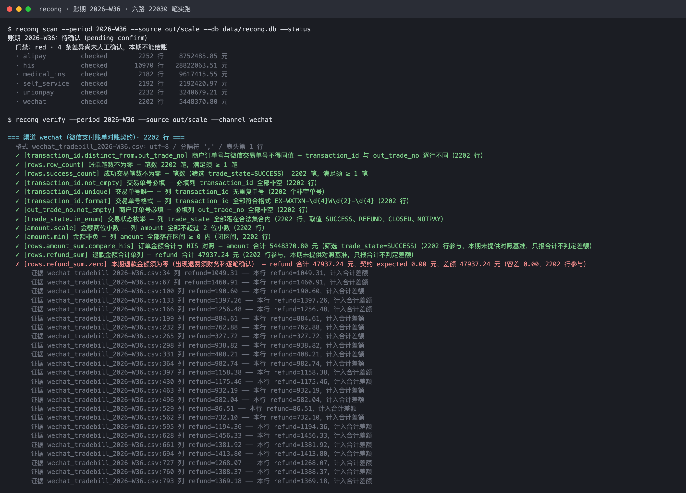
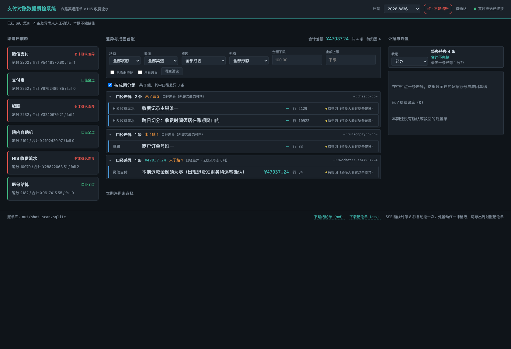
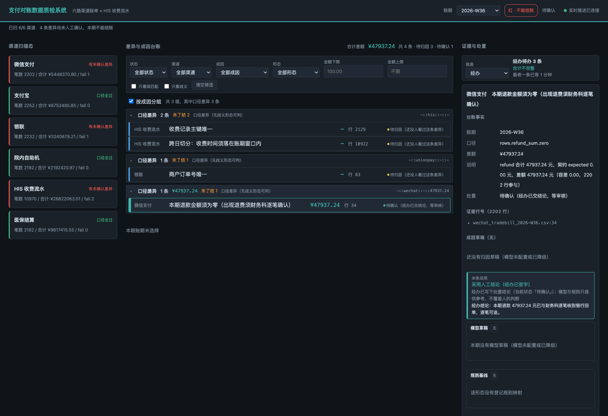
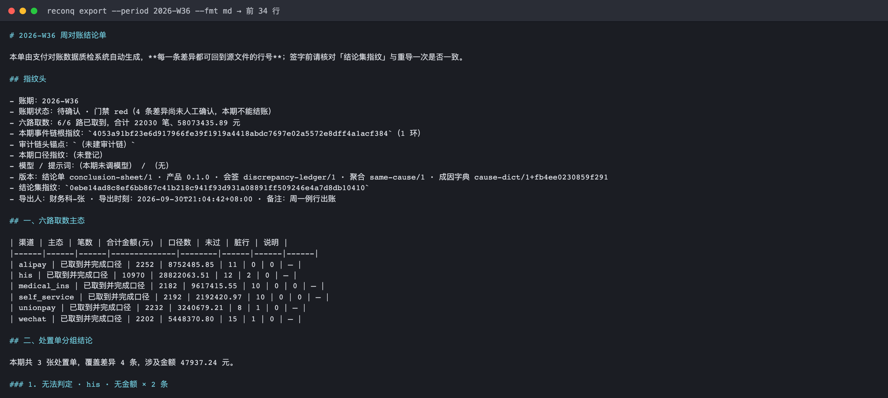
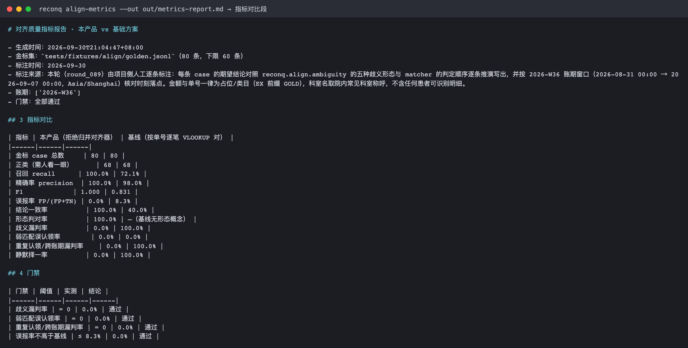

# Payment Reconciliation Data Quality Inspection System

> The finance office picks a billing period; the system automatically pulls the six statement sources — WeChat Pay, Alipay, UnionPay, self-service kiosks, HIS, and medical insurance — reconciles them row by row, and produces a weekly reconciliation conclusion sheet in which every single discrepancy traces back to its evidence rows.

WeChat Pay, Alipay, UnionPay, self-service kiosks, HIS, medical insurance — every Monday, when last week's books are closed, the reconciliation officer in the finance office has to manually reconcile six statements written to six different schemas: first export the files, then compare row by row, then ask the IT department about the reason for each discrepancy, one at a time. This system takes over that workflow: it fetches data according to YAML reconciliation contracts, validates the schemas, aligns entities across channels, and lays out every discrepancy together with its evidence row numbers on one screen; for one-sided entries whose cause cannot be explained, it produces a cause draft carrying a confidence score and evidence citations, and after a human confirms each one, it exports a signable conclusion sheet.

## Applicable Scenarios / Target Roles

| Role | When it is used | What it gets |
|------|------------|----------|
| Finance reconciliation officer | Triggers a scan on Monday for last week's billing period; produces the monthly books at month end | One screen showing the primary state of each of the six sources, per-source row counts and total amounts, and each discrepancy's difference and evidence row numbers |
| Finance reconciliation officer | The cause of a discrepancy cannot be explained and it must be decided who to chase | A cause draft with a cause label, confidence, and evidence citations, plus a suggested action and a suggested responsible party |
| Finance supervisor | The handler has finished dispositioning every item and a review is needed before signing | A weekly reconciliation conclusion sheet (Markdown / CSV) carrying the disposition conclusions, the confirmer, the reviewer, and the event-chain fingerprint |
| IT interface engineer | A statement source cannot be pulled, signature verification fails, SHA1 mismatch, rate limiting | The precise failure reason and the names of the missing environment variables — not a bare "connection failed" |
| IT interface engineer | Needs to re-run only one source or only one check | Selective re-run by channel / by check; already-completed work is not re-ingested |

## Capability Highlights

- **One scan reconciles all six statement sources**: WeChat Pay, Alipay, UnionPay, self-service kiosks, HIS, and medical insurance are each fetched per their contract, showing each source's primary state, row count, and total amount on one screen; if one source cannot be pulled it is only marked "not fetched this period + error code", and the other five still produce results.
- **Schemas live in contracts, not hard-coded**: each channel has one YAML contract declaring the column definitions and the reconciliation checks (row counts, required-non-empty, transaction-type enums, amount totals, cross-day splits, refund reversals, medical-insurance articulation equations); adding a check means editing YAML only, never code.
- **Every discrepancy carries evidence row numbers**: a failed contract check does not merely say "not passing" — it states "which row of which source file, what the original line was, how much the difference is", so it can be traced back to the exporting party.
- **Dirty rows go to a quarantine ledger, never dropped silently**: malformed rows in a statement are moved to quarantine and exported as an Excel ledger (file name + row number + original line), which the finance office reconciles line by line with the exporting party; when there are too many dirty rows the whole file is judged broken and that source is marked not-fetched — partial data is never used to produce a clean conclusion.
- **Misalignment never silently picks one**: when the same order number hits multiple records in HIS (one-code-for-many split lines, merged payment, cross-period landing, refund coexisting with the original), the system marks "ambiguous, pending human" and lists every candidate row with its cause classification; it never guesses one and calls it settled.
- **Candidates are graded into three tiers, which only decide "which one to look at first"**: when the order number is missing, each candidate is scored on five factors — amount difference, time window, department, settlement method, and cross-channel corroboration — and sorted into strong / weak / unusable. Weights and thresholds live in configuration and can be tuned by the finance office to local practice, with every change recorded. **None of the three tiers is auto-claimed** — two rows differing by 28 CNY are not "unlikely to be the same transaction", they are simply not the same transaction, and are rejected outright.
- **One-sided entries that cannot be explained get a cause draft**: the model emits ranked drafts against a controlled cause vocabulary, each with a confidence score and evidence citations; amounts, times, and order numbers stated by the model are cross-checked item by item against the evidence rows, and anything that does not line up is voided in full and returned to a human.
- **Only human confirmation counts**: discrepancy state can only be advanced by a human click (pending attribution → pending confirmation → confirmed / rejected, and withdrawable); neither the model nor the rules may auto-confirm, and when the model is unreachable not a single state advances.
- **When a schema changes, whether old conclusions still count is answerable on the spot**: each contract revision records its own fingerprint, and after an edit the system can report "which check, which parameter, changed from what to what"; before re-running, it diffs against a regression baseline and lists which conclusions will flip. **Editing only the descriptive text does not disturb already-confirmed periods** — only changing decision parameters sends them back to pending confirmation, and only a human can clear that flag.
- **Each thing is handled exactly once**: one-sided entries are stored individually for traceability, but the handler groups them by cause, channel, form, and amount into disposition tickets — 20 instances of "outpatient registration 50.00 CNY posted late" collapse into 1 ticket, one click confirms the whole ticket, and every member advances in lockstep; a "missed one out of ten" situation never occurs. When member states are inconsistent, a member cannot be located in the ledger, amounts do not reconcile, or a cause is not registered, the group is **split or refused** — it is better to hand over a few more tickets than one that cannot be clicked through.
- **A matter judged once gets a suggestion next time**: causes confirmed by a handler are recorded as precedents on seven features — channel + form + transaction type + whether it crosses the day boundary + candidate count + whether all candidate amounts are identical + order-number shape. Next time, a similar discrepancy first surfaces the historical judgment (with how many times it was judged and when most recently), and **a human still has to click confirm**. Precedents judged only once are not offered as candidates; after the cause vocabulary or prompt version changes, old precedents are automatically downgraded to "for reference only" rather than applied as-is.
- **Run it once on Monday morning and you know how many things need judging and who owns each**: one command runs eight stages — index build, three-way alignment, ambiguity classification, cross-period linked tracing, evidence bundling, attribution, anti-hallucination verification, and same-cause aggregation — and hands you a table that can be pasted into the department meeting: grouped by cause, each row carrying **count / amount involved / responsible party / evidence count / suggested action**, with a division-of-labour table at the end. Per-stage progress and elapsed time are visible, and **whatever stage crashed, the already-completed results survive** (the period is marked "conclusion incomplete" rather than rolled back to "zero discrepancies this period"). It runs even with no model endpoint configured — causes come from the deterministic rule baseline, listed separately as "not via model" in the summary, so they never blend into a single "all attributed" line.
- **When something goes wrong you can trace which step**: every run writes a JSONL structured log (event, channel, period, error code, elapsed time, batch count, peak memory), so any problem can be answered as "which source, which step, for what reason, how slow"; patient identifiers in the log are redacted before being written to disk, while ordinary order numbers and amounts are preserved as-is.

## Quick Start

### Dependencies

- Python >= 3.11
- No database service required: the ledger and event chain use SQLite (on the HIS side, SQLAlchemy connects to the hospital's read-only database)

### Installation

```bash
cd payment-reconcile-qc
python3 -m venv .venv && source .venv/bin/activate
pip install -r requirements.txt
pip install -e .
```

### Configuration

Copy `.env.example` to `.env` and fill it in according to local practice. **All credentials are read from environment variables; nothing is hard-coded.**

| Setting | Default | Description |
|--------|--------|------|
| `WECHAT_MCH_ID` / `WECHAT_SERIAL_NO` / `WECHAT_PRIVATE_KEY_PATH` / `WECHAT_API_V3_KEY` | empty | Used to fetch statements from the WeChat Pay merchant platform; if any one is missing the request is refused before it is sent, naming the missing variable |
| `ALIPAY_APP_ID` / `ALIPAY_PRIVATE_KEY_PATH` / `ALIPAY_PUBLIC_KEY_PATH` | empty | Used for Alipay RSA2 signing |
| `ALIPAY_GATEWAY` | `https://openapi.alipay.com/gateway.do` | Alipay gateway address |
| `HIS_DB_DSN` | empty | HIS charge-ledger **read-only** database connection string; the account must be read-only |
| `HIS_DB_POOL_SIZE` / `HIS_DB_POOL_TIMEOUT` / `HIS_DB_QUERY_TIMEOUT_SECONDS` | `5` / `10` / `30` | HIS connection pool and query timeout |
| `WECOM_WEBHOOK_KEY` | empty | WeCom (Enterprise WeChat) bot; pushes a summary and deep link when thresholds are exceeded, never amount details |
| `RECONQ_WECOM_UNBALANCED_COUNT_THRESHOLD` / `RECONQ_WECOM_UNBALANCED_AMOUNT_THRESHOLD` | `30` / `5000.00` | Count and amount thresholds that trigger a WeCom push (the two lines are evaluated independently; leaving one blank means that line is not evaluated) |
| `RECONQ_MODEL_BASE_URL` / `RECONQ_MODEL_API_KEY` / `RECONQ_MODEL_NAME` | `http://127.0.0.1:8000/v1` / empty / empty | Model service (OpenAI-compatible), **used only for cause drafts on one-sided entries**. If any of the first three is missing the run fails before the request is sent and names the variable — there is no fallback to a default endpoint |
| `RECONQ_MODEL_TIMEOUT` | `20` | Model call **read** timeout in seconds (connected but not responding); when blank, 30 is used, and 0 or a negative value is rejected. A timeout takes the degradation path and **does not block the scan** |
| `RECONQ_MODEL_CONNECT_TIMEOUT` | `5` | Model call **connect** timeout in seconds (not connected at all). Must be **shorter** than the read timeout; configuring them the wrong way round is rejected before the request is sent and both variables are named — the two have different troubleshooting directions: if the connection fails, check the network and whether the process is listening |
| `RECONQ_HOST` / `RECONQ_PORT` | `127.0.0.1` / `8788` | Listening address of the resident service |
| `RECONQ_TZ` | `Asia/Shanghai` | Session time zone; the basis for cross-day split determination; an invalid value raises an explicit error |
| `RECONQ_INDEX_BUDGET_MB` | `64` | Resident memory ceiling for the alignment inverted index (MB, **digits only**). It constrains the "order number → candidate reference" map and **excludes the record payload**; when exceeded, cold blocks spill to disk and lookups read back by offset |
| `RECONQ_INDEX_SPILL_ENTRIES` | `200000` | Hard threshold on resident key count. Two independent thresholds fire first-come-first-served against the byte budget: with very long order numbers (a 32-digit serial plus a prefix), the keys alone can consume the entire byte budget |
| `RECONQ_INDEX_CACHE_SIZE` | `4096` | LRU cache entry count. Results read back after a spill also enter this cache; keys in the cache count as "hot" and will not be spilled to disk again |

### Build and Verify

```bash
# Unit tests
pytest -q

# Channel protocol compatibility suite (WeChat / Alipay message replay + pre-flight credential-missing checks)
pytest tests/protocol/ -q

# Minimal end-to-end slice: one statement file -> contract check -> print discrepancies and evidence row numbers
python -m reconq verify --period 2026-W36 --source inbox

# Offline replay of attribution prompts (no model calls; non-zero exit code when worse, usable as a release gate)
pytest tests/test_prompt_replay.py -q
python -m reconq attrib-replay --compare v1,v2

# Contract fingerprints and the impact surface of a schema change (Task 17)
pytest tests/test_contract_fingerprint.py -q
python -m reconq contract snapshot --db /tmp/reconq-demo.db
python -m reconq contract diff --channel wechat --db /tmp/reconq-demo.db

# Real-scale load test: 2000+ rows per source across all six run a full scan, measuring elapsed time and peak memory
PYTHONPATH=src python3 scripts/gen_fixtures.py --out out/scale --force
PYTHONPATH=src python3 scripts/bench.py --fixtures out/scale --db out/bench-scan.sqlite
pytest tests/test_scale.py -q

# Head-to-head against a naive "per-channel single-table row-by-row VLOOKUP" implementation (run bench.py first to produce the statement store)
PYTHONPATH=src python3 scripts/baseline_compare.py --db out/bench-scan.sqlite
```

### Main Command Quick Reference

```bash
python -m reconq --help                                    # Show all subcommands
python -m reconq scan --period 2026-W36 --source inbox     # Formally scan a billing period: fetch -> ingest -> run checks -> decide whether the period can be closed (main command)
python -m reconq scan --period 2026-W36 --status           # Read-only: where has this period got to
python -m reconq scan --period 2026-W36 --reopen           # Re-scan after manual withdrawal (the only entry point for re-scanning a confirmed period)
python -m reconq scan --period 2026-W36 --resume           # Resume from checkpoint: completed channels are not re-fetched, the rest continue
python -m reconq scan --period 2026-W36 --channel wechat --only-check row_count  # Re-run only one check for one source
python -m reconq verify --period 2026-W36 --source inbox   # Read-only troubleshooting leg: no ingestion, no state writes
python -m reconq verify --period 2026-W36 --channel wechat # Run only one channel
python -m reconq verify --period 2026-W36 --json            # Emit a machine-readable summary
python -m reconq data-source test wechat                    # Check credentials and connectivity for one source
python -m reconq quarantine scan --period 2026-W36          # Ingesting scan: quarantine dirty rows, ingest clean rows
python -m reconq quarantine export --period 2026-W36        # Export the dirty-row ledger for tracing back to the exporting party
python -m reconq contract snapshot                           # Record the current contract fingerprint (the first "previous" for schema-change comparison)
python -m reconq contract diff --channel wechat              # What changed in the schema, which sources need re-confirmation
python -m reconq contract baseline --period 2026-W36 --channel wechat --record  # Record a regression baseline
python -m reconq contract status                             # Which periods need re-confirmation due to schema changes
python -m reconq trace --order EX-WX-SPLIT-0001 --period 2026-W36 --window 1  # Linked tracing: was this one already reconciled last week
python -m reconq model-usage --period 2026-W36 --db data/reconq.db           # What did the model cost this period, and how many cache hits
python -m reconq model-usage --period 2026-W36 --calls                      # Include per-call detail (exit code 1 if the audit chain is broken)
python -m reconq verify --period 2026-W36 --db data/reconq.db --replay-list   # List the evidence snapshots captured this period
python -m reconq verify --period 2026-W36 --db data/reconq.db --replay 'wechat:2026-W36:EX-WX-SPLIT-0001'  # Recompute one conclusion (without reading the statement table)
python -m reconq attrib-replay --list-versions            # Registered attribution prompt versions and their change notes
python -m reconq attrib-replay --version v2               # Offline replay of one version: Top-1/Top-3 hit rate and rejection distribution
python -m reconq attrib-replay --compare v1,v2            # Item-by-item comparison of two versions (exit code 1 when worse, usable as a release gate)
reconq attrib-eval --out out/attrib-eval.md     # Model tier vs rule tier: hit rate / abstention rate / cost (replay, no requests sent)
reconq attrib-eval --live                        # Same, but against a real model endpoint (requires RECONQ_MODEL_*)
python -m reconq align-metrics                              # Alignment quality metrics: this product vs the row-by-row VLOOKUP baseline (same schema)
python -m reconq align-metrics --cases                      # List the verdicts on both sides for all 80 golden cases (to locate which one is wrong)
python -m reconq align-metrics --out out/metrics-report.md  # Write the full metrics report (with schema, sample size, and limitations)
python -m reconq align-golden                               # Golden-sample alignment regression: did this change break what used to be right, by form
python -m reconq align-golden --cases-only                  # List the verdict and form for each of the 46 regression cases
python -m reconq align-golden --out out/align-regression.md  # Write the full regression report (with form distribution and "what this cannot show")
python -m reconq precedent top --channel wechat              # Precedent dashboard: top 5 most common historical causes for this channel
python -m reconq precedent list --channel wechat             # Precedent detail: retrieval features, hit count, version pair at registration
python -m reconq precedent hits --period 2026-W36            # Adoption trail: who adopted which precedent and when
python -m reconq export --period 2026-W36 --format md      # Export the weekly reconciliation conclusion sheet
python -m reconq serve                                     # Start the resident service and the live panel
```

## Commands / API / Configuration Reference

### Key Configuration Items

See the credential table in [Quick Start · Configuration](#configuration); two further kinds of runtime configuration live in `contracts/_scoring.yml`:

| Setting | Default | Description |
|--------|--------|------|
| `amount_tolerance` | `0.01` CNY | Amount tolerance for weak matches; the finance office can tune it to local practice |
| `weights` (5 factors) | `0.45 / 0.25 / 0.15 / 0.15 / 0.10` | Amount difference / time-window distance / department agreement / settlement-method agreement / cross-channel corroboration. A missing key or an off-vocabulary name **raises an error**; it never silently falls back to the default |
| `tiers.strong_min` / `tiers.weak_min` | `0.85` / `0.40` | Weighted-score thresholds for strong and weak candidates; below the latter it is recorded as "unusable" |
| `candidates.max_per_row` | `5` | Maximum number of candidates **displayed** for one channel row; overflow is flagged as truncated; the full candidate set is retrievable via `reconq align expand` |
| `--rate-threshold` (`quarantine scan`) | `0.05` | Dirty-row rate threshold; above it the whole file is judged `FORMAT_BROKEN` and clean rows are not ingested |
| `--bind-contract` (`verify`) | off (read-only when not passed) | When enabled, records "which schema version this source ran under this period" into the statement store; the moment the contract fingerprint changes the period is automatically marked `needs_reconfirm`. Requires `--db` at the same time |
| `--db` (`verify --bind-contract`) | not passed | Without it, verify stays a read-only troubleshooting leg and writes no state; binding requires an explicit path — no default is guessed |
| `--log-dir` (global) | `logs/` at the round root | Directory for structured JSON logs. Can also be overridden with the `RECONQ_LOG_DIR` environment variable. Logs **do not go into the project subdirectory** — that is published to GitHub as-is |
| `--log-level` (global) | `INFO` | JSON log level: `DEBUG` / `INFO` / `WARNING` / `ERROR` |
| `--no-log` (global) | off | Do not write JSON logs for this run (useful when you want a clean terminal) |
| `RECONQ_LOG_DIR` | empty | Equivalent to `--log-dir`, for resident services and container environments |
| `RECONQ_MODEL_PRICE_PROMPT_PER_1K` | empty (cost not estimated) | Unit price on the prompt side, in **CNY per 1K tokens**. When blank, the cost shows "unit price not configured" rather than "0.00 CNY" |
| `RECONQ_MODEL_PRICE_COMPLETION_PER_1K` | empty (cost not estimated) | Unit price on the completion side, same unit. **Both must be configured**: completion tokens for attribution tasks are often no fewer than prompt tokens, and configuring only one yields a half-cost figure that nonetheless looks complete |

### Dirty-Row Reason Codes (a controlled set)

Dirty rows are classified by cause, not free text — only controlled codes can be aggregated by cause, and only controlled codes accumulate experience.

| Reason code | Description | Suggested action (for the exporting party to trace back) |
|--------|----------|--------------------------|
| `COLUMN_COUNT_MISMATCH` | The column count of this row does not match the header | Usually a missing separator (or a separator inside the data); re-export per the row number |
| `AMOUNT_UNPARSABLE` | The value in the amount column is not a valid number | Export as a plain number; do not include uppercase amounts or Chinese units (thousand separators and currency symbols are cleaned automatically) |
| `TIMESTAMP_UNPARSABLE` | The transaction time cannot be parsed | Export a complete time including seconds, not just a date |
| `REQUIRED_FIELD_EMPTY` | The primary key column (channel order number) is empty | This row cannot form the idempotency key; please supply the merchant order number column |
| `DUPLICATE_ROW_CONFLICT` | The channel order number is duplicated within the same file | Identical amount and time means the exporting party exported twice; the same number with different amounts is a split/refund coexistence, not quarantined |
| `ENCODING_UNRESOLVED` | This row contains bytes that cannot be decoded | Please re-export as UTF-8 or GBK; this product will not reconcile against garbled text as an order number |

### CLI Subcommands / API Endpoints

| Command or path | Purpose | Key parameters |
|------------|------|----------|
| `reconq scan` | Formally scan a billing period: fetch each source, ingest idempotently, run checks, and judge the period closable / not closable | `--period` `--db` `--source` `--contracts` `--channel` (repeatable) `--set` `--reopen` `--json` |
| `reconq scan --status` | Read-only answer to "where has this period got to": state, gate colour, and each of the six sources' primary state | `--period` `--db` `--json` |
| `reconq scan --resume` | Resume from a checkpoint: completed channels are neither re-fetched nor re-ingested, the rest continue; when there is nothing to do it hands over a "no additions" conclusion and leaves the period state untouched | `--period` `--db` `--source` `--json` |
| `reconq scan --only-check` | Re-run only the checks matching the selector (e.g. `row_count` / `not_empty` / `transaction_id.*`), repeatable | `--only-check` (repeatable) `--channel` `--actor` |
| `reconq verify --only-check` | Narrow the check set on the read-only leg: if none match it reports `CHECK_SELECTOR_EMPTY` rather than treating it as "all passed" | `--only-check` (repeatable) `--channel` |
| `reconq verify --resume` | Check only the channels not yet finished at the checkpoint (requires `--db` to read the checkpoint; without it, falls back to a full run and says so) | `--db` `--json` |
| `reconq verify` | Validate the six statements of a billing period per contract (read-only troubleshooting leg; no ingestion, no state writes) | `--period` `--source` `--contracts` `--channel` (repeatable) `--check` `--json` `--set` |
| `reconq verify --bind-contract` | A scan that also records the schema provenance; when the schema later changes, the period is automatically marked `needs_reconfirm` | `--db` (required, otherwise an explicit error) |
| `reconq verify --lint` | Run only the static contract validation and exit, without touching any statement (run this right after writing a contract) | `--period` `--contracts` `--channel` `--json` |
| `reconq verify --replay` | Recompute one alignment conclusion from the candidate set carried by its evidence snapshot, **without reading the statement table**; it stands up even if the source data has since been re-pulled | `--period` `--db` (required) `--replay <conclusion key>` `--json` |
| `reconq verify --replay-list` | List all evidence snapshots captured this period (conclusion key, type, hash, participant count) | `--period` `--db` `--json` |
| `reconq data-source test` | Check credential presence and protocol connectivity for one source, item by item | `<channel>` `--all` `--json` |
| `reconq data-source probe` | Probe the format only, without running checks: encoding / delimiter / header row number / column mapping / dirty rows | `<channel>` `--period` `--source` `--json` |
| `reconq quarantine scan` | Ingesting scan: dirty rows into quarantine, clean rows into the statement table | `--period` `--channel` (repeatable) `--source` `--db` `--rate-threshold` `--json` |
| `reconq quarantine list` | List quarantined dirty rows (description + original line + row number) | `--period` `--channel` `--db` `--json` |
| `reconq quarantine export` | Export the dirty-row ledger as CSV (utf-8-sig, opens on double-click in Excel) | `--period` `--channel` `--out` `--db` |
| `reconq contract snapshot` | Record a fingerprint snapshot of the current contract (the first "previous" for schema-change comparison) | `--channel` (repeatable) `--contracts` `--db` `--list` `--json` |
| `reconq contract diff` | Compare the working-tree contract against the latest snapshot: what changed, which sources are affected, whether re-confirmation is needed | `--channel` (repeatable) `--contracts` `--db` `--record` `--json` |
| `reconq contract baseline` | Record a regression baseline, or diff against an existing one (listing the checks whose conclusions flip) | `--period` `--channel` `--source` `--db` `--record` `--json` |
| `reconq contract status` | List the periods needing re-confirmation due to schema changes (read-only) | `--period` `--db` `--json` |
| `reconq trace` | Linked tracing: occurrences of the same order number across adjacent periods and all six sources are strung into one chain, judging cross-period / cross-channel duplication and amount relationships | `--order` (required) `--period` \| `--periods` (one of the two) `--window` `--db` `--no-index` `--json` |
| Global switches | Directory, level, and switch for structured JSON logging (applies to all subcommands) | `--log-dir` `--log-level` `--no-log` |
| `reconq attrib-replay` | Offline attribution replay: Top-1/Top-3 hit rate and rejection distribution for a prompt version over 12 fixed evidence bundles | `--version` `--set` `--json` |
| `reconq attrib-replay --compare` | Item-by-item comparison of two prompt versions: metric deltas plus which cases went from right to wrong; **exit code 1 when worse** | `--compare <old>,<new>` `--set` `--json` |
| `reconq attrib-replay --list-versions` | List only the registered prompt versions and their change notes (no replay) | `--json` |
| `reconq attrib-eval` | Attribution effectiveness evaluation: on the same hand-labelled evaluation set, compare **the model tier against the rule-baseline tier** on Top-1/Top-3 hit rate, anti-hallucination abstention rate, and cost; **exit code 1 when the model tier's Top-3 is below the rule tier's** | `--set` `--out` `--live` `--json` `--cases` |
| `reconq attrib-eval --live` | Same, but re-run against a real model endpoint (by default replays recorded response doubles, sending no real requests and costing nothing) | `--live` |
| `reconq align-metrics` | Alignment quality metrics: same-schema comparison against a "row-by-row VLOOKUP" baseline on an 80-case hand-labelled golden set; **exit code 1 when the gate fails** | `--golden` (default `tests/fixtures/align/golden.jsonl`) `--out` `--json` `--cases` |
| `reconq align-metrics --cases` | List the "expected / this product / baseline" verdict for each golden case, to locate which one is wrong | same as above |
| `reconq align-golden` | Golden-sample alignment regression: run 46 regression cases by **form**, reporting pass/fail and the form distribution; **exit code 1 if any case fails** | `--cases` (default `tests/fixtures/align/cases.yml`) `--out` `--json` `--cases-only` |
| `reconq align-golden --cases-only` | List the verdict, ambiguity form, and pass/fail of each case (to locate "which one broke, and on which form") | same as above |
| `reconq precedent top` | Precedent dashboard: top N most common historical causes for a channel (or across channels), descending by hit count, with the responsible party and the most recent hit; **read-only** | `--channel` `--limit` (default 5) `--db` `--json` |
| `reconq precedent list` | Precedent detail: retrieval features, hit count, sample discrepancy keys, and the **dictionary / prompt version pair at registration** for each entry | `--channel` `--cause` `--min-hits` `--db` `--json` |
| `reconq precedent hits` | Precedent adoption trail: who adopted which precedent and when, and how many hits it had recorded at that moment (reverse lookup over an append-only event chain) | `--period` (required) `--channel` `--diff-key` `--db` `--json` |
| `reconq align-pipeline` | **Alignment main path (run it to see)**: runs index build / three-way alignment / ambiguity classification / cross-period linked tracing / evidence bundling / attribution / anti-hallucination verification / same-cause aggregation in one go, and produces the handler's pre-work to-do summary (cause · count · amount · responsible party · evidence count · suggested action). **Read-only**: writes no ledger and advances no disposition state | `--period` (required) `--db` `--contracts` `--amount-bucket` `--trace-window` `--history-periods` `--instructions` `--progress` `--stages` `--json` |
| `reconq align-pipeline --progress` | Print per-stage progress (stage name / rows processed / elapsed / segment index) so the panel and CI can see how far it got | same as above |
| `reconq align-pipeline --stages` | Print only the per-stage timing table: which stage is slow is obvious at a glance — index building or attribution | same as above |
| `reconq groups list` | Same-cause aggregation: collapse one-sided entries into disposition tickets plus a division-of-labour table; **read-only** | `--period` `--db` `--group-key` `--amount-bucket` `--only-channel` `--include-resolved` `--json` |
| `reconq groups confirm` / `reject` / `withdraw` | Group-level disposition: confirm / reject / withdraw a whole group, with each member advancing in lockstep | `--period` `--db` `--group-key` (required) `--operator` (required, must be a natural person) `--note` `--json` |
| `reconq groups slip` | Export the assignment ticket as Markdown: proof per group, evidence rows per entry | `--period` `--db` `--operator` `--note` `--out` |
| `reconq groups actions` | Group-level disposition trail (who confirmed / rejected / withdrew which entries of which ticket, and when) | `--period` `--db` `--group-key` `--json` |
| `reconq export` | Export the weekly reconciliation conclusion sheet | `--period` `--format md\|csv` |
| `reconq serve` | Start the resident service and the browser panel (locked to `127.0.0.1:8788` by default) | `--host` `--port` `--db` |
| `GET /` | Browser panel (three columns + SSE live refresh); `?period=&diff=` lands directly on a given discrepancy | `?period=` `?diff=` |
| `GET /api/periods` | List of scanned periods in the database plus the default period | — |
| `GET /api/vocab` | The **complete vocabulary** behind the filter dropdowns (status / channel / cause / ambiguity form / role). The frontend hard-codes no enums | — |
| `GET /api/period/{period}/channels` | Left column, six channel cards: primary state, row count, total, dirty-row count, and the error code for anything not fetched | — |
| `GET /api/period/{period}/discrepancies` | Middle column, the discrepancy ledger. **An invalid filter value returns 4xx + an error code**; it never silently returns an empty list | `?channel=&state=&cause_code=&ambiguity_kind=&amount_min=&amount_max=&only_weak_match=&only_ambiguous=&include_resolved=` |
| `GET /api/period/{period}/groups` | Grouped by cause (group key shaped the same as `reconq groups`), used for whole-group expansion in the middle column | — |
| `GET /api/period/{period}/todo` | To-do aggregation: how many items a given role currently owns, the total, and how long the oldest has been waiting | `?role=handler\|reviewer\|supervisor` |
| `GET /api/period/{period}/discrepancy/{key}/aid` | Right column, decision support: model draft / rule baseline / historical precedent / anti-hallucination verification **side by side**, plus an explicit statement of which one is adopted | — |
| `GET /api/period/{period}/discrepancy/{key}/evidence` | Evidence expansion: full candidate-row table + alignment snapshot references + three deep-link exits | — |
| `GET /api/period/{period}/disposition` | The stream of closed conclusions (confirmed / rejected) | — |
| `GET /api/period/{period}/export` | Footer download of the weekly conclusion sheet (for printing and signing). **Identical layout to `reconq export`**, with the fingerprint in both the body and the response header | `?fmt=md\|csv` `&operator=` `&note=` |
| `GET /api/events` | SSE event stream: four kinds — `progress` / `channel` / `diff` / `status` | — |
| `GET /open` | 302-redirects a `reconq://` deep link to the matching discrepancy in the panel (the entry point when clicking through from a WeCom message) | `?link=reconq://period/<period>/diff/<key>` |
| `POST /api/discrepancy/{key}/decide` | Human disposition: `confirm` / `reject` / `withdraw`. **Transitions only through the state machine's allow-list**; an illegal state returns 4xx | body: `decision` `operator` (must be a natural person) `role` `comment` `expected_version` |
| `POST /api/discrepancy/{key}/review` | Supervisor review (the server enforces `role=supervisor`; it does not trust whatever the frontend sends) | same as above |

### Model Cost and Audit (`reconq model-usage`)

This is the command to run when the finance office asks "what did the model cost this period, and where was it slow". **Read-only**: it calls no model, changes no ledger, and advances no state.

| Command or parameter | Purpose | Key parameters |
|------------|------|----------|
| `reconq model-usage --period 2026-W36` | Produce a cost-and-hit table | `--db` statement-store path; `--json` machine-readable |
| `--calls` | Include **per-call detail** (call id / discrepancy key / elapsed / tokens / status) | By default only the aggregate table is produced |
| `--no-chain-check` | Skip the audit chain fingerprint verification (troubleshooting leg: a fast path when you only want the numbers) | By default it **does** verify, and exits with code 1 when the chain is broken |

Three numbers, three different meanings — do not conflate them:

| Number | Meaning | Why there are two answers |
|------|------|------------------|
| `calls` | Calls recorded this period (**including** cache hits) | "How many times was the model called this period" has two answers |
| `actual_calls` | Calls that **actually reached the endpoint** = `calls − cache_hits` | This is what "how much did it cost" refers to. A cache-hit call sent **zero requests** |
| `cache_hits` / `cache_hit_rate` | The number and proportion of cache hits | The only basis for judging whether this cache is worth keeping on |

Cost and token accounting are just as carefully separated: elapsed time and tokens are accumulated **only over calls that actually went out** — mixing in zero-duration cache hits makes the "the model got slower" signal disappear.

### Alignment Quality Metrics (`reconq align-metrics`)

Everyone can say "this product is more accurate than the basic approach"; without saying **what it is being compared against**, the claim cannot be checked. This command writes the shape of the hospital's existing manual process out as a **runnable baseline** (a row-by-row `VLOOKUP` by order number, silently taking the first row on multiple hits), runs it over the **same hand-labelled golden set**, and produces a side-by-side metrics table plus a gate verdict.

```bash
reconq align-metrics                          # Side-by-side metrics table + gate verdict
reconq align-metrics --cases                  # List the verdicts on both sides for all 80 golden cases
reconq align-metrics --out out/metrics-report.md   # Write the full report (with schema and limitations)
reconq align-metrics --json                   # Machine-readable
```

```
指标                         本产品              基线
------------------------------------------------
金标 case 总数                  80              80
正类（需人看一眼）                   68              68
召回 recall               100.0%           72.1%
精确率 precision           100.0%           98.0%
误报率 FP/(FP+TN)            0.0%            8.3%
结论一致率                   100.0%           40.0%
形态判对率                   100.0%      —（基线无形态概念）
歧义漏判率                     0.0%          100.0%
弱匹配误认领率                   0.0%            0.0%
重复认领/跨账期漏判率               0.0%          100.0%
静默择一率                     0.0%          100.0%

门禁：全部通过
```

**Four gates; failing any one of them yields exit code 1** (same semantics as `verify` / `scan`, directly usable as a release gate):

| Gate | Threshold | Why it is enforced here |
|------|------|----------------|
| Ambiguity miss rate | = 0 | The four one-to-many causes (split / merged payment / cross-period / refund coexistence) each require a different disposition; guessing wrong assigns an entire block of amount to the wrong fee item |
| Weak-match wrongful-claim rate | = 0 | When the order number did not even match, claiming on a coincidentally equal amount amounts to burying uncertainty in the conclusion sheet |
| Duplicate-claim / cross-period miss rate | = 0 | The former lets the same amount into the total twice, the latter lets one payment be counted in two periods |
| False-positive rate no higher than the baseline | <= baseline | Reporting more is acceptable, reporting more noisily is not — the finance office will not keep using a tool that is too noisy |

**The golden set is not a credential, it is an asset**: `tests/fixtures/align/golden.jsonl` (80 cases, floor of 60 — a discrepancy matching by chance once is routine, and too few cases have no veto power) is self-contained per case: given a set of channel rows and a set of HIS rows it can report the expected verdict, and any single case can be reproduced.
The accompanying `golden_meta.json` records the annotation source, time, and per-case annotation criteria;
**when `golden_meta.json` is missing, the report explicitly states "annotation source not recorded"** —
metrics without a provenance should not be accepted as evidence of acceptance.

An insufficient golden-set size, an expected label outside the controlled space, a timestamp missing its timezone offset, or a duplicate `case_id` each produce a distinct error code; it never silently produces a fake "zero misses".

**The baseline scores 0 on "weak-match wrongful-claim rate", but that does not mean it is safer** — it never claims anything, at the cost of stating "uncertain" directly as "the channel has it, HIS does not". That is not safer; it just hides the uncertainty in a different direction: the handler ends up chasing a one-sided entry that does not exist at the cashier's desk.
So the conclusion must be read **together** — the "conclusion agreement rate" row (40% vs 100%) and the "silent-pick rate" row (100% vs 0%). What the metrics **cannot** show (desensitized samples are not real billing periods; split-payment and merged-payment are field-wise indistinguishable; real channel endpoints were never connected) is written in section 6 of `out/metrics-report.md`, not paraphrased here.

### Golden-Sample Alignment Regression (`reconq align-golden`)

`align-metrics` answers "is this product more accurate than the basic approach"; this one answers a different question — "**did this change break something that used to be judged correctly**". The two case sets are deliberately kept separate: in the metrics set a single wrong `matched` costs 1% recall, whereas in the form set a single wrong four-form case means that **the entire investigation direction for a whole class of discrepancies is reversed**.

```bash
reconq align-golden                                 # Form distribution + pass/fail
reconq align-golden --cases-only                    # List every verdict
reconq align-golden --out out/align-regression.md   # Write the full report
reconq align-golden --json                          # Machine-readable
pytest tests/test_align_golden.py -m align_golden   # Run all 46 cases in one go
```

```
形态                          说明                                    总数  通过  失败
一对一 / 明确单边              单号精确命中唯一一条 HIS 记录，或只有一侧有      10    10     0
一码付拆多笔                  渠道一条单号 → HIS 多条，两侧金额守恒              6     6     0
合并支付                      覆盖多条但金额不守恒、扇出金额不全相同              6     6     0
跨账期落点                    候选收费时间落在账期窗口之外                       6     6     0
退费与原单并存                同一单号同时存在原单与退费行                      6     6     0
弱匹配待人工                  缺单号或未命中，唯一命中也不认领                   8     8     0
脏数据下的结论稳定性           单号带空格 / 两侧皆空 / 缺时刻 / 重复导出           4     4     0

结果：通过 46 / 46
```

**The four-form coverage gate refuses at load time (not after the run finishes)**
------------------------------------------------
Split payment / merged payment / cross-period landing / refund coexistence **must each have at least 4 cases**; missing any one reports `ALIGN_FORM_COVERAGE_INSUFFICIENT` and names which form is missing and how many cases.
This gate blocks the most common form of regression: someone adds logic that "judges the four forms more finely", validates it only on the forms already covered, and **another form quietly gets judged wrong for half a year with nobody noticing**.

It sits at **load time** rather than after the run because "it finished without error" is extremely easy to read as "this change is fine" — whereas the most dangerous regression is precisely "some form has zero cases".

**The ordering of the gates also matters**: the form gate comes **before** the count gate. A missing form class necessarily drags the total below the floor as well; checking the count first hands the user "only 39 cases, below the floor", and after adding any one case the form is still missing and the gate still fails — which points the person in the wrong direction.

**Rules for registering new cases (written into the code, and tested)**
--------------------------------------------
When a new boundary form is discovered, **first** add a case to `cases.yml` (even if you write `expect` as the current behaviour and explain in `note` that it is wrong), run once to make the regression set red, and only then change the alignment code to turn it green. Reversing the order produces "the code is already written for the new form, but the regression set has zero cases for it" — and such a change is silently erased the next time someone refactors.

Form labels are a **controlled vocabulary** (`reconq.align.cases.CASE_FORMS`, 7 entries); a wrong label reports `ALIGN_CASE_FORM_UNKNOWN` at load time and lists all valid labels, and is never silently accepted as a new form. A new form must first be registered in the vocabulary and in `FORM_ZH`. The vocabulary deliberately contains **no** catch-all label such as "other / misc" — a catch-all lets new forms slip quietly into an existing form's bucket, and the coverage gate then becomes useless.

**Each case pins five things, not just "is the verdict right"**
----------------------------------------
Status / ambiguity form / cause classification / **evidence row numbers** / difference / reverse one-sided row numbers, each reported independently.
Reporting only "the verdict is wrong" lets through changes like "the status is right but one candidate row was omitted" —
and the candidate row numbers are precisely the first thing a handler uses when tracing back row by row. Failed items carry `case_id` plus the **form label** (both the Chinese name and the raw tag: the former for the finance office, the latter for whoever is editing the code, since the Chinese name changes with the wording while failure information gets pasted into a ticket).

What the regression set **cannot** show (it guards the regression surface; it does not prove recall or false-positive rate; everything passing does not mean there are no bugs) is written in section 2 of `out/align-regression.md`, not paraphrased here. The two fixtures have clearly separated responsibilities: `tests/fixtures/align/golden.jsonl` owns the metrics, `tests/fixtures/align/cases.yml` owns the regression surface.

### Attribution Effectiveness Evaluation: Model Tier vs Rule-Baseline Tier (`reconq attrib-eval`)

`attrib-replay` answers "after changing the prompt, did it get better or worse" (comparable between two versions);
`attrib-eval` answers a different question: **is this model-call layer worth its cost**. The yardstick for the latter has to be a set of **hand-labelled correct causes**, so the evaluation set and the replay set are two different things.

```bash
# By default replays recorded response doubles: no real requests, no cost, reproducible on any machine
reconq attrib-eval --out out/attrib-eval.md --cases

# Against a real endpoint (requires RECONQ_MODEL_*; unit prices optionally via RECONQ_MODEL_PRICE_*_PER_1K)
reconq attrib-eval --live --out out/attrib-eval.md
```

```
评测集 48 条（下限 40）· 期望 UNKNOWN 6 条（下限 5）· 账期 2026-W36
模型档跑法：回放录制响应替身（httpx.MockTransport，不发真实请求）
门禁：全部通过

| 指标                          | 模型档   | 规则基线档 |
|-------------------------------|----------|------------|
| Top-1 命中率                  | 72.9%    | 87.5%     |
| Top-3 命中率                  | 93.8%    | 93.8%     |
| 反幻觉拒绝率（Top-1 判不出来）| 83.3%    | 50.0%     |
| 硬猜率（该拒却给了具体成因）  | 16.7%    | 50.0%     |
| 平均置信度（仅 Top-1 答对的） | 0.607    | 0.210     |
| 单条平均成本                  | 未配置单价 | 0.000000 元/条 |
```

Three accounting conventions are worth examining on their own; none of them was chosen arbitrarily:

- **The denominator is the number of scorable cases, not the total.** Cases rejected wholesale by the schema do not enter the average — otherwise "make every draft fail validation" would make the hit rate look slightly better.
- **Average confidence is taken only over cases the Top-1 got right.** Fold in the confidently wrong ones, and the more a model that mislabels a cause while still saying 0.95, the higher the mean — the more dangerous it is.
- **The abstention-rate denominator is only the UNKNOWN cases.** Mixing in all cases dilutes it with a large number of trivial cases that "should have got a concrete cause", making it look high while carrying no information.

**The gate only enforces Top-3; it does not enforce Top-1, nor the abstention rate.** The rule tier is "the floor achievable without calling the model at all"; if the model tier is worse, this call layer has not earned its cost. But rules are inherently strong at deterministic mappings such as "form → cause", and turning Top-1 into a hard gate would push people to tune the prompt against the evaluation set — and whether the resulting score improvement translates into business value is a separate question.

**The evaluation set must contain a layer of cases where the answer given by a form lookup is explicitly wrong** (5 in this round, `semantic_override`). The rule baseline reads exactly that form; if every case's expected answer happens to equal the form-lookup result, the rule tier scores full marks — which is not it judging accurately, it is an evaluation set built to match its lookup table, which makes the two-tier comparison self-certifying and worthless. In this layer the expectation lists **only** the single correct cause, because the wrong ones point people in the opposite disposition direction (look at the cashier's desk vs look at the IT department).

The model-tier numbers come from recorded response doubles and **do not represent the discriminating ability of any real endpoint**; to actually answer "does our in-house endpoint judge accurately", configure `RECONQ_MODEL_*` and re-run with `--live`.
Section 6 of `out/attrib-eval.md` writes this point and three other limitations into the report.

### Prompt Versioning and Offline Replay (`reconq attrib-replay`)

This is the command to run before changing a prompt. **Offline**: it calls no model, costs nothing, writes no ledger, and simply feeds the **recorded model responses** from the replay set through the entire post-processing chain to see how a given version performs.

```bash
# See the registered versions and their change notes
reconq attrib-replay --list-versions

# Run the current version: Top-1/Top-3 hit rate + per-case verdicts + how many were rejected by which gate
reconq attrib-replay --version v2

# Item-by-item comparison of two versions. **Exit code 1 when worse**, directly usable as a CI gate
reconq attrib-replay --compare v1,v2
reconq attrib-replay --compare v2,v2-rc1      # A rejected version: reports worse and warns
```

```
用例 12 条 · 可评 12 条 · 降级 0 条
Top-1 命中 12/12（100.0%） · Top-3 命中 12/12（100.0%） · 引用行达标 12/12（100.0%）
保留草稿 22 条 · 被拒 0 条（反幻觉核对拒 0.0%）

  √ 01-channel-only-his-missing        Top-1 his_missing_order            引用 1 行
  √ 02-weak-match-pending              Top-1 undetermined                 引用 2 行
  √ 03-ambiguous-split-payment         Top-1 split_payment_unallocated    引用 3 行
  …
```

| Number | Meaning | Accounting caveat |
|------|------|---------|
| `scorable` | Cases that pass citation screening and anti-hallucination verification **and** have at least one cause inside the controlled vocabulary | **Not** the total. Cases rejected wholesale do not enter the average — otherwise "make every draft fail the schema" would make the hit rate look slightly better |
| Answered but wording not aligned to the vocabulary | Drafts passed the first two gates, yet because their cause used wording outside the vocabulary not one landed in the vocabulary | A **different thing** from "rejected by the out-of-range citation screen": the former means the model genuinely answered, the latter means it cited evidence that does not exist. Stating these two separately is what stops whoever edits the prompt from mistaking "wording not aligned" for "the model is talking nonsense" |
| `rejected N` | Out-of-range citation / failed verification / outside vocabulary / structurally invalid, each category listed separately | Rolling them into one number means nothing is ever learned — "ten answers, one wrong" and "one answer, rejected" look identical in hit rate, yet the former is actually a good result |
| `ref_hit` | The rows cited by the Top-1 cover the **required citation row numbers** of the case | Giving a cause without citing the discrepancy row amounts to attributing by impression |

**How "changed" is decided**: hit or miss takes priority over Top-1 text changes. If the Top-1 goes from A to B and both are in the expected set, that is "a different but equally correct phrasing" — neither better nor worse. Counting it as a change would conjure a dozen spurious "the verdict changed" entries in the report and drown out the one that actually deserves attention.

**How "worse" is decided**: the number of cases that got worse exceeds the number that got better (judged case by case, not by total score). The hit rate is a ratio over 12 cases; changing one case drops it from 11/12 to 10/12 — visible case by case, invisible in the total.

The version pair (`prompt@digest + schema@digest`) is stored with every audit record in `model_calls`, and later edits are caught by chain verification. **Changing the template body without bumping the version number** is blocked on the spot by the digest: the version is part of the cache key, so not bumping means the change never took effect, while the audit chain shows nothing happened.

The template **must not contain channel special cases** (WeChat / Alipay / UnionPay / self-service kiosk / `bill_type=` ...). This is a code-level rejection, not a comment-level convention: the channel's statement-type semantics belong to the evidence bundle (`channel_meta.bill_type`), and putting them in the template turns both "switching channels" and "changing a channel parameter" into a prompt revision, while the replay set's expectations were recorded under the old wording.

The replay set lives in `tests/fixtures/attrib/` (12 fixed evidence bundles plus recorded responses for three versions; see `MANIFEST.md` in that directory).

### Errors and Degradation

| Scenario | Behaviour | Handling |
|------|------|----------|
| A stage of the main path crashes | Results from completed stages are **preserved**, the period is marked "conclusion incomplete for this period" and **exit code 2**; the top of the summary names the stage and the error code | Check the stage table from `reconq align-pipeline --progress`. **Do not** take a partial conclusion to a conclusion sheet: "8 cases attributed, the aggregation step crashed" and "zero discrepancies this period" look identical on a signature page |
| The main path runs before the statement table exists (`ALIGN_PIPELINE_BILL_TABLE_MISSING`) | Explicit error naming the integration prerequisites; it **never produces a "zero discrepancies" conclusion** | Run `reconq scan --period 2026-W36` first (fetch and ingest idempotently); the main path reads the rows already stored |
| The main path is given no billing period (`ALIGN_PIPELINE_PERIOD_REQUIRED`) | Explicit refusal | The billing period is the shared primary key of the period instance, the ledger key, and the disposition ticket key; without it there is no unique "this period" |
| A stage name is not in the controlled stage table (`ALIGN_PIPELINE_STAGE_UNKNOWN`) | Reports the list of legal stage names | The panel draws a progress bar by stage name; a new stage must first be registered in `reconq.align.pipeline.STAGES` and `STAGE_ZH` |
| A stage-progress subscriber (panel SSE) throws | Logs one entry and continues, **without affecting this period's conclusion** | Fix the subscription on the panel side; a broken subscription should not stop the finance office from getting its to-do list |
| Model endpoint not configured / unreachable | The whole attribution stage degrades: causes come from the **deterministic rule baseline** (not via model); the panel and summary show "cause source" as a separate line; it still **awaits human judgement** and ledger state does not advance | Configure `RECONQ_MODEL_*` and re-run; "what the model said" and "what the rules guessed" are always counted separately and never blend into a single "all attributed" line |
| Prompt body changed without bumping the version (`PROMPT_DIGEST_MISMATCH`) | Any call that resolves the version pair errors immediately; the replay will not run | Update `PROMPT_VERSION_DIGEST` and `PROMPT_VERSION` together; a missed bump means one version string maps to two phrasings, and neither the cache key nor the audit chain changes while the output has |
| Channel special case appears in the prompt template (`PROMPT_CHANNEL_SPECIALCASE`) | Raises at registration or render time | Move channel-specific content into the evidence bundle or the contract; the template only describes "how to read the evidence" |
| Prompt / schema version not registered (`PROMPT_VERSION_UNKNOWN` / `SCHEMA_VERSION_UNKNOWN`) | Explicit error, **no fallback to a default version** | See what is registered via `reconq attrib-replay --list-versions`; falling back would silently turn `--compare v9,v2` into `v2,v2` |
| A version's response is missing from the replay set (`REPLAY_RESPONSE_MISSING`) | The replay for that version errors out directly | Record the missing responses. A missing version is a missing baseline, and "baseline missing" looks exactly like "this version did not improve" on the report |
| Golden set smaller than 60 cases (`GOLDEN_SET_TOO_SMALL`) | Evaluation refused outright, not "let's just try a run" | Add annotations. A "zero misses" reported on a small sample has no veto power |
| Attribution evaluation set below 40 cases total / 5 UNKNOWN (`ATTRIB_EVAL_SET_TOO_SMALL`) | Evaluation refused | Add annotations. The UNKNOWN cases are the denominator of the abstention rate — 1 out of 2 correct is 50%, which is a coin flip, not an abstention capability |
| An evaluation case has `expect_unknown` inconsistent with `expect_codes` (`ATTRIB_EVAL_CASE_INVALID`) | Errors at load time | Both describe the same thing (only exactly `['undetermined']` counts as an UNKNOWN expectation); mislabeling one throws off the abstention-rate denominator |
| An evaluation case is missing its recorded response (`ATTRIB_EVAL_RESPONSE_MISSING`) | The model tier errors out directly, naming the missing case | Record it. A missing case means one fewer case for the model tier, and "the missing one happened to be right" looks exactly like "this version did not improve" on the report |
| Evaluation fixture missing / invalid JSON / duplicate `case_id` (`ATTRIB_EVAL_FIXTURE_MISSING` / `_INVALID`) | Errors with the generation command | Re-run `tests/fixtures/attrib/golden/generate_eval_set.py`; duplicates cause the same case to be counted twice, and the two counts may even yield two different verdicts |
| The model tier's Top-3 hit rate is below the rule-baseline tier | **Exit code 1**, directly usable as a CI gate | The rule tier is "the floor without calling the model"; being worse means this call layer has not earned its cost: first see which cases dragged it down in section 5 of `out/attrib-eval.md`, then decide whether to change the prompt or switch the model layer off entirely |
| The rule-baseline tier fails on a case (`RULE_BASELINE_FAILED`) | That case counts as **not scorable** and is named in the report; it is not a "wrong answer" | The attribution fallback path has a problem; check `rank_causes_by_rules` first |
| Golden case timestamp missing a timezone offset / label outside the controlled space / duplicate `case_id` (`GOLDEN_CASE_INVALID` / `GOLDEN_LABEL_UNKNOWN`) | Errors at load time, with file and line number | A timestamp without an offset makes cross-period landing undecidable; labels must fall inside the controlled space, otherwise the same word means two different things |
| The four-form coverage gate fails (`ALIGN_FORM_COVERAGE_INSUFFICIENT`) | Refused **at load time**, not one case run, exit code 2; names which form is missing and how many cases | Split payment / merged payment / cross-period landing / refund coexistence each need at least 4 cases. Missing one form means nobody can stop "fine-tuning the criteria for one form while another quietly gets judged wrong". **Add the missing form; do not pad the total with other forms** |
| A regression case's form label is not in the controlled vocabulary (`ALIGN_CASE_FORM_UNKNOWN`) | Refused at load time, listing all 7 legal forms | A new form must first be registered in `reconq.align.cases.CASE_FORMS` and `FORM_ZH`; slipping it into an existing form's bucket defeats the coverage gate |
| Regression set smaller than 40 cases (`ALIGN_CASE_SET_TOO_SMALL`) | Refused outright, not "let's just try a run"; it also states which four forms already meet the bar and that what is missing is the depth of the other forms | A discrepancy matching by chance once is routine; too few cases cannot distinguish "really did not break anything" from "this change did not touch that code" |
| Contract static validation has an ERROR (`CONTRACT_LINT_FAILED`) | Blocked **before fetching**, exit code 2, not a single check run | Fix the contract at the YAML line numbers in the error (misspelled column name / a check hung on a nonexistent column / the same path written twice / an undeclared variable referenced); run `reconq verify --lint` first to see only the validation results |
| A group-level disposition is refused by the state allow-list (`GROUP_ACTION_DENIED`) | Not one member of the group advances; each blocked item is listed with where it is stuck, its current state, and where it can go | Common when already-confirmed items have crept into the group: check `groups actions` for the trail, or have the previous action withdrawn first |
| The operator is not a natural person (`GROUP_ACTION_OPERATOR_INVALID`) | Rejected at entry; not one request reaches the ledger, and not even a trail entry is written | `--operator` accepts only the staff number or name of a handler / reviewer / supervisor; neither the model nor the rules will click on your behalf |
| A precedent is registered before anyone has confirmed a discrepancy (`PRECEDENT_DISPOSITION_INVALID`) | Write refused; the precedent table changes not at all | Only "confirmed" sediment into precedents. Storing a sample the handler judged as "not this cause" as a precedent means next period will surface exactly the advice that was rejected |
| A model / rule / degradation path tries to register a precedent (`PRECEDENT_OPERATOR_INVALID`) | Rejected at entry; the precedent table changes not at all | A precedent is only a precedent once a human has judged it. `--operator` must be the staff number or name of a handler / reviewer / supervisor |
| A channel name is not among the six controlled channels (`PRECEDENT_CHANNEL_UNKNOWN`) | The signature cannot be computed, exit code 2 | The channel is half the retrieval features; a wrong channel means the precedent is stored somewhere else, and that kind of error is unfindable afterwards |
| A precedent that no longer exists is adopted (`PRECEDENT_HIT_MISSING`) | Adoption refused, no event chain written | A trail pointing at nothing is harder to debug than no trail. Precedent rows should not be deleted |
| An old precedent is still recommended verbatim after the cause vocabulary / prompt / signature algorithm changed | **No error**; it is automatically downweighted: the precedent is marked "for reference only", confidence drops from 0.70 to 0.40, and the output states where it differs | Discarding a human judgment is wasteful, and accepting it wholesale lets a cause judged under the old rules keep being recommended under the new ones; downgrading to "corroboration" is the only honest tier. The revision itself is normal — after revising, there is no need to manually clear the precedent library |
| The disposition ticket you hold has expired (`GROUP_MEMBER_CAUSE_CHANGED` / `GROUP_MEMBER_KIND_CHANGED`) | The group does not advance; you are told to pull a fresh ticket | Causes and forms change after re-running attribution or rescanning; applying an old ticket amounts to stamping last round's conclusion onto this round's books |
| A member of the disposition ticket has disappeared from the ledger (`GROUP_MEMBER_MISSING`) | The whole group does not advance | That discrepancy was most likely resolved by a rescan; run `groups list` again to get the current ticket |
| An amount is passed as a float (`AMOUNT_FLOAT_REJECTED`) | Explicit refusal | Amounts always use fixed-point strings or `Decimal`; float tails stop equal amounts from landing in the same ticket |
| The amount-bucket width is invalid (`AMOUNT_BUCKET_INVALID`) | Explicit refusal | `--amount-bucket` must be positive; 0 or a negative value puts every amount in one bucket, which is the same as no bucketing |
| The bill date format is invalid (`BILL_DATE_INVALID`) | Rejected **before the request is sent**, naming the value actually received | It must be `YYYY-MM-DD`. `20260907`, `2026-9-7`, `2026-13-01`, `2026-02-30`, and timestamps containing `T` are all rejected. Catching it locally is because the channel only replies with a generic `PARAM_ERROR` and you cannot tell a mistyped date from a day you lack permission for; WeChat and Alipay share the same validation |
| A channel's statement does not exist (`BILL_NOT_EXIST`) | That channel's primary state is a grey dashed "not fetched this period" | Drop that channel, let the other five produce results as usual, and show the error code on the panel |
| The statement is still being generated (`STATEMENT_CREATING`) | same as above | Prompt the user to retry later; do not block the whole period |
| The statement SHA1 does not match the response `hash` (`SHA1_MISMATCH`) | Explicit error, **ingestion refused** | Never reconcile against wrong content; check the file on the merchant platform side |
| The download link has expired (`LINK_EXPIRED`, WeChat 5 minutes / Alipay 30 seconds) | Download immediately after fetching; once expired, no request is sent | Fetch once more (within the backoff bound); on continued failure the channel is marked not-fetched |
| The channel is rate limiting (`FREQUENCY_LIMITED`) | Exponential backoff retry, with a bounded number of attempts | Beyond the bound it raises `RATE_LIMITED_EXHAUSTED`; it never retries blindly |
| The statement file's dirty-row rate exceeds 5% (`FORMAT_BROKEN`) | The whole file is judged unusable; dirty rows go to quarantine | Clean rows are **not ingested** (partial data never yields a clean conclusion); the quarantine record is still written; that channel is marked not-fetched this period and the other channels proceed as usual |
| The statement file has a few dirty rows (dirty-row rate <= 5%) | The channel's primary state turns yellow, clean rows are ingested as usual | Both the terminal and the `--json` summary carry a `dirty_rows` count and note that "the total is therefore lower"; `quarantine export` produces a ledger for tracing back |
| The same file is scanned twice | Quarantine count, statement row count, and total amount are all unchanged | The quarantine idempotency key = channel + period + file + row number; a repeated scan only updates, never accumulates |
| An HIS query times out (`HIS_QUERY_TIMEOUT`) | That channel is marked not-fetched this period | Once `HIS_DB_QUERY_TIMEOUT_SECONDS` is exceeded the query is aborted and the connection invalidated; it is recorded in the failure detail and never stalls the whole scan |
| Someone submits a write statement against HIS (`READONLY_VIOLATION`) | That statement is **blocked before it is sent to the database** | The read-only session exposes only the query entry point; DML / DDL / data-modifying CTEs / writes tacked on after a query / `SET search_path` are all refused |
| SQL uses `SELECT *` (`HIS_SELECT_STAR_REJECTED`) | Execution refused, and the error names which columns to select | Reading one column fewer on a production database saves one unit of IO; period fetching reads only the eight charge-ledger columns |
| Connected but read-only did not take effect (`HIS_READONLY_ASSERT_FAILED`) | Refuses to fetch | The read-only transaction is read back and asserted immediately; if it does not hold, not one business query is sent — ask the IT department to check account permissions |
| Read-only mode for this database is not registered (`HIS_READONLY_UNSUPPORTED`) | Connection refused | Unregistered means there is no way to prove the connection is read-only; this product does not query a production database with a state it cannot account for |
| HIS wrong password / database missing / subnet unreachable | Split into three distinct error codes | `HIS_DB_AUTH_FAILED` / `HIS_DB_NOT_EXIST` / `HIS_DB_UNREACHABLE`; when they cannot be told apart, the original exception is attached rather than guessing a cause |
| The channel returns 200 but the body is not JSON (e.g. a gateway proxy spitting back an old XML envelope) | Explicit `CHANNEL_REQUEST_FAILED` | It **must not** be treated as "no statement today" — that silently zeroes this source's total while the conclusion sheet still shows green |
| The channel returns 200 with a perfectly normal-looking message, but response signature verification fails (`RESPONSE_SIGNATURE_INVALID`) | The download link in that response is refused | Either the platform certificate was rotated without updating the configuration, or the payload was modified in transit; not even the download request is sent and no statement row is stored |
| The index memory budget is misconfigured (`INDEX_BUDGET_INVALID`: `0` / negative / carries a unit / non-numeric / above 16GB) | Errors naming `RECONQ_INDEX_BUDGET_MB`, **never silently falling back to the default** | Entering `0` means "no limit", which is precisely the situation this budget exists to prevent; a silent fallback leaves the user believing they lifted the cap while actually running at 64MB |
| A credential slot is missing / the key file cannot be read | Fails **before the request is sent**, naming the specific environment variables | All missing slots are listed at once (rather than "add one and run again"); for missing credentials channels only reply with a generic `SIGN_ERROR` / `isv.invalid-signature`, and debugging via that costs four round trips |
| The four model configuration slots are missing (`MODEL_CONFIG_INVALID`) | **Fails before the request is sent**, naming all missing variables at once | There is no "send to a default address when the endpoint is missing" fallback — that would ship an evidence bundle full of amounts and order numbers to a model whose service is unknown |
| Model service unreachable / 5xx / rate limiting (`MODEL_UNAVAILABLE`) | Degrades to "report deterministic contract conclusions only + mark all discrepancies as awaiting human judgement" | **The four failure kinds each have their own cadence** (not a uniform three attempts): connect failure backs off 0.4s, 5xx/429 backs off 0.8s, read timeout backs off 1.2s, local validation failure backs off 0.3s, each retried twice; **401/403/404 are never retried at all** — retrying an auth failure just amplifies the same error three times and burns in-house inference quota |
| Model call read timeout (`MODEL_TIMEOUT`) | Same degradation, **does not block the scan** | Adjust `RECONQ_MODEL_TIMEOUT`. It means "**connected but not responding**": check the GPU queue and whether the model has finished loading |
| Model connect timeout (`MODEL_CONNECT_TIMEOUT`) | Same degradation | Adjust `RECONQ_MODEL_CONNECT_TIMEOUT`. This is **deliberately a separate code** from the previous row because the meaning differs: this one means "**could not connect at all**", so check the in-house network and whether the inference service process is listening; merging the two codes sends both troubleshooting directions to the same sentence |
| Consecutive failures reach the threshold and the circuit breaker opens (`MODEL_CIRCUIT_OPEN`) | Degrades with **not one request sent**, at zero cost for the remaining discrepancies | This is the antidote to "one period with 200 discrepancies x 30-second timeout each": while the breaker is open, timeouts no longer stall the scan. After a 60-second cooldown a **single** probe is let through; success restores, failure restarts the timer |
| The endpoint returns `Retry-After: 600` | Waits 30 seconds then degrades; a single header never hangs the whole scan | Channel rate limiting is waited out for at most 30 seconds; any longer and it is better to degrade this period and retry the next. When the header cannot be parsed it is treated as absent (returning 0 would tell the backoff to "retry immediately", which is exactly what rate limiting tries to prevent) |
| The model response does not conform to the OpenAI-compatible structure (`MODEL_RESPONSE_INVALID`) | Refused rather than treated as "the model said nothing" | Missing `choices` / empty `content` / a non-JSON body / HTTP 200 with an `error` field in the body are each classified separately; the error detail carries the HTTP status code and a truncated summary of the response |
| The draft returned by the model does not conform to the agreed structure (`MODEL_SCHEMA_INVALID`) | The draft is discarded and the rejection reason recorded | A draft must be `{cause, confidence∈[0,1], evidence_refs[] (non-empty), explanation_zh (non-empty)}`. **There is no "fix it up as best we can"**: a percentage-scale `confidence=85` is never silently divided by 100 — you would be correcting the model's mistake at the cost of making the draft no longer recomputable |
| A draft cites rows outside the evidence bundle (`ATTRIBUTION_EVIDENCE_REF_INVALID`) | The whole draft is voided, the rejection reason recorded, and the discrepancy marked as awaiting human judgement | No "nearest match" or "match the numbers" repair: silently changing `:18` to `:17` would make a fabricated conclusion look evidence-backed. Rejected drafts enter the result with their rejection reason; they are never silently dropped |
| No single JSON can be extracted from the response (`MODEL_OUTPUT_UNPARSEABLE`) | That whole batch of drafts is rejected | Stripping ```` ```json ```` fences is allowed, and surrounding prose is allowed; but **more than one** JSON in the body (even a format example quoted inside a sentence) is refused outright — that means the model was explaining rather than answering, and picking any one of them would be fabrication |
| Draft confidence out of range (`ATTRIBUTION_CONFIDENCE_OUT_OF_RANGE`) | The draft is discarded and the rejection reason recorded | The most common case is the **percentage scale**: the model writes `85` to mean 85%, while the convention requires `0.85`. This product never silently divides by 100 — the same input would otherwise yield two confidences on two runs, and metrics like "cause Top-1 hit rate" would no longer be recomputable |
| The Chinese explanation is empty or too long (`ATTRIBUTION_EXPLANATION_INVALID`) | The draft is discarded and the rejection reason recorded | The limit is 500 characters. Over-long usually means the model recited the entire evidence bundle — what should be written is "which rows support this cause", not a second copy of the evidence |
| The cause phrase is outside the controlled vocabulary (`ATTRIBUTION_CAUSE_UNKNOWN`) | The draft is discarded and the rejection reason recorded | Free-text causes cannot be grouped or counted for hit rate, and same-cause aggregation cannot recognise them either. When the vocabulary is unconfigured this layer is recorded as "**skipped**" rather than "passed" — recording "did not run" as a pass means nobody notices when the vocabulary is added and finds that this layer has never once run |
| The cause phrase is outside the controlled vocabulary (`ATTRIBUTION_CAUSE_UNKNOWN`) | **The whole draft is refused** and the rejection reason recorded; the discrepancy is marked as awaiting human judgement | Free-text causes cannot be grouped or counted for hit rate, and same-cause aggregation cannot recognise them either. **No nearest-vocabulary merging** — folding "late posting" into "channel late posting" makes "the model has never produced a new cause" disappear from the metrics table, and that is precisely the signal that the vocabulary should be extended. Please add the cause to the controlled vocabulary and re-run |
| An explanation template slot is missing or an amount was passed as a float (`CAUSE_TEMPLATE_SLOT_UNKNOWN`) | That explanation is **not rendered**; an error names the missing slot | A missing slot would render half a sentence (`this transaction amount  CNY`), which a handler reads as "the system did not check"; a `float` renders `1020.00` as `1020.0` and `0.1+0.2` as `0.30000000000000004`, and the finance office would assume the statement itself is broken. Template slots always take Decimal strings |
| The rows a draft cites **do exist**, but it says the wrong thing about them (`ATTRIBUTION_EVIDENCE_MISMATCH`) | The whole draft is voided, the rejection reason recorded, and the discrepancy marked as awaiting human judgement | Item-by-item reconciliation: amount / time / order number must match **the rows it cites**, and the declared cause must be compatible with the shape of the evidence rows. This is a different code from the previous row (a citation out of range): an out-of-range citation at least gives itself away, whereas "cites a real row number, states the wrong amount" walks into the handler's confirmation flow carrying a correct row number — the handler sees "well-evidenced" and signs. **The model's text is not rewritten**: after quietly changing 66.00 to 86.00 it is no longer something the model said, and both recomputation and the hit-rate metric lose their meaning |
| Someone tries to persist an unvalidated raw dict | `ATTRIBUTION_DRAFT_INVALID`, **not one byte is written** | The persistence exit only accepts an `AttributionDraft` that has passed the six layers (a pydantic model). The discipline lives in the **parameter type**, not in the verbal promise to "remember to validate first" |
| The model is not configured at all / cannot be reached | The panel shows "pending human judgement (attribution degraded: <error code>)" and **displays no causes at all** | Cause ranking must always be a draft: the draft structure **cannot hold** "confirmed", and advancing state requires a separate human-clicked allow-list transition. The rule baseline does attach **candidates** with evidence rows (marked "rule-inferred (not via model)", confidence capped at 0.5), but `causes` stays empty and no state moves |
| A transaction time carries no timezone offset, so the period-boundary criterion is unusable | That criterion is explicitly skipped, **the remaining clues still yield candidates**, and `skipped_clues()` gives the reason | A period boundary is an offset-carrying instant; guessing naive instants as UTC would get an entire batch of rows judged as "sitting on Monday midnight", which is harder to debug than not judging at all. A clue that did not run and a clue that ran but missed look identical on the panel, so a skip has to be queryable |
| A rule clue produces a cause code outside the controlled vocabulary | Raises `ATTRIBUTION_CAUSE_UNKNOWN` on the spot | Rules may be sparse, may be blunt, but may not invent codes: an invented code never lands in ledger aggregation and nobody can later say what that bucket was |
| The same billing period is scanned twice | Row count and total amount are exactly unchanged | Idempotency key = period + channel + bill date |
| The contract fingerprint changed (`PERIOD_NEEDS_RECONFIRM`) | That source of that period is marked "needs re-confirmation", and **old confirmed conclusions no longer apply automatically** | The handler reviews item by item and a supervisor explicitly confirms; the system, the model, and the rules all have **no** path that automatically clears this flag |
| Rescanning a confirmed period directly (`PERIOD_STATE_TRANSITION_DENIED`) | The state transition is refused by the allow-list and **not one statement row is re-fetched** | The error names the only viable path: `reconq scan --period <period> --reopen` to manually withdraw it to "pending confirmation" before scanning. A confirmed conclusion sheet may already be filed by the finance office, and a silent rescan leaves "the version signed last week" and "the current version" unable to be matched up |
| The target of a state transition is not a legal state (`PERIOD_STATE_INVALID`) | Refused outright, listing the five legal states in Chinese/English | Check whether the caller passed a Chinese state name or a mistyped code |
| Querying a period that has never been scanned (`PERIOD_SCAN_NOT_INITIALIZED`) | `--status` returns "not scanned" rather than an error | Asking "has this period been scanned" against an empty database is routine and should not raise |
| The process is killed mid-scan | The instance **stays at "scanning" and is tagged "interrupted"**; it does **not** fall back to "not scanned" | The finance office decides whether to rescan (`--reopen`) or void it; the system does not auto-rerun. Falling back makes "half-scanned" and "not yet started" look identical on the panel |
| A second scan arrives for the same period at the same time (`SCAN_IN_PROGRESS`) | The second one **does not start**, and the error names the counterpart run / holding process / last heartbeat | Running the same period in parallel makes the two ingestion batches overwrite each other, with the total flickering through an intermediate state, which is harder to debug than an error. Wait for the first to finish, or run `reconq scan --status` first to check whether the last one was interrupted; when the counterpart's heartbeat has expired (its process was killed), take over and warn |
| `--only-check` selected not a single check (`CHECK_SELECTOR_EMPTY`) | **The whole scan aborts**, and not one existing discrepancy is resolved | "Nothing ran" cannot be treated as "everything passed" — otherwise that source's old discrepancies would be mistaken for "gone after this alignment" and all resolved, turning a whole period green out of thin air. Re-check the selector expression and re-run |
| Linked tracing was given both `--period` and `--periods` (`TRACE_WINDOW_INVALID`) | Execution refused outright | "How wide is the window" has no unique answer, and picking one to run amounts to guessing the user's range. Choose one |
| Linked tracing's `--periods` is an empty list (`TRACE_PERIOD_REQUIRED`) | Execution refused | An empty period list means a full table scan; tracing must be given a range (`--periods 2026-W35,2026-W36` or `--period` with an expanded window) |
| An amount relationship on the chain does not hold (`AMOUNT_INCONSISTENT`) | Gives the **measured difference** and every node on the chain, with a non-zero exit code | A refund should equal the negation of the charge it reverses, and one channel row should equal the sum of several HIS rows; the system **does not decide which side to change**, it only lays out the difference |
| The same discrepancy produces snapshots with **different content** across two scans (`SNAPSHOT_CONFLICT`) | Errors and points at which conclusion key to use for recomputation; **both snapshots are preserved** | This discrepancy changed between the two scans — either the data or the schema did. Use `verify --replay` to recompute and see which; **do not hand-delete either one**, since last period's conclusion sheet may still be referencing it |
| The same discrepancy produces snapshots with **identical content** | Judged a duplicate capture; **no second row is inserted** | The content hash deliberately excludes the capture time, and "ran again but nothing changed" is the most common re-run; reporting it as a conflict would add a row on every rescan |
| A snapshot contains a patient name / ID number / mobile number / admission number (`SNAPSHOT_NOT_DEIDENTIFIED`) | **Refuses to write**, raising an error rather than logging a line | Snapshot fields go through an allow-list (amount, order number, voucher number, period, department, time); it does not rely on remembering to write a block list — values that look like an ID number or mobile number are blocked too, since exporting parties routinely write personal information into a remarks column |
| The recomputed verdict disagrees with the snapshot record | Marked `replay_mismatch` with every change point listed, exit code 1 | Any change in decision state, difference, or ambiguity form is listed. Changes in the schema fingerprint and index version are reported **separately** and not mixed into the change points: the former means "the premise of the comparison changed", and mixing them sends people to check the data first when the real cause is that last week the schema was edited |
| Attempting to recompute a cross-channel / cross-period linked conclusion | States plainly that it is **not recomputable** and gives the reason, rather than forcing a verdict | The adjudicator's inputs are single channel rows, while a linked conclusion spans channels and periods — a different shape; the recomputation criteria for such conclusions are specified separately when the main path is wired up in Task 42 |
| Old discrepancies hang off checks not selected by `--only-check` | Those discrepancies **stay as they are** and are not resolved | Not run is not the same as run-and-passed. When only `row_count` is re-run, the conclusions of the other 14 checks remain unknown, and it is not our place to conclude "passed" on their behalf |
| A re-run after a schema change flips a conclusion | `contract baseline` lists every check flipping `pass → fail` / `fail → pass`, with its difference | The flip list flows straight into the discrepancy ledger; newly added or deleted checks do not count as flips (there was never a "before" to compare with)
| Only the contract description text / version was changed | **Does not** require re-confirmation | Two layers of fingerprint: `check_digest` covers only the column definitions and check parameters that can change a conclusion, so editing description text does not disturb the finance office |
| A model unit price is configured as a non-number or a negative number (`MODEL_PRICE_INVALID`) | Execution refused and the variable named | An invalid value silently falling back to 0 makes "this period cost 0 CNY" look like a **real conclusion** |
| Only the prompt unit price is configured, not the completion side (cost not estimated) | Shows "unit price not configured", not half a number | A half-price figure yields a number that looks complete, and the missing side is often not zero |
| Someone tries to overwrite an existing cache entry without a reason (`CACHE_OVERWRITE_DENIED`) | Overwrite refused; the cache still holds the first version | Once the cache is poisoned, every discrepancy in the period gives the wrong answer alongside it, **with no degradation signal at all**. If a correction is genuinely needed, pass an explicit `correction_reason`; the overwrite is recorded in `model_call_corrections` |
| Audit chain verification fails (`MODEL_AUDIT_CHAIN_BROKEN`) | The cost table still prints, but the **exit code is 1** | A broken chain means this period's audit records were altered or deleted. It lets a human see the numbers while using a non-zero code to tell a script "these numbers are untrustworthy" — ask the IT department to restore from backup; **this product never recomputes and overwrites automatically**
| A call record is missing its period, or `error_code` has been stuffed into a whole blob of detail (`MODEL_AUDIT_SCHEMA_MISSING` / `MODEL_AUDIT_FIELD_INVALID`) | Refused to write | A record without a period attaches to no chain at all; stuffing detail into a short code is the most discreet way to copy evidence text into the audit database. Detail goes into the event chain (JSON logs are uniformly redacted); the audit table keeps only the code |
| An **unregistered** error code appears | Fallback metadata; no `KeyError` is raised | The interface still shows "unregistered error code + please report this code to the IT department", rather than a bare English code or a crash |
| An **unexpected** exception occurs (a code bug, a third-party library blowing up) | Exit code 2; **no bare stack trace** on the interface | The full call stack goes only into the JSON log; the terminal gets one readable line plus a log path — ask the IT department to search on `event=error.raised` |

### Run Summary and Structured Logging

The `run_summary` inside the `--json` output is the **single source of truth for the run** — the panel, the CLI, and the conclusion sheet all read the same one, rather than each writing their own (and whatever writes their own first ends up producing "the panel says 20 rows, the conclusion sheet says 19, the database has 19").

| Field | Meaning | Why it is needed |
|------|------|-------------|
| `status` | `checked` / `not_fetched` / `failed` | "Not fetched" also counts as a failure: with one of six sources missing, it must never show green |
| `row_count` / `total_amount` | This source's row count and amount total for the period (Decimal fixed-point strings) | Amounts never use float, avoiding `0.1 + 0.2` printing as 1e-17 on a conclusion sheet |
| `batches` | Number of fetch batches (by file count on the file channel, by FETCH round trips for HIS) | Only by reading "how many batches" together with "how many rows" can you tell whether batching took effect: 2000 rows in 2000 batches means batching did nothing |
| `elapsed_ms` | Elapsed time for this source | 40s for one source and 400ms for another both fall under "success"; row counts alone do not reveal it |
| `peak_rss_kb` | Peak resident process memory during processing (KB) | Streaming fetch should keep the peak within one batch; when someone sets the batch budget to 0, this number surfaces **before** the error does |
| `dirty_rows` | Number of rows moved into quarantine | The total was read short and nobody knows the shortfall is dirty rows — the hardest kind of problem to trace |
| `error_code` / `cause_code` | Failure code and root-cause code (listed separately when they differ) | "Retries exhausted" is a disposition outcome, "link expired" is a root cause; conflating them means the cause shown on the panel gets overwritten by the disposition action |
| `carried` | Whether this source's result is carried over from a previous run | Without it, the finance office mistakes the rows computed last week for ones computed just now |
| `channels_ok` / `channels_failed` / `can_close` | Summary verdict | When one of six sources is missing, `can_close` is always `false` |
| `verification_checked` / `consistent` / `rejected` / `consistency_rate` | Statistics from the anti-hallucination verification of cause drafts | Answers "how much of what the model said can be shown to a human directly" — a different thing from `model_calls` ("how many times it was called"): 200 calls with only 40 correct means the other 160 all need human re-judgement |
| `verification_mismatch_by_kind` | Distribution of failed checks (amount / time / order number / cause form) | **For prompt iteration**: whichever check fails most often points directly at whether to reorganise the evidence bundle or tighten the prompt |

Each run also writes a JSONL structured log (`logs/reconq-<date>.jsonl`), with every line carrying seven fixed fields — `ts` / `level` / `event` / `channel` / `period` / `code` / `duration_ms` — so a ticket system can aggregate by `event` and `channel` ("how many times did the HIS source fail this month, and what is the cause-code distribution" is only answerable in aggregate terms).
Event names form a **controlled set** (`runlog.LOG_EVENTS`); names outside it are recorded as `unknown` while preserving the original name — silently renaming turns "where did that event go" into a troubleshooting puzzle.

Patient identifiers in logs and summaries are uniformly redacted **before being written to disk** (`runlog.redact_payload`):
mobile numbers, ID numbers, labelled names, and admission numbers are replaced with `[REDACTED]`, and a match records **the pattern name only, never the content** (recording the content would route around the redaction). Redaction follows controlled patterns rather than relying on the caller's diligence:
the data plane of statement reconciliation is amounts and order numbers in the first place, and contains no patient detail.

```bash
# A machine-readable summary of one scan (consumed directly by the panel / ticket system)
reconq verify --period 2026-W36 --source inbox --json | jq '.run_summary'

# Aggregate by event: what happened on each source this period
jq -r '[.event, .channel, .code, .duration_ms] | @tsv' logs/reconq-20260930.jsonl

# Failures only (disposition outcome and root cause listed separately — check both)
jq -r 'select(.code != "") | [.channel, .code, .message] | @tsv' logs/reconq-20260930.jsonl
```

### Integration with Existing Systems

| Counterparty | Protocol | Direction | Credential source |
|---|---|---|---|
| WeChat Pay merchant platform | `GET /v3/bill/tradebill` → download and verify the statement SHA1 | read | `WECHAT_MCH_ID` / `WECHAT_SERIAL_NO` / `WECHAT_PRIVATE_KEY_PATH` / `WECHAT_API_V3_KEY` |
| Alipay open platform | `POST gateway.do` (`alipay.data.dataservice.bill.downloadurl.query`, RSA2) | read | `ALIPAY_APP_ID` / `ALIPAY_PRIVATE_KEY_PATH` / `ALIPAY_PUBLIC_KEY_PATH` |
| HIS charge-ledger database | SQLAlchemy (PostgreSQL / MySQL), **read-only account** | read | `HIS_DB_DSN` |
| UnionPay / self-service kiosks | In-hospital exported files `inbox/<period>/<channel>/*.csv` | read | File channel; **not the final integration method** — the official method is a same-format statement interface or SFTP delivery agreed with the hospital |
| WeCom (Enterprise WeChat) bot | `POST qyapi.weixin.qq.com/cgi-bin/webhook/send` | write (summary and deep link only) | `WECOM_WEBHOOK_KEY` |
| Model service | OpenAI-compatible `POST {base_url}/chat/completions` (structured output `response_format: json_schema`) | read | `RECONQ_MODEL_BASE_URL` / `RECONQ_MODEL_API_KEY` / `RECONQ_MODEL_NAME` / `RECONQ_MODEL_TIMEOUT`. **No real endpoint was connected this round** (in-house model credentials required); protocol-level tests use a local replay double, and the double exists only in the test data layer, not as the final integration method |

**This product does not write to HIS books, does not modify channel books, and sends no channel write interfaces.** On the HIS side this is not merely "agreed not to write" — all three defences are in place:

1. **Read-only session**: the connection immediately sets a read-only transaction (PostgreSQL `SET TRANSACTION READ ONLY` / MySQL `SET SESSION TRANSACTION READ ONLY`), and **reads back and asserts on the spot** that it genuinely took effect; if it did not, fetching is refused.
2. **Guard blocks writes**: the read-only session exposes only a query entry point and has no `execute_update` / `commit` at all; even if a write statement were passed in, it is rejected **before being sent to the database** (DML, DDL, data-modifying CTEs, writes tacked on after a query, and changes to `search_path` all count as writes).
3. **Independent refusal at the database layer**: even if someone bypassed the first two defences and wrote over a raw connection, the read-only transaction / read-only account refuses on its own — this layer stops *any* code, not just this product.

`reconq data-source test his` verifies "read-only confirmed" on the spot (`read_only_verified: true` in `--json`) and reports the pool's actual configuration and status, so the IT department knows whether the connection can write without reading documentation.

### Channel Protocol Compatibility Tests (`tests/protocol/`)

Channel protocols change: WeChat adds an error code, Alipay rewords a `sub_code`, a gateway proxy swaps envelope formats — none of these should wait until the finance office opens on Monday morning. This suite pins down the **shape of real messages** so that a channel change turns the tests red.

```bash
# Run only the channel protocol compatibility suite (37 cases)
pytest tests/protocol/ -q
```

| Test file | What it guards | Typical assertions |
|----------|---------|---------|
| `test_wechat_protocol.py` | The request shape and five response classes for WeChat fetching | The URL hits `/v3/bill/tradebill`; all three of `bill_date` / `bill_type` / `tar_type` present in the query; all five elements of `Authorization` present; a nonexistent statement is **never retried**; a statement still being generated is retried with bounded backoff; the rate-limit backoff sequence is 0.5→1.0 |
| `test_alipay_protocol.py` | The request shape and three response classes for Alipay fetching | A `POST` form to `gateway.do` (not WeChat's GET+query); all seven common parameters present; `biz_content` canonical JSON with stable key order; `EMPTY_DATA_WITH_BILL_FILE` is handled as **success** with an empty dataset; `isv.bill-not-exist` is not retried; an unknown `sub_code` is not silently treated as success |
| `test_credential_absent.py` | Failing **before any request is sent** when credentials are missing | Clears each of the four WeChat slots and three Alipay slots in turn; every time the variable is named and not one request is sent; with all missing, everything is listed at once; pure whitespace counts as missing; a missing platform certificate is also refused; credential **values** never appear in the error |

Message samples live in `tests/fixtures/protocol/`, where `MANIFEST.md` lists the error category each message corresponds to. It deliberately contains two kinds of message that **look normal but are unusable**, kept for regression purposes:

- `wechat/take_signature_invalid.json` — HTTP 200, all fields present, a working `download_url`; only response signature verification fails. It must be refused and **not even the download request sent**.
- `alipay/query_empty_data_with_bill_file.json` — HTTP 200, `code=10000`, but the business state is "file exists, no data". It must be handled as success with an empty dataset and a reason.

These two guard against the two simplifications "always pass anything that returns 200" and "always error on anything that isn't 10000".

> **Test doubles exist only in the test data layer.** Product code speaks the real protocol: real URLs, real header shapes, real error-code tables, real credential slots, and doubles take no part in the product's execution path. Real in-hospital integration is a direct connection to the channel's official interface (credentials read from environment variables), **not** these samples. No real endpoint was connected **this round** — in-house merchant credentials are missing, so all tests use locally generated keys and recorded messages.

## Typical Scenarios

### Scenario 1: The finance office runs one scan for last week's period on Monday

1. The finance office selects `2026-W36` in the panel and clicks "Start scan".
2. The six sources are fetched in turn, schemas validated, entities aligned across channels, and the page refreshes progress live.
3. The middle column appends discrepancies row by row, each with a cause colour block, the difference, and evidence row numbers; the right column waits for the handler.

```bash
export RECONQ_TZ=Asia/Shanghai
python -m reconq serve                 # Open http://127.0.0.1:8788 in a browser
# Or via the CLI while troubleshooting:
python -m reconq verify --period 2026-W36 --json
```

### Scenario 2: A handler works a one-sided entry where "WeChat has it, HIS does not"

1. The discrepancy row shows the difference, the candidate rows, and the cause draft (cause label + confidence + evidence citations + Chinese explanation).
2. The handler clicks "Confirm" or "Reject"; anything the model judged ambiguous must first be reviewed against all candidate rows.
3. After supervisor review the item enters the confirmed-conclusion stream, and it can be withdrawn at any time back to pending confirmation.

```bash
python -m reconq verify --period 2026-W36 --channel wechat --json
python -m reconq export --period 2026-W36 --format md   # Exports out/2026-W36-conclusion.md
```

### Scenario 3: The IT department troubleshoots a statement source that will not pull

1. First test the data source alone, to confirm whether credentials are missing or it is a protocol problem.
2. The error names the missing environment variable directly, rather than saying "connection failed".
3. After the fix, re-run only that source; the other results are carried over.

```bash
python -m reconq data-source test wechat
python -m reconq verify --period 2026-W36 --channel wechat
```

### Scenario 4: The finance office finds one source's total is a few rows short of HIS

1. Run `quarantine scan`: dirty rows go to quarantine, clean rows go to the statement table, and each file gets a primary state.
2. A yellow primary state means "dirty rows present but under the threshold" — the lower total is caused by that, not by the channel withholding money.
3. `quarantine export` produces the ledger; hand the **file name + row number + original line** to the exporting party to check line by line.
4. After the exporting party fixes it, rescanning the same period updates the quarantine records by idempotency key without double-counting.

```bash
python -m reconq quarantine scan --period 2026-W36 --source inbox
python -m reconq quarantine list --period 2026-W36 --channel unionpay
python -m reconq quarantine export --period 2026-W36 --out out/2026-W36-dirty-rows.csv
```

### Scenario 5: The schema changed — do last week's confirmed discrepancies still count

1. The finance office adds a `REVOKED` value to the "transaction status enum" (the channel's new export version has one more status).
2. `contract diff` reports which check, which parameter, changed from what to what, and names the period as needing re-confirmation.
3. First look at the `contract baseline` diff: will this change flip the verdicts of any checks?
4. When the change only touches description text and not decision parameters, `diff` states plainly that "confirmed discrepancy conclusions remain valid" — saving the finance office a pointless re-review.
5. Once satisfied, `--record` stores the current schema as the new "previous".

```bash
python -m reconq contract snapshot --channel wechat              # The previous snapshot
# —— after editing contracts/wechat.yml ——
python -m reconq contract diff --channel wechat                  # What changed, which sources are affected
python -m reconq contract baseline --period 2026-W36 --channel wechat   # Will any conclusions flip
python -m reconq contract diff --channel wechat --record         # Record it as the new "previous"
```

### Scenario 6: Can this period be closed? — Check period status without rescanning

On Monday the finance office only wants to know where last week's period got to (no re-run, no data changes).

1. `reconq scan --period 2026-W36 --status`: reads out the state, the gate colour, and each of the six sources' primary state
2. If it shows "pending confirmation (red)", enter the discrepancy ledger and confirm item by item
3. To rescan a confirmed period, first `--reopen` to withdraw it manually

```bash
python -m reconq scan --period 2026-W36 --status           # Read-only: where has this period got to
python -m reconq scan --period 2026-W36 --status --json    # Machine-readable, for the panel / ticket system
python -m reconq scan --period 2026-W36 --source inbox     # Formal scan (a repeat scan does not re-ingest)
python -m reconq scan --period 2026-W36 --source inbox --reopen   # Confirmed period: rescan after manual withdrawal
```

### Scenario 7: Re-running only the affected part

On Tuesday morning UnionPay delivers a supplementary batch of statements, and the IT department says the WeChat `row_count` check must be re-run — redoing the whole period takes ten minutes and turns over every discrepancy already confirmed.

1. Re-run only WeChat's two checks; the other four sources' results are carried over as-is
2. The terminal separates "produced this run" from "carried over", so at a glance you can see which numbers were just computed
3. Old discrepancies that pass this time are marked resolved (the ledger rows are kept and not counted as pending); discrepancies on checks that were not re-run stay exactly as they are

```bash
python -m reconq scan --period 2026-W36 --channel wechat --only-check row_count --actor zhangsan
python -m reconq scan --period 2026-W36 --resume          # Last run crashed: resume from the checkpoint, completed channels are not re-fetched
```

> If, on resume, every remaining source turns out to be unfetchable (most often because HIS credentials are not configured), this product **does not abort**; it hands over a "no additions this round + this source could not be fetched" conclusion and leaves the period state untouched — the database already holds results computed by earlier rounds, and aborting would throw them away.

### Scenario 9: A handler works a case where "one order number hit two HIS charges"

1. The discrepancy row's state is "ambiguous, pending human", listing **all** candidate rows at once (row number / amount / time / department / settlement method).
2. The form label tells the handler directly what to look up: in this case it is "refund coexisting with the original" — the question is whether the reversal took effect, not whether the payment was split.
3. After the handler confirms, a supervisor reviews; the system does not pick one on their behalf, nor does it auto-close the item because "the first row looks right".

```bash
# All ambiguities and weak matches for the period (--json hands over structured candidates that can be pasted straight into a ticket)
python -m reconq verify --period 2026-W36 --json
```

### Scenario 8: The IT department asks "which source was slow this run, and why did it fail"

Monday's scan finishes, the finance office says "it was unusually slow today", and the UnionPay row shows not fetched. What the IT department wants is not the four words "look at the logs", but a conclusion aggregated by channel that can be pasted into a ticket.

1. Run a scan once (the JSON log is written automatically to `logs/reconq-<date>.jsonl`)
2. Aggregate by event to see elapsed time and batch count per source — whether the slowness was in fetching or in running checks becomes obvious at a glance
3. Pull the failure rows and read the root-cause code alongside them (`error_code` is the disposition outcome, `cause_code` is the root cause)

```bash
python -m reconq verify --period 2026-W36 --source inbox --json | jq '.run_summary.channels[] | {channel, status, batches, elapsed_ms}'

# Aggregate how long each source took this week, by channel
jq -r 'select(.event=="channel.check.done") | [.channel, .duration_ms] | @tsv' logs/reconq-*.jsonl \
  | awk '{s[$1]+=$2; n[$1]++} END {for (c in s) printf "%-14s %6.0f ms (%d times)\n", c, s[c]/n[c], n[c]}'

# Failures only: disposition outcome and root cause listed separately — check both
jq -r 'select(.code != "") | [.channel, .code, .message] | @tsv' logs/reconq-*.jsonl
```

> Patient identifiers in the logs (admission number, mobile number, ID number, labelled names) are replaced with `[REDACTED]` **before being written to disk**, and a match records only the pattern name, never the content. Order numbers, amounts, and periods are preserved as-is — eating those too would leave the log with no troubleshooting value.

### Scenario 10: A handler asks "wasn't this amount already reconciled last week?"

The discrepancy ledger has a "channel has it, HIS does not" row for 128.00 CNY. The handler remembers handling an identical one last week and asks whether it was double-reported. When each of the six sources scans its own period, this question **cannot be answered** — last period's one-sided entry is in last period's statement, and each statement looks correct on its own.

1. Run linked tracing by order number, stringing occurrences across adjacent periods and all six sources into one chain
2. The chain gives the verdict directly: **cross-period duplicate counting**, with one evidence row per period, each traceable back to the source file line number
3. The suggested action is written into the conclusion: confirm which period this payment belongs to, and reverse it in the other — **do not** keep it in both periods just to make both balance

```bash
# Centred on W36, expanding one period either side
python -m reconq trace --order EX-WX-SPLIT-0001 --period 2026-W36 --window 1

# Or specify the tracing range directly (mutually exclusive with --period)
python -m reconq trace --order EX-WX-SPLIT-0001 --periods 2026-W35,2026-W36
```

> Conclusions are **not written to the ledger**: `reconq trace` is a read-only troubleshooting leg that infers claims from stored rows, which is a notch weaker than the aligner's actual claims at the time (the statement table stores order numbers, not "what the aligner judged"). The formal conclusion is generated by the scan orchestration at the alignment stage — only then is it clear which rows were genuinely claimed.

### Scenario 11: Before signing, a supervisor asks "which rows was last week's discrepancy based on"

The conclusion sheet has a row saying "WeChat channel has it, HIS does not, amount 128.00 CNY". Three months later, on review, the statements have been re-pulled and the exporting party has switched templates, so **nobody can say which rows were actually compared**. Evidence snapshots exist precisely for this question: when capturing a snapshot it also stores the participants (channel row + HIS row + all candidate rows), the amounts, the timestamps normalised to a time zone, the source file and row number, and the contract fingerprint and index version at that moment — append-only.

1. List all evidence snapshots captured this period and get the conclusion key for that discrepancy
2. Recompute using that conclusion key — recomputation reads **only the snapshot**, never the statement table, so it stands even if the source data has since been re-pulled
3. Compare item by item: any change in decision state, difference, or ambiguity form is listed; a changed schema fingerprint is prompted **separately**
4. If the recomputation agrees, the basis for signing is "these rows at the time, the same result on recomputation today" — verifiable

```bash
# List all evidence snapshots for this period (conclusion key, type, hash, participant count)
python -m reconq verify --period 2026-W36 --db data/reconq.db --replay-list

# Recompute one; --replay takes a three-part conclusion key of "channel:period:order number"
python -m reconq verify --period 2026-W36 --db data/reconq.db \
  --replay 'wechat:2026-W36:EX-WX-SPLIT-0001'
```

> A mismatch exits with code 1 (the same gate semantics as `verify` / `scan`), so the IT department can use `$?` in a script to determine "does this period have any conclusion that fails recomputation".

### Scenario 12: The model service is down, and the scan still must not be dragged down

While Monday's scan runs, the GPU queue of the in-house inference service happens to be full. This kind of failure is not a rejection but a non-response — every discrepancy waits out the full 30-second timeout, and one period has two or three hundred discrepancies. What the finance office sees is not the four words "attribution unavailable" but **the scan going from 40 seconds to 40 minutes**, and then everything pending human judgement because no cause could be obtained.

1. The first few discrepancies go through the failure chain as usual: initial attempt + 2 retries (backoff tiered by failure type), degrading if still failing
2. Consecutive failures reach the threshold → the circuit breaker opens. After that **not one request is sent**, and the remaining two hundred discrepancies degrade at zero cost
3. The panel shows "200 degraded this period, breaker open 10:12 / recovered 10:13", rather than a single "unavailable"
4. After the cooldown a **single** probe is let through: success restores, failure restarts the timer
5. Throughout, not one discrepancy ledger state moves — degraded attribution merely marks "pending human judgement"; **confirmed can still only be clicked by a human**

```bash
# Walk the whole chain end to end: unreachable → degrade → breaker with zero requests → half-open recovery → ledger state unchanged
PYTHONPATH=src python3 scripts/demo_gateway_degradation.py
```

> The demo script uses a local protocol double and a fake clock; it **neither really waits nor really sends**. Product code speaks the real OpenAI-compatible protocol; the in-house endpoint requires in-house credentials and was not connected this round.

### Scenario 13: The finance office asks "what did the model actually cost last week"

After a period is closed, the finance office has to apply for next month's in-house inference quota. What it needs is not "the model was called", but **a number that can go into the application**, plus an explanation of how that number was derived.

1. Configure unit prices first (the unit is **CNY per 1K tokens**; both slots must be set — leave them blank if the in-house endpoint has no public pricing)

   ```bash
   export RECONQ_MODEL_PRICE_PROMPT_PER_1K=0.012
   export RECONQ_MODEL_PRICE_COMPLETION_PER_1K=0.036
   ```

2. Produce a cost-and-hit table:

   ```bash
   reconq model-usage --period 2026-W36 --db data/reconq.db
   ```

3. The four numbers on the table each answer one question: **total calls** (including cache hits), **calls actually sent** (the money was spent here), **cache hit rate** (judging whether this cache is worth keeping on), and **degradation count** (grouped by real error code, not a single "attribution unavailable")
4. Use `--calls` for the per-call detail to put in the application, and `--json` to paste the table into a ticket
5. Exit code 0 means the audit chain is intact; 1 means this period's call records were tampered with — **the numbers on the table are untrustworthy at that point**, so ask the IT department to restore from backup rather than using them to request quota

Asking a second time with the same evidence and the same prompt version **does not call the model again** (the cache key = the evidence bundle's byte sha256 + the prompt version + the model name; missing any of the three is a silent bug), yet the audit table still records a `cache_hit` entry — not recording it would make the hit rate vary with "whether auditing was recorded", and it is precisely the only basis for judging whether the cache is worth keeping on.

```bash
# End-to-end walkthrough: 12 items queried one by one → rescan hits cache on 6 with zero requests → timeout degrades →
# cost table → tamper with one entry and the audit chain detects it → evidence text never entered the audit database
PYTHONPATH=src python3 scripts/demo_model_usage.py
```

> The demo script uses a local protocol double and a fake clock; it **neither really waits nor really sends**. Product code speaks the real OpenAI-compatible protocol; the in-house endpoint requires in-house credentials and was not connected this round.

### Scenario 14: A supervisor asks "can that cause the model gave be trusted"

A period has two hundred-odd one-sided entries needing attribution. The system produces ranked cause drafts, and before signing the supervisor wants to know whether these claims **have been verified** or whether the model's word was simply written down.

1. Every draft passes an item-by-item reconciliation before entering the handler's confirmation flow: every **single** amount, time, and order number appearing in the draft is compared against **the rows it cites itself**; the declared cause must also be compatible with the shape of the evidence rows (claiming "split payment" when there is only one row on the other side is judged contradictory)
2. If any item fails to line up → the whole draft is refused, the discrepancy is marked "pending human judgement", and it **does not enter the handler's confirmation flow**
3. The supervisor wants the overall picture: how many were verified, how many agreed, what the agreement rate is, and which category of check fails most often
4. Whichever check fails most often points at what to change: many amount/order-number failures mean **the evidence bundle needs reorganising** (columns that should have been supplied are missing); many cause-form failures mean **the prompt needs tightening**

```text
归因草稿反幻觉核对 4 条：一致 1 / 拒 3（一致率 25.00%） · 不一致项 金额与所引证据行对不上×1、声明的成因与证据行形态矛盾×1、引用的单号不在证据包内×1
```

The most important question for the supervisor is the **three rejected ones**. They are not "the model failed to answer", they are **"the model answered, but what it said does not line up with the evidence"** — especially in the amount category, where the row number the model cites is often entirely correct and it simply wrote the wrong amount for that row. The out-of-range row-number category is actually easy to spot (fabrication shows at a glance), whereas this one arrives with a correct row number and a confident tone, and without item-by-item reconciliation it walks straight through to the signature.

> A low agreement rate does not necessarily mean a bad prompt — it may also mean **the evidence bundle simply did not contain enough information** for the model to be right. The two directions call for entirely different remedies, and the distribution field exists to separate them.


### Scenario 15: After changing the prompt, whether it improved or regressed

Last week the attribution prompt was changed based on replay: the model is now required to emit a controlled cause code directly, with the cause vocabulary injected. After changing it, a period was run, it looked "about the same", and it shipped. Today the supervisor asks "how did those two 'undetermined' cases from last week become 'split payment' this week", and digging through the audit chain only shows the prompt version number changed — nobody can say whether it improved or regressed.

1. `reconq attrib-replay --list-versions` shows each version's change notes (which sentence changed)
2. `reconq attrib-replay --compare v1,v2` compares them item by item: metric deltas plus **which cases went from right to wrong**
3. The worse version **exits non-zero**, directly usable as a release gate; it is never silently adopted

```bash
# Hook this into a script before shipping: red when worse
python -m reconq attrib-replay --compare v1,v2 || echo "Replay did not pass, do not ship"
```

```
指标                        v1          v2          变化
Top-1 命中率              83.3%      100.0%     +16.7pp
Top-3 命中率             100.0%      100.0%       0.0pp
引用行达标率             100.0%      100.0%       0.0pp
反幻觉核对拒率             14.3%        0.0%     -14.3pp

逐条结论变化：
  ↑ 01-channel-only-his-missing        （无） → his_missing_order
  ↑ 02-weak-match-pending              （无） → undetermined
  …
```

> Replay **calls no model**: it runs the model responses recorded in the replay set (12 fixed evidence bundles covering all six channels and all six alignment forms, including one whose expectation is "undetermined"). Re-calling the model measures the endpoint's state on the day rather than the difference between prompt versions — that is what `reconq scan` is for.
> The replay set lives in `tests/fixtures/attrib/`; see `MANIFEST.md` in that directory.

### Scenario 16: The model service is down on Monday, and this period cannot simply be handed in blank

On Monday morning the finance office selects last week's period and runs a scan. Halfway through, the in-house inference service process is restarted by operations, and the remaining discrepancies get no causes — twenty discrepancies on the panel, zero causes, zero clues, every one of them reading only "pending human judgement". What the finance office wants is "first tell me who to chase", not "I don't know either".

1. Attribution automatically switches to the **deterministic rule baseline** (no model call, no network traffic, about 0.02 ms per case)
2. Each discrepancy gets cause candidates carrying **evidence row numbers**, marked "rule-inferred (not via model)"
3. `causes` stays empty, the state stays at "pending human judgement", and not one ledger row moves
4. Rescan once the endpoint is back: the model takes over, and the rules run a pass as well to record "agreement or divergence"

```text
wechat / 2026-W36 / wechat:2026-W36:ex-split-0003：待人工判定（归因降级：MODEL_CONFIG_INVALID
网关配置缺位或非法）（已附 2 条规则推断候选，未经模型）
  降级原因：未提供模型网关（RECONQ_MODEL_* 未配置？）。本条差异只保留确定性口径结论，成因待人工判定
  以下为规则推断候选（未经模型，置信度封顶 0.5），仅供人工判定的起点：
  1. 规则推断(未经模型) · 一码付拆笔未分摊（置信度 0.25，封顶 0.5） ← wechat_bill.csv:3、charge_record.csv:17、charge_record.csv:18
     · 线索：候选金额结构（守恒 / 不守恒 / 全同） —— 2 条候选金额加总 128.00 元与差异行 128.00 元守恒（差 0.00 元，容差 0.01）
  2. 规则推断(未经模型) · 无法判定（置信度 0.02，封顶 0.5） ← wechat_bill.csv:3
```

What the handler now sees is "split payment not allocated, please ask the cashier's office for an allocation breakdown, responsible party is the medical-record cashier's office", rather than an empty sentence. They still have to confirm it themselves — the 0.5 confidence cap exists precisely so that "what the rules said" always looks different on the interface from "what the model said".

> **Why confidence is capped at 0.5**: everything the rules can read is **shape** (how many candidates, whether amounts conserve, whether it is a refund row); a cause requires knowing the **business meaning** of the statement columns — `bill_type=ALL` and `=SUCCESS` are two different statements. Two classes of discrepancy with the same shape but different causes are indistinguishable at the field level, and that is exactly why the model exists. Having rules output 0.9 would only lead people to believe at signature time that the model had confirmed it too.

### Scenario 17: The same class of discrepancy reappears the following week — precedent suggests, but a human still clicks

Last week 13 instances of "WeChat cross-period landing, 2 candidates with identical amounts" were confirmed item by item by the handler as **channel late posting**. This week the same source produces 8 discrepancies of exactly the same shape, and the handler's first reaction is "wasn't this already reconciled last week?" — but nobody can say whether the cause judged last week was **one a human accepted** or merely **the top item of a model draft**.

1. Every discrepancy's attribution draft this period carries one more **precedent candidate**, with how many times it was judged, when most recently, and who to chase
2. Confidence is capped at 0.70 — above the rule baseline's 0.50 (it comes from human judgement), below the model (it has not seen this period's statement columns)
3. **Not one state moves**: a precedent is only a candidate, and the handler must still click to confirm each one
4. Who adopted which precedent and when is written into the same append-only event chain as re-runs and dictionary versions
5. If the cause vocabulary or prompt version changed this week, old precedents are automatically marked "for reference only" with confidence dropping to 0.40

```bash
# See the whole picture before starting work: what were the most common historical causes on this source, and who to chase
python -m reconq precedent top --channel wechat --db data/reconq.db

# See which features retrieved a given precedent (this decides who has the final say on "does this look like the same kind")
python -m reconq precedent list --cause channel_late_posting --db data/reconq.db

# Reverse lookup afterwards: who adopted which precedent and when
python -m reconq precedent hits --period 2026-W40 --db data/reconq.db
```

> **A precedent judged only once is not offered as a candidate**: a precedent with one hit and "last week's payment was just an accident" are indistinguishable on the evidence, and pushing it forward as experience is worse than honestly saying "no precedent applies this period".

> **A precedent is a suggestion, not a conclusion**, and it **does not replace the model or the rules**: it is a **third leg** alongside model drafts and the rule baseline. The provenance marker (`precedent_library` / rule baseline / model draft) is clearly separated on the panel, so a reader can tell at a glance "which was computed this period, which was inferred this period, which was judged by a human before".

### Scenario 18: Run it once on Monday morning and know "how many things do I have to judge this week, and who owns each"

There is no need to drill into `groups` key by key. `align-pipeline` runs all eight stages in one go and hands you a table that can be pasted into the department meeting:

```bash
# 1) First scan the period into the statement store (fetch + idempotent ingestion)
python -m reconq scan --period 2026-W36 --source inbox --db data/reconq.db

# 2) Run the main path, seeing stage by stage how far it got
python -m reconq align-pipeline --period 2026-W36 --db data/reconq.db --progress
```

What the handler gets is "N things need your judgement this period": aggregated by cause, each row carrying **count / amount involved / responsible party / evidence count / suggested action**, plus a division-of-labour table at the end (who has how many). Once in hand, work through the tickets one by one with `reconq groups confirm --group-key '<ticket key>' --operator <staff number>`.

> **This leg is read-only**: it writes no ledger and advances no disposition state. It answers "how many things are waiting for my judgement" without doing them for you. It runs even with no model endpoint configured — causes come from the deterministic rule baseline, and "cause source" in the summary lists "rule-inferred 8 cases / not via model" on its own line, never blending into a single "all attributed".

## Output Samples

### Terminal output (`reconq align-pipeline --progress`: run it and see)

The demo input is four desensitized statements under `tests/fixtures/align/2026-W36/` (HIS 15 rows / WeChat 7 rows / Alipay 4 rows / UnionPay 2 rows), with the model endpoint **not configured** (so the whole attribution stage degrades to the rule baseline):

```text
  [1/8] ✓ 建索引           0 条      0.0 ms  开始
  [1/8] ✓ 建索引          12 条      0.1 ms  2 片 / 1 条跨账期
  [2/8] ✓ 三方对齐          0 条      0.0 ms  开始
  [2/8] ✓ 三方对齐          8 条      0.1 ms  alipay 3 条待归因、wechat 4 条待归因；反向单边账 1 条
  [3/8] ✓ 歧义分型          0 条      0.0 ms  开始
  [3/8] ✓ 歧义分型          2 条      0.0 ms  跨账期落点 1、不可判定 1
  [4/8] ✓ 跨账期跨渠道连坐         0 条      0.0 ms  开始
  [4/8] ✓ 跨账期跨渠道连坐         0 条      0.4 ms  追查窗口 2026-W34、2026-W35、2026-W36、2026-W37、2026-W38
  [5/8] ✓ 建证据包          0 条      0.0 ms  开始
  [5/8] ✓ 建证据包          8 条     88.3 ms  证据包 8 份
  [6/8] ✓ 归因            0 条      0.0 ms  开始
  [6/8] ✓ 归因            8 条      0.8 ms  8 条降级（模型不可达/超时/草稿被拒）
  [7/8] ✓ 反幻觉核对         0 条      0.0 ms  开始
  [7/8] ✓ 反幻觉核对         0 条      0.2 ms  未核对任何草稿
  [8/8] ✓ 同根因聚合         0 条      0.0 ms  开始
  [8/8] ✓ 同根因聚合         8 条      0.1 ms  8 条 → 8 张处置单（合并 0 条）

账期 2026-W36 · 对账主路径待办汇总
  待判 8 件 / 共 8 条差异，涉及金额 1476.00 元 · 六路 + HIS 落库 25 行 / 合计 8782.10 元 · 耗时 89 ms

  按成因（本期需要你判的事）：
    成因 / 条数 / 金额 / 责任方 / 证据条数 / 建议动作
    HIS 未落单（his_missing_order） 2 条 / 888.00 元 / 病案收费处 / 证据 2 条
      建议动作：请收费处核查该笔是否漏做收费登记；确属漏登的补登记后复扫本期
    无法判定（undetermined） 2 条 / 335.00 元 / 财务科 / 证据 3 条
      建议动作：由经办人人工判定：向导出方索取完整单号，或由收费员确认；系统不猜
    对账口径配置错（contract_config_error） 2 条 / 99.00 元 / 信息科 / 证据 4 条
      建议动作：核对 contracts/<渠道>.yml 里报错那条口径的取值，改完重跑本期（改口径要留版本）
    账期边界落点差（period_boundary_landing） 1 条 / 240.00 元 / 财务科 / 证据 2 条
      建议动作：与财务科确认周一零点的归属规则，统一后调整账期口径；不要为了让账对平手工挪账
    退费已在 HIS 红冲（refund_offset_in_his） 1 条 / -86.00 元 / 病案收费处 / 证据 2 条
      建议动作：与收费处确认红冲是否已生效；若已生效，按账单类型重取（微信须用 bill_type=ALL）

  分工：病案收费处 3 条、财务科 3 条、信息科 2 条
  已收成处置单 8 张（8 条 → 8 张，合并 0 条）
  ~ 8 条归因降级（模型不可达/超时/草稿被拒）：成因取自规则基线，**未经模型**，台账状态未推进，仍待人工判定
  成因出处：规则推断 8 条
```

Running the same period three times in a row produces a byte-identical conclusion fingerprint (the `fingerprint` field of `--json`; elapsed time and construction timestamp **do not enter the fingerprint**, otherwise the "repeated runs agree" assertion would be vacuous):

```bash
for i in 1 2 3; do
  python -m reconq align-pipeline --period 2026-W36 --db data/reconq.db --json \
    | python -c "import json,sys; print(json.load(sys.stdin)['fingerprint'])"
done
# The three lines print the same sha256
```

> **Real boundaries stated honestly**: in this sample only two of the four ambiguity forms are exercised
> (`cross_period` / `weak_pending`). The statement table's primary key
> `(channel, period, bill_date, channel_order_no)` keeps the second row of a "same number, multiple rows" out of
> the database (see `docs/` and `discoveries.md`), so split payment / multiple candidates with equal amounts /
> refund coexisting with the original cannot be sampled on the **ingestion path** — full four-form coverage is
> guaranteed by `reconq align-golden`'s golden regression set (that path constructs alignment rows directly and
> does not go through the statement table). Neither place pretends otherwise.

### Terminal output (`reconq scan`: can this period be closed)

The demo input is five desensitized statements under `tests/fixtures/bills/2026-W36/` (of 20 WeChat rows, 1 with an empty merchant order number went to quarantine, so 19 rows were ingested), with HIS not fetched because `HIS_DB_DSN` is not configured:

```text
账期 2026-W36 扫描完成（run=b94b1c799d11）
  状态：待确认（pending_confirm） · 门禁：red · 2 条差异尚未人工确认，本期不能结账
  落库 42 行 · 合计 25406.54 元 · 口径 54 条（未通过 2 条）
  · wechat         checked          19 行      5394.69 元  口径 15 条/未通过 2 条  新增 19 行/重复 0 行
  · alipay         checked           7 行     16383.85 元  口径 11 条/未通过 0 条  新增 7 行/重复 0 行
  · unionpay       checked           6 行       873.00 元  口径 8 条/未通过 0 条  新增 6 行/重复 0 行
  · self_service   checked           5 行      1155.00 元  口径 10 条/未通过 0 条  新增 5 行/重复 0 行
  · his            failed            0 行            0 元  口径 0 条/未通过 0 条  新增 0 行/重复 0 行  [CREDENTIAL_MISSING] 环境变量 HIS_DB_DSN 未设置或为空，无法完成连接属性装配
  · medical_ins    checked           5 行      1600.00 元  口径 10 条/未通过 0 条  新增 5 行/重复 0 行
  ! wechat 本期 1 行进隔离区（REQUIRED_FIELD_EMPTY 等），未参与对账
  ! his 未取到：[CREDENTIAL_MISSING] 环境变量 HIS_DB_DSN 未设置或为空，无法完成连接属性装配
  ✗ 本期还不能结账（2 条差异尚未人工确认，本期不能结账）
```

**Scanning the same period again** (idempotent): row count, total amount, and discrepancy count are all unchanged — only the "new / duplicate" columns flip:

```text
  状态：待确认（pending_confirm） · 门禁：red · 2 条差异尚未人工确认，本期不能结账
  落库 0 行 · 合计 25406.54 元 · 口径 54 条（未通过 2 条）
  · wechat         checked          19 行      5394.69 元  口径 15 条/未通过 2 条  新增 0 行/重复 19 行
```

The machine-readable form of `--status` (`--json`) is for the panel and for pasting into IT tickets:

```json
{
  "period": "2026-W36",
  "status": "pending_confirm",
  "status_zh": "待确认",
  "gate": "red",
  "reason": "2 条差异尚未人工确认，本期不能结账",
  "channels_total": 6,
  "channels_ok": 5,
  "channels_failed": 1,
  "rows_ingested": 42,
  "checks_total": 54,
  "checks_failed": 2,
  "unconfirmed": 2,
  "total_amount": "25406.54",
  "interrupted": false,
  "stale": false,
  "note": "扫描完成 → 待确认（2 条差异尚未人工确认，本期不能结账）：his"
}
```

### Billing period state machine (`src/reconq/engine/period.py`)

```text
              ┌──────────────────┐
              │   未扫描         │  从没扫过：不跑任何口径
              └────────┬─────────┘
                       │ reconq scan
              ┌────────▼─────────┐
     ┌────────│   扫描中         │  进程被杀 → 打「已中断」标记，停在原处
     │        └────────┬─────────┘  不回退成「未扫描」
     │                 │ 扫描收尾，算门禁色
     │      ┌──────────┴──────────┐
     │ 绿   │                     │ 红/黄
     │ ┌────▼──────┐        ┌─────▼──────┐
     │ │  已确认   │        │  待确认    │←── 已确认 --reopen ──┐
     │ └────┬──────┘        └─────┬──────┘                    │
     │      │ 存疑                │ 口径改了 / 有人撤回          │
     │ ┌────▼──────┐              └─────────── 人工 ────────────┘
     │ │  已存疑   │
     │ └───────────┘
     └─→ 重扫只能走 待确认 → 扫描中；**已确认不能直跳扫描中**
```

### Terminal output (`reconq verify`)

The demo input is one 20-row desensitized WeChat statement under `inbox/2026-W36/wechat/` (the header follows WeChat's real specification, order numbers and payers are placeholders, and no patient-identifiable detail is included), with **3 deliberate mismatches**: two rows with an empty required order number, and one refund of 86.00 CNY.

```text
=== 渠道 alipay（支付宝账单对账契约）· 0 行 ===
  ○ 未取到 — 本期未取到账单文件：inbox/2026-W36/alipay/
  ...（his / medical_ins / self_service / unionpay 同理）
=== 渠道 wechat（微信支付账单对账契约）· 20 行 ===
  格式 wechat_tradebill_2026-W36.csv：utf-8 / 分隔符 ',' / 表头第 1 行
  ✓ [transaction_id.distinct_from.out_trade_no] 商户订单号与微信交易单号不得同值 — transaction_id 与 out_trade_no 逐行不同（18 行），另有 2 行因任一列为空未判
  ✓ [rows.row_count] 账单笔数不为零 — 笔数 20 笔，满足须 ≥ 1 笔
  ✓ [rows.success_count] 成功交易笔数不为零 — 笔数（筛选 trade_state=SUCCESS） 20 笔，满足须 ≥ 1 笔
  ✗ [transaction_id.not_empty] 交易单号必填 — 必填列 transaction_id 有 1 行为空
      证据 wechat_tradebill_2026-W36.csv:6 列 transaction_id=（空） —— 必填字段为空
  ✓ [transaction_id.unique] 交易单号唯一 — 列 transaction_id 无重复单号（19 个非空单号），另有 1 行为空（由 not_empty 口径判定）
  ✓ [transaction_id.format] 交易单号格式 — 列 transaction_id 全部符合格式 EX-WXTXN-\d{4}W\d{2}-\d{4}（19 行），另有 1 行为空（由 not_empty 口径判定）
  ✗ [out_trade_no.not_empty] 商户订单号必填 — 必填列 out_trade_no 有 1 行为空
      证据 wechat_tradebill_2026-W36.csv:12 列 out_trade_no=（空） —— 必填字段为空
  ✓ [trade_state.in_enum] 交易状态枚举 — 列 trade_state 全部落在合法集合内（20 行，取值 SUCCESS、REFUND、CLOSED、NOTPAY）
  ✓ [amount.scale] 金额两位小数 — 列 amount 全部不超过 2 位小数（20 行）
  ✓ [amount.min] 金额非负 — 列 amount 全部落在区间 ≥ 0 内（闭区间，20 行）
  ✓ [rows.amount_sum.compare_his] 订单金额合计与 HIS 对照 — amount 合计 5714.69 元（筛选 trade_state=SUCCESS）（20 行参与，本期未提供对照基准，只报合计不判定差额）
  ✗ [rows.refund_sum.zero] 本期退款金额须为零（出现退费须财务科逐笔确认） — refund 合计 86.00 元，契约 expected 0.00 元，差额 86.00 元（容差 0.00，20 行参与）
      证据 wechat_tradebill_2026-W36.csv:17 列 refund=86.00 —— 本行 refund=86.00，计入合计差额
  ✓ [rows.success_time.in_period] 跨日切分：交易时间须落在账期窗口内 — 全部 20 行交易时间落在账期 2026-W36 窗口内（[2026-08-31 00:00, 2026-09-07 00:00)）
  ✓ [rows.refund.offset] 退费红冲：退款额须挂得住原单且不超过原单金额 — 退费红冲逐笔挂得住原单且金额方向正确（行内退费（配对本行原单），退费/红冲 1 行，正向 19 行）
  小计：15 条口径，3 条未通过

=== 账期 2026-W36 汇总 ===
  渠道        状态      笔数        金额合计(元)   口径(未通过)  脏行
  alipay       未取到               0            0.00   0(0)     0
  his          未取到               0            0.00   0(0)     0
  medical_ins  未取到               0            0.00   0(0)     0
  self_service 未取到               0            0.00   0(0)     0
  unionpay     未取到               0            0.00   0(0)     0
  wechat       已核对              20         5714.69   10(3)     0

未取到账单的渠道：alipay, his, medical_ins, self_service, unionpay（本期结论不含这些渠道，需先补齐账单）
结论：3 条口径未通过，账期 2026-W36 门禁不通过（退出码 1）
```

Every failure carries the **source file name + row number + cause description**, so the finance office can go straight to the original statement with that row number; `--json` additionally emits machine-readable `check_path` / `diff_amount` / the raw evidence line, for pasting into IT tickets.

### Run summary (`run_summary` of `--json`)

The panel, the CLI, and the conclusion sheet read the **same** summary. Excerpt from a real run (`reconq verify --period 2026-W36 --source inbox --json`):

```json
{
  "run_summary": {
    "period": "2026-W36",
    "command": "verify",
    "elapsed_ms": 68.334,
    "peak_rss_kb": 35744,
    "gate": "red",
    "gate_reason": "3 条口径未通过",
    "can_close": false,
    "total_amount": "25726.54",
    "rows_total": 43,
    "checks_total": 54,
    "checks_failed": 3,
    "dirty_rows": 0,
    "channels_ok": 5,
    "channels_failed": 1,
    "channels": [
      {
        "channel": "alipay",
        "status": "checked",
        "status_zh": "已取到并完成口径",
        "row_count": 7,
        "total_amount": "16383.85",
        "batches": 1,
        "elapsed_ms": 13.185,
        "peak_rss_kb": 35568,
        "dirty_rows": 0,
        "error_code": null,
        "cause_code": null,
        "checks_total": 11,
        "checks_failed": 0,
        "carried": false
      },
      {
        "channel": "wechat",
        "status": "checked",
        "status_zh": "已取到并完成口径",
        "row_count": 20,
        "total_amount": "5714.69",
        "batches": 1,
        "elapsed_ms": 12.884,
        "peak_rss_kb": 36618,
        "dirty_rows": 0,
        "error_code": null,
        "cause_code": null,
        "checks_total": 15,
        "checks_failed": 3,
        "carried": false
      }
    ]
  }
}
```

Note that with `channels_ok: 5` / `channels_failed: 1` (HIS not fetched), `can_close` is always `false` — that source's money was neither reconciled nor excluded.

### Structured JSON logs (`logs/reconq-<date>.jsonl`)

One event per line, with seven fixed fields `ts` / `level` / `event` / `channel` / `period` / `code` / `duration_ms`, and everything else as extension fields:

```json
{"ts": "2026-09-30T01:43:42+0800", "level": "INFO", "event": "channel.check.done", "channel": "wechat", "period": "2026-W36", "code": "", "duration_ms": 12.884, "row_count": 20, "batches": 1, "dirty_rows": 0, "checks_total": 15, "checks_failed": 3, "message": "wechat：20 行 / 口径 15 条 / 未通过 3 条"}
{"ts": "2026-09-30T01:43:42+0800", "level": "INFO", "event": "channel.not_fetched", "channel": "his", "period": "2026-W36", "code": "CHANNEL_NOT_FETCHED", "duration_ms": 11.755, "dirty_rows": 0, "message": "his：本期未取到账单（0 行进隔离区）"}
{"ts": "2026-09-30T01:43:42+0800", "level": "INFO", "event": "run.finish", "channel": "", "period": "2026-W36", "code": "", "duration_ms": 68.334, "gate": "red", "rows_total": 43, "total_amount": "25726.54", "message": "verify 账期 2026-W36：5/6 路可用，口径未通过 3 条"}
```

### Reconciliation checks (contract `type`) and failure evidence

One check = one check entry in the contract. Failure evidence must always locate back to "which file, which row, how big the difference", otherwise the finance office has to recompute it themselves to find out where it went wrong.

| Check `type` | What it checks | Failure evidence | Typical scenario |
|------------|--------|----------|----------|
| `not_empty` | Required columns must not be empty | All empty row numbers (not truncated at the first) | The exporting party omitted the WeChat transaction ID |
| `in_enum` | Range of transaction type / settlement method values | The out-of-range raw value + the row numbers it affects + the legal set | A payment method the hospital has not integrated appears in the channel statement |
| `unique` | Order numbers must not duplicate | Each duplicate group + all of its row numbers | The same order posted twice |
| `decimal_scale` | Amount decimal places must not exceed the agreed fixed precision | The actual digit count + the contract-allowed digit count | Amounts were converted twice, leaving the column total off by an invisible fraction |
| `between` | Value falls within a range (`min` / `max` / `inclusive`) | Direction of violation + actual value + range endpoints | A single payment exceeds the kiosk's ceiling |
| `matches_regex` | The whole string matches the agreed format (`pattern` / `ignore_case`) | The actual value + the format from the contract | The channel switched export versions, order numbers gained a prefix, and subsequent alignment is systematically off |
| `set_contains` | Value must fall inside the given set | Values outside the set + row numbers + the set contents | The charging department is not on the hospital's department list |
| `column_not_equal` | Two columns must not hold equal values row by row | The duplicate values + row numbers | The export script wrote the same column twice, leaving zero cross-check ability |
| `column_equality` | Cross-column equation (medical-insurance articulation equations) | Per-row difference and row numbers + whole-table total difference | The settlement list's amount total does not match the four payment categories |
| `row_count` | Row-count bounds (`min` / `max` / `exact` + `where`) | The actual count + the extra row numbers when out of range | "Zero rows this period" means the export failed, not that everything is fine |
| `decimal_sum` | Amount total, comparable against a HIS-side baseline | The difference + the rows that actually contribute to it | The WeChat total differs from the HIS charge total by a small remainder |
| `cross_period` | Transaction time must fall inside this period's window | Out-of-range row numbers + which day the payment actually fell on | The exporting party cut at the wrong day boundary, and a batch of orders landed in two periods |
| `refund_offset` | Refunds / reversals attach to the original and the amount is not inverted | Unpaired order numbers, or rows where the refund exceeds the original | The channel refunded the money but there is no matching reversal on the HIS side |

**Adding a reconciliation check means editing YAML only, never code.** Precision, ranges, sets, and regular expressions all live as thresholds in `contracts/<channel>.yml`; the finance office and the IT department can add a "no single payment above 5000 CNY" check themselves, without waiting for a development slot:

```yaml
        - name: 单笔缴费上限
          path: [amount, max]
          type: between
          min: 0
          max: 5000
          inclusive: true      # 顶格 5000 元算合规（院内上限常就卡在这个数）
```

Thresholds are never guessed: when the contract is missing `scale` / `pattern` / `values` / `min`+`max`, it reports `CHECK_PATH_INVALID` and names the missing attribute rather than adjudicating on a default value — a guessed threshold produces a pile of professional-looking false problems that the finance office has to check line by line with the exporting party, which costs far more than just erroring out.

### Cross-Channel Entity Alignment (where did the rows that did not match go?)

Checks ask "is this row itself compliant"; alignment asks "**the transaction the channel reports equals which of the several rows HIS recorded**". The three parties are the channel order number, the HIS charge record, and the period time window, and the verdicts fall into seven states,
with **both directions of one-sided entries reported** — reporting only "channel has it, HIS does not" misses cash and medical-insurance collections, while reporting only the other direction misses missing charges.

| State | When it is judged | How it is handled | What it looks like in practice |
|------|-----------|----------|--------------|
| `matched` aligned | The order number exactly hits a single HIS record, and the amount is within a 0.01 tolerance | Claimed; this transaction is settled | Normal flow |
| `mismatch` aligned but the amount differs | The order number hits a single row, but the two amounts differ | Claimed with the difference reported, **without guessing which side is right** | Channel 1020.00 vs HIS 999.00, a difference of 21.00 |
| `channel_only` channel has it, HIS does not | The channel order number does not exist on the HIS side | Report a one-sided entry with the channel row number and amount | A missing charge, a suspense posting never recorded |
| `ambiguous` ambiguous, pending human | The order number hits **2 or more** HIS records | **Merging is refused**; every candidate is listed | Split payment / merged / multiple candidates with equal amounts |
| `weak_pending` weak match, pending human | The order number missed; candidates found by amount + period time window | **Not claimed even on a unique hit** | The channel order number was not carried over, so only the amount can be used |
| `cross_period` cross-period landing, pending confirmation | The order number hits a single row, but that charge's time falls outside this period's window | Reported, not claimed | The channel has posted it, HIS places it after Monday 00:00 |
| `duplicate_claim` duplicate claim, pending human | The HIS record hit by the order number was already claimed by an earlier channel row | Reports the second claim and names the first claimant | The same payment is reported once by each of two channels |
| `his_only` HIS has it, the channels do not | After all six sources run, an HIS record claimed by no channel row | Report the reverse one-sided entry | Cash, medical-insurance collection, offline payment |

**Why one-to-many must never be merged.** There are four real business situations in a hospital that produce "one order number against several HIS records": split payment (inpatient prepayments booked per fee item), merged payment (a relative paying several orders in one card swipe), cross-period landing, and refund coexisting with the original. The four have **completely different correct handlings** — some should be merged, some should be allocated, some should not be touched at all — and no field on the system side distinguishes them. The cost of picking one is an entire block of amount assigned to the wrong fee item, possibly in the wrong direction for several days running. Getting it wrong is far more dangerous than leaving it pending, so this product
**lists all candidates and hands them to a human**:

```text
一码付拆多笔：EX-WX-SPLIT-0001 命中 2 条候选，未归并
  说明：渠道行 wechat_tradebill_2026-W36.csv:4 金额 128.00 元，单号 EX-WX-SPLIT-0001
        命中 2 条 HIS 记录；本产品不择一归并
  候选（逐条回查，系统不择一）：
    charge_record_2026-W36.csv:4 金额 50.00 时间 2026-09-01T10:05:00+08:00 住院收费处 微信
    charge_record_2026-W36.csv:5 金额 78.00 时间 2026-09-01T10:05:00+08:00 住院收费处 微信
  建议：同一渠道订单号在 HIS 侧有多条收费记录，通常是一次结算按费用项目拆开入账；
        请确认哪几条属于本次支付，或请收费处补充拆分说明
```

Every candidate carries **row number, amount, time, department, and settlement method**, so the finance office can trace straight back to the exporting party with it.
There are six form classifications, and the criteria run from the most specific cause backwards (cross-period → refund coexistence → equal amounts → split):

| Form | How it is determined | What to go and check |
|------|-------------|-----------|
| `cross_period` cross-period landing | All candidate charge times fall outside the period window | Which period this payment belongs to; **do not move it into this period just to make it balance** |
| `refund_and_original` refund coexisting with the original | The candidates contain both reversal rows and normal rows | Whether the reversal has taken effect; do not treat a refunded amount as collected |
| `equal_amount` multiple candidates with equal amounts | All candidate amounts identical, and identical to the channel row | The order number may have been truncated or reused by the exporting party; request the full order number |
| `split` one code split into several payments | One-to-many with differing amounts | Which rows belong to this payment; ask the cashier's office for an allocation breakdown |
| `weak_multiple` weak match, pending human | Candidates could only be found by amount + time window | A human assigns the corresponding record; the system does not auto-merge |
| `duplicate_claim` duplicate claim | The HIS record hit was already claimed by an earlier channel row | A duplicate export, or the same payment really was collected twice |

Getting the form wrong makes the guidance wrong: describing "refund coexisting with the original" as "split payment" sends the handler off to look for an allocation breakdown when what actually needs checking is whether the reversal took effect. So the criterion order in `classify_ambiguity` is a product decision rather than an implementation detail, and every form comes with a sentence on "what to go and check" — the three one-to-many cases must land in three different forms on real samples, which dedicated tests pin down.

**Why weak matches are never auto-claimed.** A unique hit only means "it matched by coincidence": in a hospital there are dozens of same-amount payments in a single day, and treating a coincidental match as a real one buries uncertainty in the conclusion sheet. Weak-match candidates are **never claimed**,
and that HIS record also **does not get its own separate "HIS has it, the channel does not" entry** — otherwise the same amount both hangs under an ambiguity and gets a reverse one-sided entry against it, which on the ledger means the same payment reported twice and the handler having to judge it twice.

### Weak-Match Candidate Scoring: three tiers only decide "which one to look at first"

"Found N candidates" is useless to a handler — N might be 3, or 2000, and they clearly are not equally suspicious. The system scores each candidate on **five factors** and sorts them into three tiers, so the handler can look at the most likely one first:

| Factor | Default weight | How the value is derived | When a side is missing the field |
|------|---------|---------|------------|
| Amount difference | `0.45` | Equal `1.0`; non-zero but within tolerance `0.5`; **over tolerance it is a direct veto** | Not applicable (amount is mandatory) |
| Time-window distance | `0.25` | Same minute `1.0`, decaying linearly with the minute difference to `0` at the window edge | **Unusable**, excluded from the denominator |
| Department agreement | `0.15` | Both sides have a value and they are equal `1.0`, different `0.0` | **Unusable**, excluded from the denominator |
| Settlement-method agreement | `0.15` | Same as above | **Unusable**, excluded from the denominator |
| Cross-channel corroboration | `0.10` | The same amount also appears on **another channel** and that source likewise has no HIS counterpart, `1.0` | **Unusable** when that data is not supplied |

The denominator **accumulates only the weights of usable factors**. Channel statements commonly have no department column, and recording that as "disagreement" would make every file-channel candidate drop a tier for no reason — that is "incomplete data" being treated as "contradictory data", the most common way weak matching gets misused. A weight of `0` is a legal setting (that factor does not participate in weighting) and is distinct from "this key is missing": the latter is a configuration omission and the program errors out.

| Tier | Criterion | Disposition |
|------|------|------|
| `strong` strong candidate | Weighted score >= `strong_min`, **and** the amounts are exactly equal, the time is in the window, and neither department nor settlement method scores 0 where its weight is > 0 | Confirm by human priority |
| `weak` weak candidate | Some factors are satisfied and the weighted score is >= `weak_min` | Still awaiting human confirmation |
| `unusable` unusable | The weighted score is below `weak_min`, **or the amount is over tolerance** | Not shown by default; retrievable via `expand` |

**An amount over tolerance is a "veto", not a "low score".** Two rows differing by 28 CNY are not "unlikely to be the same transaction" — they are **simply not the same transaction**. Scoring it 0 and letting it participate in the weighting means a candidate with "0 on amount, full marks on department and settlement method" can still reach 0.55 and land among the weak candidates, ahead of what the handler should look at first — **the earlier it ranks the more it looks like a conclusion, and the earlier it is wrong the more it costs**. So when the tolerance is exceeded the score is zeroed as well and the candidate sinks.

**None of the three tiers is auto-claimed.** `strong` only means "most worth looking at first", not "this is it": equal amounts + close times + same department can all hold simultaneously and still be two different payments. Cross-channel corroboration is the same — it is a **clue**, not a **piece of evidence** (it tells the handler "go look at the same amount on another channel"), which is why its weight is deliberately pressed down to 0.10, and why it does **not participate in the veto decision**: "no corroboration on another channel" does not mean this payment does not match, only that nobody can corroborate it from the other side.

```text
强候选（1.0000）：wechat_tradebill.csv:7 128.00 元 ← charge_record.csv:1 128.00 元
  · 金额差：1 × 权重 0.45 = 0.45（金额完全相等）
  · 时间窗距离：1 × 权重 0.25 = 0.25（交易时间同分钟）
  · 科室一致：不可用（渠道行无科室一致字段（导出侧本就没有这一列），不计入分数）
  · 结算方式一致：1 × 权重 0.15 = 0.15（两侧一致）
  · 跨渠道印证：1 × 权重 0.10 = 0.10（同金额在渠道 self_service 也出现且同样无 HIS 对应，疑合并支付（仅为线索，不作证据））
  · 分母只累加可用因子权重（科室一致 不可用，已剔除）
  · 线索：同一金额在另一路渠道也出现且无 HIS 对应，先去查是否为合并支付
  · 本档位只影响「先看哪一条」，不构成认领，需人工确认
```

**The display cap is not a decision cap.** Only 5 are shown by default; beyond that, `truncated` is flagged explicitly along with the real total — silent truncation makes "there are 2000 candidates" and "there are only 5" look identical on the panel. The 6th truncated candidate could easily be a strong one (HIS ledgers are exported by charge time, so there is by no means a guarantee that strong ones come first), so the full set is retrieved through a separate `reconq align expand` leg rather than setting the limit to infinity.

**Weight changes are written into the event chain.** "Last week's row was a strong candidate, but this week the same data became a weak one" has to be answerable on the spot, or nobody can explain it at next week's review. The moment the configuration fingerprint (a canonicalised sha256, **excluding paths** — changing directory would otherwise change the fingerprint and pollute the "did the schema change" question) changes, the change detail along with each factor's current weight is written into the `align.scoring.config` event. A misconfigured setup (a bare decimal weight, a missing factor, an off-vocabulary factor name, inverted thresholds) is always an **explicit error** rather than a silent fallback to defaults: falling back leaves you believing you tuned a parameter while built-in values are actually running.

**Measured with 2000 candidates** (one channel row against 2000 HIS records — the order of magnitude of same-amount payments in a hospital in one day):

```text
2000 条候选 → 展示 5 条 / 总数 2000 / 截断=True / 14ms
分档: {'strong': 5, 'weak': 0, 'unusable': 0}
默认展示(强+弱): 5
```

### Alignment Inverted Index and Period Sharding (memory at 2000–3000 rows per source)

Three-way alignment has to build an "order number → candidate records" inverted table over the HIS charge ledger. Order numbers are also **not unique** (split payments, merged payments, cross-period landings, refunds coexisting with originals), so each key carries 1.5–3 candidates on average. Keeping everything resident at the million-row scale would eat several GB — one scan click from the finance office would kill the IT department's panel service.

**Measured with 2000 rows per source across six sources (12000 rows)**, with the memory budget squeezed to 256KB to force a spill:

```text
建索引 12000 行耗时 0.06s
索引：12000 条记录 / 4000 个键 / 冲突键 4000 / 分片 1 / 常驻 1810 键（255KB，预算 256KB）
      / spill 6 次（2190 键） / LRU 命中率 0.0% / 构建 74.8ms
抽 5 个键回查（验证 spill 后按 offset 回查一条不丢）：
  SCALE-000000 → 3 条候选
  SCALE-000500 → 3 条候选
  SCALE-002000 → 3 条候选
  SCALE-003333 → 3 条候选
  SCALE-003999 → 3 条候选
```

**Period sharding: a cross-period record enters both adjacent shards, so both views are retained.** In the W35 shard it is a normal charge; in the W36 shard it is a cross-period landing candidate. Dropping either side turns a real form into "not findable":

```text
分片: ['2026-W35', '2026-W36', '2026-W37']
PREV-1    → {'2026-W35': '本片正常收费', '2026-W36': '跨期落点'}
INSIDE-1  → {'2026-W36': '本片正常收费'}
NEXT-1    → {'2026-W36': '跨期落点', '2026-W37': '本片正常收费'}
记录全集去重后 3 条 —— 同一笔跨期记录只报一次，不开两张单边账单
```

**Five spellings of the same order number match each other; the ledger display keeps the original value.** The normalised key is only used for lookup; what the finance office sees on the conclusion sheet must be the spelling in their system, or they cannot trace it back:

```text
查询 'wx-abc123'        → 命中 1 条；台账展示原值 'ＷＸ－ＡＢＣ１２３'
查询 ' WX-ABC123 '      → 命中 1 条；台账展示原值 'ＷＸ－ＡＢＣ１２３'
查询 'Ｗｘ－Ａｂｃ１２３ ' → 命中 1 条；台账展示原值 'ＷＸ－ＡＢＣ１２３'
```

### Linked Tracing (wasn't this amount already reconciled last week?)

The two most common forms of mismatch are **invisible** when each of the six sources scans its own period:

- **Cross-period landing**: that transaction just after midnight on Monday is recorded by the channel under the settlement day into last week, and by HIS under the charge time into this week. The previous period reports "HIS has it, the channel does not", this period reports "the channel has it, HIS does not", and each statement looks correct on its own — **together they are the same payment recorded twice**.
- **Cross-channel duplication**: a relative swiped once at a self-service kiosk (the kiosk rides the WeChat channel), so both sources claim it once each, and either source on its own reads "aligned".

Neither belongs to any of the seven single-row states: **every row is correct in isolation**; what is wrong is "the relationship between these rows". This module strings the occurrences of the same order number across adjacent periods and all six sources into one chain, and judges three things **on the chain**:

| Chain conclusion | Trigger condition | Disposition in the ledger |
|---|---|---|
| `duplicate_across_period` cross-period duplicate counting | The same HIS charge is claimed once by each of two periods | Lists one evidence row per period; the conclusion lands on the **earliest** period, so there is a landing point for deciding which one to reverse |
| `duplicate_across_channel` cross-channel duplicate counting | The same channel order number is claimed once by each of two sources | Lists one evidence row per source; claims it only once, so the same amount is not counted into the total twice |
| `amount_inconsistent` the amount relationship on the chain does not hold | A refund is not negative / merged payment does not equal the sum of allocations | Gives the **measured difference** and every node on the chain |

**The two amount-relationship criteria rest not on heuristics but on business identities between channels:**

1. **Refunds are negative** — for a cross-period reversal node, the net amount must equal the **negation** of the charge it reverses. Channel statements record a refund in the refund column of the original row (a positive amount), while the HIS-side reversal record is itself negative, so the two net amounts must be of opposite sign.
2. **Merged payment equals the sum of allocations** — within the same period, when **one channel node maps to multiple HIS nodes**, the channel's net amount must equal the sum of those HIS nodes' net amounts.

Both criteria **deliberately abstain when information is insufficient**: where an allocation relationship exists between multiple channel nodes, the criterion needs context of the "who allocates to whom" kind that the system side cannot obtain; where a reversal node exists in the period, the meaning of the sum of net amounts has already changed (a single refund pulls the sum toward 0), and computing it anyway may report a difference pointing the wrong way. When the window contains only a reversal with no earlier original, it only logs and issues no conclusion — reporting "the amount does not hold" stuffs the ledger with a discrepancy nobody can explain.

**Conclusions hang off the global level (channel recorded as `*`), not split onto either source.** Cross-channel duplication inherently involves two sources, and recording it under WeChat implies "WeChat recorded one extra row", when in fact both exporting parties may be involved. Both source names go into the conclusion text; the channel being `*` does not lose "which two sources were involved".

**The window constrains conclusions only; it never deletes evidence.** Occurrences outside the window are called out separately rather than quietly dropped — the clue "there is also a copy of this in W33" becomes unaskable once it is lost:

```text
单号 EX-WX-SPLIT-0001 · 追查窗口 2026-W36 ±1 期：5 个节点，覆盖 3 个账期、2 路渠道，
      相邻期成对 2 对，净额合计 624.00 元
  链上节点：
    2026-W35 wechat/channel 金额 128.00 元 … · wechat_tradebill_2026-W36.csv:4
    2026-W35 his/his       金额 120.00 元 … · charge_record.csv:5
    2026-W36 wechat/channel 金额 128.00 元 … · wechat_tradebill_2026-W36.csv:4
    2026-W36 his/his       金额 120.00 元 … · charge_record.csv:5
    2026-W37 wechat/channel 金额 128.00 元 … · wechat_tradebill_2026-W36.csv:4
  连坐结论 1 条：
    跨账期重复计入：EX-WX-SPLIT-0001
  说明：同一笔 HIS 收费记录（ex-wx-split-0001）被 2 个账期各认领一次：2026-W35、2026-W36；
        每一期单看都「已对齐」，放在一起是同一笔钱被记了 2 次
  链上节点（逐条回查，本产品不择一）：
    2026-W35 wechat 金额 128.00 元 · wechat_tradebill_2026-W36.csv:4
    2026-W36 wechat 金额 128.00 元 · wechat_tradebill_2026-W36.csv:4
  建议：…请确认这一笔应计入哪一期，并在另一期做冲销 —— **不要**为了两期都对平而在两期都留
```

**Fetching uses a `(order number, period)` composite index.** The entry point of a linked query is always "which periods did this order number appear in"; using `(period, order number)` degrades the order number to a filter condition and scans the whole table once per period — with several hundred thousand rows across six sources that is minutes. Neither of these two implementation details is optional:

- `COLLATE NOCASE` is declared on the index columns. The column's default collation is BINARY, while the query compares case-insensitively against the normalised key (NFKC + casefold); when the `WHERE` clause says `= ? COLLATE NOCASE` and the index does not declare it, SQLite considers the collation mismatched, and the composite index — **built and yet never used once** — degrades the query plan back to a per-period scan.
- Split into **two index queries** rather than a single `channel_order_no = ? OR his_order_no = ?`. SQLite can only evaluate an OR across two columns row by row, and cannot use the composite indexes even when both exist.

```text
SEARCH bill_rows USING INDEX ix_bill_order_period (channel_order_no=? AND period=?)
SEARCH bill_rows USING INDEX ix_bill_his_order_period (his_order_no=? AND period=?)
```

**Only `matched` counts as a claim.** A claim is a decision act ("the aligner says these two rows are the same transaction") and must be collected explicitly. `ambiguous` / `weak_pending` / `cross_period` are essentially a **refusal to merge**, and counting them as claims would make linked tracing judge duplicate counting over a relationship the system never accepted in the first place.


**Weak matches still find their candidates after a spill.** This is the most important property of this layer: when the order number is not given at all and candidates are sought purely by amount + period time window, the spilled records must still be reachable:

```text
已 spill 46 个键；单号完全不给、只按金额 + 账期窗找候选：
  金额 100.50 → 1 条候选（ch_id=[0]）
  金额 125.50 → 1 条候选（ch_id=[25]）
  金额 149.50 → 1 条候选（ch_id=[49]）
```

Treating a spilled inverted table as the full set would make these three land as "channel has it, HIS does not" one-sided entries, even though the money is in the database.
`IndexStats` hands out build time, entry count, conflicting-key count, shard count, spill count, LRU hit rate, and resident memory in full — "memory is about to blow up" must be **visible in advance**, rather than having to guess backwards after the finance office says "yesterday's scan hung".
**Conflicts between channels are visible**: a record hit by two sources under the same order number is reported as a duplicate claim rather than claimed twice.

### Ambiguity Cause Classification (the same "does not match" — who should chase it)

After one-to-many merging is refused, the ledger still only says "split payment". But four causes can produce one-to-many in practice, and their **disposition actions are completely different**: a split needs the allocation breakdown checked, a merged payment needs the allocation rules checked, a cross-period entry needs a decision on which period it belongs to, and a refund coexistence needs the reversal checked. Merging them into one category sends the whole investigation in the wrong direction.
`ambiguity_kind` expands the single error code `AMBIGUOUS_ENTITY` into an actionable cause classification:

| Cause | Criterion (ordered from hardest to softest) | Suggested action | Who to chase |
|---|---|---|---|
| `refund_coexist` refund coexisting with the original | The candidates contain both refund/reversal rows and original rows | Check whether the reversal has taken effect, and confirm the refunded amount was not counted as collected | Cashier's office |
| `cross_period` cross-period landing | Some candidate's period differs from this period | Check which period this payment belongs to; **do not move it into this period just to make it balance** | Finance office + exporting party |
| `split_payment` split payment | Multi-to-one fan-out, and the two sides' amounts conserve | Check the split breakdown and allocation (common with inpatient prepayments split by fee item) | Cashier's office |
| `merged_payment` merged payment | Multi-to-one fan-out, amounts do not conserve, and the fan-out side's amounts are not all identical | Check the merged-payment allocation rules and confirm which HIS charges this payment should cover | Cashier's office / IT department |
| `unknown` undetermined | None of the above holds | Request the full order number from the exporting party, or have a cashier confirm; **the system does not guess** | Exporting party |

**`unknown` is an explicit category, not a fallback.** Every `unknown` carries a list of "criteria already excluded", stating rule by rule which rule does not hold and why:

```text
不可判定：EX-WX-SAME-0001（渠道侧与 HIS 侧相差 -66.00 元）
  说明：扇出侧候选金额全同且与对侧不守恒，信息已耗尽，判不出是合并支付还是导出重复
  判别依据：
    · 扇出侧金额集合：['66.00']
  参与判别的行（逐条回查）：
    wechat_tradebill_2026-W36.csv:5
    charge_record_2026-W36.csv:6
    charge_record_2026-W36.csv:7
  已排除的判据：
    · 退费与原单并存：不成立（候选里没有退费行（无负额、无红冲标志））
    · 跨账期落点：不成立（全部候选都落在本账期窗口内）
    · 一码付拆笔（金额守恒）：不成立（两侧金额不守恒：渠道 66.00 元 ≠ HIS 132.00 元（差 -66.00 元））
    · 合并支付（金额不守恒）：不成立（扇出侧 2 条金额全为 66.00 元：属信息耗尽（单号被截断或复用），判不出分摊关系）
  建议：现有系统侧字段不足以判别成因：候选金额全同或形态不构成多对一扇出。请向导出方索取完整单号，或由收费员确认，系统不猜
```

This is the most important of them: **two same-day payments of the same amount (candidates 66.00 + 66.00 against a channel 66.00), if judged as "merged payment", produce the advice "go check the allocation rules" — when in practice there is no merged payment at all and the exporting party truncated the order number.**
The cost of judging in the wrong direction is far greater than not knowing, so "the fan-out side's amounts are not all identical" is a **necessary** condition for judging merged payment.

The four causes produce at least three different conclusions on real samples (`tests/fixtures/align/2026-W36`, read through the main path):

```text
一码付拆笔：EX-WX-SPLIT-0001（渠道侧与 HIS 侧相差 0.00 元）
  说明：构成多对一扇出（渠道 1 行 / HIS 2 行），且两侧金额守恒：渠道 128.00 元 = HIS 128.00 元
  判别依据：
    · 渠道侧合计 128.00 元；HIS 侧合计 128.00 元；差额 0.00 元（容差 0.01）
    · 拆分明细：50.00（charge_record_2026-W36.csv:4） + 78.00（charge_record_2026-W36.csv:5） = 128.00
  已排除的判据：
    · 退费与原单并存：不成立（候选里没有退费行（无负额、无红冲标志））
    · 跨账期落点：不成立（全部候选都落在本账期窗口内）
  建议：建议核对拆分明细与分摊：一次渠道支付在 HIS 侧被按费用项目拆成多笔（常见于住院预交金）。请收费处补充分摊说明，确认这几条是否同属本次支付
```

Cause results land in the `ambiguity_kind` column of the discrepancy ledger (`check_path` shaped like `taxonomy.ambiguity:<order number>`),
sitting **alongside** one-sided entries and linked-tracing conclusions. When the panel groups by cause, schema-level differences (an empty string in that column) form their own group and are not mixed into "undetermined" — counting schema problems as "the cause could not be determined" inflates exactly the group that most needs a human to push on it.

### Item-by-Item Reconciliation of Cause Drafts (a real row number cited, wrong words still rejected)

A legal row number does **not** mean the draft is talking about that row. The model can perfectly well cite a genuinely existing row and then say something else about it.
The four drafts below all cite **real rows** from the same evidence bundle (channel `wechat_bill.csv:17` 128.00 CNY, HIS `charge_record.csv:31` 50.00 CNY and `:32` 78.00 CNY):

| Draft | Citations | What it said | Verification verdict |
|---|---|---|---|
| ① Split into several payments | `:17` `:31` `:32` | The channel's 128.00 CNY was split into 50.00 and 78.00 on the HIS side | **Agrees** (all 3 amounts, 0 times, 0 order numbers, and 1 form line up) |
| ② Split into several payments | `:17` `:31` | The channel's **66.00** CNY was split into a single 50.00 CNY on the HIS side | **Rejected** — the amount does not match the cited rows |
| ③ The exporting party dropped it | `:17` | Transaction time UTC `2026-09-02T02:00:00Z`, probably the same transaction as HIS **EX-9** for 128.00 CNY | **Rejected** — order number EX-9 is not in the evidence bundle |
| ④ The refund reversal is not reflected in the channel statement | `:17` | The channel has 128.00 CNY, already reversed on the HIS side | **Rejected** — the declared cause contradicts the shape of the evidence rows (there is no reversal row in the bundle) |

```text
  REJECT: ATTRIBUTION_EVIDENCE_MISMATCH | 归因草稿与所引证据行对不上（待人工判定（归因草稿与证据不一致：金额与所引证据行对不上×1））；整条作废，不改写模型文本，不进入经办确认流
  REJECT: ATTRIBUTION_EVIDENCE_MISMATCH | 归因草稿与所引证据行对不上（待人工判定（归因草稿与证据不一致：引用的单号不在证据包内×1））；整条作废，不改写模型文本，不进入经办确认流
  REJECT: ATTRIBUTION_EVIDENCE_MISMATCH | 归因草稿与所引证据行对不上（待人工判定（归因草稿与证据不一致：声明的成因与证据行形态矛盾×1））；整条作废，不改写模型文本，不进入经办确认流

归因草稿反幻觉核对 4 条：一致 1 / 拒 3（一致率 25.00%） · 不一致项 金额与所引证据行对不上×1、声明的成因与证据行形态矛盾×1、引用的单号不在证据包内×1

  amount_mismatch          66.00 元   草稿写「66.00 元」，但所引证据行（charge_record.csv:31、wechat_bill.csv:17）上没有这个金额。不改写模型文本 —— 整条草稿标待人工判定
  order_no_not_in_evidence EX-9       草稿引用单号 EX-9，但它不在证据包的任何一行上 —— 证据包外的事实无法被本条差异核对
  cause_evidence_conflict  退费红冲…  草稿声明「退费与原单并存」，但证据包里没有同时出现红冲行与原单行
```

The four check items are: **amount** (the amount literals in the draft must be findable in the amount / refund / net amount of the cited rows, or in this period's difference), **time** (date / instant / ISO week; **different timezone notations of the same instant count as agreeing**, so `T02:00:00Z` in draft ③ and the in-house row's `10:00:00+08:00` are judged consistent), **order number** (the cited order number must be within the evidence bundle), and **cause form** (the declared cause must be compatible with the shape of the evidence rows).

Three boundaries it will not give up:

* **The basis of judgement is "the rows it cites".** In ②, the number 66.00 does not exist in the evidence bundle at all; and were it present but on `:32` while the draft cited only `:17`, it would still be recorded as a mismatch — the amount itself is not the fabrication; what is fabricated is "the row it was argued from".
* **The model's text is not rewritten.** Discovering 66.00 versus an actual 128.00 does not quietly rewrite it to 128.00: after that it is no longer something the model said, and both recomputation and metrics like "cause Top-1 hit rate" lose their meaning. There is exactly one disposition: reject the whole draft and mark it pending human judgement.
* **A check that cannot be performed is neither passed nor failed.** If the draft states no amount, the amount check is not performed (recorded as "skipped", not "passed"); when a cause phrase maps to no controlled form, the entire form cross-check is skipped — this round does not guess a form to compare against, because a wrong guess would reject a correct draft, which is worse than letting one through. If a caller misspells the `explanation_zh` field name, none of the four checks execute, and the result **states plainly** "this is not a verification pass" rather than displaying a silent pass.

The statistics `verification_checked / consistent / rejected / consistency_rate` go into the `run_summary` of `--json` and the terminal summary, and the agreement-rate line **only appears when a verification was performed** — writing a "0% agreement rate" line for a period that was never verified looks like "everything the model said was wrong", when in fact not a word was said.

### Controlled Cause Vocabulary (how 20 one-sided entries collapse onto one screen)

"Late posting", "the channel synced late", and "probably a reconciliation timing difference" are three phrasings of one idea; "the exporting party dropped it", "the refund was not reversed", and "cross-day split double counting" are three separate things that might nonetheless be written in identical wording. Whether they group at all depends purely on whether the wording happens to line up — and a month later, reviewing last week's period, nobody can say whether last week's "channel synced late" and this week's "late posting" are the same thing. So causes are collected into a **controlled set** of ten:

| Code | Chinese cause | Responsible party | Discriminating clues (summary) |
|---|---|---|---|
| `channel_late_posting` | Channel late posting | Channel operator | The transaction time is within the period window but the statement file arrives more than a day late; the payment is findable in the next period's statement |
| `his_missing_order` | HIS has not recorded the order | Medical-record cashier's office | The channel has an order number and amount, but **no row can be found** on the HIS side (not an amount mismatch) |
| `cross_period_duplicate` | Cross-day split double counting | Finance office | The same order number is recorded once in each of two adjacent periods with identical amounts, hitting the Monday midnight boundary |
| `refund_offset_in_his` | Refund already reversed in HIS | Medical-record cashier's office | The original and reversal rows of the same order number coexist; the statement type contains no refund row |
| `bill_type_excludes_refund` | Statement type excludes refunds | IT department | This period fetched a statement containing only successful transactions (e.g. `bill_type=SUCCESS`) |
| `split_payment_unallocated` | Split payment not allocated | Medical-record cashier's office | One channel payment is split into several rows in HIS, with **amounts conserving** |
| `merged_payment_allocation` | Merged payment allocation | Medical-record cashier's office | One payment covers several HIS rows, **amounts do not conserve**, and the fan-out side's amounts are not all identical |
| `period_boundary_landing` | Period boundary landing difference | Finance office | The charge time falls on the boundary of the half-open window, and the two sides handle period attribution inconsistently |
| `contract_config_error` | Reconciliation schema misconfigured | IT department | The discrepancy was produced by some contract check, and disappears when re-run with last period's contract |
| `undetermined` | Undetermined | Finance office | Candidate amounts are all identical and do not conserve (information exhausted); a weak match with no HIS order number |

**The responsible-party column is the other half of the reason this table exists.** A handler holding "cross-day split double counting" still has to decide whom to chase; binding `owner` to the cause makes the panel's cause grouping **be** the division-of-labour table — and guessing the responsible party wrong costs more than guessing the cause wrong: a wrong cause merely means one extra round of checking, while a wrong responsible party means the discrepancy gets kicked back and forth between two posts for two weeks.

**The trailing "undetermined" is a required entry, not a fallback branch.** Without it, the model is forced to pick the closest-looking of the other nine, and "I cannot tell" costs far more than "I got it wrong": the former sends people to verify, the latter sends people to sign.

The template's **sentence patterns come from the vocabulary, and the model only supplies the filled-in content** (amount / order number / evidence row / count) — the same class of cause should read the same way across ten periods, and that wording is decided jointly by the finance office and the IT department, not generated afresh by the model each time:

```text
【一码付拆笔未分摊】一次渠道支付在 HIS 侧被按费用项目拆成多笔，各笔加总与渠道侧相等
（单号 EX-2026-0001，渠道 1020.00 元，差额 12.50 元）。证据行：wechat_bill_2026-W36.csv:6、
his:charge:11、his:charge:12。建议：请收费处补充分摊说明，确认这几条 HIS 收费是否同属本次
支付；属实的按同一成因结案。责任方：病案收费处（收费与退费业务问题，收费处补手续后财务科复扫）。

【无法判定】现有账单列不足以判别成因：候选金额全相同且与对侧不守恒（单号 EX-2026-0001，
1020.00 元）。证据行：wechat_bill_2026-W36.csv:6、his:charge:11、his:charge:12。
建议：由经办人人工判定：向导出方索取完整单号，或由收费员确认；系统不猜。
责任方：财务科（账期与结算口径问题，财务科与收费处确认后重跑）。
```

Causes outside the vocabulary are **rejected in full, never merged into the nearest entry**:

```text
REJECT: ATTRIBUTION_CAUSE_UNKNOWN | cause='导出方漏传' 不在受控成因字典内；字典现有 10 项，
  可用编码见 reconq.align.causes.cause_vocabulary()。系统不把未登记成因就近归并 —— 请把该成因
  补进字典后重跑
```

Not merging into the nearest entry has a cost: new causes the vocabulary does not cover will certainly turn up in practice, and rejecting every time makes "the model has never produced a new cause" disappear from the metrics table — which is precisely the signal that the vocabulary should be extended. Quietly folding "late posting" into "channel late posting" erases that signal.

The template yields on two points: a missing slot reports `CAUSE_TEMPLATE_SLOT_UNKNOWN` rather than rendering half a sentence ("this transaction amount  CNY" reads as "the system did not check"), and an amount slot receiving a `float` is refused outright
(`0.1+0.2` renders as `0.30000000000000004`, and the finance office would assume the statement itself is broken):

```text
SLOT-ERR: CAUSE_TEMPLATE_SLOT_UNKNOWN | 成因 'his_missing_order' 的说明模板需要 {evidence}（证据行），
  本次未提供。渲染半句会让人误以为系统没查 —— 请补齐该槽位，确无可填内容时显式传占位值而不是省略
FLOAT-ERR: CAUSE_TEMPLATE_SLOT_UNKNOWN | 模板槽位金额收到 float：0.30000000000000004。模板槽位一律走
  Decimal —— float 会让 1020.00 渲染成 1020.0，且 0.1+0.2 会渲染成 0.30000000000000004
```

**20 one-sided entries aggregated onto one screen (real output)**. Counts and amounts are deliberately **listed separately**: a single split payment can carry several thousand CNY, while several dozen cross-period entries can total less than a hundred — looking at amount alone puts "8 small missing entries from the channel" behind "1 large split payment", when the former is what most needs to be raised with the channel operator this week. By default only each discrepancy's Top-1 cause is counted (counting all three candidates would turn "20 one-sided entries" into 60, and the numbers on the panel would mislead):

```text
收下 20 条；丢弃 1 条（ATTRIBUTION_CAUSE_UNKNOWN）
2026-W36 单边账成因聚合（字典 cause-dict/1+fb4ee0230859f291，共 20 条、1108.00 元）：
  · 渠道延迟入账 8 条 / 528.00 元 → 渠道方
  · HIS 未落单 6 条 / 516.00 元 → 病案收费处
  · 对账口径配置错 4 条 / 48.00 元 → 信息科
  · 无法判定 2 条 / 16.00 元 → 财务科
  分工：渠道方 8 条、病案收费处 6 条、信息科 4 条、财务科 2 条
```

Entries that bypass the vocabulary and reach storage directly are **not merged into any bucket** but recorded under `unregistered` — silently merging them into "undetermined" makes the question "has anyone bypassed the controlled vocabulary" permanently unanswerable on the panel.

Vocabulary content carries a version and fingerprint (`cause-dict/1+<first 16 of sha256>`), **appended to that period's event chain**
(the same append-only + sha256 chain as the scan events, idempotent: if the chain tail already has the same fingerprint it is not recorded twice). Every cause conclusion carries its own `dict_version`; after a wording change in the vocabulary, recomputing last week's period makes `version_check` state plainly "back then it recorded version `…`" — otherwise "guaranteed recomputable" is just a slogan.

### Deterministic Cause Baseline When the Model Is Unreachable (rule-inferred, not via model)

The whole apparatus above produces causes given by a model. **The model is not the only path** — the in-house endpoint may be unreachable, may time out, may trip the circuit breaker, or may simply not have `RECONQ_MODEL_*` configured that day. If all that is left in that case is "pending human judgement", what the handler gets is an **empty conclusion sheet**: twenty discrepancies, zero causes, zero clues, and a need to go dig through the original files themselves.

So there is a second, **purely deterministic, model-free, network-free** baseline: attribution switches to it automatically when the model is unreachable; when the model is available it still runs once, purely to leave a line in the result saying "do the rules and the model agree on Top-1, or do they diverge".
Divergent samples are exactly the **direction for prompt iteration** (a form-type cause the rules catch reliably while the model's Top-1 lands elsewhere means the prompt is not reading form as cause).

| Clue rule | What it reads | Cause it points to | Weight |
|---|---|---|---|
| Whether the statement type covers refunds | `channel_meta.bill_type` (`ALL` / `SUCCESS`) | Statement type excludes refunds | 0.55 |
| Transaction type enum | The discrepancy row's `trade_type` (refund-type / closed, unpaid) | Refund already reversed in HIS / reconciliation schema misconfigured | 0.55 / 0.50 |
| Refund row shape | `is_refund`, the `refund` amount, negative-amount rows among candidates | Refund already reversed in HIS | 0.50 |
| Whether it sits on the period boundary | The transaction time is under 60 seconds from the period's half-open window boundary | Period boundary landing difference | 0.45 |
| Whether the same order number already appeared in an adjacent period | Whether, historically, that order number appeared in a **later** or an **earlier** period | Channel late posting / cross-day split double counting | 0.55 / 0.50 |
| Alignment form maps to a cause | One of the seven forms the aligner determined | The corresponding entry among the ten in the vocabulary | 0.25–0.50 |
| Candidate amount structure | Candidate totals **conserve** / **do not conserve** / **are all identical** | Split / merged payment / undetermined | 0.50 / 0.45 / 0.40 |
| Precedents from recent periods' dispositions | How many confirmed conclusions already exist for the same form | Added to candidates that **already hold** | 0.15 |

A few boundaries it will not give up:

* **Confidence is capped at 0.5** (`MAX_CONFIDENCE`), and it is a **hard ceiling**. Everything the rules can read is **shape** (how many candidates, whether amounts conserve, whether it is a refund row); a cause requires knowing the **business meaning** of the statement columns — `bill_type=ALL` and `=SUCCESS` are two different statements. Two classes of discrepancy with the same shape but different causes are indistinguishable at the field level, and that is exactly why the model exists. Rules outputting 0.9 would only lead people to believe at signature time that the model had confirmed it too.
* **Every candidate must carry a real evidence row**; a candidate that cannot cite a row is not offered (rather than an empty candidate being offered). "Rule-inferred" on the panel with no row number after it means sending the handler back to the original files.
* **The rules map only onto those ten controlled cause codes**; an off-vocabulary code raises on the spot, and none is invented. For the same reason as the vocabulary itself: an invented code never lands in ledger aggregation and nobody can later say what that bucket was.
* **The rules advance no state at all.** When degraded, `causes` stays empty, `degraded` stays True, `needs_manual` stays True, and not one ledger row moves. Rule candidates are the **starting point for human judgement**, not a conclusion — and `CandidateDraft` likewise has **no** `disposition` field, the same discipline as for model drafts.
* **"I cannot tell" is always in the candidate table** (at the permanently lowest weight of 0.05). Since the vocabulary keeps that entry, the baseline should not hand over an empty table when it genuinely cannot tell — an empty table looks exactly like "it ran but found no clues" on the panel.

**Real output (12 replay cases run one by one, no model calls, no network traffic)**. Currently the Top-1 lands in the expected cause family **12/12**, every candidate has `confidence ≤ 0.5`, and a single discrepancy takes about **0.023 ms** (budget: 5 ms):

```text
01-channel-only-his-missing   → his_missing_order         conf=0.2250 期望族=['his_missing_order','channel_late_posting'] ✓
    线索[对齐形态对应成因] w=0.45 → 渠道有、HIS 侧本账期无任何记录（不是金额不符，是查不到行）
03-ambiguous-split-payment    → split_payment_unallocated conf=0.2500 期望族=['split_payment_unallocated'] ✓
    线索[候选金额结构] w=0.50 → 2 条候选金额加总 128.00 元与差异行 128.00 元守恒（差 0.00 元，容差 0.01）
    证据行: wechat_bill.csv:3、charge_record.csv:17、charge_record.csv:18
05-ambiguous-refund-coexist   → refund_offset_in_his      conf=0.2500 期望族=['refund_offset_in_his','bill_type_excludes_refund'] ✓
    线索[退费行形态] w=0.50 → 该行本身是退费（红冲）行：金额 128.00 元、退款额 42.00 元、净额 86.00 元
06-cross-period-landing       → period_boundary_landing   conf=0.5000（三条线索叠加，仍封顶 0.5）✓
    线索[是否压在账期边界] w=0.45 → 交易时间 2026-09-07T00:00:00+08:00 距账期 止 边界不足 60 秒
10-unknown-equal-amounts      → undetermined              conf=0.2000 期望族=['undetermined'] ✓
    线索[候选金额结构] w=0.40 → 2 条候选金额全相同（66.00 元）且与差异行 66.00 元不守恒 —— 规则判不出是不是同一笔

规则版本 rule-baseline/1，封顶 0.5，规则 8 条，字典 10 项
```

Case 10 is deliberate: when candidate amounts are all identical and do not conserve, the correct answer is **necessarily `undetermined`** — the order number may have been truncated or reused by the exporting party, and at that point any form-based criterion is merely picking the one that looks right.
"I cannot tell" costs far more than "I got it wrong": the former sends people to verify, the latter sends people to sign.

**Automatic takeover when degraded (real rendering)**:

```text
wechat / 2026-W36 / wechat:2026-W36:ex-split-0003：待人工判定（归因降级：MODEL_CONFIG_INVALID
网关配置缺位或非法）（已附 2 条规则推断候选，未经模型）
  降级原因：未提供模型网关（RECONQ_MODEL_* 未配置？）。本条差异只保留确定性口径结论，成因待人工判定
  以下为规则推断候选（未经模型，置信度封顶 0.5），仅供人工判定的起点：
  1. 规则推断(未经模型) · 一码付拆笔未分摊（置信度 0.25，封顶 0.5） ← wechat_bill.csv:3、charge_record.csv:17、charge_record.csv:18
     【一码付拆笔未分摊】一次渠道支付在 HIS 侧被按费用项目拆成多笔，各笔加总与渠道侧相等
     （单号 EX-SPLIT-0003，渠道 128.00 元，差额 （无差额））。证据行：wechat_bill.csv:3、
     charge_record.csv:17、charge_record.csv:18。建议：请收费处补充分摊说明…责任方：病案收费处。
     · 线索：候选金额结构（守恒 / 不守恒 / 全同） —— 2 条候选金额加总 128.00 元与差异行 128.00 元守恒（差 0.00 元，容差 0.01）
  2. 规则推断(未经模型) · 无法判定（置信度 0.02，封顶 0.5） ← wechat_bill.csv:3
```

`causes` is still empty (`causes=()`): rule candidates **do not enter** that storage path. Mixing them in would mean letting rule candidates capped at 0.5 share a ranking with model drafts that can reach 0.9, and the ledger could no longer tell who said what.

**Rules versus model side by side** (under the same evidence bundle):

```text
模型 Top-1=split_payment_unallocated  规则 Top-1=split_payment_unallocated → agree
模型 Top-1=channel_late_posting       规则 Top-1=split_payment_unallocated → diverge
    分歧用例可落盘：case_id=div-wechat:2026-W36:ex-split-0003
    expect={'cause_codes': ['channel_late_posting','split_payment_unallocated'],
             'required_refs': ['wechat_bill.csv:3'], 'min_refs': 1}
```

Divergent samples are already in the shape of `tests/fixtures/attrib/cases/*.json` and can be written straight to disk, where `reconq attrib-replay` reads them back (the comparison mechanism described in the prompt-versioning section above).
`cause_codes` gives an **acceptable set** rather than a single value: one discrepancy can have two equally defensible causes, and what the replay set should assess is "does it land in this family". **Agreements do not enter the replay set** — the value of a replay set lies in every case posing the prompt a question in some direction.

**A criterion that "did not run" must also be visible.** A clue that did not run and a clue that ran without matching look identical on the panel, and the former means this discrepancy is missing a criterion. `skipped_clues()` provides that outlet separately:

```text
无时间窗时仍给出候选：['split_payment_unallocated', 'undetermined']
skipped_clues: ['账期时间窗不可用，跳过账期边界判据']
无时区偏移时刻：["交易时间 '2026-09-07T00:00:00' 不带时区偏移，无法与账期边界比较 ——
  跳过该判据（不按 UTC 猜，猜错会让整批行都被判成边界行）"]
```

The second line comes from a real crash: a period boundary is an **offset-carrying** instant, and subtracting a naive instant from it raises `can't subtract offset-naive and offset-aware` outright, taking the whole attribution stage down with it — even though it was "the only path still running when the model is unreachable". The fix is **not** to add a `replace(tzinfo=...)`: guessing the offset wrong would get an entire batch of rows judged as "sitting on Monday midnight", which is harder to debug than the crash.

### Evidence Snapshots and Recomputable Replay (`reconq verify --replay`)

The demo input is the desensitized WeChat / Alipay / UnionPay statements plus the HIS charge ledger under `tests/fixtures/align/2026-W36/`, going through the main path (contract → file read → normalisation → alignment) to capture 13 snapshots. The one recomputed below is WeChat's "split payment" case:

```text
$ python -m reconq verify --period 2026-W36 --db data/reconq.db --replay-list
账期 2026-W36：已拍证据快照 13 条
  · wechat:2026-W36:ex-wx-align-0001                 matched          快照 66da84f3cb83 参与方 2 条（2026-09-07T09:00:00+08:00）
  · wechat:2026-W36:ex-wx-align-0002                 matched          快照 dd3d281d5592 参与方 2 条（2026-09-07T09:00:00+08:00）
  · wechat:2026-W36:ex-wx-split-0001                 ambiguous        快照 1754c319001a 参与方 3 条（2026-09-07T09:00:00+08:00）
  · wechat:2026-W36:ex-wx-same-0001                  ambiguous        快照 f767207d7de6 参与方 3 条（2026-09-07T09:00:00+08:00）
  · wechat:2026-W36:ex-wx-refund-0001                ambiguous        快照 016744cd807b 参与方 3 条（2026-09-07T09:00:00+08:00）
  · wechat:2026-W36:ex-wx-cross-0001                 cross_period     快照 0c5089babb65 参与方 2 条（2026-09-07T09:00:00+08:00）
  · wechat:2026-W36:ex-wx-chanonly-0001              channel_only     快照 c28d05675ea6 参与方 1 条（2026-09-07T09:00:00+08:00）
  · alipay:2026-W36:ex-alipay-align-0001             matched          快照 dfec5050b7c6 参与方 2 条（2026-09-07T09:00:00+08:00）
  · alipay:2026-W36:ex-alipay-diff-0001              mismatch         快照 c8cc6b0d460b 参与方 2 条（2026-09-07T09:00:00+08:00）
  · alipay:2026-W36:ex-alipay-chanonly-0001          channel_only     快照 b87df1a08d12 参与方 1 条（2026-09-07T09:00:00+08:00）
  · alipay:2026-W36:ex-alipay-no-hit-0001            weak_pending     快照 7e777219d43e 参与方 2 条（2026-09-07T09:00:00+08:00）
  · unionpay:2026-W36:ex-upl-align-0001              matched          快照 854f942a9741 参与方 2 条（2026-09-07T09:00:00+08:00）
  · unionpay:2026-W36:ex-upl-dup-0001                matched          快照 5b6320916d39 参与方 2 条（2026-09-07T09:00:00+08:00）
```

```text
$ python -m reconq verify --period 2026-W36 --db data/reconq.db \
    --replay 'wechat:2026-W36:ex-wx-split-0001'
复算 wechat:2026-W36:ex-wx-split-0001
  记录结论：ambiguous
  复算结论：ambiguous
  ! 口径指纹已变：1754c319001a → 2ea3b96e6d6c；结论翻转可能来自口径变更而非数据出错，请先确认口径版本
  ✓ 复算与快照记录一致（候选集完全取自快照，未读账单表）

快照 1754c319001a · 2026-W36 wechat · ambiguous EX-WX-SPLIT-0001
  说明：一码付拆多笔：EX-WX-SPLIT-0001 命中 2 条候选，未归并
  参与方 3 条（复算只用这些，不读账单表现状）：
    channel/wechat 128.00 元 2026-09-01T10:05:19+08:00 · wechat_tradebill_2026-W36.csv:4
    his/his 50.00 元 2026-09-01T10:05:00+08:00 住院收费处 · charge_record_2026-W36.csv:4
    his/his 78.00 元 2026-09-01T10:05:00+08:00 住院收费处 · charge_record_2026-W36.csv:5
  口径指纹 1754c319001a · 口径内容指纹 cccccccccccc · 索引版本 sharded-inverted/1
  拍快照时刻：2026-09-07T09:00:00+08:00
```

Three things worth understanding:

- **"3 participants" rather than 1**: the candidate rows of an ambiguous conclusion must go into the snapshot together. Omitting candidates leaves the index empty on recomputation, the verdict necessarily flips to a one-sided entry, and `replay_mismatch` becomes noise reported every time.
- **"The schema fingerprint has changed" coexisting with "the recomputation agrees" is not a contradiction**: the former says "the premise of the comparison changed" (the working-tree contract differs from the one at capture time), and the latter says "the conclusion is still the same". They are reported separately so that whoever is troubleshooting does not immediately go check the data.
- **The snapshot contains only these seven things**: amount, order number, voucher number, period, department, time, source file row number. Patient names, ID numbers, mobile numbers, and admission numbers are never stored — the conclusion sheet's appendix uses desensitized samples for tracing back.

### Contract Static Validation (run it once after writing, don't let a scan go to waste)

`reconq verify` statically validates the contract **before fetching the six statements**. If the contract itself is wrong (a misspelled column name, a check hung on a nonexistent column, the same path written twice, an undeclared variable referenced), discovering it only after the data is fetched makes the finance office wait for a whole scan and then have to work out "was the problem the statement or the contract".

```bash
python -m reconq verify --period 2026-W36 --lint     # Validate only, do not fetch
```

| Severity | Verdict | Example |
|--------|------|------|
| **ERROR** | Blocks, exit code 2, never reaches the fetch stage | Misspelled column name (`column: amt` while the table only has `amount`), a check hung on a nonexistent column, the same path written twice, an undeclared variable referenced, an unimplemented operator |
| **WARN** | Logged and allowed through | A required column with no `not_empty` attached, an amount column with no precision check declared, a zombie variable left behind by copying a template |

All WARNs are **coverage** problems: they will not make a check compute wrongly, they only make some class of problem unfindable. Blocking a scan over them puts the cart before the horse. Coverage WARNs are aggregated into a single entry per table listing which columns are missing, rather than flooding the screen column by column.

```text
契约 contracts/wechat.yml：0 个 ERROR，2 个 WARN
  [WARN ] REQUIRED_COLUMN_NO_NOT_EMPTY dataset.tables[0].columns（第 47 行）：必填列未挂 not_empty 口径：trade_state、amount、success_time；…
  [WARN ] AMOUNT_COLUMN_NO_SCALE_CHECK dataset.tables[0].columns（第 73 行）：金额列未声明精度口径（decimal_scale）：refund；…
```

A mistake looks like this (`--lint --json` hands over the same structured result, for pasting into IT tickets):

```text
[ERROR][DANGLING_COLUMN_REF] checks[0]（第 38 行）：口径引用了未声明的列 amt（属性 column）；该列没在
  dataset.tables[].columns 里声明，运行期取不到值却不会报错 建议：在 columns 里补上这一列，或把属性
  改成已声明的列名；当前表已声明：amount, out_trade_no
```

The line number points at **the line that is actually wrong** (the `column: amt` line), not vaguely at the whole check — so the finance office lands on the right spot in one jump in the editor.

The two medical-insurance articulation equations are taken from the Jiangsu Provincial Healthcare Security Administration's Su Yi Bao Ban Fa [2021] No. 38 revision key points, article 4; the two are **each asserted independently**, so attaching one does not affect the other's conclusion:

```text
✓ [rows.total_amount.equation] 金额合计 = 医保统筹 + 补充医疗 + 医疗救助 + 个人负担
    — 逐行成立（5 行，合计 1600.00 元，容差 0.01）
✓ [rows.personal_burden.equation] 个人负担 = 其他支付 + 个人支付
    — 逐行成立（5 行，合计 770.00 元，容差 0.01）
```

**Refund reversals come in two ledger shapes, with entirely different pairing criteria** (conflating them reports every normal refund as anomalous):

| Shape | Which channels | How a refund row is recognised | Pairing criterion |
|------|---------|------------|----------|
| In-row refund | WeChat, UnionPay statements | The refund column amount of that row is non-zero | The pairing target is **this row's** original amount: the refund must be <= the original, and the original must not be unpaid/closed |
| Standalone reversal row | HIS reversals, self-service kiosk refunds | Rows marked with `is_refund` | The pairing target is **another row** with the same order number that is not a refund; failing to find one means a one-sided reversal |

### Terminal output (cross-channel alignment: seven states each finding their place)

Real sample period 2026-W36 (15 authoritative HIS records x 7 WeChat / 4 Alipay / 2 UnionPay rows), six of the seven states appear on real data, and each conclusion is traceable back to the source file row number
(the full output is in `logs/task21-align-e2e.log`):

```text
渠道 wechat 账期 2026-W36：共 7 行，已对齐 2、渠道有 HIS 无 1、歧义待人工 3、跨账期落点待确认 1
渠道 alipay 账期 2026-W36：共 4 行，已对齐 1、已对齐但金额不符 1、渠道有 HIS 无 1、弱匹配待人工 1
渠道 unionpay 账期 2026-W36：共 2 行，已对齐 2

HIS 有渠道无：1 条
  ▸ charge_record_2026-W36.csv:16 EX-HIS-ONLY-0001 75.00 门诊收费室 现金

合计待归因：9 条
```

Compared head-to-head with a basic implementation: the hospital's existing manual process is "per-channel single-table row-by-row VLOOKUP against the HIS export", and on multiple hits it **silently takes the first row**. On the same sample, the baseline judges "two candidates with identical amounts" as "matched" — a conclusion that looks cleanest while being entirely wrong; this product reports an `equal_amount` ambiguity and lists both candidates.
The baseline also makes reverse one-sided entries disappear entirely (it only asks "does the channel have it", never "does HIS have something the channels do not").

### Same-Cause Aggregation and Whole-Ticket Disposition (`reconq groups`)

The finance office finishes pulling last week's books on Monday, and 20 one-sided entries sit in the ledger one by one. The truth is three things: 8 outpatient registrations posted late, 7 blood-draw fees posted late, and 5 self-service kiosk orders never recorded in HIS. A handler should not have to click 20 times.

```bash
# 1) Group by cause + channel + form + amount into disposition tickets, and produce a division-of-labour table (read-only)
python -m reconq groups list --period 2026-W40 --db data/reconq.db

# 2) Whole-ticket confirmation: 8 members advance in lockstep, committed in one transaction
python -m reconq groups confirm --period 2026-W40 --db data/reconq.db \
  --group-key 'channel_late_posting::wechat::cross_period::50.00' \
  --operator 'Finance-Zhang' --note 'Settlement query raised with the channel'

# 3) Export the assignment ticket: proof per group, evidence rows per entry
python -m reconq groups slip --period 2026-W40 --db data/reconq.db \
  --operator 'Finance-Zhang' --out out/2026-W40-disposition-tickets.md

# 4) Check the trail: who confirmed which entries of which ticket, and when (including rejected clicks)
python -m reconq groups actions --period 2026-W40 --db data/reconq.db
```

Excerpt from a real run (full output in `logs/task36-group-aggregate.log`):

```text
单边账按同根因聚合（same-cause/1）：20 条 → 3 张处置单（合并 17 条，合计 870.00 元）
  · [待确认] 渠道延迟入账 / wechat / 50.00 元 × 8 条 = 400.00 元 → 渠道方
  · [待确认] 渠道延迟入账 / alipay / 20.00 元 × 7 条 = 140.00 元 → 渠道方
  · [待确认] HIS 未落单 / self_service / 66.00 元 × 5 条 = 330.00 元 → 病案收费处
  分工：渠道方 2 张、病案收费处 1 张

处置单 channel_late_posting::wechat::cross_period::50.00
  成因：渠道延迟入账（channel_late_posting） · 形态：cross_period
  渠道：wechat · 单笔差额：50.00 元 · 共 8 条 / 合计 400.00 元
  责任方：渠道方
  建议动作：向渠道方发起该笔结算查询，拿到结算单号后回填 HIS 对应关系
  逐条明细（共 8 条）：
    · EX-WX-LATE-0001 50.00 元 [待确认] 证据 wechat_bill_2026-W40.csv:2
    · EX-WX-LATE-0002 50.00 元 [待确认] 证据 wechat_bill_2026-W40.csv:3
    ...（其余 6 条略）

处置单 channel_late_posting::wechat::cross_period::50.00 · 确认（操作人 财务科-李静）：8/8 条已推进为 已确认；整组一致，无漏项
```

**Why 20 entries collapse into 3 tickets**: hospital statements repeat a small number of fixed amounts heavily (outpatient registration 50.00, blood draw 20.00), and repeated entries with the same cause, channel, form, and amount are simply the same thing booked N times. Amount bucketing defaults to **exact to the cent** (0.01 CNY), and 50.00 and 50.01 are never merged — when the cashier's office refunds one of them, the ticket total still has to add up. When the amounts are all different there are more groups, and that is the honest cost of exact bucketing: it is better to hand over 20 tickets than one whose amounts do not add up.

**When a group is split** (it is better to hand over a few more tickets than one that is ambiguous):

| Situation | Handling | Why |
|------|------|--------|
| Disposition states within the group are inconsistent (1 confirmed + 7 pending) | Split into two tickets by disposition state | Merged into one, a confirm click succeeds 1 time and fails 7, and the handler thinks it is done |
| The cause is not registered in the controlled vocabulary | That entry is refused and still gets its own "undetermined" ticket | The assignment ticket cannot state "who investigates what", so nobody will pick it up |
| A member's self-reported identity does not match its ledger coordinates | **Refused, no ticket formed** | Group-level confirmation returns to the ledger by key to locate the row; if the key does not match, the update cannot land — handing it a ticket amounts to providing a button that is guaranteed to fail |
| A member has already been resolved by a rescan | The whole group refuses the operation | Run `groups list` again to get the current ticket |

**A group either moves entirely or not at all**: if any member's state is not permitted (a direct jump such as confirmed → rejected is forbidden), not one member advances, each blocked item is reported with "where it is stuck, what its current state is, where it can go",
and this rejected click is also written into the trail table — "I clearly clicked confirm, so why didn't anything move" has to be answerable.

### Precedent Library (`reconq precedent`)

```
$ reconq precedent top --channel wechat --db data/reconq.db
历史最常见成因 Top 3（先例看板）· wechat
成因                              责任方        先例条数  命中次数  最近命中
--------------------------------------------------------------------------------------------
渠道延迟入账（channel_late_posting）渠道方               1       13  2026-09-07T09:12:00
一码付拆笔未分摊（split_payment_unallocated）病案收费处           1        9  2026-09-07T12:00:00
合并支付分摊（merged_payment_allocation）病案收费处           1        6  2026-09-07T10:00:00
```

That cell of the dashboard **is** the division-of-labour table: before starting work the handler sees the whole picture — 13 items go to the channel operator, 9 to the medical-record cashier's office, 6 also to the cashier's office — rather than assembling it only after 28 clicks.

```
$ reconq precedent list --cause channel_late_posting --db data/reconq.db
先例明细（共 1 条，按命中次数降序）
检索特征（签名口径）：channel、kind、trade_type、cross_period、candidate_count、amounts_equal、order_no_prefix
  渠道延迟入账（channel_late_posting） 渠道 wechat 命中 13 次 最近 2026-09-07T09:12:00 签名 d1a1ce788e1a3041
    特征：channel=wechat、kind=cross_period、trade_type=SUCCESS、cross_period=True、candidate_count=2、amounts_equal=True、order_no_prefix=ALPHA_MIXED
    登记时版本：字典 cause-dict/1@fb4ee0230859f291 / 提示词 v2@297daa01ecd39758
    样本差异键（最近）：2026-W36|wechat|taxonomy.ambiguity:EX-WX-0010、…、EX-WX-0012
```

```
$ reconq precedent hits --period 2026-W36 --db data/reconq.db
2026-W36 先例采信留痕（共 1 条）
 2026-09-07T14:02:11+08:00 wechat channel_late_posting（权威度 strong，当时命中 13 次） ← 审核人-李工 2026-W36|wechat|taxonomy.ambiguity:EX-WX-0000
    备注：跨日切分重复计入，本期已与收费处对上
```

**Retrieval relies on seven comparable features, not on the cause and not on the order number**
------------------------------------------------
Last period was "WeChat + cross-period landing + 3 candidates", this period is "WeChat + cross-period landing + 4 candidates" — is it the same thing? Searching by cause would also pull in the "same form, different cause" cases, and then the sentence "someone judged it this way last period" carries no information. So the retrieval key is a stable hash over seven **form quantities**:

| Feature | In the signature | Why |
|------|--------|--------|
| `channel` | ✅ | The cause distribution differs enormously between channels |
| `kind` (ambiguity form) | ✅ | The same form is the first filter for "the same class of problem" |
| `trade_type` | ✅ | `SUCCESS` and `REFUND` do not see the same set of rows |
| `cross_period` | ✅ | The causes of discrepancies sitting on Monday midnight are completely different |
| `candidate_count` | ✅ | 2 candidates and 4 candidates are two different kinds of split |
| `amounts_equal` | ✅ | "two rows of 66.00" and "66.00 + 65.00" have different causes |
| `order_no_prefix` | ✅ | Only the **form label** is taken (`DIGIT` / `ALPHA-DIGIT` / `ALPHA_MIXED`), never the prefix characters themselves |

**Deliberately excluded from the signature**: the amount itself (putting it in the signature would make every discrepancy its own precedent, which is the same as having no precedents), the full order number (that table is retained long-term and is not a side store for patient identifiers), and the department and file name (they would shatter the most reusable form of all, "the same problem exported repeatedly across different departments").

**A revision downgrades; it neither discards nor applies as-is**
--------------------------------------
At registration the precedent records the cause-vocabulary fingerprint and prompt version in effect at that time. After a revision, the same precedent becomes:

| Situation | Authority | Confidence cap | What the interface shows |
|------|--------|-----------|---------|
| Neither the vocabulary, prompt, nor signature algorithm changed | `strong` | 0.70 | Precedent · 13 historical hits |
| The vocabulary, prompt, or signature algorithm changed | `reference` | 0.40 | Precedent (for reference) · and it states where it differs |

Discarding a human judgement is wasteful, and accepting it wholesale lets a cause judged under the old rules keep being recommended under the new ones — and nobody usually remembers why the two versions of the rules differ. Downgrading to the "corroboration" tier is the only honest option.

### Linked Tracing (`reconq trace --order <order number>`)

Excerpt from a real run (a sample where two periods each claim the same HIS charge; the full output is in `logs/task24-trace.log`):

```text
单号 EX-WX-SPLIT-0001 · 追查窗口 2026-W36 ±1 期：5 个节点，覆盖 3 个账期、2 路渠道，相邻期成对 2 对，净额合计 624.00 元
  链上节点：
    2026-W35 wechat/channel 金额 128.00 元 2026-09-01T10:05:19+08:00 · wechat_tradebill_2026-W36.csv:4
    2026-W35 his/his 金额 120.00 元 2026-09-02T10:00:00+08:00 现金 · charge_record.csv:5
    2026-W36 wechat/channel 金额 128.00 元 2026-09-01T10:05:19+08:00 · wechat_tradebill_2026-W36.csv:4
    2026-W36 his/his 金额 120.00 元 2026-09-02T10:00:00+08:00 现金 · charge_record.csv:5
    2026-W37 wechat/channel 金额 128.00 元 2026-09-01T10:05:19+08:00 · wechat_tradebill_2026-W36.csv:4
  连坐结论 1 条：
    跨账期重复计入：EX-WX-SPLIT-0001
  说明：同一笔 HIS 收费记录（ex-wx-split-0001）被 2 个账期各认领一次：2026-W35、2026-W36；每一期单看都「已对齐」，放在一起是同一笔钱被记了 2 次
  链上节点（逐条回查，本产品不择一）：
    2026-W35 wechat 金额 128.00 元 · wechat_tradebill_2026-W36.csv:4
    2026-W36 wechat 金额 128.00 元 · wechat_tradebill_2026-W36.csv:4
  建议：同一笔 HIS 收费被两个账期各认领了一次。常见于周一零点前后的落点差异：渠道按自己的结算日记账、HIS 按收费时间记账。请确认这一笔应计入哪一期，并在另一期做冲销 —— **不要**为了两期都对平而在两期都留
```

`--json` hands over the machine-readable form of the same conclusion (consumed by the panel and the conclusion sheet's appendix):

```json
{
  "order_no": "EX-WX-SPLIT-0001",
  "periods": ["2026-W35", "2026-W36", "2026-W37"],
  "occurrences": {"2026-W35": 2, "2026-W36": 2, "2026-W37": 1},
  "adjacent_period_hits": 2,
  "outside_window": [],
  "conclusions": [
    {
      "kind": "duplicate_across_period",
      "kind_zh": "跨账期重复计入",
      "period": "2026-W35",
      "diff_amount": "",
      "evidence_total": 2
    }
  ],
  "needs_attribution": true
}
```

### Terminal output (`reconq model-usage`: what did this period cost)

```text
账期 2026-W36 · 模型调用 20 次（真正发出 14 次，缓存命中 6 次 / 30.00%）
  token  提示 22080 + 生成 3120 = 合计 25200
  耗时  合计 2160 ms · 平均 154 ms · 单次最慢 360 ms
  成本  0.3773 元
  模型  reconq-attribution-1
  提示词版本  v1
  去重  不同证据包 14 份
  重试  2 次调用发生过重试
  降级  2 次（MODEL_TIMEOUT×2）
```

> Demo data. The amount is converted from the two unit prices in `RECONQ_MODEL_PRICE_*_PER_1K`;
> **when no unit price is configured this line shows "unit price not configured" rather than "0.00 CNY"** — showing 0 CNY
> would be read as "this period really cost nothing".

The machine-readable form of the same table (`--json`):

```json
{
  "period": "2026-W36",
  "calls": 20,
  "actual_calls": 14,
  "cache_hits": 6,
  "cache_hit_rate": "30.00%",
  "degraded": 2,
  "retried": 2,
  "total_elapsed_ms": 2160.0,
  "avg_elapsed_ms": 154.286,
  "max_elapsed_ms": 360.0,
  "prompt_tokens": 22080,
  "completion_tokens": 3120,
  "total_tokens": 25200,
  "distinct_fingerprints": 14,
  "errors": {"MODEL_TIMEOUT": 2},
  "priced": true,
  "cost_text": "0.3773 元",
  "chain": {"ok": true, "checked": 20, "broken_seq": null, "reason": "链完整"}
}
```

When `chain.ok` is `false` the **table still prints** (so a human can see the numbers), but the exit code is 1 —
letting a script know those numbers are untrustworthy. The break is located down to the specific record:

```text
  ! 审计链校验未通过：本条指纹与重算值不一致（记录内容被改过）（第 5 条）
```

### Conclusion sheet excerpt (`out/<period>-conclusion.md`)

This is the real product of `reconq export --period 2026-W36` (desensitized; the exporting party's account and patient identifiers have all been replaced).
Before signing, first verify that the "conclusion set fingerprint" matches a re-export — only a match shows this period was not quietly altered by anyone.

```text
# 2026-W36 周对账结论单

## 指纹头

- 账期：2026-W36
- 账期状态：待确认 · 门禁 red（4 条差异尚未人工确认，本期不能结账）
- 六路取数：6/6 路已取到，合计 22030 笔、58073435.89 元
- 本期事件链根指纹：`4053a91bf23e6d917966fe39f1919a4418abdc7697e02a5572e8dff4a1acf384`（1 环）
- 版本：结论单 conclusion-sheet/1 · 产品 0.1.0 · 会签 discrepancy-ledger/1 · 聚合 same-cause/1
- 结论集指纹：`0ebe14ad8c8ef6bb867c41b218c941f93d931a08891ff509246e4a7d8db10410`
- 导出人：财务科-张 · 导出时刻：2026-09-30T21:04:42+08:00 · 备注：周一例行出账

## 一、六路取数主态

| 渠道 | 主态 | 笔数 | 合计金额(元) | 口径数 | 未过 | 脏行 |
|------|------|------|--------------|--------|------|------|
| alipay | 已取到并完成口径 | 2252 | 8752485.85 | 11 | 0 | 0 |
| his | 已取到并完成口径 | 10970 | 28822063.51 | 12 | 2 | 0 |
| medical_ins | 已取到并完成口径 | 2182 | 9617415.55 | 10 | 0 | 0 |
| self_service | 已取到并完成口径 | 2192 | 2192420.97 | 10 | 0 | 0 |
| unionpay | 已取到并完成口径 | 2232 | 3240679.21 | 8 | 1 | 0 |
| wechat | 已取到并完成口径 | 2202 | 5448370.80 | 15 | 1 | 0 |

## 二、处置单分组结论

本期共 3 张处置单，覆盖差异 4 条，涉及金额 47937.24 元。

### 1. 无法判定 · wechat · 47937.24 元 × 1 条

- 处置单键：`-::wechat::-::47937.24`
- 责任方：财务科
- 建议动作：由经办人人工判定：向导出方索取完整单号，或由收费员确认；系统不猜
- 当前处置：待确认
- 经办：财务科-张（2026-09-30T21:03:53+08:00） · 复核：—
- 组级结论：本期退款 47937.24 元已与财务科逐笔核到银行回单，逐笔可追。

| # | 渠道单号 | 差额(元) | 处置 | 会签状态 | 结论键 | 证据行 |
|---|----------|----------|------|----------|--------|--------|
| 1 | （无单号） | 47937.24 | 待确认 | 财务科-张 | `2026-W36|wechat|rows.refund_sum.zero` | wechat_tradebill_2026-W36.csv:34 |

## 三、附录

### 附录二 · 未取到渠道及错误码
六路全部取到并完成口径。

### 附录四 · 模型降级与规则基线
- 模型调用 0 次，其中降级 0 次。
- 成因只是**草稿**：`已确认` / `已驳回` 只能由人工在处置单上点出，模型与规则都推不动状态。

## 四、签字

| 岗位 | 姓名 / 工号 | 日期 |
|------|------------|------|
| 经办（财务科） |  |  |
| 复核（信息科） |  |  |
| 主管（财务科长） |  |  |
```

Reading this sheet only takes three looks: **whether the gate is red** (if red, do not sign), **whether any of the six sources is yellow** (yellow means not fetched), and the **evidence row** on each discrepancy line (`file name:row number`) — use it to check against the source file, and only enter review if it reconciles.

### Dirty-Row Ledger (`reconq quarantine export`)

The quarantine ledger is the table the finance office actually holds in hand: one **source file row number** + the original line text per row, used to check line by line with the exporting party. The CSV is written as `utf-8-sig`, so it opens on double-click in Windows Excel with no garbled Chinese.

```text
已导出脏行台账：out/2026-W36-脏行台账.csv（3 行，utf-8-sig，Excel 可直接打开）
下一步：把这张表连同文件名与行号回查给导出方；修好后在 2026-W36 账期重跑
reconq quarantine scan，隔离记录会按幂等键更新不重复累计
```

```csv
渠道,账期,来源文件,源文件行号,原因码,原因说明,原始行,详情,发现时间,回查定位
unionpay,2026-W36,unionpay_bill_2026-W36.txt,6,COLUMN_COUNT_MISMATCH,该行列数与表头不一致,EX-UPL-BD1	EX-UPTRX-BD1	2026-09-03 13:23:11	900.00,第 6 行列数与表头不一致：表头 7 列，本行 4 列,2026-09-29T21:54:55+08:00,unionpay_bill_2026-W36.txt:6
unionpay,2026-W36,unionpay_bill_2026-W36.txt,7,AMOUNT_UNPARSABLE,金额列的值不是合法数字,EX-UPL-BD2	EX-UPTRX-EX-UPL-BD2	2026-09-04 14:24:11	壹佰元	银行卡	2026-09-07	否,金额列 amount 的值不是合法数字：'壹佰元'（清洗后 '壹佰'）,2026-09-29T21:54:55+08:00,unionpay_bill_2026-W36.txt:7
wechat,2026-W36,wechat_tradebill_2026-W36.csv,12,REQUIRED_FIELD_EMPTY,主键列（渠道单号）为空,"2026-09-10 10:55:09,EXAM_WX_MCH_ID,,EX-WXTXN-2026W36-0011,…",主键列 out_trade_no 为空，该行进不了幂等唯一键；请让导出方补齐该列,2026-09-29T21:54:55+08:00,wechat_tradebill_2026-W36.csv:12
```

The terminal output of the quarantine scan gives every file a primary state, using the same colour semantics as the panel:

```text
=== 脏行隔离扫描 · 账期 2026-W36 · 库 data/reconq.db ===

  wechat_tradebill_2026-W36.csv（渠道 wechat）：19 行入库，1 行隔离（5.0%）
    状态：黄 · 本期有脏行，需回查导出方
    19 行入库，1 行进隔离区（本次新增 1 条，命中幂等键跳过 0 条）；隔离台账：reconq quarantine export --period 2026-W36 --channel wechat

  b_broken.txt（渠道 unionpay）：0 行入库，2 行隔离（33.3%）
    状态：红 · 脏行率超阈值，整文件判 FORMAT_BROKEN，本渠道标未取到
    脏行率 33.3% 超过阈值 5.0%：b_broken.txt 共 6 行，其中 2 行进隔离区，
    干净行未入库（避免拿残缺数据出干净结论）。本渠道本期标未取到，其余渠道照常。
```

### Contract Schema Change (`reconq contract diff`)

```
## 契约口径变更 · wechat

- 指纹：`2ea3b96e6d6c` → `9f8df70cd300`（口径指纹 `c4c3bafa33fa` → `e3640461e0c3`）
- 影响面：1 条口径参数变化；口径变了，已确认的差异结论需重新确认

### 参数变化（1）
- 口径 交易状态枚举（in_enum:trade_state.in_enum）参数变化：values：[SUCCESS, REFUND, CLOSED, NOTPAY] → [SUCCESS, REFUND, CLOSED, NOTPAY, REVOKED]

  ⚠ 本期口径已变更（wechat）：trade_state.in_enum，结论需重新确认

结论：wechat 的口径语义已变更，相关账期需重新确认（reconq contract status 看具体账期）
```

### Regression Baseline Diff (`reconq contract baseline`)

```
当前契约指纹 4296ac3c6762
回归基线对拍（基线账期 2026-W36 · 指纹 2ea3b96e6d6c）
  2 条口径结论翻转：
    - 账单笔数不为零（rows.row_count）pass → fail
    - 成功交易笔数不为零（rows.success_count）pass → fail
  未变化 13 条
```

Exit code 1 (the gate fails when there is a flip); newly added or deleted checks are only reported as "N added this round / N deleted from the baseline" and do not count as flips.

### Terminal output (`reconq scan --only-check`: re-run only the affected part)

Below is **real run output**: first a full-period scan, then a re-run of only two WeChat checks. Note four things:

- "Scope this run" is printed **before** the conclusions — first say what was run this time, then look at the numbers;
- Each source is marked "carried over", separately from this run's output;
- `Check provenance: 3 produced this run · 51 carried over` — 3 + 51 = 54 checks in total;
- `Total 25406.54 CNY` is the **whole-period** total (computed from the statement store), not the 5394.69 of the source that ran this time;
- The gate is still red — the other 14 checks did not run this time, and the 2 discrepancies on them stay exactly as they were, none resolved.

```text
账期 2026-W36 扫描完成（run=b4a1c07e9d2f）
  状态：待确认（pending_confirm） · 门禁：red · 2 条差异尚未人工确认，本期不能结账
  落库 0 行 · 合计 25406.54 元 · 口径 54 条（未通过 2 条）
  本次范围：渠道 wechat；口径选择器 row_count,transaction_id.format
  · wechat         checked          19 行      5394.69 元  口径 3 条/未通过 0 条  新增 0 行/重复 19 行
  · alipay         checked           7 行     16383.85 元  口径 11 条/未通过 0 条  新增 0 行/重复 0 行（沿用上次）
  · his            failed            0 行            0 元  口径 0 条/未通过 0 条  新增 0 行/重复 0 行（沿用上次）
  · medical_ins    checked           5 行      1600.00 元  口径 10 条/未通过 0 条  新增 0 行/重复 0 行（沿用上次）
  · self_service   checked           5 行      1155.00 元  口径 10 条/未通过 0 条  新增 0 行/重复 0 行（沿用上次）
  · unionpay       checked           6 行       873.00 元  口径 8 条/未通过 0 条  新增 0 行/重复 0 行（沿用上次）
  口径出处：本次产出 3 条 · 沿用上次 51 条
  ! wechat 本期 1 行进隔离区（REQUIRED_FIELD_EMPTY 等），未参与对账
  ✗ 本期还不能结账（2 条差异尚未人工确认，本期不能结账）
```

### Panel Screenshots

The real browser rendering is in items ② and ③ of "[Concept / Measured Comparison](#concept--measured-comparison)":
the three-column overview after the scan completes, and the interface **after genuinely clicking "Submit disposition conclusion" in the browser**
(that row in the middle column changes from "pending attribution" to "pending confirmation", and the right column echoes the handler's written conclusion).
See `docs/screenshots/README.md` for the capture commands and reproduction steps.

### Panel Filtering and Grouping (real API responses)

Everything below is real output produced with `curl` against a running `reconq serve`
(period `2026-W36`, sample statement: WeChat 19 rows / total ¥5394.69 / 2 discrepancies).

**An invalid filter value must return 4xx, never a silent empty list** — a silent empty list is indistinguishable on the panel from
"no discrepancies this period", so the handler concludes the period is clean when in truth the filter never took effect:

```console
$ curl -s -G --data-urlencode 'state=待审' localhost:8788/api/period/2026-W36/discrepancies
{"code":"WEB_FILTER_STATE_UNKNOWN","detail":"未登记的处置状态 '待审'；可筛的是：待归因、待确认、待主管复核、已确认、已驳回、未开单。写错状态名会静默返回空列表，看起来像「本期没有差异」"}

$ curl -s -G --data-urlencode 'amount_min=500' --data-urlencode 'amount_max=100' \
      localhost:8788/api/period/2026-W36/discrepancies
{"code":"WEB_FILTER_AMOUNT_INVALID","detail":"金额区间反了：下限 500 > 上限 100。这种条件永远筛不出东西，面板不该把空列表当成「本期没有差异」"}
```

Each filter parameter takes effect, and **the total is recomputed after filtering** (it is not carried over from before the filter):

```console
$ curl -s 'localhost:8788/api/period/2026-W36/discrepancies' | jq '{matched,total,total_amount}'
{"matched": 3, "total": 3, "total_amount": "214.00"}

$ curl -s 'localhost:8788/api/period/2026-W36/discrepancies?amount_min=50' | jq '{matched,total_amount,dropped_unknown_amount}'
{"matched": 2, "total_amount": "214.00", "dropped_unknown_amount": 1}   # 1 条上游未给金额，被排除且**报出来**

$ curl -s 'localhost:8788/api/period/2026-W36/discrepancies?channel=alipay' | jq '{matched,total}'
{"matched": 0, "total": 3}                     # 筛不出要说清是「3 条里 0 条命中」

$ curl -s -G --data-urlencode 'cause_code=undetermined' \
      localhost:8788/api/period/2026-W36/discrepancies | jq '{matched,total}'
{"matched": 1, "total": 3}
```

**Cause filtering and cause grouping read the same criterion** (the three tiers take the strongest: human-confirmed > model draft > rule form),
so "how many the filter returns" and "how many in that group" always agree:

```console
$ curl -s -G --data-urlencode 'cause_code=undetermined' \
      localhost:8788/api/period/2026-W36/groups >/dev/null   # 组内 count 与上面 matched 相同
```

**To-dos return different counts per role** — the criterion asks the state machine's
`required_role_for` directly, rather than the panel keeping its own copy of "who may act in which state":

```console
$ for r in handler reviewer supervisor; do
    curl -s -G --data-urlencode "role=$r" localhost:8788/api/period/2026-W36/todo; echo
  done
{"period":"2026-W36","role":"handler","role_zh":"经办","count":1,"by_status":{"待归因":1},
 "amount":"128.00","amount_known":true,"oldest_hours":0.0,"oldest_key":"2026-W36|wechat|taxonomy.ambiguity:EX-…",
 "oldest_text":"0 分钟"}
{"period":"2026-W36","role":"reviewer","role_zh":"审核","count":0,"by_status":{},
 "amount":"0.00","amount_known":true,"oldest_hours":null,"oldest_key":"","oldest_text":"—"}
{"period":"2026-W36","role":"supervisor","role_zh":"主管","count":0,"by_status":{},
 "amount":"0.00","amount_known":true,"oldest_hours":null,"oldest_key":"","oldest_text":"—"}

$ curl -s -G --data-urlencode 'role=老板' localhost:8788/api/period/2026-W36/todo
{"code":"LEDGER_ROLE_INVALID","detail":"未登记的处置角色 '老板'；本产品只有三个：handler（经办）、reviewer（审核）、supervisor（主管复核）"}
```

### Evidence Expansion: Full Candidate Table + Snapshot References + Three Deep-Link Exits

The right column's "Expand evidence" hits this endpoint. **The raw source lines are not returned in the response**; only the locating elements shaped like `SnapshotRef` are returned (every column the panel displays can be found in the conclusion sheet's snapshot appendix by the finance office):

```console
$ curl -s 'localhost:8788/api/period/2026-W36/discrepancy/2026-W36%7Cwechat%7Ctaxonomy.ambiguity%3AEX-WX-2026W36-0001/evidence'
{
  "key": "2026-W36|wechat|taxonomy.ambiguity:EX-WX-2026W36-0001",
  "order_no": "EX-WX-2026W36-0001",
  "conclusion_key": "wechat:2026-W36:EX-WX-2026W36-0001",
  "candidates": [
    {"side": "channel", "channel": "wechat", "order_no": "EX-WX-2026W36-0001",
     "his_order_no": "", "amount": "128.00", "refund": null,
     "trade_time": "2026-08-31T09:12:03+08:00", "trade_type": "SUCCESS",
     "department": "", "settle_type": "脱敏占位用户01", "is_refund": false,
     "source_file": "wechat_tradebill_2026-W36.csv", "source_row_no": 2,
     "bill_date": "2026-08-31", "ref": "wechat_tradebill_2026-W36.csv:2"}
  ],
  "candidate_total": 1,
  "snapshots": [], "snapshot_total": 0, "snapshot_conflict": false,
  "ledger_evidence_rows": ["wechat_tradebill_2026-W36.csv:2"],
  "drift": [], "drifted": false,
  "links": {
    "deep_link": "reconq://period/2026-W36/diff/2026-W36|wechat|taxonomy.ambiguity:EX-WX-2026W36-0001",
    "panel_url": "/?period=2026-W36&diff=2026-W36%7Cwechat%7Ctaxonomy.ambiguity%3AEX-WX-2026W36-0001",
    "cli_command": "reconq verify --replay wechat:2026-W36:EX-WX-2026W36-0001",
    "conclusion_key": "wechat:2026-W36:EX-WX-2026W36-0001",
    "parsed_period": "2026-W36",
    "parsed_key": "2026-W36|wechat|taxonomy.ambiguity:EX-WX-2026W36-0001",
    "round_trip_ok": true
  },
  "note": "候选行与快照引用一致，可直接复算"
}
```

Three things worth mentioning:

- **The three deep-link exits correspond to three "send it on" scenarios** — a deep link (paste into WeCom), a return URL (paste into a ticket), and a CLI recomputation command (send to the IT department). Construction and parsing reuse
  the same pair of functions as the WeCom push (`round_trip_ok` re-proves itself every time), so the panel and
  the message can never diverge in how the same key is written.
- **`cli_command` uses the conclusion key** (`wechat:2026-W36:<order number>`) rather than the discrepancy key
  (`period|channel|check`): `--replay` takes the former, and mixing them up yields a
  "no such conclusion" command that sends someone on a wasted run.
- **`drifted` only applies when there is a snapshot**: without a snapshot there is no "those rows back then" to compare against, and
  a blank is not drift. When a row in the snapshot is missing from the statement store, `drifted` is true and names
  which row, and the panel states plainly that "the snapshot is authoritative for recomputation".

Deep-link landing and an illegal deep link:

```console
$ curl -s -o /dev/null -D - -G \
    --data-urlencode 'link=reconq://period/2026-W36/diff/2026-W36|wechat|rows.refund_sum.zero' \
    localhost:8788/open | grep -i '^HTTP\|^location'
HTTP/1.1 302 Found
location: /?period=2026-W36&diff=2026-W36%7Cwechat%7Crows.refund_sum.zero

$ curl -s -G --data-urlencode 'link=http://example.com/x' localhost:8788/open
{"code":"WECOM_PAYLOAD_REJECTED","detail":"'http://example.com/x' 不是 reconq:// 协议深链。支持的形态是 reconq://period/<账期>/diff/<差异键>"}
```

The discrepancy key in the return URL **must be percent-encoded**: the key contains `|`, and when unencoded some reverse proxies and `URLSearchParams` truncate it, so clicking lands on a half-key — while the link itself looks perfectly normal.
An unparseable link must return 4xx and say why: clicking a link and having nothing happen, with the interface neither navigating nor erroring, gets mistaken for "the panel is broken".

> **About the `settle_type` column**: per the existing column mapping, on the WeChat source it takes the `payer`
> (user identifier) column — this is the convention carried consistently through ingestion, snapshots, weak-match scoring, and the conclusion sheet,
> and **is not introduced by the panel layer**. The panel does not unilaterally change a product-wide convention, nor does it therefore hide this column:
> the settlement method is precisely the key evidence for judging "is this really the same transaction", and hiding it would leave the handler
> guessing. Tightening it properly means changing the column mapping table and re-running snapshots along with it.

### Real-Scale Load Test (`scripts/bench.py`)

Six sources with 2000+ rows each (WeChat 2202 / Alipay 2252 / UnionPay 2232 / self-service 2192 / medical insurance 2182 / HIS 10970) run through the **main path** `scan()` for real — not a batch of fake objects in a for loop:

```text
── 取数规模 ──
  alipay          2252 行   合计 8752485.85 元
  his            10970 行   合计 28822063.51 元
  medical_ins     2182 行   合计 9617415.55 元
  self_service    2192 行   合计 2192420.97 元
  unionpay        2232 行   合计 3240679.21 元
  wechat          2202 行   合计 5448370.80 元

── 口径 ──
  共执行 66 条，未通过 4 条，门禁 red

── 耗时（主路径实跑）──
  完整扫描 scan()        1.742 s   峰值内存   30.49 MB
  HIS 流式取数            0.146 s   峰值内存    0.81 MB   10930 行 / 49 批 / 7 窗
  六路对齐 align_all()    2.366 s   峰值内存   49.69 MB

── 内存口径（两条腿分开报，不混算）──
  流式腿峰值 0.81 MB，界 = 批预算 8 MB × 2 + 最宽行 532 B
  扫描腿峰值 30.49 MB：scan() 要把整期读进内存才能跑口径，这个量级是设计如此，不在流式预算口径内

── 幂等重放 ──
  第二次扫同一账期：新增 0 行 / 跳过重复 22030 行，合计金额不变=True
```

**The two memory numbers are deliberately reported separately.** "0.81 MB, bounded" describes the HIS **streaming fetch leg** (8MB batch budget, 1000-row batch cap, at most 4x amplification per batch); the 30.49 MB for the whole scan is the magnitude of reading all six sources for a full period into memory so checks can run, which is by design and **outside** the streaming budget. Reporting the two together as a single "peak 0.8MB" is a form this project explicitly refuses — the finance office would use it to size a production machine and underestimate memory by an order of magnitude.

The 4 failing checks **are all deliberately left in by the sample**, and `manifest.json`'s `expected_fail_layers` states case by case why each should fail: two HIS rows sharing an order number (the ambiguity layer — a duplicate primary key is exactly the fact to be reported), WeChat's non-zero refund total this period (a refund requires per-item confirmation by the finance office), a UnionPay reversal row reusing the original order number, and the batch of HIS back-entries for the cross-period batch whose charge times fall outside the window (the cross-day split check exists precisely to catch it).
`tests/test_scale.py` reconciles the actual failures against that declaration case by case, and any **undeclared** fail fails the test — generator and contract drift (digit counts in serial numbers, enum values, articulation equations, and the like) is exposed on the spot.

### Head-to-Head Against a Basic Implementation (`scripts/baseline_compare.py`)

The baseline is the shape of the hospital's existing manual process: **a row-by-row VLOOKUP by order number, silently taking the first row on multiple hits**.
Running both over the same 2000+ row sample:

| Conclusion | Baseline (VLOOKUP) | This product |
|---|---|---|
| Judged as matched | 10590 | 10507 |
| Amount mismatch | 60 | 0 |
| Channel has it, HIS does not | 300 | 288 |
| Ambiguous, pending human (baseline has no such category) | 0 | 106 |
| Cross-period landing (baseline has no such category) | 0 | 40 |
| Weak match, pending human (baseline does not do this) | 0 | 12 |
| Duplicate claim (baseline has no such category) | 0 | 10 |

The core difference is the **103 cases where "the baseline silently picked one and this product reports ambiguous, pending human"**, along with the same 103
**HIS records swallowed wholesale by the baseline** — the latter being the most dangerous: when the same order number has several rows on the HIS side, the baseline
only accepts the first, and the "already referenced" marker is recorded **by order number**, so the remaining rows with that number are neither selected
nor falling into "HIS has it, the channel does not" — they turn up nowhere in any of the baseline's outputs, the difference simply vanishes,
and not a single discrepancy is left on the ledger. This product lists all 103 and hands them to a human.

The difference table carries `channel / source file:row number / amount / difference` per line, and the same random seed run on a different machine produces a byte-identical result (asserted by `tests/test_scale.py -k reproducible`).

## Concept / Measured Comparison

### Visual Target

See `docs/concepts/visual-target.md` (the three-state screens, colour scheme and information hierarchy, and the constraints that must be achievable). This environment has no image-generation capability, so only a structured visual target card exists; **no concept images were generated**.

### Measured Evidence

All five of the following are artifacts **really produced on this machine on 2026-09-30**; see
[`docs/screenshots/README.md`](docs/screenshots/README.md) for the capture commands and reproduction steps. The samples are not a toy of a dozen rows,
but a layered sample of 2000+ rows per source across six sources, totalling **22030 transactions**.

**① Real terminal run: six-source scan state + 15 WeChat checks judged one by one + per-row evidence for the refund failure**



**② Panel overview: the three columns after the scan (six sources' primary state / discrepancies and cause ledger / 4 handler to-dos)**



**③ After genuinely clicking "Submit disposition conclusion" once**: that row in the middle column becomes "pending confirmation (handler has submitted a conclusion, awaiting review)", the right column shows "Adopted for this item: the human conclusion (signed off by the handler)" and echoes the conclusion text — in the database, the `ledger_discrepancies` state really did move from `pending_attribution` (rendered 待归因) to `pending_confirm` (rendered 待确认), version 0 → 1



**④ The first 34 lines of the exported weekly reconciliation conclusion sheet**: the fingerprint header (conclusion set fingerprint, event chain root fingerprint, exporter, export timestamp) plus the six-source primary state table



**⑤ Alignment quality metrics**: this product vs the row-by-row VLOOKUP baseline on the 80-case golden set
(conclusion agreement rate 100% vs 40%, ambiguity miss rate 0% vs 100%, silent-pick rate 0% vs 100%) and the four gate verdicts



> **Honest labelling**: above is the design target (`docs/concepts/visual-target.md`); below are real run screenshots.
> The gap between them is **substantive**, not a layout difference: the visual target depicts the "mature form" with all six sources green and discrepancies at zero, whereas the measured run stops at the mid-state of "4 discrepancies this period, gate red" — because a real period never happens to land exactly at the moment discrepancies hit zero, and **that is precisely how this product most needs to be seen**. The measured screens differ from the target card in three further places: the right column's "decision support" shows "none" rather than a model draft when the model is unconfigured; after grouping by cause, the middle column shows only the first few entries of each group, with the count in the group header; and long evidence row numbers (`charge_record_2026-W36.csv:2129`) wrap on narrow screens. The measured run is authoritative, and **no after-the-fact effect image was generated to paper over the gap**.

## Architecture and Data Flow

```
┌──────────────┐   ┌──────────────┐   ┌──────────────┐
│ 微信账单 API │   │ 支付宝网关   │   │ 院内文件通道 │
│ /v3/bill/*   │   │ gateway.do   │   │ inbox/<账期> │
└──────┬───────┘   └──────┬───────┘   └──────┬───────┘
       │  凭据读自环境变量 │ RSA2 签名        │ GBK/BOM 探测
       └───────────┬───────┴─────────────────┘
                   ▼
        ┌──────────────────────────┐
        │ sources/ 取数 + 脏行隔离  │  单渠道失败只剔除该渠道
        │ 时区归一 / 链接窗口 / SHA1 │
        └────────────┬─────────────┘
                     ▼
        ┌──────────────────────────┐
        │ contracts/ YAML 对账契约  │  dataset=账单表  check=对账口径
        │ engine/checks 逐条 check  │  产出证据行号与差额
        │ engine/orchestrator 编排  │  取数→落库→口径→差异台账（reconq scan）
        └────────────┬─────────────┘
                     ▼
        ┌──────────────────────────┐
        │ align/ 三方实体对齐       │  渠道订单号 ↔ HIS 收费 ↔ 账期窗口（倒排索引内存有界，跨期记录双片）
        │ 歧义拒绝归并 / 弱匹配打分  │  跨账期跨渠道连坐追查
        │ 证据快照 / 证据包         │
        └────────────┬─────────────┘
                     ▼
        ┌──────────────────────────┐
        │ gateway/ ModelGateway     │  成因草稿（必为草稿）
        │ gateway/schema 六层校验    │  提取 → 结构 → 字典 → 证据域 → 置信度 → 说明
        │ align/ attribution 反查    │  受控成因字典 + 规则基线兜底
        └────────────┬─────────────┘
                     ▼
        ┌──────────────────────────┐        ┌──────────────────────┐
        │ ledger/ 差异处置单状态机   │───────▶│ web/ 三栏面板 + SSE   │
        │ engine/period 账期状态机   │        │ 人工确认 / 驳回 / 复核│
        │ audit/ 链式事件 events.jsonl│        └──────────┬───────────┘
        └────────────┬─────────────┘                    │
                     ▼                                 │
        ┌──────────────────────────┐                    │
        │ export/ 周对账结论单      │◀───────────────────┘
        │ md + csv + 事件链指纹     │
        └──────────────────────────┘

  账期状态机（engine/period.py）横切上面每一层：
  未扫描 → 扫描中 → 待确认 → 已确认 / 已存疑（白名单迁移，非法跳转被拒）
  门禁色 绿/黄/红 由口径结果算出，决定这期能不能结（reconq scan 退出码 0/1）
```

### Key Invariants

- **Amounts use `Decimal` only**: the entire chain is Decimal, float is forbidden; storage is a fixed-point string, restored on read.
- **Only humans advance state**: the transitions of a discrepancy entry through `pending attribution → pending confirmation → confirmed / rejected` accept only the human-operated entry point; neither model nor rules may transition automatically, and no state moves at all during model degradation.
- **The period state machine follows an allow-list**: `not scanned → scanning → pending confirmation → confirmed / disputed`; any combination outside the table is rejected with a statement of "where it can go now". A confirmed period **cannot jump straight back to scanning** — it must first be manually withdrawn with `--reopen`; the withdrawal trail is preserved all the way to the end of the scan, and the conclusion sheet shows "this period was rescanned after withdrawal".
- **Re-runs change neither the data nor confirmed conclusions**: the row-level idempotency key (channel + period + bill date + channel order number) makes a repeated scan leave row counts and totals exactly unchanged; the discrepancy ledger uses overwrite semantics with `disposition` preserved as-is — otherwise every rescan would force the finance office to re-confirm the entire ledger.
- **Missing one of six sources means the period can never be judged green**: when a source's statement is not fetched, the period gate tops out at "yellow" and is never given green. "All checks passed" with one source missing is not all passing.
- **Interruption never rolls back**: if the process is killed mid-scan, the instance stays at "scanning" and is tagged "interrupted"; the system does not auto-rerun and never sets the state back to "not scanned".
- **Attribution degradation cannot reach the ledger**: the degradation layer imports no state machine and holds no database connection; the only actions it can take are "return a pending-human-judgement marker" and "record an observation". This red line holds **structurally**, not by remembering not to call — the discrepancy ledger is field-for-field identical before and after degradation, and confirmed can only be produced by a human click.
- **No more calls once the endpoint persistently stops responding**: consecutive failures reaching the threshold open the circuit breaker, and while it is open **not one request is sent**. In-house model services often fail by not responding rather than by refusing (queue full, process hung); if every discrepancy waits out the full timeout, two hundred discrepancies in one period can stretch a 40-second scan into 40 minutes, ending with everything pending human judgement for want of causes.
- **Merging never swallows evidence, and never half-succeeds**: a disposition ticket collects discrepancies sharing cause, channel, form, and amount into one ticket, and one confirm click advances the whole group item by item — **if any member's state is not permitted, not one member moves**, and each blocked item is reported. A partial success is the most dangerous outcome: the handler thinks the whole ticket is done when only part of it is.
- **Different amounts never merge into one ticket**: amount bucketing defaults to exact-to-the-cent (0.01 CNY), so 50.00 and 50.01 are two tickets. Widening the bucket requires explicitly passing `--amount-bucket`, and the assignment ticket then records a range rather than that range's lower bound.
- **Carried over is not produced**: when only some channels or some checks are re-run, the remaining results stay usable, but the check result table labels `origin` per row (`this_run` produced this run / `carried` carried over), counted separately in the terminal and in `--json`. When the finance office sees a "pass" on the conclusion sheet, they must be able to tell whether it was just computed or completed last week.
- **Not run is not the same as run and passed**: a discrepancy is resolved only on a check that **actually executed this run**. Checks not selected by `--only-check`, and channels whose fetch failed so their checks never ran, keep their old discrepancies exactly as they are — otherwise "re-running one check" could resolve the whole period's discrepancies.
- **The gate and the total read the full ledger, not "how much ran this time"**: after a subset re-run, `checks_total` / `checks_failed` come from the check result table and the discrepancy ledger (full), and the period total is summed per source from the statement store. Accumulating only this run's output would make a re-run drop the books from 25406.54 to 5394.69 without a single row of data having changed.
- **A vanished discrepancy is marked resolved, never deleted**: when the check passes this time, the old discrepancy stays in the ledger tagged `resolved` plus the resolving batch, and is not counted as pending. Deleting it would turn "3 last week, 0 this week" on the conclusion sheet into "it was never reported", and neither attribution nor the precedent library could learn from resolved causes. When the discrepancy reappears the resolved flag is automatically withdrawn.
- **The model only produces drafts, never conclusions**: the cause draft structure is `{cause, confidence, evidence_refs[], explanation_zh}`, with **no** `disposition` field — advancing state requires a separate human-clicked allow-list transition. If a draft cites rows outside the evidence bundle it is **voided in full** with the rejection reason recorded, with no "nearest match": quietly changing `:18` to `:17` would make a fabricated conclusion look evidence-backed.
- **A larger scale does not license different criteria**: six sources with 2000+ rows each and six sources with 20 rows each run **the same** checks and alignment logic. Every red item in the load-test sample must be declared in `manifest.json`'s `expected_fail_layers` with a reason, and any undeclared fail fails the test — otherwise "a pile of reds came out" passes as normal while genuine generator/contract drift hides inside it.
- **The two memory numbers are never merged when reporting**: the peak of the streaming fetch leg (bounded by the 8MB batch budget) and the peak of a whole scan (which must read a full period into memory to run checks, an order of magnitude larger) are **reported separately**. Describing the latter as "bounded" leads the finance office to underestimate production memory.
- **One error code per layer, never shared**: extraction (`MODEL_OUTPUT_UNPARSEABLE`) / structure (`ATTRIBUTION_DRAFT_INVALID`) / cause vocabulary (`ATTRIBUTION_CAUSE_UNKNOWN`) / evidence domain (`ATTRIBUTION_EVIDENCE_REF_INVALID`) / confidence (`ATTRIBUTION_CONFIDENCE_OUT_OF_RANGE`) / explanation (`ATTRIBUTION_EXPLANATION_INVALID`). The actions the finance office takes on "confidence out of range" and on "cited a row that does not exist" are entirely different — the former means telling the model to change its wording, the latter means rereading the evidence; sharing one code closes off "which layer is it stuck at" as a troubleshooting entry point.
- **Precedents come only from humans**: only "confirmed" discrepancies sediment into precedents, and "rejected" and "pending confirmation" are never written; the model, the rules, and the degradation path cannot register one at the **entry point** at all (`--operator` must be a natural person). Storing a sample the handler judged as "not this cause" as a precedent means next period surfaces exactly the advice that was rejected, and nobody re-checks the evidence this period.
- **A precedent is a suggestion, not a conclusion, and it does not replace the model or the rules**: it is a third leg alongside model drafts and the rule baseline, each with its own provenance marker; confidence is capped at 0.70 (above the rules' 0.50 because it comes from human judgement; below the model because it has not seen this period's business-meaning columns). **A precedent judged only once is not offered as a candidate** — one hit and "last week's payment was just an accident" are indistinguishable on the evidence.
- **The retrieval key is seven form quantities, excluding the amount / the full order number / the department**: putting the amount in the signature would make every discrepancy its own precedent (which is the same as having no precedents), and a full order number would turn this long-retained table into a side store of patient identifiers. The order number contributes only its **form label** (`DIGIT` / `ALPHA-DIGIT` / `ALPHA_MIXED`), so different order numbers of the same form hit the same precedent.
- **A revision downgrades; it neither discards nor applies as-is**: at registration the precedent records the dictionary fingerprint, prompt version, and signature algorithm version in effect then; any change downgrades that precedent to "for reference only", drops confidence from 0.70 to 0.40, and states where it differs. Discarding a human judgement is wasteful, and accepting it wholesale lets a cause judged under the old rules keep being recommended under the new ones.
- **No criterion does not mean pass**: when the controlled cause vocabulary is unconfigured, the `cause_vocab` layer reports "skipped" rather than "passed". Recording "this layer did not run" as a pass buries a trap for the future — "the vocabulary was added and nobody noticed it had never once run".
- **The form gate precedes the count gate**: when four-form coverage falls short, it reports "which form is missing, how many cases", not "the total is too low". A missing form class necessarily drags the total below the floor as well; reporting the count first means the user adds any one case and the form is still missing and the gate still fails — pointing them in the wrong direction.
- **Form labels are a controlled vocabulary with no catch-all cell**: `CASE_FORMS` deliberately leaves out "other / misc". With a catch-all cell, a new form quietly slips into an existing form's bucket, the coverage gate looks like it passed, and that form in fact has zero cases.
- **An illegal structure never reaches storage, and discarding always leaves a trace**: drafts have exactly one storage exit, accepting only an `AttributionDraft` that has passed the six layers (the parameter type is the defence). Rejected drafts write the **rejection reason + which layer blocked it + which index** into the rejection table and are counted per layer — discarding is allowed, silent discarding is not: the latter makes "the model is doing badly today" look exactly like "there are no discrepancies today". 3 in, 2 kept is recorded as **success**; the one rejected was something the model made up.
- **Storage neither reorders nor half-writes**: ranks are numbered in the order passed in (ranking is a conclusion of the attribution layer, and only there is there a stability guarantee that equal scores keep their original order; re-sorting at storage turns "who decides the ranking" into a question both places must get right); the whole batch is an explicit transaction and any mid-batch failure rolls everything back — the panel would show 3 causes while only 2 survive scrutiny, and the missing 3rd is precisely the one the model stated most vaguely.
- **Auditing records metadata only, never the body**: a model call records the model name / elapsed time / token usage / request digest fingerprint / whether it was retried / the error code, plus the evidence bundle's size and fingerprint. The raw prompt and the response body **never enter the log** — they contain channel statement rows, and letting them into the log store is keeping a second copy of the statement.
- **Only one run per period at a time**: scans and re-runs take a lock keyed on "period"; failing to acquire it while the counterpart's heartbeat has not expired reports `SCAN_IN_PROGRESS`, and when the counterpart's heartbeat has expired (its process was killed) takeover is permitted with a warning; releasing the lock only releases one's own, and a late `finally` cannot lift someone else's lock.
- **Data is never silently changed**: dirty rows go to quarantine and can be exported for tracing (with source file row number and original text); a source whose fetch fails is marked "not fetched this period + error code" while the other five proceed; a SHA1 mismatch refuses ingestion.
- **An over-threshold dirty-row rate yields no clean conclusion**: a dirty-row rate above 5% means the problem is the export method rather than those few rows, so the whole file is judged `FORMAT_BROKEN` and clean rows are not ingested; only at a rate of 5% or below do clean rows reconcile as usual, with the source marked yellow and the `dirty_rows` count entering the summary — a low total has to be visible at a glance.
- **Empty required columns are routed apart**: an empty primary key column (channel order number) is quarantined (it cannot form the idempotency key); an empty non-key required column (WeChat transaction ID) is **kept** and reported by the `not_empty` check with evidence row numbers. The latter is a discrepancy the finance office needs to see, not parsing garbage.
- **An unregistered check is explicitly reported as unimplemented**: if the contract references a `type` that is not in the operator table, the scan reports `CHECK_OPERATOR_UNSUPPORTED` naming the operator and the registered list, and **is never allowed to count as a pass** — a check that never goes red is no different from having no check at all, and makes the gate a sham.
- **Thresholds come only from the contract, and are never guessed when missing**: precision, ranges, sets, and regular expressions are all read from YAML attributes; a missing `scale` / `pattern` / `values` / range endpoint reports `CHECK_PATH_INVALID` naming what is missing, and never adjudicates on a default value on the finance office's behalf.
- **Empty values are not reported once by several checks each**: precision, uniqueness, regular expression, and set checks all skip empty values and state in the message "another N rows are empty (judged by the not_empty check)", avoiding both flooding the evidence list with the same batch of missing-value rows and biasing the conclusion toward wrong directions like "duplicate".
- **None of the three scoring tiers is auto-claimed**: `strong` only indicates "which one to look at first"; there is no claim path inside the module and no `claimed` field on `Candidate`. Auto-claiming buries uncertainty in the conclusion sheet, and the cost of a one-sided entry is the finance office adjusting the books on the strength of it.
- **An amount over tolerance is a veto, not a low score**: scoring it 0 and letting it participate in the weighting means a candidate with "0 on amount, full marks on department and settlement method" can still reach 0.55 and land among the weak candidates, ahead of what the handler should look at first — the earlier it ranks the more it looks like a conclusion, and the earlier it is wrong the more it costs. When the tolerance is exceeded the score is zeroed as well.
- **A misconfigured scoring setup errors rather than silently falling back**: a bare decimal weight, a missing factor, an off-vocabulary factor name, and inverted thresholds all explicitly report `SCORING_CONFIG_INVALID` naming the field. Falling back leaves you believing you tuned a parameter while built-in values are actually running, and the interface shows nothing wrong. Weight changes are written into the event chain, so "last week's row was a strong candidate" is answerable on the spot.
- **A cross-day split without a period errors out**: the period window is passed at **runtime** by `--period` (one contract serves several periods); without it, `cross_period` errors explicitly rather than passing off "today" as the period — using the wrong window to judge a cross-day split yields conclusions that are 100% wrong and look fine.
- **An empty value does not count as being in the enum**: `in_enum` judges an empty value out of range. The channel providing no status and the channel confirming a status are two different things, and normalising them away amounts to passing the channel's "unknown" off as "legitimate".
- **Evidence truncation must announce itself**: when a single check's evidence rows exceed the limit, `truncated` is flagged along with the true total, never silently cut — otherwise the finance office believes "only these 3 rows are the problem".
- **Idempotency and replay**: the idempotency key = period + channel + bill date; a repeated scan of the same period leaves row counts and totals exactly unchanged; only one scan per period may run at a time.
- **One-to-many is never merged by picking one**: when a channel order number hits 2 or more HIS records, merging is refused and every candidate is listed for human judgement. The claim statement appears in **exactly one place** in the entire alignment package, executed only in the "unique hit" branch (pinned by an AST assertion) — the cost of guessing one row wrong is an entire block of amount assigned to the wrong fee item, possibly in the wrong direction for several days, which is far more dangerous than leaving it pending.
- **Weak matches are never claimed**: when the order number misses, candidates are sought by amount + period time window, and even a unique hit is only marked pending human judgement. A hospital sees dozens of same-amount payments in a day, and a unique hit only means "it matched by coincidence".
- **A single HIS record can be claimed at most once**: all six sources share one claim set. When the same payment is reported once by each of two sources, claiming it as usual means "both sources show aligned while the total counts it only once", and the difference is eaten right there; the second source instead reports `duplicate_claim` and names the first claimant.
- **Candidates are never double-counted**: a row already listed as an ambiguity or weak-match candidate does not get its own separate "HIS has it, the channel does not" entry. Otherwise the same amount both hangs under an ambiguity and gets a reverse one-sided entry, meaning the same payment is reported twice on the ledger.
- **Cross-period landings are not claimed**: when the order number hits a unique row but that charge's time falls outside this period's window, it is reported and not claimed. Claiming it inflates this period's total out of thin air, and claiming it again next period turns it into a two-period duplicate.
- **Linked conclusions hang off the global level, not split onto any one source**: cross-channel duplication involves two sources and cross-period duplication involves two periods; recording it under WeChat implies "this source recorded one extra row", when in fact both exporting parties may be involved. In the ledger `channel` is always `*`, and both source names go into the conclusion text.
- **Only `matched` counts as a claim**: `ambiguous` / `weak_pending` / `cross_period` are essentially a **refusal to merge**, and counting them as claims makes linked tracing judge duplicate counting over a relationship the system never accepted. Claims must be collected explicitly and cannot be inferred from "these two rows happen to share an order number".
- **The linked-tracing window constrains conclusions only; it never deletes evidence**: occurrences outside the window go into `outside_window` and are named at the chain tail. Quietly dropping out-of-window rows makes the clue "there is also a copy in W33" unaskable forever — and it is often precisely the other half of a cross-period duplicate.
- **No amount relationship is judged when information is insufficient**: where an allocation relationship exists between multiple source nodes, where a reversal node exists in the period so the meaning of the net sum has changed, and where the window holds only a reversal with no earlier original — all three cases log only and issue no conclusion. Reporting a discrepancy nobody can explain is worse than not reporting: the handler goes off to investigate a problem that does not exist.
- **Linked queries use a `(order number, period)` composite index**: `COLLATE NOCASE` must be declared on the index columns (the column defaults to BINARY, and with a mismatched collation the index is built and yet never used once), and it must be split into two index queries (SQLite can only evaluate an OR across two columns row by row). The query plan itself is pinned by assertions — deleting the index turns the test red immediately.
- **Reverse one-sided entries are a global fact, not attributable to one source**: an HIS charge with no matching channel row may simply never have gone through these channels (cash, medical-insurance collection). Describing it as "WeChat missed it" sends the investigation directly in the wrong direction.
- **Both refund criteria are required**: on the channel side a non-zero refund column (the amount is a **positive** number), on the HIS side the `is_refund` marker (that row's amount is the post-reversal net amount and its refund column is empty). Looking only at the refund column judges a reversal row as a normal charge, and the "original + reversal" candidate pair gets misreported as a split payment. Boolean normalisation reuses the same vocabulary as the check layer rather than defining a second one.
- **Ambiguity causes are never force-fitted**: candidates that cannot be classified land in `unknown` with a list of "criteria already excluded", and are never stuffed into some category. Stuffing them in gives a false lead nobody can follow, and a misled investigation costs more than not knowing.
- **All-equal fan-out amounts mean information is exhausted**: when candidate amounts are all equal and do not conserve against the other side, the verdict is `unknown` and **not** merged payment. This restriction is not rhetorical — judging it as merged payment sends people to check "the allocation rules" when there is no merged payment in play at all and the exporting party truncated the order number.
- **The cause does not enter the ledger key**: `check_path` carries only the order number, not the `kind`. Causes can change at any time (candidates change after a rescan), and splicing them into the key makes the same discrepancy appear on two ledger rows while the already-confirmed old row still hangs pending; a cause change must manifest as an update to the original row.
- **Weak candidates are uniformly undetermined**: a weak match has only amount + time window and not even a criterion for "is this the same transaction", so classifying on top of it amounts to fabricating on a human's behalf.
- **The rules only propose candidates, with confidence capped at 0.5**: a deterministic baseline takes over when the model is unreachable, but `causes` stays empty, not one state moves, and `CandidateDraft` has **no** `disposition` field. What the rules can read is only **shape** (how many candidates, whether amounts conserve, whether it is a refund row), while a cause requires knowing the **business meaning** of the statement columns (`bill_type=ALL` and `=SUCCESS` are two different statements). Having rules output 0.9 only leads people to believe at signature time that the model had confirmed it too. Rule candidates **do not enter** the storage path — mixing them into `causes` would let rules capped at 0.5 share a ranking with model drafts that can reach 0.9, and the ledger could no longer tell who said what.
- **A rule criterion that "did not run" must also be visible**: criteria like the period boundary depend on **offset-carrying** instants; a naive instant is not guessed as UTC (a wrong guess would get an entire batch of rows judged as sitting on Monday midnight); it is explicitly skipped with `skipped_clues()` giving the reason. A clue that did not run and a clue that ran without matching look identical on the panel.
- **Divergence between rules and model is an asset, not noise**: both run over the same evidence bundle, and divergent samples are already in the shape of a replay-set case (`tests/fixtures/attrib/cases/*.json`), writable straight to disk and readable back by `reconq attrib-replay`. A form-type cause the rules catch reliably that the model answers wrongly means the prompt is not reading form as cause — that is exactly the sentence to change.
- **Every discrepancy traces to a source row**: an alignment conclusion produces an immutable evidence snapshot (source file, row number, amount, contract fingerprint, index version), still recomputable for review after the source data is re-pulled. Snapshots are **append-only, never UPDATEd** — the conclusion sheet references a snapshot id, and rewriting it amounts to silently swapping the contents of "last week's conclusion sheet" in the database. When the same conclusion produces snapshots with different contents, `SNAPSHOT_CONFLICT` is reported and **both are kept**: the conflict is itself information ("when did it change"), and quietly overwriting it makes it unfindable forever.
- **Recomputation goes through the snapshot, not the statement table**: `--replay` rebuilds the alignment from the candidate set recorded in the snapshot and re-runs the verdict. Even if the source statements have been re-pulled and last period's database overwritten, this command must yield the same conclusion — that is exactly the pre-signature question "which rows were compared back then, and does recomputing today give the same result". Changes in the contract fingerprint and index version are reported **separately** and not mixed into the change points: "the premise of the comparison changed" and "the conclusion itself flipped" must be viewable apart, because mixing them sends people to check the data when the real cause is that the schema was edited last week.
- **Redaction is structural, not a matter of diligence**: snapshot fields go through an **allow-list** (amount, order number, voucher number, period, department, time), checked key by key and value by value before writing; a block list depends on remembering to write it down completely, and missing one entry lets it into the database. Values resembling an 18-digit ID number or an 11-digit mobile number are blocked too — exporting parties routinely write personal information into a remarks column.
- **A legal row number does not mean the draft is talking about that row**: the model can perfectly well cite a **genuinely existing** row and then say something else about it. Item-by-item reconciliation compares the draft's amount, time, and order number against **the rows it cites**, and a mismatch voids the whole draft. A draft with an out-of-range citation at least gives itself away, whereas "cites a real row number, states the wrong amount" walks into the handler's confirmation flow carrying a correct row number — the handler sees "well-evidenced" and signs.
- **Reconciliation never rewrites the model's text**: discovering "the draft says 66.00, that row is 128.00" does not quietly change it to 128.00. After that it is no longer something the model said — recomputation no longer lines up, and metrics like "cause Top-1 hit rate" lose their meaning. There is exactly one disposition: reject the whole draft and mark it pending human judgement.
- **A check that cannot be performed is neither passed nor failed**: if the draft states no amount, the amount check is not performed (recorded as "skipped"); when a cause maps to no controlled form, the form check is skipped in full and no form is guessed to compare against. Once a false rejection happens, handlers start ignoring the "rejected" marker and the whole verification is wasted. When a caller misspells a field name so none of the four execute, the result **states plainly** "this is not a verification pass" rather than displaying a silent pass.
- **Different timezone notations of the same instant count as agreeing**: offset-carrying instants are compared as absolute instants, and plain dates are folded into the in-house time zone before the calendar day is taken. Judging them inconsistent forces the model to write in-house local time exclusively, while models on in-house endpoints are sometimes more accustomed to emitting UTC.
- **Chained auditing**: events are append-only, `chain_hash = sha256(previous chain_hash + this payload)`, and altering any single entry fails verification.
- **No patient-identifiable detail is stored**: the entire chain carries only amounts, voucher numbers, order numbers, periods, and departments.
- **Changing a description is not changing a schema**: the contract fingerprint has two layers, and `check_digest` covers only the column definitions and check parameters that can change a conclusion. Changing only name / description / version does not send a period back to pending confirmation — otherwise editing two lines of description would force the finance office to re-review two hundred discrepancies, and the feature would be bypassed within three days.
- **Check provenance lives in the same database as the conclusions**: `verify --bind-contract` writes "which schema version this source ran under this period" into the same statement store. The moment the fingerprint changes the period is automatically marked `needs_reconfirm`; **clearing that flag has exactly one path, an explicit human action**, and neither model, rules, nor re-runs can touch it.
- **An index spill only evicts the inverted table, never the record set**: the memory budget constrains the "order number → candidate reference" map, **not** the record payload (payload memory is governed by the fetch side's batching budget). Mixing the two produces the very worst outcome — after the spill empties the inverted table, weak matching by amount cannot see that batch of records, the aligner judges "no candidates found" and lands it as a one-sided entry, and the finance office sees "channel has it, HIS does not" while the money is in fact in the database.
- **Hot or cold is decided by queries, not by repeated writes**: a split payment would write the same key 2–3 times in a single batched index build anyway; treating "repeated writes" as a hot signal leaves the cold queue permanently empty, the spill never triggers, and the budget becomes decorative. Heat is produced only by queries.
- **Cross-period records retain both views**: they enter the shard of the period they belong to (where they are a normal charge) **and** this shard tagged `cross_period` (where they are a cross-period landing candidate). Keeping only one shard turns a real form into "not findable"; the `cross_period` tags of the two views are **opposites**, so the truth must be recorded at write time and cannot be inferred afterwards from "which shard it is in".
- **The read and write pointers of a spill are independent**: the on-disk file uses two handles (sequential write + random read). Sharing one `w+b` means a look-up `seek()` drags the write pointer along with it, and the next append overwrites from the look-up position, truncating the record just written to disk and yielding a tail-truncated JSON — and what gets truncated is often exactly the cross-period record the finance office most wants to see.
- **The fingerprint is period-independent**: the fingerprint is taken from the raw contract file rather than the loaded model. The model's `location` carries the injected period value, and taking the fingerprint from it would make the same contract produce two digests in two periods, drowning the "was the schema changed" question in period noise.
- **The audit stores fingerprints and sizes, not the evidence body**: what is stored is statistics of the "model name / elapsed time / tokens / fingerprint / how big the evidence bundle" kind. The evidence body (amount, transaction time, and fee category all together on that one line) exists only in the statement table and the evidence snapshot — **both of which carry source file row numbers and can be traced back, whereas the audit database does not**. A copy without row numbers is the dangerous one: someone takes it to reconcile against the channel and, when it does not match, cannot find which row was wrong. To reproduce a given call, look it up by evidence bundle fingerprint in the snapshots.
- **The audit foreign key is not a body**: `conclusion_key` containing the channel order number (shaped like `align.channel_only#wechat:EX-9`) is **deliberate** — it is the discrepancy ledger's foreign key, and without it "what discrepancy did this spend correspond to" is unanswerable. The same order number already exists in the statement table and the discrepancy ledger, and the audit table storing it does not constitute a second copy of statement facts.
- **"I don't know" must never display as "0"**: with no unit price configured the cost shows "unit price not configured" rather than "0.00 CNY"; a period with zero calls does not show "cost 0.0000 CNY" either. Displaying "I don't know" as a complete number sends the finance office to request quota with it.
- **A cache hit sends no request, but is still recorded**: on a hit the gateway sends **not one request**, while the audit table still records a `cache_hit=True` entry with 0 elapsed and 0 tokens. Not recording it would make the hit rate vary with "whether auditing was recorded", and it is precisely the only basis for judging whether this cache is worth keeping on. The cache key = evidence bundle sha256 + prompt version + model name, and missing any of the three is a **silent bug** (no error, no degradation, just a quietly different answer).
- **Overwriting the cache requires a reason and leaves a trail**: silent overwriting is refused. Once the cache is poisoned, every discrepancy in the period gives the wrong answer alongside it, with no degradation signal at all. To correct it, go through `correction_reason`; the overwrite is recorded in `model_call_corrections` (append-only, and **the correction table itself may not be modified either**, or "who changed it" is never answerable).

## Security and Compliance Boundaries

- This system does not write to HIS books, does not modify channel books, and sends no channel write interfaces. Three defences stand on the HIS side: a read-only transaction plus an **on-the-spot read-back assertion** (fetching is refused if it does not take effect), a guard blocking writes before they reach the database, and an independent refusal of read-only sessions at the database layer (bypassing the first two still cannot write).
- Artifacts are **data quality conclusions**, not accounting judgements, diagnoses, or treatment advice; the confirmed state can only be produced by a human, and the model never auto-confirms.
- No patient names, admission numbers, or other identifiable detail is stored; the entire chain carries only amounts, voucher numbers, order numbers, periods, and departments.
- WeCom pushes carry only a summary and a deep link, **never amount details**.
- It listens on `127.0.0.1` only, with no outward-facing API surface; all credentials are read from environment variables, never hard-coded and never logged.
- Model call auditing **stores fingerprints and sizes, not the evidence body**. What is stored is statistics of the "model name / elapsed time / tokens / fingerprint / how big the evidence bundle" kind; that whole statement row (amount, transaction time, fee category) exists only in the statement table and the evidence snapshot, **both of which carry source file row numbers and can be traced back, whereas the audit database does not** — a copy without row numbers is the dangerous one. The audit and correction tables are append-only, triggers block modification and deletion, and changes that bypass the triggers are caught by the fingerprint chain, which names which entry broke.

## Acceptance and Self-Check

| Acceptance item | Command | Expected result |
|--------|------|----------|
| Alignment main path runs end to end and produces to-dos | `pytest -q tests/test_align_pipeline.py` | 23 cases: four real desensitized statements go through all eight stages to produce 8 to-dos / 8 disposition tickets, each carrying a source file row number; stage progress events are exactly two per stage (start + end) with complete indices; a throwing stage-progress subscriber does not bring down the main path; when the aggregation stage crashes the first seven stages' results are all present and the period is marked partial rather than rolled back entirely; a missing statement table errors explicitly rather than producing a "zero discrepancies" result; repeated runs of the same period produce a byte-identical conclusion fingerprint; the counts / amounts / responsible parties / evidence counts in the summary match the item-by-item results, and "what the model said" is counted separately from "what the rules guessed"; the CLI `--progress` / `--json` work end to end, exiting 1 with to-dos and 2 with an incomplete stage set |
| The main path CLI really runs | `python -m reconq align-pipeline --period 2026-W36 --db data/reconq.db --progress` | Prints `[n/8]` progress per stage plus a "N things need your judgement this period" table (cause / count / amount / responsible party / evidence count / suggested action) and a division-of-labour table; exit code 1 with to-dos; exit code 2 on any stage failure, stating that no conclusion sheet can be produced from it |
| The minimal end-to-end slice runs | `python -m reconq verify --period 2026-W36 --source inbox` | Prints the row count and total amount of all six sources, and lists failing checks with evidence row numbers; non-zero exit on failure (current sample: WeChat 20 rows / 3 failures / exit code 1) |
| Model gateway protocol and degradation | `pytest -q tests/test_model_gateway.py` | 44 cases: missing configuration is refused before the request is sent with all variable names listed at once; 401/403/404 are never retried while 5xx/429/timeouts are retried with a bounded count; a response not conforming to the OpenAI protocol is refused outright; audit metadata contains neither the raw prompt nor the API key |
| Cause draft structure and voiding | `pytest -q tests/test_attribution.py` | 40 cases: drafts not conforming to the agreement are rejected one by one (a percentage-scale `confidence=85` is never quietly divided by 100); a draft citing rows outside the evidence bundle is voided in full with the rejection reason recorded; the discrepancy ledger is field-for-field identical before and after degradation, with not one state advanced |
| Citing a real row number but saying the wrong thing is still rejected | `pytest -q tests/test_verify_draft.py` | 52 cases: four categories of item-by-item reconciliation across amount / time / order number / cause form; `T02:00:00Z` and the in-house `10:00:00+08:00` are judged the same instant; bare integers and percentages are not judged as amounts; a misspelled `explanation_zh` field name states plainly "this is not a verification pass" rather than passing silently |
| 20 one-sided entries collapse into 3 tickets, and a whole ticket is done in one go | `pytest -q tests/test_aggregate.py` | 42 cases: 20 entries → 3 tickets (8/7/5, totalling 870.00); under exact amount bucketing 50.00 and 50.01 are two tickets, merging only happens when explicitly widened to the 100 CNY bucket, flooring is not rounding, and `float` amounts are refused; inconsistent member states / unregistered cause / mismatched identity each result in splitting or refusing; after a whole-group confirm all 8 ledger states change and the trail records the operator item by item; pre-seeding one illegal state leaves the group entirely untouched and reports each blocked item; after a whole-group withdraw both the confirm and the withdraw trails exist; `model`/`rule`/`系统` (system) cannot advance state; an expired group is refused; all four CLI legs work end to end |
| 20 one-sided entries aggregate onto one screen by cause | `pytest -q tests/test_causes.py` | 62 cases: all ten causes' fields are present, all four responsible-party categories are covered, off-vocabulary causes are refused in full (no nearest merging), a missing template slot errors rather than rendering half a sentence, `float` amounts are refused, the four forms map one way, aggregation by cause with the division-of-labour table, and the dictionary fingerprint enters the event chain idempotently with historical versions visible |
| Changing the prompt can answer "better or worse" | `pytest -q tests/test_prompt_replay.py` | 34 cases: 12 fixed evidence bundles are byte-reproducible; a smuggled edit to the template body without a version bump is caught on the spot by `PROMPT_DIGEST_MISMATCH`; the schema version enters the chain fingerprint and later tampering is caught by chain verification; replay goes through all four gates (out-of-range citations / off-vocabulary causes each listed separately); "changed" is judged by hit or miss rather than by Top-1 text; `v2→v2-rc1` reports worse and makes the CLI return exit code 1 |
| Six layers of structured-output validation | `pytest -q tests/test_schema_validation.py` | 61 cases: ```` ```json ```` fences and surrounding plain prose both parse, while a second JSON in the body is refused outright; each of the six layers has a registered error code; an out-of-range `confidence` and an out-of-range `evidence_ref` each land in their own layer; when 3 drafts yield 2 kept and 1 refused, the two kept are kept as-is while the refused one is stored with its reason and index, counted; when the cause vocabulary is unconfigured that layer records "skipped" rather than "passed" |
| One source failing does not take down the period | `pytest -q tests/test_registry.py` | With 5 sources succeeding and 1 returning `BILL_NOT_EXIST`, the rest complete as usual |
| Dirty rows are never silently dropped | `pytest -q tests/test_quarantine.py` | 100 clean rows all ingested + 5 dirty rows quarantined under the six controlled reason codes, exported with original text and row numbers; at a 33% dirty-row rate the whole file is judged broken and clean rows are not ingested; repeated parsing does not re-quarantine |
| The quarantine ledger is traceable | `python -m reconq quarantine export --period 2026-W36` | Produces `out/2026-W36-dirty-rows.csv` containing channel / file / source file row number / reason code / original line / lookup location |
| Idempotency | `pytest -q tests/test_bill_store.py` | Rewriting the same key leaves the row count and total amount unchanged |
| Ambiguity refuses merging | `pytest -q tests/test_ambiguity.py` | When the same order number hits several HIS records it is marked ambiguous with all candidates listed, never silently picking one; all six forms have Chinese descriptions and investigation suggestions; the claim write point appears in exactly one place in the whole package (AST assertion) |
| Alignment inverted index and period sharding | `pytest -q tests/test_align_index.py` | Case/full-width/space variants of an order number match each other after normalisation while display preserves the original value; cross-period records occupy both shards with correct `cross_period` tags; building an index over 12000 rows stays within the memory budget, lookups after a spill lose nothing, and weak matching still sees the full set; the conflicting-key count matches the actual number of one-to-many order numbers |
| Weak-match scoring and three-tier classification | `pytest -q tests/test_scoring.py` | A full match on amount/time/department/settlement method scores a strong candidate, a mismatch on department or settlement method drops it to weak, and an amount over tolerance is recorded unusable with the score zeroed; a 0.01 CNY difference and a 0.02 CNY difference land in different tiers; widening the tolerance, adjusting weights, and adjusting thresholds each change the conclusion independently; 12 candidates truncate to 5 and are flagged `truncated` while `expand` still retrieves all of them; a factor whose field is missing is recorded as "unusable" and excluded from the denominator; `contracts/_scoring.yml` equals the built-in defaults item by item |
| Evidence snapshots and recomputable replay | `pytest -q tests/test_snapshot.py` | Snapshots each carry a source file row number, timestamp, fixed-point amount, and the contract fingerprint / index version in effect at the time; for the same `(period, conclusion key)`, differing content reports `SNAPSHOT_CONFLICT` and **both stay in the database** with the old row's content byte-for-byte unchanged, while identical content is judged a duplicate capture and no second row is inserted; rebuilding the whole `bill_rows` table and then emptying it leaves the recomputed conclusion unchanged (proving the statement table is not read); any change in difference / state / ambiguity form is listed as a `replay_mismatch` change point, while contract fingerprint and index version changes are reported **separately**; snapshot fields go through an allow-list, and the key names `患者姓名` (patient name) / `身份证` (national ID) / `手机号` (mobile number) / `住院号` (admission number) as well as values that "look like" those are all refused; recomputing a linked conclusion states plainly that it is not recomputable and gives the reason rather than forcing a verdict |
| Cross-period and cross-channel linked tracing | `pytest -q tests/test_trace.py` | The same order number is strung into one chain across W35/W36/W37 with every node traceable to a source file row number; the same HIS charge claimed once by each of two periods reports `duplicate_across_period`, and the same channel order number claimed once by each of two sources reports `duplicate_across_channel` (the ledger's `channel` is always `*`); the two relationships "refund is negative" and "merged payment equals the sum of allocations" issue no conclusion when they hold and give the **measured difference** when broken; occurrences outside the window go into `outside_window` and are not dropped; fetching uses a `(order number, period)` composite index (the query plan asserts `SEARCH … ix_bill_order_period`, and the `OR`-across-two-columns form is pinned by a counter-assertion requiring two separate queries); tracing an order number across 4200 nodes takes under 1s |
| Cross-channel three-way alignment | `pytest -q tests/test_matcher.py` | On a real sample (15 HIS rows x 7 WeChat / 4 Alipay / 2 UnionPay) all seven states each find their place and every conclusion traces to a source file row number; aligning 2000x2000 rows takes under 5s |
| Illegal state transitions are refused | `pytest -q tests/test_period_state.py` | A direct `confirmed → scanning` jump is refused and returns `PERIOD_STATE_TRANSITION_DENIED` along with "where it can go now"; `not scanned → confirmed` is likewise refused |
| Whether a period can be closed is answerable on the spot | `python -m reconq scan --period 2026-W36 --source tests/fixtures/bills --db /tmp/t18.db` | Five sources produce checks, 2 discrepancies pending confirmation → state "pending confirmation" with a red gate and exit code 1; a second scan ingests 0 rows and leaves the total and row count exactly unchanged |
| The panel still answers with the six sources' primary states after a restart | `python -m reconq scan --period 2026-W36 --db /tmp/t18.db --status` | Exit code 0, listing each source's state / row count / total amount / error code (data comes from the database rather than memory) |
| One source failing does not take down the period | `pytest -q tests/test_orchestrator.py` | With 5 sources succeeding and 1 returning `CREDENTIAL_MISSING`, the other five still ingest and run checks as usual, the instance shows `channels_ok=5` and `channels_failed=1`, and the gate is never given green |
| A discrepancy ledger's initial state is always pending confirmation | `pytest -q tests/test_orchestrator.py -k disposition` | No code path in this task pushes `disposition` to confirmed; after a re-run, entries already confirmed by a human remain confirmed |
| Attribution: is the model call worth it, in numbers | `pytest -q tests/test_attrib_eval.py` | 47 cases: a 48-case evaluation set (floor of 40) covers all ten vocabulary causes and five channels, with 6 UNKNOWN expectations (floor of 5); both tiers' Top-1/Top-3 are checked by hand-computation rather than by trusting the module's self-reported numbers; the three error-prone accounting conventions — the denominator is the scorable count rather than the total, average confidence is taken only over correct answers, and the abstention-rate denominator covers only UNKNOWN samples — are each pinned down; the gate **does not depend on the current score** (three tiers of worse / level / better are each verified, plus "flooding the rule tier with full marks must re-report a failure" to prevent a vacuous pass); the report has all seven sections and must state that the model-tier numbers come from a double and do not represent a real endpoint; the model-tier assertions go through the real gateway (request body `response_format` shape + audit metadata free of credentials and the raw prompt); a missing response, an insufficient count, insufficient UNKNOWN cases, inconsistent flags, and a duplicate `case_id` each give a distinct error code |
| Whether alignment is accurate, in numbers | `pytest -q tests/test_align_metrics.py` | 34 cases: on the 80 golden cases this product reaches a 100% conclusion agreement rate against the baseline's 40%; the three hard gates (ambiguity miss / weak-match wrongful claim / duplicate claim · cross-period miss) each verify numerator and denominator with **constructed inputs whose answers are known**; the relative gate (false-positive rate no higher than the baseline) is verified separately; a zero denominator yields 0.0 rather than 1.0; a golden set below 60 cases / an out-of-range label / a timestamp missing a timezone offset / a duplicate `case_id` are each refused |
| "Same schema" is not just talk | `python -m reconq align-metrics` | Both sides are fed **the same batch of case objects** (pinned by stubbed counts in tests) and the same 0.01 CNY tolerance constant; the baseline implementation is the very function used by the `scripts/baseline_compare.py` head-to-head, not a separately written double; the baseline scores 100% on ambiguity / cross-period / silent-pick with a 40% conclusion agreement rate, while this product has zero misses on all four and passes every gate |
| Causes a human confirmed sediment into precedents; rejected ones do not | `pytest -q tests/test_precedent.py` | 68 cases. A precedent row is written after confirmation (hit count / first and last hit times / sample keys / version pair at registration all present), and re-registering the same key **creates no new row** and only increments the hit count; "rejected", "pending confirmation", and model/rule/baseline/system operators each raise the corresponding error code and leave the **precedent table entirely unchanged** |
| Precedent retrieval is reliable | `pytest -q tests/test_precedent.py -k signature` | The same features hash to the same signature twice; the seven features are **each verified in turn in parameterised form** that "changing any one of them changes the signature" (a symptom of registering one feature too few is extremely insidious: retrieval still hits, the precedent looks like it is working, and the advice is actually of the wrong kind); different order numbers of the same form hit the same precedent; the signature contains no amount, no full order number, and no patient-identifiable field |
| A precedent is a suggestion, not a conclusion | `pytest -q tests/test_precedent.py -k suggest` | A hit produces a suggestion with `precedent_hit=True`, carrying the historical hit count and authority; confidence falls between the rules' 0.50 and the 0.70 cap; **a precedent with one hit is not offered as a candidate**; the provenance marker is a different value from the rule baseline's; the prompt says "for reference only, not the conclusion for this item" rather than "recommended verdict" |
| Old precedents are downweighted after a revision | `pytest -q tests/test_precedent.py -k downgrade` | Any change to the dictionary fingerprint, prompt version, or signature algorithm yields `authority=reference`, confidence dropping to 0.40, and text naming where it differs; when the versions match it stays `strong`; downweighting **does not delete the precedent** nor zero the confidence |
| Precedent adoption is auditable | `pytest -q tests/test_precedent.py -k hit` | Adoption is written into the same append-only event chain as the dictionary version (`precedent.hit`, carrying actor / the hit count at the time / authority); changing the body of any middle link breaks the recomputed digest; re-registering the same trail entry **does not append a duplicate event**; registering a hit against a nonexistent precedent row is refused |
| Whether a change broke what used to be judged correctly | `pytest -q tests/test_align_golden.py` | 79 cases: 46 regression cases each compared on six items (state / ambiguity form / cause / evidence row number / difference / reverse one-sided row number); the four-form coverage gate is **verified per form in parameterised form** (testing only one form would let an implementation that checks just that one pass); the gate refuses at load time and the form gate precedes the count gate; an unregistered form label is refused with the full legal vocabulary listed; the report must state "what this cannot show" and point to the `align-metrics` one; a single case failing still produces a report for the whole batch; the fixtures contain no patient-identifiable fields, amounts are always fixed-point strings, and order numbers have no overlap with real sample statements |
| Interruption does not fall back to not-scanned | `pytest -q tests/test_orchestrator.py -k interrupted` | After the process is killed and the connection reopened, the instance is still "scanning" and tagged "interrupted" |
| Resuming does not re-ingest | `pytest -q tests/test_resume.py -k does_not_reingest` | Channels already completed at the checkpoint are not re-fetched; after the re-run each source's row count and amount are character-for-character identical to before the checkpoint |
| A subset re-run touches only the specified scope | `pytest -q tests/test_resume.py -k only_touches` | When only WeChat is re-run the other four sources are marked "carried over" and not one of their discrepancies is resolved |
| Old discrepancies are marked resolved, not deleted | `pytest -q tests/test_resume.py -k resolved_not_deleted` | The ledger row is kept along with the resolution timestamp and batch; when the discrepancy reappears the resolved flag is automatically withdrawn |
| A concurrent second trigger is refused | `pytest -q tests/test_resume.py -k concurrent` | The second run reports `SCAN_IN_PROGRESS` naming the counterpart run / process / heartbeat; a wedged lock is taken over |
| Checks that did not re-run produce no resolution conclusion | `pytest -q tests/test_resume.py -k never_resolves` | When only `row_count` is re-run, the discrepancies on the other 14 checks stay exactly as they were and the gate is still red |
| Illegal state transitions are refused | `pytest -q tests/test_ledger.py` | A direct `confirmed → pending attribution` jump is refused and returns an error code |
| Model degradation advances no state | `pytest -q tests/test_gateway_degradation.py -k disposition` | After all five degradation paths (endpoint unconfigured / unreachable / 5xx / 4xx / structurally non-conforming), the discrepancy ledger is field-for-field identical and still "pending confirmation" |
| No more model calls once the breaker opens | `pytest -q tests/test_gateway_degradation.py -k breaker` | After 3 failures the breaker opens and the additional request count for the remaining 20 discrepancies is **0**; after the cooldown a **single** probe is let through, success restoring and failure restarting the timer |
| The four failure kinds each have their own retry cadence | `pytest -q tests/test_gateway_degradation.py -k backoff` | Backoff of 0.4 / 0.8 / 1.2 / 0.3 seconds is tiered by failure type and does not break that kind's ceiling after jitter |
| 4xx is never retried | `pytest -q tests/test_gateway_degradation.py -k 4xx` | 400/401/403/404/422 each send 1 request and wait 0 times |
| Degradation counts and breaker timings enter the summary | `pytest -q tests/test_gateway_degradation.py -k run_summary` | The summary carries `degradation_count` / `degradation_by_reason` / the open and recovery timestamps; without those passed it omits those fields and every other summary item is word-for-word unchanged |
| Chained auditing detects tampering | `pytest -q tests/test_audit_chain.py` | Altering any event and recomputing the digest raises an error |
| What this period cost is answerable on the spot | `python -m reconq model-usage --period 2026-W36 --db /tmp/t31.db` | 20 calls / 14 actually sent / 6 cache hits (30.00%) / 25200 tokens / 0.3773 CNY; an intact audit chain gives exit code 0 |
| With no unit price configured it does not say "0 CNY" | `pytest -q tests/test_model_audit.py -k cost_is_not_estimated` | `cost_text` is "unit price not configured" and contains no `0.00`; a period with zero calls likewise does not report "cost 0.0000 CNY" |
| A half-configured price does not yield a half cost | `pytest -q tests/test_model_audit.py -k half_configured` | With only the prompt-side price set, the verdict is still "unit price not configured" — completion is often no fewer than the prompt |
| A cache hit really sends no request | `pytest -q tests/test_model_audit.py -k cache_hit_sends_no_request` | After a hit the MockTransport count remains 1 (not one request was sent), yet the audit table gains a `cache_hit=True` entry and the hit rate reads 50.00% |
| Changing the cache requires a reason and leaves a trail | `pytest -q tests/test_model_audit.py -k cache_correction` | A silent overwrite reports `CACHE_OVERWRITE_DENIED` and the cache still holds the first version; only with a reason does it overwrite, and the correction lands in `model_call_corrections` |
| There is no evidence body in the audit database | `pytest -q tests/test_model_audit.py -k no_evidence_text` | After a full real-chain run, a scan of the whole database finds not one fragment of amount / fee category / transaction time; the ledger foreign keys and the evidence bundle fingerprints are all present |
| Model call auditing blocks tampering | `pytest -q tests/test_model_audit.py -k append_only` | UPDATE / DELETE are refused by triggers (including on the correction table); changing one entry while bypassing the triggers makes chain verification return `ok=false` and names **which entry broke** |
| Cost accounting does not count cache hits as money spent | `pytest -q tests/test_model_audit.py -k cache_hits_separately` | 4 calls including 2 hits: `calls=4` / `actual_calls=2`, with elapsed time and tokens accumulated only over the two calls actually sent |
| HIS is unwritable the moment it connects | `reconq data-source test his` | Reports "the read-only transaction has been asserted in effect", with `read_only_verified: true` in `--json` |
| A write statement against HIS cannot get out | `pytest -q tests/test_his_pool.py` | DML / DDL / CTE / mixed writes / `search_path` changes all yield `READONLY_VIOLATION`, and not one reached the database |
| A slow HIS query does not stall the scan | `pytest -q tests/test_his_pool.py -k timeout` | Exceeding the deadline yields `HIS_QUERY_TIMEOUT` and the leftover thread is a daemon thread |
| HIS fetching reads only the columns it should | `pytest -q tests/test_his_pool.py -k columns` | The real SQL contains only the eight charge-ledger columns, with no `*` |
| Channel protocol changes can be detected | `pytest -q tests/protocol/` | WeChat's three error-code classes and Alipay's three response classes each map to the correct error code; a nonexistent statement is never retried; rate-limit backoff stays within its ceiling; a signature-verification failure stores no statement row at all; with credentials missing not one request is sent |
| A contract mistake is blocked before fetching | `python -m reconq verify --period 2026-W36 --lint` | The six current contracts produce 0 ERROR and exit code 0; a bad contract reports `DANGLING_COLUMN_REF` / `DUP_CHECK_PATH` / `VARIABLE_UNDECLARED` with YAML line numbers and exits with code 2 |
| A bad contract never reaches the fetch stage | `pytest -q tests/test_linter.py -k gate` | The terminal shows only the lint list, with no check subtotals and no period summary |
| The six-source summary is complete | `pytest -q tests/test_run_summary.py -k all_six_channels` | A real six-source `verify --json` run has all eight fields present for each source, and the per-source totals sum exactly to `total_amount` |
| Missing one of six sources never gives green | `pytest -q tests/test_run_summary.py -k never_reports_green` | When HIS is not fetched, `channels_failed=1` and `can_close=false` |
| A subset re-run never shrinks the period total | `pytest -q tests/test_run_summary.py -k does_not_shrink` | After re-running only WeChat, `total_amount` is character-for-character identical to a full scan |
| Error code metadata is complete | `pytest -q tests/test_errors.py -k required_code` | Each of the 16 named error codes has a Chinese description and a suggested action; the `retryable` / `channel_level` semantics are self-consistent |
| Bare exceptions never reach business users | `pytest -q tests/test_errors.py -k bare_exceptions` | An AST scan of the whole codebase finds no `raise ValueError(...)` / `RuntimeError(...)`; unexpected exceptions show no bare stack on the CLI |
| No patient identifiers in logs or summaries | `pytest -q tests/test_run_summary.py -k redaction` | After a dirty row carrying patient identifiers goes into the JSON log, the admission number / mobile number / ID number are all replaced with `[REDACTED]`, recording only the pattern name |
| Redaction does not damage business data | `pytest -q tests/test_run_summary.py -k not_mistaken` | Order numbers / amounts / periods are preserved as-is — eating those too would leave the log with no troubleshooting value |
| The JSON log has all seven fixed fields | `pytest -q tests/test_run_summary.py -k seven_fixed` | `ts` / `level` / `event` / `channel` / `period` / `code` / `duration_ms` are all present |
| Logs do not go into the project subdirectory | `pytest -q tests/test_errors.py -k log_dir` | The default log directory is `logs/` at the round root, not the project subdirectory |
| What the schema changed, and which sources are affected | `python -m reconq contract diff --channel wechat` | Reports "which check, which parameter, changed from what to what", and names the period as needing re-confirmation |
| Changing only the description does not disturb confirmed periods | `python -m reconq contract diff --channel wechat` (changing only version) | `requires_reconfirm` is empty, the panel prompt is empty, and the only difference is a label change |
| Whether conclusions flip after a schema change | `python -m reconq contract baseline --period 2026-W36 --channel wechat` | Lists the checks moving `pass → fail` / `fail → pass` with their differences; exit code 1 when there is a flip |
| Periods needing re-confirmation are queryable | `python -m reconq contract status` | Lists the period, channel, old and new schema fingerprints, and a Chinese reason; with no flags it gives a definite conclusion |
| The fingerprint is unaffected by comments / key order / period | `pytest -q tests/test_contract_fingerprint.py` | The same content written differently produces the same fingerprint; the `${period}` placeholder does not leak into it |
| The rule baseline takes over when the model is unreachable | `pytest -q tests/test_baseline.py` | `degraded=True` and `causes=()` while `rule_baseline` is non-empty, `needs_manual=True`, and the ledger's `disposition` is still `pending` |
| Rule inference does not exceed the confidence cap | `pytest -q tests/test_baseline.py -k confidence` | Every candidate across the 12 replay cases has `confidence ≤ 0.5`, and the strongest one (three clues overlapping) is exactly 0.5 |
| The rules map only onto the controlled cause vocabulary | `pytest -q tests/test_baseline.py -k dictionary` | The `cause_code` hit by each clue falls inside the ten-entry vocabulary; the form table is statically scanned in full |
| A skipped rule criterion is visible | `pytest -q tests/test_baseline.py -k skipped` | For naive instants and when no time window exists, `skipped_clues()` gives the reason; on the raw payload it is always empty |
| Single-discrepancy performance | `pytest -q tests/test_baseline.py -k 5ms` | Both the average and the **slowest single case** are under 5 ms (measured at about 0.023 ms) |
| 2000+ rows across six sources is workable | `pytest -q tests/test_scale.py -k six_channels` | **Every one** of the six sources has >= 2000 rows, and >= 2000 HIS rows fall within the window |
| Peak memory is bounded (streaming leg) | `pytest -q tests/test_scale.py -k batch_budget` | The peak of the HIS streaming fetch is <= the 8MB batch budget plus headroom plus the widest row (measured at about 0.8 MB / 10930 rows) |
| Batching genuinely takes effect | `pytest -q tests/test_scale.py -k fewer_than_rows` | 10930 rows use only 49 batches (far fewer batches than rows, showing the result set is not materialised all at once) |
| A larger scale loses no rows | `pytest -q tests/test_scale.py -k every_channel_row` | The number of alignment conclusions equals the number of channel rows; `matched` is over 80% (the overwhelming majority of rows in a real period do match) |
| The deliberately planted failures line up case by case | `pytest -q tests/test_scale.py -k declared_layers` | The red items correspond one-to-one with the `manifest.json` declarations, with no undeclared fails |
| Rescanning changes no data | `pytest -q tests/test_scale.py -k rescanning` | A second scan of the same period adds 0 rows, hits 22030 unique keys, and leaves every per-source Decimal total word-for-word unchanged |
| The baseline silently picks one; this product refuses to merge | `pytest -q tests/test_scale.py -k silently_picks` | 103 cases in the sample where "the baseline took the first row and called it matched, this product reports ambiguous, pending human", each with a source file row number and the difference that got eaten |
| HIS records swallowed wholesale by the baseline | `pytest -q tests/test_scale.py -k swallowed` | The other 103 members of same-number-multiple-rows groups turn up nowhere in any baseline output; this product lists all of them |
| The head-to-head conclusion is recomputable | `pytest -q tests/test_scale.py -k reproducible` | Running twice over the same database yields a byte-identical difference table |
| The three load-test scripts run from the command line | `pytest -q tests/test_scale.py -k console_scripts` | `gen_fixtures.py` / `bench.py` / `baseline_compare.py` exit with code 0 when run with the README commands |
| Full test suite | `pytest -q` | All pass |

## Project Structure

```
payment-reconcile-qc/
├── src/reconq/
│   ├── contracts/          # A 契约引擎：YAML 契约解析、check 路径与属性过滤、变量注入
│   │   ├── linter.py       # 契约静态校验：取数前挡住列名拼错/挂错列/重复 path/未声明变量，带 YAML 行号
│   │   └── fingerprint.py  # 契约指纹与变更比对：两层指纹（整份/口径级）、结构化差异、影响面、回归基线对拍
│   ├── sources/            # B 数据源与取数：微信 / 支付宝 / HIS / 院内文件、连接属性、时区归一、格式探测
│   │   └── his_pool.py     # HIS 只读连接保护：只读事务与断言、连接池与查询超时、发库前拦写、拒 SELECT *
│   ├── engine/             # C 扫描编排：check 执行器与算子库、账期状态机、断点续跑
│   │   ├── common.py       # 算子与执行器共用：BillRow / Evidence / CheckResult / 定点取值判据
│   │   ├── operators.py    # 可组合断言算子库：非空/枚举/精度/区间/唯一/正则/等式/不等式/集合
│   │   ├── checks.py       # 行级口径（笔数/合计/跨日切分/退费红冲）+ check 分派与执行入口
│   │   ├── period.py       # 账期扫描实例状态机：白名单迁移、门禁色、渠道/口径结果与差异台账、差异消解
│   │   ├── resume.py       # 断点续跑：按路断点、重跑范围判据、账期并发锁、重跑事件链（链式指纹）
│   │   └── orchestrator.py # 一次扫描的编排：取数→幂等落库→跑口径→写差异台账→判这期能不能结
│   ├── store/              # 账单表、脏行隔离区、契约快照与回归基线：幂等落库、脏行台账、口径出处
│   │   ├── quarantine.py   # 脏行隔离台账、六个受控原因码、脏行率判坏、CSV 导出
│   │   ├── attribution_store.py # 归因草稿落库唯一出口：只收已过六层的草稿 + 拒因按层计数（Task 29）
│   │   └── snapshots.py    # 契约快照 / 回归基线 / 账期×契约绑定：口径变了哪些账期要重新确认
│   ├── align/              # D 实体对齐与归因【核心】：三方对齐 / 歧义拒绝归并 / 打分分级 / 归因 / 聚合
│   │   ├── metrics.py      # 对齐质量指标：金标集口径 + 与逐笔 VLOOKUP 基线同口径对比 + 四条门禁
│   │   ├── pipeline.py     # 对齐主路径编排：八阶段串接 + 阶段进度事件 + 阶段级失败隔离（标 partial 不整期回滚）+ 开工前待办汇总 + 结论指纹（Task 42）
│   │   ├── precedent.py    # 先例库：七项形态特征签名 + 人工确认才沉淀 + 检索建议与置信度封顶 + 改版降权 + 命中入事件链（Task 41）
│   │   ├── cases.py        # 对齐黄金样例回归集：受控形态词表 + 四形态覆盖门禁 + 逐项比对 + 回归报告（Task 40）
│   │   ├── vlookup_baseline.py  # 基础方案基线（Task 37 对拍与本指标共用同一份实现）
│   │   └── eval.py         # 归因效果评测：模型档 vs 规则基线档的 Top-1/Top-3、反幻觉拒答率与成本（Task 39）
│   │   ├── matcher.py      # 三方对齐：订单号↔HIS↔账期窗口倒排索引、七种状态、认领集合
│   │   ├── ambiguity.py    # 歧义拒绝归并：六种形态分类、候选行渲染、KIND_ZH 排查建议
│   │   ├── index.py        # 对齐倒排索引：单号归一 / 账期分片 / 冷块 spill / LRU 与统计（Task 22）
│   │   ├── scoring.py      # 弱匹配二级候选打分：五因子加权 + 三档分级 + 金额超容差否决 + 配置指纹留痕（Task 23）
│   │   ├── taxonomy.py     # 歧义四形态分类：拆笔/合并/跨账期/退费并存 + 显式 UNKNOWN 与排除清单、建议动作（Task 25）
│   │   └── trace.py        # 连坐追查：跨账期/跨渠道重复计入 + 链上金额关系（退款为负 / 合并支付为分摊和）+ 链导出（Task 24）
│   │   ├── snapshot.py     # 对齐结论的不可变证据快照：只追加 + 内容冲突两份都留 + 仅凭快照复算回放 + 脱敏白名单（Task 26）
│   │   ├── bundle.py       # 归因证据包：差异行 + 全部候选行 + 口径摘要 + 时间窗 + 历史先验，脱敏且可复现（Task 27）
│   │   ├── attribution.py  # 成因排序草稿：证据引用越界整条作废 + 排名稳定 + 降级不推进状态（Task 28）
│   │   ├── baseline.py     # 确定性成因兜底基线：八条线索规则、置信度封顶 0.5、模型不可达时接管、与模型对照（Task 35）
│   │   ├── causes.py      # 受控成因字典（十项 + 判别线索 + 建议动作 + 责任方）、中文解释模板、按成因聚合、字典版本入事件链（Task 33）
│   │   ├── verify_draft.py # 草稿与证据逐项对账：金额/时间/单号/成因形态四类核对 + 一致率台账（Task 32）
│   │   ├── prompts.py     # 归因提示词模板与版本注册表：正文指纹 + 变更说明 + 渠道特例拒绝（Task 34）
│   │   ├── schema_version.py # 提示词 × Schema 成对版本：各自正文指纹、漏改检测、随审计记录落库（Task 34）
│   │   └── replay.py      # 离线回放：12 条固定证据包批量跑后处理链、Top-1/Top-3 指标、两版逐条对比（Task 34）
│   ├── gateway/            # 模型网关两层：单次调用怎么发 / 一批调用端点挂了怎么办
│   │   ├── model_gateway.py # 单一协议调用：结构化输出 / 超时分层 / 错误归一 / 审计只记元数据（Task 28）
│   │   ├── schema.py       # pydantic 草稿模型 + 六层校验链，逐层独立错误码（Task 29）
│   │   └── degradation.py  # 失败处理链：四类重试分档 + 连接/读超时分层 + 熔断半开 + 降级观测台账（Task 30）
│   ├── ledger/             # 差异处置单状态机与三角色确认流
│   ├── audit/              # 链式事件 events.jsonl、按账期切片导出、模型调用审计与成本计量
│   │   └── model_calls.py  # 逐次调用 append-only 链 + 证据包指纹去重缓存 + 按账期成本聚合（Task 31，schema_version 列 Task 34 追加）
│   ├── web/                # E 实时面板：三栏界面 + SSE + 确认 / 驳回 / 复核
│   ├── errors.py           # 统一错误码分类表与 ReconqError（全产品唯一异常出口）
│   ├── runlog.py           # 结构化 JSON 日志：受控事件名、写盘前脱敏、日志目录不落项目子目录
│   ├── run_summary.py      # 运行摘要对象：每路八字段 + 账期汇总，面板/CLI/结论单共用的唯一真源
│   ├── cli.py              # verify / scan / data-source / quarantine / contract / trace / model-usage / attrib-replay / attrib-eval / export / serve
│   └── __main__.py         # python -m reconq 入口
├── contracts/              # 六路渠道对账契约 YAML（wechat / alipay / unionpay / self_service / his / medical_ins）
├── tests/                  # 单测、协议兼容性测试、脱敏样例与黄金回归集
│   ├── test_precedent.py  # 先例库六类断言：确认才沉淀 / 驳回不写 / 签名稳定 / 命中标 precedent_hit / 改版降权 / 采信入事件链
│   ├── protocol/           # 微信 / 支付宝协议兼容性套件：报文回放 + 凭据缺失前置校验
│   └── fixtures/           # 六路脱敏样例账单、协议报文样例、脏行隔离样例
│       ├── align/          # 对齐专用样例：三方单号能对上，含拆笔/退费并存/金额相同/跨期/弱匹配各一例
│       │   ├── golden.jsonl   # 人工标注金标集（80 条，下限 60）：逐条自足，可单条复现
│       │   ├── golden_meta.json  # 标注来源 / 时间 / 逐条标注口径 / 自记局限（缺它则指标无出处）
│       │   └── cases.yml     # 对齐黄金样例回归集（46 条，下限 40）：按 7 种形态组织，四形态各 ≥4 条
│       └── protocol/       # 渠道报文样例（测试数据层，MANIFEST.md 说明边界）
├── scripts/                # 样例生成、压测与基线对拍脚本
│   ├── gen_fixtures.py     # 六路各 2000+ 行分层样例生成器（正常/退费/单边账/歧义/跨期/重复认领/边界）
│   ├── bench.py            # 规模压测：流式取数峰值内存、六路扫描耗时、对齐耗时、幂等重放
│   ├── baseline_compare.py # 与「按渠道单表逐笔 VLOOKUP 对」的基础实现对拍，出可复现差异表
│   ├── demo_schema_validation.py # 六层校验端到端演示：提取→校验→落库→拒因按层计数→重跑幂等
│   ├── demo_gateway_degradation.py # 失败处理链端到端演示：不可达→降级→熔断零请求→半开试探→台账状态未动
│   └── demo_model_usage.py # 成本表端到端演示：12 条逐条问→重扫 6 条命中缓存零请求→超时降级→审计链检出篡改→证据正文未入库
├── inbox/                  # 院内文件通道输入目录（inbox/<账期>/<渠道>/），运行数据不纳入版本库
├── data/ logs/ out/        # 运行期数据与产物目录
├── docs/
│   ├── concepts/           # 视觉目标卡
│   └── screenshots/        # 真实运行截图
├── .env.example            # 凭据位示例（凭据全部从环境变量读，无硬编码）
├── pyproject.toml
├── requirements.txt
└── README.md
```

## License

MIT

---

## Follow Us

Scan the QR code to follow our official account for updates and community access:

